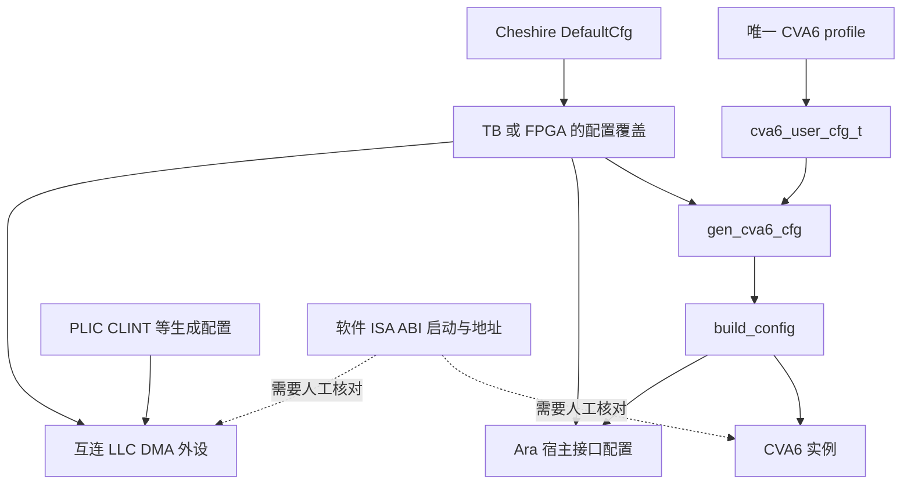

# Cheshire/CVA6/Ara 配置参考手册

> 2026-10-25正式工程入口：请先读[当前配置与电路关系](../engineering/Fixed_Vector_SoC_Resource_Guide.md#q1)。`~/CheshireAra`已使用统一 `cheshire_pkg::Cfg`，不使用旧SELCFG/TB四配置选择；本文旧路径、默认值和2026-10-19服务器表保留为其历史输入说明，不直接作为正式工程修改步骤。

本目录承载参数字典和配置操作说明；连续的原理解释以[主教程](../learning/index.html)为准。同一字段在这里保留声明、覆盖、消费者与验证边界，教材只引用必要子集。

本手册面向有 MIPS/自定义总线经验、正在学习 RISC-V/AXI 的团队，按“在哪里改、参数是什么意思、实际值是多少、哪些地方要一起改”组织。

**2026-10-19使用入口：**先读[上手指南：配置生效路径](../software/SERVER_SIMULATION_GUIDE.md#config)，再查[服务器固定配置追踪表](RECIPES.md#server-config-trace)。前者解释硬件结构、运行行为、TB环境和工具选项的区别；后者按pkg/TB/脚本列出默认值、覆盖、消费者与重做范围。以本地`2f0f2d6f…`源码和2026-10-18服务器证据为依据，本轮SSH握手超时，未新增服务器实测。下文旧日期保留其原检查范围。

整理日期：2026-09-20；任务：L01 配置学习文档；源码基准：本仓库 HEAD `379ae4544bc62e05a2736b11b33a3244181bba38`，含版本管理中的 `.bender/` 本地依赖快照。**该次只做源码与文档静态检查，未编译、仿真、综合或板测。** 用户此前报告的 VCU118 HelloWorld 不扩展解释成 Ara/DDR 全功能已验证。

> 2026-10-11 复核基准：HEAD `2784340240915fe4338ec54bfd613723b127d62e`。本次按子系统重组 CVA6 字段，并定向核对配置覆盖、Ara、iDMA、Serial Link 和平台时钟；未重新验证所有组合或运行生产目标。原编制日期与历史证据保留。

> 配置机制与系统行为请从[单线教材](../learning/index.html)进入，重点读[硬件配置与结构展开](../learning/configuration.html)和[互连、地址译码与接口适配](../learning/interconnect.html)。本页仍作为参数字典。

## 1. 配置参考的阅读顺序

| 文档 | 解决的问题 | 覆盖范围 |
| --- | --- | --- |
| [常用配置与修改流程](RECIPES.md) | 当前到底用哪组配置？哪一层真正使用它？ | 首部为当前固定配置的文件地图、覆盖链与有效值表；后附仿真/FPGA/软件示例 |
| [CVA6 参数](CVA6.md) | CPU profile、ISA、cache、MMU、PMP 怎么配？ | cva6_user_cfg_t 全部 88 字段，按六类子系统组织，附覆盖与派生量 |
| [Cheshire SoC 参数](CHESHIRE.md) | 总线、地址、外设开关、LLC、外部接口怎么配？ | 当前 cheshire_cfg_t 全部 113 字段、默认值、地址图、容量公式 |
| [Ara 参数](ARA.md) | lanes、VLEN、浮点、访存带宽怎么配？ | 顶层参数、固定实例参数、包常量、现有 lane 示例 |
| [其他模块与平台参数](PERIPHERALS.md) | DMA、外设、生成包、DDR wrapper、VIP 怎么配？ | 当前集成相关参数与运行时入口、生成依赖和限制 |

这是一份当前本地版本的配置字典和使用指南。它没有逐个列出第三方 IP 所有内部参数，也没有把未验证的自由组合写成受支持产品配置。若以后更换依赖版本，应重新对照结构体和实例，而不是直接照抄旧表。

## 2. 配置层次与生效阶段

| 层次 | 例子 | 何时生效 | 误区 |
| --- | --- | --- | --- |
| 源文件/profile 选择 | cv64a6_imafdcv_sv39_config_pkg.sv | 编译源码时 | SELCFG 不会切换已编译的 CPU profile |
| 宏 | ARA、NR_LANES、VLEN、TARGET_VCU118 | 预处理时 | 必须有消费者：FPGA wrapper读宏，Cheshire TB Ara函数独立赋值2/2048 |
| 硬件参数 | Cfg.Ara、Cfg.LlcSetAssoc、Cva6Cfg.RVV | 展开/综合时 | 运行软件无法增加 lane 或扩容 SRAM |
| 生成参数 | PLIC src/target、CLINTCORES、SerialLink NumBits | 生成寄存器 RTL/头文件时 | 改 SoC 字段不自动重生成 IP |
| 软件与运行时 | -march/-mabi、VS/FS、DMA 长度、LLC SPM way | 软件构建/运行时 | 编译器能生成指令不表示硬件已经支持 |
| TB环境参数 | UseDramSys、VIP的ClkPeriodSys/RstCycles | 仿真展开及运行激励 | 不改变SoC内部电路仍可能需要重新展开；tb文件中的SelectedCfg却会改变DUT配置 |
| 工具与观察 | CXX_PATH、-debug_access、UCLI波形窗口、timeout | 对应构建或运行阶段 | 主机工具配置与芯片配置不同，工具参数本身也不是同一阶段生效 |

`parameter`是实例可传入的常量/类型，既用于DUT也用于TB；`localparam`通常由其他参数计算或由实现固定；`typedef struct packed`把许多配置打包成一个可传递对象。package可包含这些声明、枚举和函数，不是运行时配置寄存器。`DefaultCfg`是起点，函数先复制再覆盖部分字段。模块声明的`Cfg='0`或类型`logic`等可能只是占位，不能据此判断工作实例。继续沿TB的`DutCfg`或FPGA的`FPGACfg`查绑定，再核对profile/宏和最终消费者；源码推导值与实际构建证据分开记录。

## 3. 常用配置基准

以下是**向量profile＋TB Ara配置**的静态取值快照。旧版手册所述“当前标量仿真脚本”指当时本地生成产物，不代表服务器后续状态：2026-10-18服务器已核对向量清单及SelectedCfg=3，并取得修正FS后的单例运行证据。下表仍不冒充逐项动态读回；默认/覆盖/消费者及证据范围见[当前追踪表](RECIPES.md#server-config-trace)。

| 项目 | 值 |
| --- | --- |
| CPU profile / core 数 | cv64a6_imafdcv_sv39 / 1 |
| CPU XLEN / CPU VLEN / Sv 模式 | 64 / 64 / Sv39 |
| CPU I-cache / D-cache | 4 KiB / 8 KiB WT |
| Ara | 开启，2 lanes，向量 VLEN=2048 bit |
| SoC AXI 地址/数据/USER | 48/64/2 bit |
| CPU AXI ID / xbar 输入 ID / LLC 下游 ID | 4/2/6 bit |
| LLC 阵列 / Boot ROM 初始化用途 | 128 KiB / 全部先设为 SPM |
| DMA | 2D 前端，任务 FIFO=2，在途 AXI=16 |
| RTC 信息 | TB 32768 Hz；FPGA wrapper 1000000 Hz |
| PLIC 源/context、CLINT 核数 | 58/2、1 |

## 4. 配置依赖与修改约束

1. 向量能力要同时对齐 CPU profile、Ara 开关、真实 decoder、软件 ISA 和 VS/FS 初始化。
2. `Cva6NrPMPEntries=0` 覆盖 CPU profile 的 8；profile 名含 sclic 也会被 SoC Clic=0 关闭。
3. CPU 的 VLEN 是地址容器，Ara 的 VLEN 是向量寄存器长度，不能一起改成 2048。
4. LLC 与启动 SPM 共用阵列；删 LLC 会影响 Boot ROM、栈和链接脚本。
5. AXI master 数变化会影响 ID 位宽、AXI RT 生成尺寸、原子来源标识与下游适配。
6. NPU/ISP 接入外部 AXI master 端口不自动绕过 LLC，也不自动获得一致性。
7. FPGA IO 宏、SoC 模块存在与板上测试是三个独立事实。
8. 本地未提交文档与 `.bender/` 依赖应保留，配置学习不需要清依赖或升级版本。

## 5. 证据与维护

本手册依据仓库内源码，不依赖最新版网络文档推断本地行为。每章链接到具体定义/消费者。表中区分 profile 原值、SoC 覆盖值、派生值与建议；以当前代码和可追溯测试为准。

历史发现的消费者差异与待核查项集中在[修改流程的已知缺口](RECIPES.md#6-本轮静态发现与待验证项)，包括旧本地仿真profile/decoder、Serial Link分频字段、SPM执行属性、DMA 1D busy、VGA错误追踪容量。服务器清单后续状态另列，未将单例通过当作其他缺口关闭；没有修改RTL。

项目目标与边界见 [PROJECT_STATE](../PROJECT_STATE.md)、[AGENT_TASKS](../AGENT_TASKS.md) 和 [ASIC 提取交接书](../02_Cheshire_Ara_ASIC_Extraction_Handoff.md)。原手册验证见[L01记录](../handoffs/L01_configuration_reference.md)；2026-10-19配置导读增量见[E01交接](../handoffs/E01_fixed_vector_extraction.md)。

## 配置学习补充：从参数字典到系统契约（2026-10-07）

本节基于当前 HEAD `5ddec4fb4e982b460b12c3f3587523807602d5d4` 静态核对，保留前文历史基准。配置字典列出选项，教材解释它们为什么必须一起选择：

| 阅读目的 | HTML 讲解 | Markdown 对照 |
| --- | --- | --- |
| CPU 能力、cache 与接口的可选项 | [CVA6 配置族](../learning/cva6.html#configuration-families) | [88 个本地字段](CVA6.md) |
| 参数如何形成实例和总线尺寸 | [三个入口的系统契约](../learning/configuration.html#configuration-contract) | [113 个 SoC 字段](CHESHIRE.md) |
| 组合约束与验证状态 | [合法性分层与候选组合](../learning/configuration.html#legality-levels) | [推导流程](RECIPES.md#teaching-20261007) |
| 官方集成接口到 ASIC wrapper | [实例化及接口方向](../learning/integration.html#official-instantiation) | [Cheshire 的结构联动](CHESHIRE.md#teaching-20261007) |
| 工具链、启动代码、链接布局 | [软件选项](../learning/build.html#software-options) | [当前 Make/SDK](../software/BUILD_AND_SDK.md#teaching-20261007) |

一组能工作的系统配置应同时回答：硬件识别哪些指令，指令在哪里执行，数据在哪里保存，各模块如何得到时钟/复位，软件怎样把它们初始化。以 RVV 为例，V 编译选项、RVV profile、真实 decoder、Ara 实例、VS 状态和可访问缓冲区缺一不可。这是约束链，不能由某个名字相似的选项自动推出其余条件。

官方在线手册描述的范围可能大于当前依赖快照。CVA6 的其他 RV32/profile 或 HPDcache 分支需要各自的集成适配，Cheshire 的概述也不能替代本地字段宽度及固定生成文件检查。全文所列“候选组合”是静态条件，不新增动态通过记录；官方与本地差异见[来源对照](../learning/OFFICIAL_SOURCES.md#teaching-20261007)。
