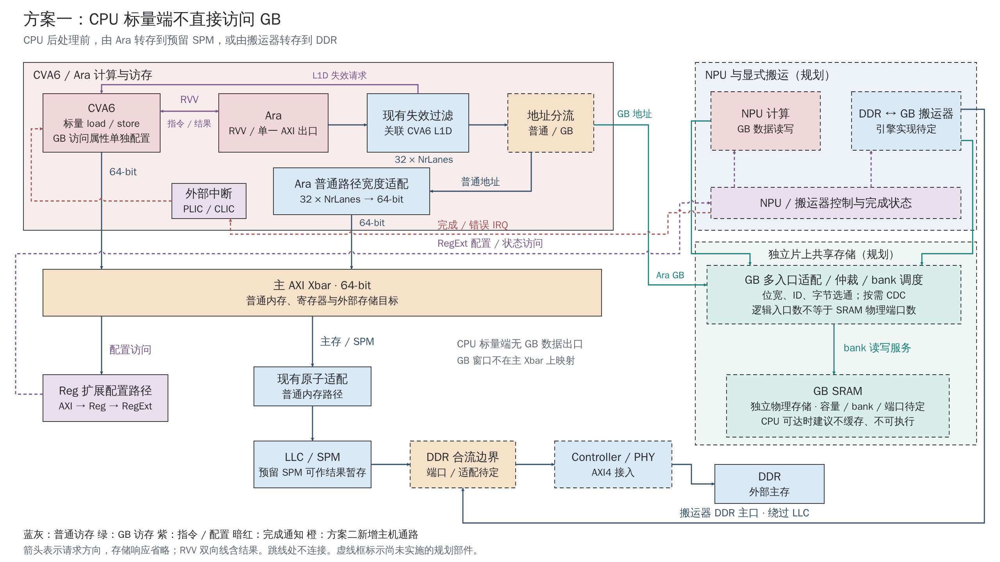
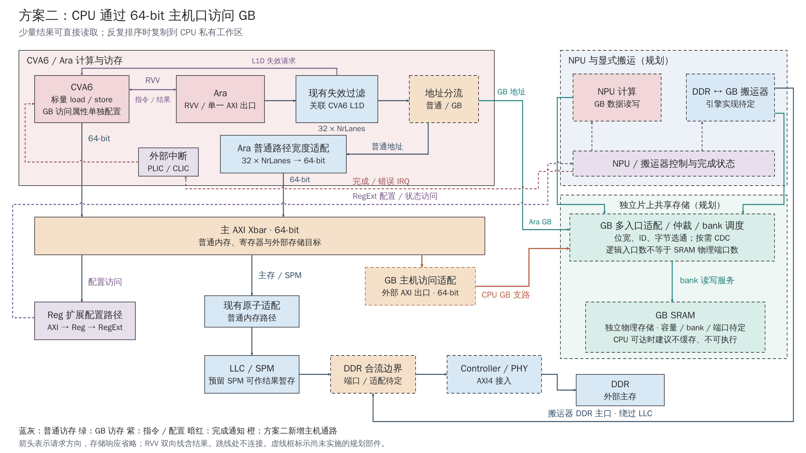

# CPU 与 Global Buffer：两种连接方案图稿

2026-10-15，L01。输入 `mp/ara-pulp-v2` / `322bd6ce964c96cd4337ceb98e5ce89d1bb478d8`。本目录为用户授权的方案说明与绘图交付；不表示新连接已经实施或通过硬件验证。

正式说明：[CPU 接入 Global Buffer：方案比较与连接设计](../../engineering/Global_Buffer_CPU_Access.md)。已有接口参数和需求仍以 [IP/DDR/GB 契约](../../engineering/IP_DDR_Interface_Contract.md)为准；本次未改该契约、原集成教程或已有一致性图稿。

## 阅读与下载

| 方案 | PNG 预览 | SVG 母版 |
|---|---|---|
| CPU 标量端不直接访问 GB | [cpu-isolated.png](cpu-isolated.png) | [cpu-isolated.svg](cpu-isolated.svg) |
| CPU 通过 64-bit 主机口访问 GB | [cpu-accessible.png](cpu-accessible.png) | [cpu-accessible.svg](cpu-accessible.svg) |

[两页原生可编辑 PPTX](export/diagrams.pptx) · [导出报告](export/export_report.json) · [最终检查](evidence/validation.json)





两张图采用相同模块位置；方案二增加外部 AXI 出口后的 GB 主机访问适配及两段橙色连接。主 Xbar 保持 64-bit，Ara GB 分流保留在收窄前，普通路径及 DDR 旁路职责相同。

## 图形语义

- 蓝灰线：普通存储访问；绿色：GB 访问；橙色：方案二新增主机支路。存储箭头表示请求方向，返回通道省略，读结果沿对应接口返回。
- 紫色实线：CPU/Ara 指令与结果、现有失效请求；紫色虚线：配置/状态访问；暗红虚线：完成/错误中断请求。
- 虚线框：尚未实施的规划部件。无连接交叉以单条连续路径上的跳线表达，不能把跳线交点视为协议合流。
- NPU/搬运器控制框是控制与状态职责集合，不冻结独立或共享的寄存器 IP；PLIC/CLIC 框表示按配置选用的目标控制器，不表示两个控制器必须串接或同时启用。
- GB 适配/仲裁框包含位宽、ID、字节选通及按需 CDC；不是已经选定宏接口。逻辑入口可复用 bank 物理端口，不等于原生多端口 SRAM。
- 图中 `32 × NrLanes` 是 Ara 当前宽度公式；不冻结 lane/VLEN。NPU DDR 主口按契约有 256-bit 需求，但图中不将它当作 Controller 或 GB 的已定宽度。
- 搬运器是待选的显式搬运引擎，不代表现有 Cheshire iDMA 已完成控制接口修复。CPU 访问建议、缓存属性和所有权见正式说明。

## 来源与绘图方法

关键源码为 [cheshire_soc.sv](../../../hw/cheshire_soc.sv) 的 `gen_ext_axi_slv`、`i_axi_xbar`、`gen_llc_atomics` 和 Ara 路径，以及 [cheshire_pkg.sv](../../../hw/cheshire_pkg.sv) 的 `gen_axi_out()` / `gen_cva6_cfg()`。完整版本、依赖来源及方案论证集中在正式说明中。

使用 `industrial-svg-pptx` 的工业风格和 `svg-pptx-diagrams-native` 原生导出后端；SVG 保留独立文本和几何，箭头与跳线各为一个连续对象。渲染脚本沿用本仓库 L01 已有 Chrome/CDP 测量方式，不调用硬件构建。

SVG/PNG 使用 WenQuanYi Zen Hei；PPTX 字体设为 Microsoft YaHei，导出时使用本机文泉驿字体测量，未嵌入字体。两图画布为 2560×1440，PPTX 保持 16:9。目标 Office 字体渲染可能有差异。

## 复现与实际检查

在仓库根执行。下面 `source-02`、`render-03`、`export` 是本次最终目录；重新执行应改成不存在的新目录，不覆盖历史证据。

```sh
python3 docs_codex/diagrams/2026-10-15_global_buffer_cpu_access/build_figures.py --out-dir docs_codex/diagrams/2026-10-15_global_buffer_cpu_access/evidence/source-02
python3 docs_codex/diagrams/2026-10-15_global_buffer_cpu_access/render.py --source-dir docs_codex/diagrams/2026-10-15_global_buffer_cpu_access/evidence/source-02 --out-dir docs_codex/diagrams/2026-10-15_global_buffer_cpu_access/evidence/render-03
```

将最终源图与 PNG 复制到本目录对应文件后，从已安装 skill 目录调用原生后端。`native_skill_root` 指向实际安装的 `svg-pptx-diagrams-native`，不得指向本工程其他图稿转换器：

```sh
python3 "$native_skill_root/scripts/run.py" \
  --input docs_codex/diagrams/2026-10-15_global_buffer_cpu_access/cpu-isolated.svg docs_codex/diagrams/2026-10-15_global_buffer_cpu_access/cpu-accessible.svg \
  --out-dir docs_codex/diagrams/2026-10-15_global_buffer_cpu_access/export \
  --aspect source --font 'Microsoft YaHei' \
  --font-file /usr/share/fonts/truetype/wqy/wqy-zenhei.ttc

python3 docs_codex/diagrams/2026-10-15_global_buffer_cpu_access/validate.py --out-file docs_codex/diagrams/2026-10-15_global_buffer_cpu_access/evidence/validation.json
```

| 本次执行 | 结果与边界 |
|---|---|
| 初次 Chrome 渲染 `render-01` | 沙箱拒绝 Chrome 的本地 socket，退出 1；日志保留 |
| 经环境审批渲染到 `render-02` | 成功生成两张预览，布局检查退出 1：NPU→GB 连线与 GB 分区标题相交 |
| 修正标题、补全失效请求线后 `source-02` / `render-03` | 退出 0；两图无文字出界、框内溢出、文字重叠或连线穿字；逐张人工查看 PNG |
| 原生 PPTX 导出 | 退出 0；两页，125 个文本，48 个原生箭头对象；保存重读通过，无整图图片替代 |
| 最终文档/图稿检查 | 见 `evidence/validation.json`；链接、图形端点、公共布局、SVG/PPTX 文本和箭头、输入保护及空白检查 |

**Office 显示/编辑未实测。** 原生箭头未绑定模块端口，移动模块不保证自动跟随或重新布线。当前检查不包含软件/RTL 编译、展开、仿真、综合或板测；本目录不提供目标性能结论。

输入保护见 [input.json](evidence/input.json)，包括原有 67 个未提交/未跟踪文件和 15 个关键源码/文档输入；本次新增正式说明与主题交接不在旧文件集合中。[主题交接](../../handoffs/L01_global_buffer_cpu_access.md)只记录本次交付、证据和待办。
