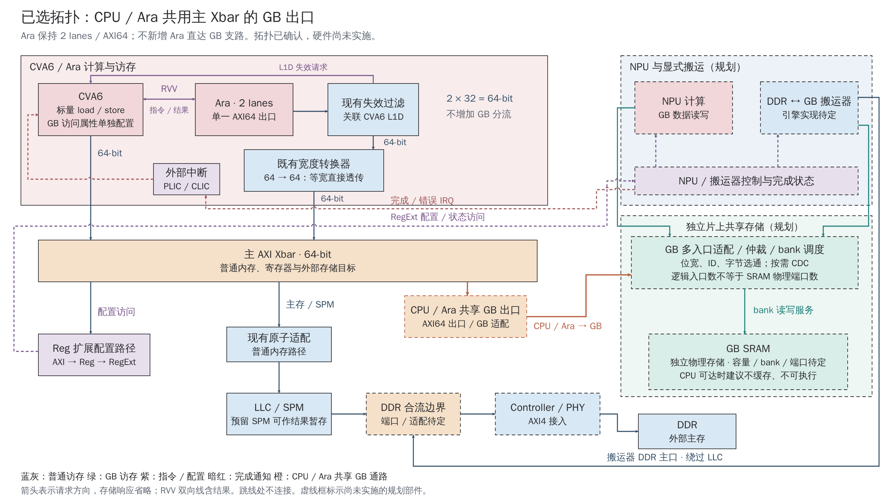

# CPU / Ara 共用主 Xbar 的 GB 出口

2026-10-16，L01。输入 `mp/ara-pulp-v2` / `322bd6ce964c96cd4337ceb98e5ce89d1bb478d8`。用户已选择 Ara 保持 2 lanes，CPU 与 Ara 经主 Xbar64 的同一 GB 目标出口访问 GB，取消此前规划的 Ara 独立分流。**本目录记录架构选择，不表示 RTL 已接入或性能已验收。**

[正式分析与接口条件](../../engineering/Global_Buffer_CPU_Access.md) · [PNG 预览](shared-xbar.png) · [SVG 母版](shared-xbar.svg) · [单页原生可编辑 PPTX](export/diagrams.pptx) · [导出报告](export/export_report.json) · [最终检查](evidence/validation.json)



## 连接与阅读边界

- CPU 与 Ara 保留独立 master 和 Xbar 输入，橙色 GB 出口承载双方仲裁后的请求。没有直接并接 master 信号，也没有先把 Ara 串接到 CPU 内部。
- Ara2 的 AXI 数据宽度为 `32 × 2 = 64 bit`。保留既有失效过滤和宽度转换实例；等宽转换分支直接透传，不增加 Ara 地址分流及响应合并。
- 主 Xbar 在 GB、普通 DDR/SPM 与外设目标之间译码；GB 出口绕过 LLC。相同 GB 目标竞争带宽，不同目标可以并行，仍受在途事务和顺序约束影响。64-bit 宽度匹配不构成实际负载达标证据。
- GB 多入口框概括已规划共享数据代理/控制器的适配、仲裁与 bank 调度，不要求新增重复代理。图中省略 ISP 等其他 GB 发起端及 DDR 范围维护控制细节；省略不代表取消这些职责。
- 蓝灰为普通访存，绿色为 GB 访问，橙色为 CPU/Ara 共享 GB 通路；箭头表示请求方向，响应沿接口返回。紫色表示指令/配置，暗红表示完成通知。跳线交叉处不连接；虚线框是未实施部分。
- NPU/搬运器寄存器框为职责集合；PLIC/CLIC 表示按配置选择。搬运器引擎、GB 容量/bank/时钟/地址未定，不把图中示意当作 IP 选型。

图稿延续 [2026-10-15 两方案比较](../2026-10-15_global_buffer_cpu_access/README.md)的布局，但仅此新图代表本次选择。旧目录及其证据保持原样，旧图中的 Ara 独立 GB 支路已被本次选择替代。

## 来源与制作

本地 [cheshire_soc.sv](../../../hw/cheshire_soc.sv) 的 Ara filter→converter→`axi_in_req[AxiIn.ara]`、`gen_ext_axi_slv`，以及 [cheshire_pkg.sv](../../../hw/cheshire_pkg.sv) 的外部窗口配置和默认 Ara2/Xbar64 是复用依据。[axi_dw_converter.sv](../../../.bender/git/checkouts/axi-ecdc900686449c15/src/axi_dw_converter.sv) 的 `gen_no_dw_conversion` 确认等宽直接透传；[当前依赖官方 Xbar 说明](../../../.bender/git/checkouts/axi-ecdc900686449c15/doc/axi_xbar.md)说明目标并发、ID 扩展与同 ID 跨目标顺序。实际源码哈希见 [input.json](evidence/input.json)。

使用 `industrial-svg-pptx` 风格和同级 `svg-pptx-diagrams-native` 后端；SVG 文本、模块、连续箭头分别可编辑，PPTX 不使用整图图片替代。SVG/PNG 为 2560×1440，字体 WenQuanYi Zen Hei；PPTX 保持 16:9，字体设为 Microsoft YaHei，以本机文泉驿字体测量，不嵌入字体。

## 复现与检查

在仓库根执行。以下为本次实际最终目录，再执行时应使用新目录保护证据。`native_skill_root` 指向本机安装的 `svg-pptx-diagrams-native`。

```sh
python3 docs_codex/diagrams/2026-10-16_global_buffer_shared_xbar/build_figures.py --out-dir docs_codex/diagrams/2026-10-16_global_buffer_shared_xbar/evidence/source-02
python3 docs_codex/diagrams/2026-10-16_global_buffer_shared_xbar/render.py --source-dir docs_codex/diagrams/2026-10-16_global_buffer_shared_xbar/evidence/source-02 --out-dir docs_codex/diagrams/2026-10-16_global_buffer_shared_xbar/evidence/render-03
```

将最终 SVG、layout.json 和 PNG 复制至本目录后导出并检查：

```sh
python3 "$native_skill_root/scripts/run.py" \
  --input docs_codex/diagrams/2026-10-16_global_buffer_shared_xbar/shared-xbar.svg \
  --out-dir docs_codex/diagrams/2026-10-16_global_buffer_shared_xbar/export \
  --aspect source --font 'Microsoft YaHei' \
  --font-file /usr/share/fonts/truetype/wqy/wqy-zenhei.ttc
python3 docs_codex/diagrams/2026-10-16_global_buffer_shared_xbar/validate.py --out-file docs_codex/diagrams/2026-10-16_global_buffer_shared_xbar/evidence/validation.json
```

| 执行 | 结果与边界 |
|---|---|
| `source-01` / `render-01` | 生成成功；Chrome 本地 socket 受沙箱限制，渲染退出 1，保留日志 |
| 经环境审批的 `render-02` | 成功生成预览；布局检查退出 1，发现 GB 适配框副标题过长 |
| 缩短副标题后 `source-02` / `render-03` | 均退出 0；无文字越界、框内溢出、文本重叠或连线穿字；实际查看最终 PNG |
| 原生导出与保存重读 | 1 页、60 个文本对象、23 条原生箭头；无整图图片，见导出报告及最终检查 |
| 文档/图稿验证 | 检查链接、独立输入/共享出口拓扑、端点、模块避让、SVG/PPTX 对象、旧文件保护和空白；报告见 `evidence/validation.json` |

**Office 显示/编辑未实测。** 原生箭头未绑定模块端口，移动模块不保证自动重连。未执行软件/RTL 编译、仿真、综合、板测或 ASIC 验收。

[输入快照](evidence/input.json)保护 42 个既有文件和 6 个源码输入；修改前的正式文档及主题 handoff 已备份于 `evidence/before/`。共享状态、其他工程契约和历史图稿未修改。决策与协调事项见 [主题交接](../../handoffs/L01_global_buffer_cpu_access.md)。
