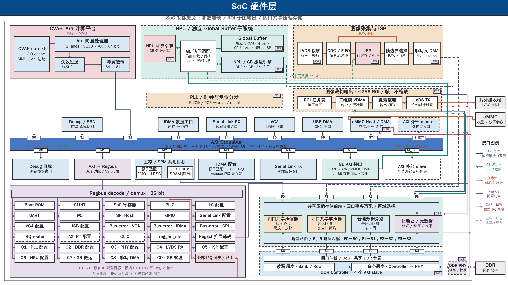

# SoC 全景图：共享 GB、参数加载与四口压缩存储

2026-10-16，L01。输入 HEAD `322bd6ce964c96cd4337ceb98e5ce89d1bb478d8`，分支 `mp/ara-pulp-v2`。按用户确认计划，在当前三页 PPT 后追加第 4 页；前三页及其依赖完整保留，继续使用本目录。仅实施图稿、配套说明及稳定主题交接，没有修改 RTL、地址配置、驱动、正式工程契约或共享状态。

**[四页原生可编辑 PPTX](soc_landscape_m5_gb.pptx)**

| 页码 | 内容 | PNG | SVG |
|---|---|---|---|
| 1 | 原始全景图，完整保留 | [预览](slide-01.png) | [矢量预览](slide-01.svg) |
| 2 | 下侧 M5 → GB；首次布局纠正，完整保留 | [预览](slide-02.png) | [矢量预览](slide-02.svg) |
| 3 | 下侧目标等距；GB 下方左侧 M5、右侧 ISP，完整保留 | [预览](slide-03.png) | [矢量预览](slide-03.svg) |
| 4 | eMMC 内置 DMA、≤256 ROI 纯裁切、四口共享压缩存储前端 | [预览](slide-04.png) | [矢量预览](slide-04.svg) |



## 第 4 页采用的规划

本页复制第 3 页的页面框架后重排图形对象，保留计算、GB、图像输入、既有主机与目标、Regbus 外设及 DDR 子系统的功能和连接含义。采用 `industrial-svg-pptx` 工业风格与原生 SVG/PPTX 后端；16:9 画布、标题/模块/说明字号层级保持，通过重新分配版面容纳新模块。

Crossbar 上侧为请求发起端，下侧为访问目标。上侧 S0～S7、S_EXT 等距排列；下侧 M0～M5、M_EXT 仍等距排列。说明改为 **8 × 6 固定端口 + 扩展**：这是本页规划的八个发起端、六个固定目标，扩展口另计；不表示当前 Cheshire RTL 已内建这些新增端口。

CPU→S0、Ara→S2 保持独立；Ara 仍为 2 lanes / AXI64，沿失效过滤→等宽透传进入主 Crossbar。M5 是唯一共享 GB 目标，经下侧 GB AXI 接口回接上方访问适配；只有一个 GB SRAM 实例。接口注明“CPU / Ara / eMMC DMA 共用”，描述主要使用者，不构成其他 master 的访问隔离保证。

### eMMC 参数加载

连续数据路径为 **片外 eMMC ↔ eMMC Host / DMA → S7 → Crossbar M5 → GB 访问适配 → GB**。Host 内置 DMA，不额外借用既有 iDMA；S7 位于 S6 与 S_EXT 之间，保留独立外部扩展入口。Host 的实际 AXI 位宽、ID、突发及控制接口适配需按后续采购接口核对。

模型参数、ISP 非均匀性校正及盲元补偿参数按 GB 容量分批加载和交接，不假定全部常驻。配置/状态经 RegExt 的 C10 目标访问，完成和错误通过外部 IRQ 同步/路由进入 PLIC。本轮不增加 eMMC 早期启动依赖。

### ROI 裁切与 LVDS 发送

**ROI 任务表/调度器 → 一个二维读 VDMA → 像素整理/输出 FIFO → LVDS TX → 片外接收端**。每帧最多 256 个可配置矩形区域，按任务列表顺序纯裁切、不缩放；256 是自定义调度能力，不是 DMA 数量、LVDS 通道数或某个 IP 的帧缓冲数量。

VDMA 经 F3/S3 读取已经写完且完成所有权交接的 RAW 帧。图中深蓝箭头表示读请求，绿色返回线表示解压后的原始数据；像素输出采用橙色箭头。保留原有 RAW/ISP 帧选择路径。按 ROI 所需行发起二维读取，不默认先读取整帧；压缩块边界造成的额外读取和解码量需另测。

CPU 经 C11 配置帧起址、行跨度、像素格式、ROI 坐标及尺寸；完成/错误沿外部 IRQ 路径通知。ROI 输出结束前不能复用源帧，输出 FIFO 的背压、欠载及错误恢复尚未实现验证。

### 四口共享压缩存储前端

前端位于**采购 DDR Controller 外部**，是本项目新增设计。内部画出四口事务适配/区域选择、独立的共享压缩器、共享解压器、块地址/元数据管理，以及普通旁路和返回路由。压缩器处理写数据，解压器处理读返回；旁路也通过端口与返回路由。

| 请求来源 | 前端入口 | 下游独立接口 | DDR Controller 目标 |
|---|---|---|---|
| SoC / LLC | F0 | 通路 0 | S0 |
| NPU / GB 搬运引擎 | F1 | 通路 1 | S1 |
| 图像帧写入 DMA | F2 | 通路 2 | S2 |
| ROI 二维读 VDMA | F3 | 通路 3 | S3 |

四口共享内部服务，但保留各自的请求来源、ID/顺序及响应归属。图中的公共适配/路由框表示逻辑汇聚和调度，不是把 AXI 导线短接；四个服务模块的横向位置不代表仅供某一路使用。下游仍有四条连续 AXI 接口分别接 Controller 的 S0～S3，Controller 标签为“4 个 AXI slave”。PHY 与片外 DDR 保留其后。

本段 DDR S0～S3 与主 Crossbar S0～S7 属于不同接口命名空间。四口实际可配置能力、并发/顺序保证及参数仍需供应商确认，不把图稿当作采购配置验收。

### 配置、中断与图例

原 Regbus 外设及 C1～C9 IP 配置目标保留。新增连续紫色配置通路从 RegExt 引到 **C10：eMMC，C11：ROI/VDMA/LVDS TX，C12：压缩存储前端**。C 标识只用于说明逻辑目标，不冻结寄存器地址，也不规定供应商采用哪种控制总线；需要时增加控制接口适配。

新增模块完成/错误汇入图中红色“独立 IRQ 向量”，经外部 IRQ 同步/路由接 PLIC。该线表示多路独立中断的束线，不是把输出电气短接或 wired-OR；位数、编号、跨时钟及边沿/电平策略待定。数据线交叉使用连续路径上的跳线；无跳线的配置/IRQ 分支节点表示相应逻辑通路的汇接。

## 接口约束与待验证事项

这些是本页方案必须落实的条件，尚不代表当前 RTL 能力或供应商保证：

- 四口对同一逻辑地址采用一致的压缩属性；普通旁路只服务普通区域，不能绕过压缩区的格式解释。读侧返回原始数据，不能让消费者接收到压缩载荷。
- 不可压缩块需要原样存储及明确格式标记；元数据损坏必须报告错误，不能误判为原样数据。压缩块须支持独立解码；压缩算法、块大小及模型/通用内存适用性未定。
- 部分写入、跨块访问、块地址分配、元数据原子更新、跨口可见性、响应 ID/顺序及复位中断事务的恢复，留待硬件设计与验证。共享编解码资源的仲裁和有界服务亦未冻结。
- 压缩前端不替代既有缓存维护、范围同步和缓冲区所有权交接。eMMC 参数加载达到约定可见点并交接后，ISP/NPU 才能消费；ROI 输出结束后才可释放源帧。单个完成 IRQ 不独立证明这些条件。
- 初始化先开放普通旁路，再配置压缩区域。改变区域格式前停止相关访问、完成排空和必要缓存维护；错误时停止依赖任务，保留诊断/恢复状态，不提前发布完成或复用仍可能被迟到事务访问的缓冲。
- eMMC/VDMA/编解码 IP、LVDS 速率、DDR 参数、地址、IRQ、容量、时钟和性能目标均未冻结。现行工程契约中旧的三口 DDR 描述未由本轮改写，后续需协调者按用户最新需求同步。

后续硬件验证至少覆盖：参数加载及 GB 交接；1/256 个 ROI、越界/重叠 ROI；输出背压和欠载；四口并发读写；跨块/部分写；不可压缩数据；元数据错误；排空及错误恢复。性能统计应包含实际 DDR 字节数、元数据流量、编解码延迟、四口等待时间和 ROI 解码放大，不能预先承诺压缩一定提高吞吐。

## 图稿验证与保护

[检查报告](evidence/page4-validation.json) · [交付检查](evidence/page4-delivery.json) · [编辑清单](evidence/page4-build-04/edit_report.json) · [输入及保护快照](evidence/page4-input.json)

- 输出准确为四页；前三页 XML、关系、备注及共享依赖保留原字节。已有 slide-01～03 SVG/PNG 未改，新生成的前三页预览也与原文件字节一致。仅新增第 4 页/备注及其关系，更新全局页面列表、内容类型和页数等必要元信息。
- 第 4 页含 461 个原生对象、192 个文本对象、96 个原生箭头和 16 个原生虚线对象；没有整图图片替代。112 条路径均连续，端点与箭头检查通过；51 处显式跳线保留交叉语义。
- S7/M5、两侧等距端口、单个 GB、eMMC/ROI 数据与配置/IRQ 路径、F0～F3→S0～S3、共享压缩/解压/旁路均核对。框内文字、文字相交、连线穿字/穿模块检查无未处理问题。
- 包关系、原生文本/箭头/虚线和 Python 保存重读检查通过；66 个既有受保护文件及修改前备份保持不变。保存重读测试不是 Office 应用验收。
- 已实际查看最终整页及 [eMMC/ROI](evidence/page4-preview-04/emmc-roi-detail.png)、[压缩前端/DDR](evidence/page4-preview-04/compression-ddr-detail.png)、[Regbus/IRQ](evidence/page4-preview-04/regbus-irq-detail.png)、[GB 入口](evidence/page4-preview-04/gb-adapter-detail.png)局部预览。

**Office 显示/编辑未实测。** 配套 SVG/PNG 由显式 DrawingML 几何与本地字体近似渲染，使用文泉驿替代字体，不是 Office 截图。原生路径没有绑定模块端口，移动模块后可能需要调整连线。本轮没有运行硬件编译、仿真、综合或板测。

## 输入、来源和复现

本轮输入三页 PPT 的 SHA-256：`8522fffd3d4b36412d72da427866e59ebe67252b497913d9cd8298ed1a2bdeeb`。修改前 [PPT](evidence/page4-before/soc_landscape_m5_gb.pptx)、[README](evidence/page4-before/README.md)和 [handoff](evidence/page4-before/L01_global_buffer_cpu_access.md)均有可恢复备份。最终 PPT SHA-256：`4574947a4d716530021dd0735c6affdfe525202dd82ee246ae8e4ea2a5d51c98`。

当前工程扩展依据为 [集成说明](../../../docs/tg/integr.md)、[cheshire_soc.sv](../../../hw/cheshire_soc.sv)中的 `gen_ext_axi_mst`、RegExt 转发、外部 IRQ 同步与 PLIC 消费路径，以及 [cheshire_pkg.sv](../../../hw/cheshire_pkg.sv) 的外部 master 配置。GB 共用出口与缓存/所有权边界参考 [GB 接入说明](../../engineering/Global_Buffer_CPU_Access.md)及 [DDR–GB 同步设计](../../engineering/DDR_GB_Coherence_Design.md)。当前依赖不包含本页已经选型或集成完成的 eMMC、ROI 和压缩前端。

官方资料用于核对可复用机制，不代表选型：[Synopsys eMMC Host](https://www.synopsys.com/designware-ip/interface-ip/mobile-storage/sd-emmc-host-controller.html)提供 AXI 数据主口与 DMA 的产品先例；[AMD PG020](https://docs.amd.com/r/en-US/pg020_axi_vdma/Product-Specification)提供二维传输机制，≤256 ROI 调度是本项目新增需求；[Arm AFBC](https://www.arm.com/technologies/graphics-technologies/arm-frame-buffer-compression)提供图像无损压缩及随机访问参考，其适用性不能直接推广到模型和通用内存。共享四口透明压缩前端属于自定义设计。

[结构化 SVG 母版](evidence/page4-build-04/slide-04.svg)和同名 JSON 保存图形、端点与文字归属；根目录 `slide-04.svg` 是从交付 PPT 原生几何导出的预览。下列命令对应最终生成流程，工作目录为仓库根；复跑必须换用尚不存在的构建/预览目录与报告路径，以保留原始证据。

```sh
native_skill_root=/home/zhaowenyao/.codex/skills/svg-pptx-diagrams-native
figure_dir=docs_codex/diagrams/2026-10-16_soc_landscape_m5_gb
build_dir="$figure_dir/evidence/page4-build-04"
preview_dir="$figure_dir/evidence/page4-preview-04"
python3 -B "$figure_dir/build_page4.py" \
  --input "$figure_dir/evidence/page4-before/soc_landscape_m5_gb.pptx" \
  --out-dir "$build_dir" --native-skill-root "$native_skill_root"
"$native_skill_root/.venv/bin/python" -B "$figure_dir/preview_deck.py" \
  --deck "$build_dir/soc_landscape_m5_gb.pptx" --out-dir "$preview_dir"
/home/zhaowenyao/.codex/skills/publication-figures/.venv/bin/python -B - "$preview_dir" <<'PY_RENDER'
import sys
from pathlib import Path
import cairosvg
for svg in Path(sys.argv[1]).glob('slide-*.svg'):
    cairosvg.svg2png(url=str(svg), write_to=str(svg.with_suffix('.png')))
PY_RENDER
"$native_skill_root/.venv/bin/python" -B "$figure_dir/validate_page4.py" \
  --build "$build_dir" --preview "$preview_dir" \
  --report "$figure_dir/evidence/page4-validation.json"
```

构建、预览及最终检查均退出 0；CairoSVG 2.9.1 仅复用已安装的渲染依赖。首版局部检查发现文字偏上及 PHY 配置标记重叠，第二版修正；第三版明确“四口共享”与“独立 IRQ 向量”；第四版修正 Regbus 左侧分支的 2 px 边界差异后通过最终检查。各版证据保留，没有把早期排版问题记录为通过。

## 历史页与交接

第 2 页删除原上侧 M_GB，增加下侧 M5；第 3 页进一步均匀排列目标端口并交换 GB 下方 M5/ISP 位置。两页仍保留当时的 7×6 规划标签，不追改为第 4 页的 8×6。

[第 2 页检查](evidence/validation.json)、[第 3 页检查](evidence/page3-validation.json)、[第 3 页交付检查](evidence/page3-delivery.json)及相应构建脚本均保留。其两页/三页结论对应历史输入，不能用于验收当前四页主 PPT；详细旧说明见上述修改前 README 备份。稳定主题记录见 [L01 交接](../../handoffs/L01_global_buffer_cpu_access.md)。
