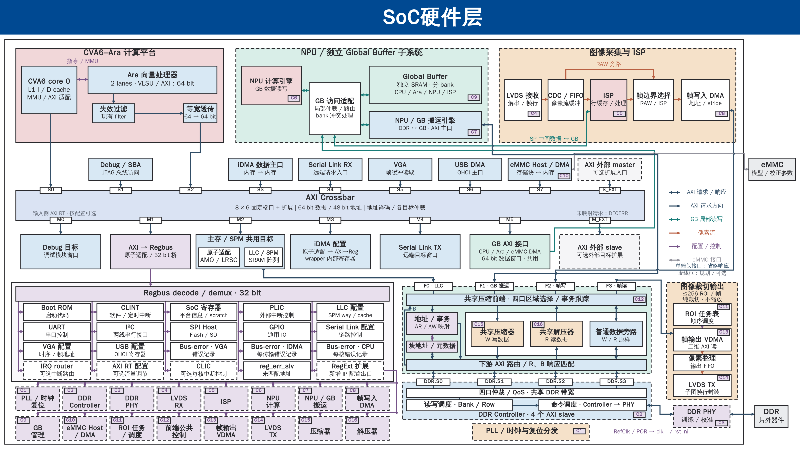

# SoC 全景图：共享 GB、参数加载与四口压缩存储

2026-10-17，L01。输入 HEAD `322bd6ce964c96cd4337ceb98e5ce89d1bb478d8`，分支 `mp/ara-pulp-v2`。本轮从第 4 页规划复制并追加第 5 页：四路 DDR 接口双向表达请求/响应，C1～C8 / C9～C16 分两行放到 Regbus 下方，恢复第 3 页原生标题栏并下移架构。前四页及其依赖、主题、母版和布局保持不变，继续使用本目录。仅实施图稿、配套说明及稳定主题交接，没有修改 RTL、地址配置、驱动、正式工程契约或共享状态。

**[五页原生可编辑 PPTX](soc_landscape_m5_gb.pptx)**

| 页码 | 内容 | PNG | SVG |
|---|---|---|---|
| 1 | 原始全景图，完整保留 | [预览](slide-01.png) | [矢量预览](slide-01.svg) |
| 2 | 下侧 M5 → GB；首次布局纠正，完整保留 | [预览](slide-02.png) | [矢量预览](slide-02.svg) |
| 3 | 下侧目标等距；GB 下方左侧 M5、右侧 ISP，完整保留 | [预览](slide-03.png) | [矢量预览](slide-03.svg) |
| 4 | eMMC 内置 DMA、≤256 ROI 纯裁切、四口共享压缩存储前端 | [预览](slide-04.png) | [矢量预览](slide-04.svg) |
| 5 | 双向 DDR 接口、Regbus 下方两行 C 配置、恢复标题栏；当前布局 | [预览](slide-05.png) | [矢量预览](slide-05.svg) |



## 第 5 页：当前布局与接口表达

本页采用第 4 页的相同拓扑；前四页不追改。修改前主 PPT、README、第 4 页 SVG/PNG 和 L01 交接已保存在 [page5-before](evidence/page5-before/)。本次输入 PPT SHA-256 `24427f14665215fbef05494c4b28175ea2222c73631fd23267ca5a687dc0b890`；输出 `3f100763d6bd76966b2e7b9ee6773735e716aebfd349a6034f444f842d4a8887`。

### 双向箭头表示什么

第 4 页的单箭头只表示请求方向，VDMA→F3 在那个图例下成立。第 5 页按用户要求，将 **F0～F3 的四条外部连接，以及前端到 DDR.S0～DDR.S3 的四条接口**改为一个原生对象两端带箭头，表达同一 AXI 接口的请求与响应。主从角色与数据访问能力不随箭头改变。

| 通路 | 请求发起者 | 向前端 / DDR 方向 | 返回发起者方向 |
|---|---|---|---|
| F0 | SoC / LLC | 读地址、写地址及写数据 | 读数据 R / 写响应 B |
| F1 | NPU / GB 搬运引擎 | DDR↔GB 搬运所需的读写请求 | R / B |
| F2 | 帧写入 DMA | 当前用途是写地址 AW 和写数据 W | 写响应 B；不因此增加读帧功能 |
| F3 | 帧输出 VDMA | 当前用途是读地址 AR | 读数据及响应 R；不因此增加写帧功能 |

这不是一根双向复用导线，AXI 各通道仍独立握手。前端内部 AR/AW、W 压缩、R 解压、B 匹配、普通旁路与元数据路径保留各自方向；不把所有功能箭头一律双向化。图例分别给出“AXI 请求/响应”的双箭头和“AXI 请求方向”的单箭头，既有 Crossbar 路径的单箭头仍省略响应；绿色仍仅用于 GB 局部读写。

### 两行配置与标题安排

- 第一行从左到右为 C1～C8，第二行为 C9～C16；每行八组，与 Regbus 主框左右对齐。C 的含义、次序及对应 IP 标识保留，具体配置说明见下方 C1～C16 表。
- RegExt 出口沿右侧公共竖线分出两条横向配置线，再用短分支接各框。两行是并列配置目标，不表示第二行必须经过第一行 IP；没有重复寄存器实例或远端配置长线。
- 适度压紧 Regbus 既有四行的空隙；模块名称、说明和 C 标识字号保留。两行配置占用此前左下方空白，第二行底边与 PLL / 时钟与复位分发框底边对齐。
- 标题栏直接复制第 3 页的两个原生对象，保留其位置、颜色、字体与主题引用；SoC 主体下移约 158.095 设计单位，画布仍为 3600×2025 / 16:9。计算、GB、Crossbar、DDR、ROI 纵向链和 PLL 均保持原宽高，不整体缩小字体。
- 前端下游路由框稍上移，为四条短 AXI 接口的双箭头留出可辨间距；控制器四端口、独立返回归属及共享服务含义不变。

### 第 5 页检查与复现

[检查报告](evidence/page5-validation.json) · [最终交付检查](evidence/page5-delivery.json) · [输入快照](evidence/page5-input.json) · [几何母版](evidence/page5-build-02/slide-05.svg)

前四页的 XML、关系、备注及 SVG/PNG 原字节保留，已有主题/母版/布局部件不变。仅增加第 5 页及其备注/关系，更新页数、页面列表及包内容类型；第 3 页标题的原生对象完整复制。329 个受保护文件和修改前备份保持不变。第 5 页 547 个原生对象、242 个文本对象、99 个原生箭头、29 个虚线对象；116 条连续路径，配置归属/行列顺序/PLL 对齐、原填充与字号、连线端点、文字/标识框避让、包关系和保存重读检查通过。

已从最终主 PPT 重新生成并实际查看整页及 [两行配置](evidence/page5-final-preview/config-detail.png)、[配置/PLL 对齐](evidence/page5-final-preview/config-pll-detail.png)、[存储/ROI 双向接口](evidence/page5-final-preview/storage-roi-detail.png)局部，核对 F2 的返回为 B、F3 的返回为 R，以及内部编解码方向不变。构建 01 常规检查通过，但局部预览发现下游双箭头间距偏紧；构建 02 拉开间距后通过最终检查。根目录第 5 页 SVG/PNG 来自最终主 PPT 的重新解析。

复现使用 `build_page5.py --input evidence/page5-before/soc_landscape_m5_gb.pptx --out-dir <新目录> --native-skill-root <既有原生后端目录>`，再运行 `preview_deck_colours.py --deck <生成PPT> --out-dir <新预览目录>` 和 `validate_page5.py --build <构建目录> --preview <预览目录> --report <新报告路径>`。构建 02、最终预览和验证均退出 0；预览器和验证器使用既有原生 skill 的 `.venv/bin/python -B`。标题在最终 PPT 组装时从第 3 页复制，因此几何母版只含正文，完整标题以根目录 `slide-05.svg/png` 和最终 PPT 为准。

**Office 显示/编辑未实测**；预览为原生 DrawingML 几何与替代字体渲染，非 Office 截图。原生连线没有绑定模块端口，拖动模块不保证自动重连。没有 RTL、仿真、综合、板测或性能验证；本次不改变配置组与接口参数的未冻结状态。

## 第 4 页采用的规划

以下保留第 4 页方案、接口约束与当时图稿证据；第 5 页沿用其拓扑，配置布局与 F 通路箭头表达以上节为准。第 4 页本身没有修改。

本页保留计算、GB、图像输入、既有主机与目标、Regbus 外设及 DDR 子系统的功能和连接含义。沿用 `industrial-svg-pptx` 工业风格与 16:9 画布，继续使用整页架构图，无“SoC 硬件层”标题栏；保留模块和说明的字号层级。C1～C9 的含义和顺序不变，与 C10～C16 一起缩窄并换行放在底部；配置名称仍为 30 设计单位，C 标识仍为 21，没有整体缩小字体。PLL / 时钟与复位分发框位置不变。Regbus 与压缩前端靠近，右侧保留 ROI→VDMA→FIFO→LVDS TX 竖向链。LVDS 的片外发送端、接收端统一省略，eMMC 和 DDR 器件保留。

Crossbar 上侧为请求发起端，下侧为访问目标。上侧 S0～S7、S_EXT 等距排列；下侧 M0～M5、M_EXT 仍等距排列。说明改为 **8 × 6 固定端口 + 扩展**：这是本页规划的八个发起端、六个固定目标，扩展口另计；不表示当前 Cheshire RTL 已内建这些新增端口。

CPU→S0、Ara→S2 保持独立；Ara 仍为 2 lanes / AXI64，沿失效过滤→等宽透传进入主 Crossbar。M5 是唯一共享 GB 目标，经下侧 GB AXI 接口回接上方访问适配；只有一个 GB SRAM 实例。接口注明“CPU / Ara / eMMC DMA 共用”，描述主要使用者，不构成其他 master 的访问隔离保证。

### eMMC 参数加载

连续数据路径为 **片外 eMMC ↔ eMMC Host / DMA → S7 → Crossbar M5 → GB 访问适配 → GB**。Host 内置 DMA，不额外借用既有 iDMA；S7 位于 S6 与 S_EXT 之间，保留独立外部扩展入口。Host 的实际 AXI 位宽、ID、突发及控制接口适配需按后续采购接口核对。

模型参数、ISP 非均匀性校正及盲元补偿参数按 GB 容量分批加载和交接，不假定全部常驻。配置/状态经 RegExt 的 C10 目标访问；当前图将配置项和完成/错误状态集中在 Regbus，不再外引配置及 IRQ 长线。中断接口需求仍保留在方案说明中，图形简化不表示取消硬件中断。本轮不增加 eMMC 早期启动依赖。

### ROI 裁切与 LVDS 发送

**ROI 任务表/调度器 → 一个二维读 VDMA → 像素整理/输出 FIFO → LVDS TX**，在压缩前端右侧自上而下排列；片外链路对端统一不绘制。每帧最多 256 个可配置矩形区域，按任务列表顺序纯裁切、不缩放；256 是自定义调度能力，不是 DMA 数量、LVDS 通道数或某个 IP 的帧缓冲数量。

VDMA 经 **F3 → DDR.S3** 对应通路读取已经写完且完成所有权交接的 RAW 帧。VDMA 是读请求发起者，F3 是前端接收请求的接口，因此外部只画一条深蓝接口线，箭头为 **VDMA → F3**。返回数据经前端解压器或普通旁路，按事务身份通过同一 AXI 接口的 R 通道返回 VDMA；“同一接口”不表示 AR/R 共用同一组导线。删除原外部绿色读返回线，绿色仅用于 GB 局部读写；VDMA 后的像素输出采用橙色箭头。保留原有 RAW/ISP 帧选择路径。按 ROI 所需行发起二维读取，不默认先读取整帧；压缩块边界造成的额外读取和解码量需另测。

CPU 经 C11 配置 ROI 列表与调度，经 C13 配置帧输出 VDMA 的帧起址、行跨度和像素格式，经 C14 配置 LVDS TX。完成/错误通知的要求保留，但图中不展开 IRQ 连线。ROI 输出结束前不能复用源帧，输出 FIFO 的背压、欠载及错误恢复尚未实现验证。

### 四口共享压缩存储前端

前端位于**采购 DDR Controller 外部**，是本项目新增设计。四个入口先进入公共区域选择/事务跟踪；左侧单独绘制地址/事务控制和块地址/元数据管理，右侧公共区域并列放置共享压缩器、共享解压器、普通数据旁路，底部为下游 AXI 路由与 R/B 响应匹配。这些框表示逻辑职责，未冻结流水级、缓冲深度、仲裁或实际 RTL 模块划分。

| 通道或操作 | 图内路径 | 必须保持的语义 |
|---|---|---|
| AR / AW | 四口区域选择/事务跟踪 → 地址/事务映射 → 下游 AXI 路由 | 地址与事务控制不经过数据编解码器；仍需依据块格式和元数据进行地址、长度等处理 |
| 压缩写 W | 公共适配 → 共享压缩器 → 下游 AXI 路由 | 只有数据载荷走写压缩路径；由控制逻辑协调数据、地址及元数据 |
| 压缩区读 R | 下游 R 响应匹配 → 共享解压器 → 公共适配 → 原发起者 | 返回原始数据，恢复原事务所需的长度、顺序及归属 |
| 普通区域读写 | 公共适配 ↔ 普通数据旁路 ↔ 下游 AXI 路由 | 保留响应匹配，不将普通旁路作为绕过压缩区格式解释的入口 |
| 写响应 B | 下游响应匹配 → 左侧独立 B 返回线 → 公共适配 | 不经过压缩器/解压器；不能把一个下游 B 等同于整次上游操作完成 |
| 块地址 / 元数据 | 与地址/事务控制交互，经公共下游路由访问存储 | 没有新增第五个 DDR 接口；元数据访问仲裁、错误和一致性待实现验证 |

| 请求来源 | 前端入口 | 下游独立接口 | DDR Controller 目标 |
|---|---|---|---|
| SoC / LLC | F0 | 通路 0 | DDR.S0 |
| NPU / GB 搬运引擎 | F1 | 通路 1 | DDR.S1 |
| 图像帧写入 DMA | F2 | 通路 2 | DDR.S2 |
| ROI 帧输出 VDMA | F3 | 通路 3 | DDR.S3 |

四口共享编解码、旁路及元数据服务，同时保留各自的请求来源、ID/顺序及响应归属。公共适配/路由框横跨四口；AR/AW/B 与数据服务分开，不再采用“四个端口下各放一个功能模块”的排列。公共路由表示调度、事务重组与响应匹配，不是把 AXI 导线短接。下游仍有四条独立、连续的 AXI 接口分别接 Controller 的 DDR.S0～DDR.S3，Controller 标签为“4 个 AXI slave”。共享服务不是四套独占编解码器，也不承诺四路同时无等待。PHY 与片外 DDR 保留其后。

图中 `DDR.S0～DDR.S3` 与主 Crossbar 的 `S0～S7 / S_EXT` 属于不同接口命名空间；F0～F3 是自定义前端的上游接口。四口实际可配置能力、并发/顺序保证及参数仍需供应商确认，不把图稿当作采购配置验收。帧输出 VDMA 在当前用途下只发读请求；共享前端的写压缩服务对具备写能力的入口开放，不表示 VDMA 必须有写通道。

### 配置、中断与图例

原 Regbus 外设保留。全部扩展配置组 **C1～C16** 在底部一行，由同一条 RegExt 主线及各组短分支接入；原 Regbus 内 C10～C12 汇总框已删除，没有重复配置实例。各配置组与对应 IP 上的 C 标识匹配，不从配置框向远端 IP 引长线。

| 标识 | 配置组 / 对应模块 | 移出图框的配置说明，待接口设计细化 |
|---|---|---|
| C1 | PLL / 时钟与复位 | 配置、锁定、切换 |
| C2 | DDR Controller | 初始化、QoS、状态 |
| C3 | DDR PHY | 训练、校准、状态 |
| C4 | LVDS RX | 通道、对齐、帧行 |
| C5 | ISP | 尺寸、模式、校正参数位置 |
| C6 | NPU 计算 | 命令、GB 数据位置、状态 |
| C7 | NPU / GB 搬运 | 地址、长度、stride、完成/错误 |
| C8 | 帧写入 DMA | 缓冲区、格式、帧状态 |
| C9 | GB 管理 | 能力、bank、错误状态 |
| C10 | eMMC Host / DMA | Host 命令、DMA 源/目的和长度、完成/错误 |
| C11 | ROI 任务表 / 调度 | ≤256 个矩形的坐标与尺寸、顺序、源帧身份及任务状态 |
| C12 | 压缩前端公共控制 | 区域属性、块格式、元数据配置、初始化、排空及公共错误 |
| C13 | 帧输出 VDMA | 帧起址、行跨度、像素格式、二维读任务及完成/错误 |
| C14 | LVDS TX | 输出格式、子图帧行封装、启停及状态 |
| C15 | 压缩器 | 能力/模式、状态及统计；实际可配置项目待 IP 确认 |
| C16 | 解压器 | 能力/格式检查、状态及错误；实际可配置项目待 IP 确认 |

C1～C9 保留原有含义和顺序。以上是**绘图配置组**，不冻结寄存器地址、实际寄存器文件数量或独立 Regbus slave 数量；C12/C15/C16 可以由同一物理寄存器文件实现，内部归属和权限后续再定。

删除红色完成/错误 IRQ 向量及其分支，图例也同步移除。完成状态、错误报告及必要中断仍是方案需求，图形省略不代表取消 PLIC 或把 IRQ 当作 Regbus 数据传输。寄存器地址、IRQ 编号及供应商控制总线均未冻结。

线条含义统一：外部深蓝 AXI 接口箭头指向请求目标，响应由原接口返回；前端内部的深蓝箭头按 W/R/B 及 AR/AW 标签表示相应通道方向。绿色只表示 GB 局部读写，橙色表示像素流，紫色表示配置/控制，灰色表示 eMMC 物理接口。深色虚线框表示规划/可选模块，不能据此认定已有模块已启用或完成验证。DDR Controller→PHY→DDR 保留双向接口示意，不将其物理接口误称 AXI。

### 颜色与主题修正

上一版把 Crossbar 的主题基色误用为最终颜色，两个扩展框也未继承原填充。根因之一是旧预览器忽略了 `lumMod/lumOff` 亮度修饰。本轮以第 3 页实际 DrawingML 为准，67 个既有框/分区的填充定义逐项一致；Crossbar 保留原 `accent1 + lumMod=20000 + lumOff=80000`，解析后为浅蓝 `#DAE3F3`；S_EXT/M_EXT 外部模块均为浅灰 `#F5F5F7`。

交付 PPT 的主题、母版、布局和关系文件原字节保留；只修改 `slide4.xml`。没有把中间 PPT 的主题带入最终文件。新预览器支持亮度修饰，预览从最终主 PPT 重新读取生成。原 slide-01～03 SVG/PNG 作为旧证据未覆盖；其中旧 Crossbar 预览颜色不准确，颜色比较请看[修正解析后的第 3 页](evidence/page4-layout-final-preview/slide-03.png)，其 PPT 页面内容未变。

## 接口约束与待验证事项

这些是本页方案必须落实的条件，尚不代表当前 RTL 能力或供应商保证：

- 四口对同一逻辑地址采用一致的压缩属性；普通旁路只服务普通区域，不能绕过压缩区的格式解释。读侧返回原始数据，不能让消费者接收到压缩载荷。
- 不可压缩块需要原样存储及明确格式标记；元数据损坏必须报告错误，不能误判为原样数据。压缩块须支持独立解码；压缩算法、块大小及模型/通用内存适用性未定。
- 部分写入、跨块访问、块地址分配、元数据原子更新、跨口可见性、响应 ID/顺序及复位中断事务的恢复，留待硬件设计与验证。共享编解码资源的仲裁和有界服务亦未冻结。
- 压缩前端不替代既有缓存维护、范围同步和缓冲区所有权交接。eMMC 参数加载达到约定可见点并交接后，ISP/NPU 才能消费；ROI 输出结束后才可释放源帧。单个完成 IRQ 不独立证明这些条件。
- 初始化先开放普通旁路，再配置压缩区域。改变区域格式前停止相关访问、完成排空和必要缓存维护；错误时停止依赖任务，保留诊断/恢复状态，不提前发布完成或复用仍可能被迟到事务访问的缓冲。
- eMMC/VDMA/编解码 IP、LVDS 速率、DDR 参数、地址、IRQ、容量、时钟和性能目标均未冻结。现行工程契约中旧的三口 DDR 描述未由本轮改写，后续需协调者按用户最新需求同步。

后续硬件验证至少覆盖：参数加载及 GB 交接；1/256 个 ROI、越界/重叠 ROI；输出背压和欠载；四口并发读写；跨块/部分写；不可压缩数据；元数据错误；排空及错误恢复。性能统计应包含实际 DDR 字节数、元数据流量、编解码延迟、四口等待时间和 ROI 解码放大，不能预先承诺压缩一定提高吞吐。

## 第 4 页图稿验证与保护（历史快照）

[第 4 页检查报告](evidence/page4-controls-validation-final.json) · [当时最终文件检查](evidence/page4-controls-delivery.json) · [填充对照](evidence/page4-controls-build-04/colour_map.json) · [配置归属](evidence/page4-controls-build-04/config_bindings.json) · [输入快照](evidence/page4-controls-input.json)

- 输出仍为四页。与本轮修改前 PPT 比较，仅 `ppt/slides/slide4.xml` 改变；前三页 XML、关系、备注及所有主题/母版/布局部件均原字节保留。已有 slide-01～03 SVG/PNG 未覆盖。
- 第 4 页含 541 个原生对象、240 个文本对象、98 个原生箭头和 29 个原生虚线对象；114 条路径连续，9 处显式跳线，无整图图片替代。67 个既有框/分区的填充定义继承第 3 页；PLL 位置、上下端口等距、S7/M5、单个 GB、四条 DDR 接口和竖向 ROI 链检查通过。
- C1～C16 配置组均在底部，接入同一 RegExt 主线，每组与模块标识匹配；无 Regbus 内重复汇总框，无远端配置长线、红色 IRQ 线及 LVDS 片外对端。F3 仅有 VDMA→F3 深蓝请求接口，绿色仅用于 GB。
- 文字边界/重叠、文字与 C 标识框重叠、连线穿字/穿模块、端点、原生箭头、包关系和 Python 保存重读检查通过。四口公共服务与 AR/AW、W、R、B 路径逐项核对；不是仅按对象数量判断图稿正确。
- 203 个既有受保护文件及修改前备份保持不变。最终主 PPT 与检查版本哈希一致，并从该最终文件重新生成整页与局部 SVG/PNG。
- 已实际查看最终整页、[存储/ROI](evidence/page4-controls-final-preview-04/memory-roi-detail.png)、[底部 C1～C8](evidence/page4-controls-final-preview-04/config-left-detail.png)、[C9～C16](evidence/page4-controls-final-preview-04/config-right-detail.png)，并检查 [Crossbar](evidence/page4-controls-final-preview-04/crossbar-detail.png)、[Regbus](evidence/page4-controls-final-preview-04/regbus-detail.png)、[GB/RAW-ISP](evidence/page4-controls-final-preview-04/upper-gb-detail.png)和 [PLL/配置行](evidence/page4-controls-final-preview-04/extension-pll-detail.png)。

语义复核沿三个具体场景进行：eMMC DMA 经 S7/M5 加载 GB；帧写 DMA 经 F2、地址映射和共享 W 压缩路径写入 DDR.S2，B 由匹配逻辑处理；VDMA 经 F3/DDR.S3 读已交接的源帧，R 经解压或普通旁路回原接口，再输出像素到 FIFO/LVDS TX。CPU/Ara 独立输入、原 RAW/ISP 选择与 NPU/GB 搬运路径保持。这里只确认图中表达，未执行这些硬件场景。

**Office 显示/编辑未实测。** SVG/PNG 为最终 PPT 的显式几何和主题颜色解析预览，采用文泉驿替代字体，不是 Office 截图。原生路径没有绑定模块端口，移动模块后可能需要调整连线。本轮没有硬件编译、仿真、综合或板测。

## 第 4 页输入、来源和复现（历史快照）

本轮输入四页 PPT 的 SHA-256：`92c80e25bc9bb5d444dfa3269997e1b0c78168885ac4d627fd92e9cebaa9dc8b`；最终输出：`24427f14665215fbef05494c4b28175ea2222c73631fd23267ca5a687dc0b890`。修改前 [PPT](evidence/page4-controls-before/soc_landscape_m5_gb.pptx)、[README](evidence/page4-controls-before/README.md)、[handoff](evidence/page4-controls-before/L01_global_buffer_cpu_access.md)及第 4 页 SVG/PNG 均已备份。此前布局纠正的输入、哈希、报告和旧生成脚本保留，详见历史说明。

当前工程扩展依据为 [集成说明](../../../docs/tg/integr.md)、[cheshire_soc.sv](../../../hw/cheshire_soc.sv)中的 `gen_ext_axi_mst`、RegExt 转发、外部 IRQ 同步与 PLIC 消费路径，以及 [cheshire_pkg.sv](../../../hw/cheshire_pkg.sv) 的外部 master 配置。GB 共用出口与缓存/所有权边界参考 [GB 接入说明](../../engineering/Global_Buffer_CPU_Access.md)及 [DDR–GB 同步设计](../../engineering/DDR_GB_Coherence_Design.md)。当前依赖不包含本页已经选型或集成完成的 eMMC、ROI 和压缩前端。

官方资料用于核对可复用机制，不代表选型：[Synopsys eMMC Host](https://www.synopsys.com/designware-ip/interface-ip/mobile-storage/sd-emmc-host-controller.html)提供 AXI 数据主口与 DMA 的产品先例；[AMD PG020](https://docs.amd.com/r/en-US/pg020_axi_vdma/Product-Specification)提供二维传输机制，≤256 ROI 调度是本项目新增需求；[Arm AFBC](https://www.arm.com/technologies/graphics-technologies/arm-frame-buffer-compression)提供图像无损压缩及随机访问参考，其适用性不能直接推广到模型和通用内存。共享四口透明压缩前端属于自定义设计。

AXI 方向依据：当前本地依赖 `axi-ecdc900686449c15/include/axi/typedef.svh` 的 AR/R 及请求/响应结构（约 62～101 行）分别描述读地址与读返回通道；[Arm AMBA AXI 规范 IHI0022H](https://developer.arm.com/-/media/Arm%20Developer%20Community/PDF/IHI0022H_amba_axi_protocol_spec.pdf) A2.5/A2.6 给出主设备发起 AR、从设备返回 R 的方向。当前 `Bender.lock` 对该 path 依赖的 version/revision 为 null，不据此套用最新上游版本。压缩前端的地址映射、事务重组和元数据协议仍是本项目自定义规划，不是 AXI 官方提供的压缩能力。

[当前 SVG 母版](evidence/page4-controls-build-04/slide-04.svg)与同名 JSON 保存结构和端点；根目录 `slide-04.svg/png` 来自最终主 PPT 的重新解析。使用既有 `industrial-svg-pptx` 的原生导出流程，仅将第 4 页形状写回原包，不导入中间 PPT 的主题。以下命令展示本轮构建和检查；复跑须使用尚不存在的输出目录与报告路径，保留原始证据。

```sh
native_skill_root=/home/zhaowenyao/.codex/skills/svg-pptx-diagrams-native
figure_dir=docs_codex/diagrams/2026-10-16_soc_landscape_m5_gb
build_dir="$figure_dir/evidence/page4-controls-build-04"
preview_dir="$figure_dir/evidence/page4-controls-preview-04"
python3 -B "$figure_dir/revise_page4_controls.py" \
  --input "$figure_dir/evidence/page4-controls-before/soc_landscape_m5_gb.pptx" \
  --out-dir "$build_dir" --native-skill-root "$native_skill_root"
"$native_skill_root/.venv/bin/python" -B "$figure_dir/preview_deck_colours.py" \
  --deck "$build_dir/soc_landscape_m5_gb.pptx" --out-dir "$preview_dir"
"$native_skill_root/.venv/bin/python" -B "$figure_dir/validate_page4_controls.py" \
  --build "$build_dir" --preview "$preview_dir" \
  --report "$figure_dir/evidence/page4-controls-validation-final.json"
```

完成核对后更新主 PPT，再对该最终文件运行 `preview_deck_colours.py --deck …/soc_landscape_m5_gb.pptx --out-dir …/evidence/page4-controls-final-preview-04`。PNG 使用既有 CairoSVG 2.9.1；局部预览由最终 PPT 解析的 SVG 调整 viewBox 渲染，不重画示意内容。

本轮中间检查：最初用系统 Python 运行预览器因缺少 Pillow 失败，改用既有 skill 环境；构建 01 的 F 端口文字贴上边框，构建 02 增加端口高度后常规几何检查通过。实际局部预览发现部分 C 标识框压到名称，构建 03 增加留白，并补充“文字与标识框”检查；该检查还发现旧 eMMC/PHY 说明贴住 C10/C3 框，构建 04 微调说明位置后通过。最终构建、预览和完整检查均退出 0。中间报告和预览仅对应各自阶段，不能代替最终验收；`page4-controls-final-preview` 和 `page4-controls-final-preview-03` 是中途从主 PPT 读出的旧快照，最终以带 `-04` 的目录为准。

## 历史页与交接

第 2 页删除原上侧 M_GB，增加下侧 M5；第 3 页进一步均匀排列目标端口并交换 GB 下方 M5/ISP 位置。两页仍保留当时的 7×6 规划标签，不追改为第 4 页的 8×6。

[第 2 页检查](evidence/validation.json)、[第 3 页检查](evidence/page3-validation.json)、[第 3 页交付检查](evidence/page3-delivery.json)及相应构建脚本均保留。其两页/三页结论对应历史输入，不能用于验收当前四页主 PPT；详细旧说明见上述修改前 README 备份。稳定主题记录见 [L01 交接](../../handoffs/L01_global_buffer_cpu_access.md)。

第 4 页初版的 [检查](evidence/page4-validation.json)、[交付检查](evidence/page4-delivery.json)与旧构建脚本保留为历史证据；其外引 IRQ/配置布局已被本轮替代，不能用于验收当前主 PPT。

2026-10-16 第 4 页布局与配色纠正的 [检查](evidence/page4-layout-validation.json)、[交付检查](evidence/page4-layout-delivery.json)及 [修改前说明](evidence/page4-controls-before/README.md)继续保留。其“Regbus 内 C10～C12 汇总配置”和“外部绿色读返回线”已被本轮统一底部 C1～C16 与单条 F3 AXI 接口替代。
