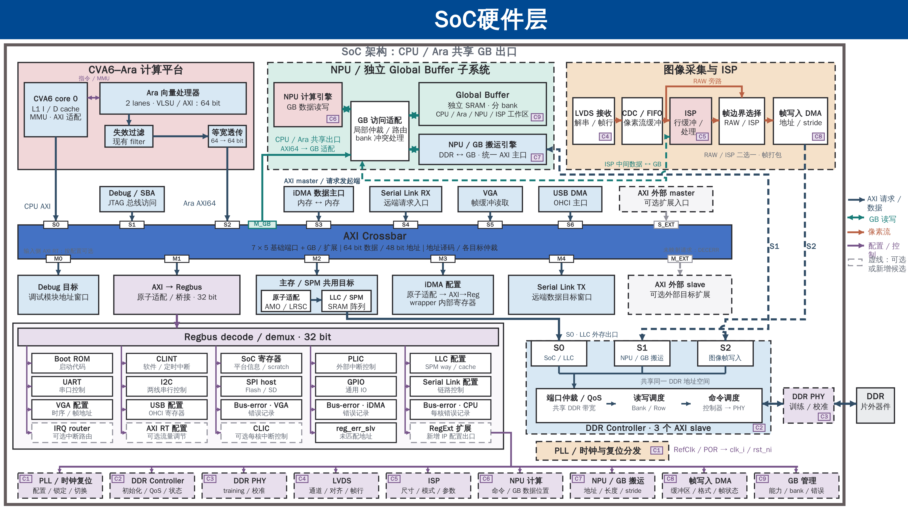

# SoC 全景 PPT：CPU / Ara 共用 GB 出口

2026-10-16，L01 图稿修订。输入为用户提供的 [soc_landscape.pptx](../soc_landscape.pptx)，SHA-256 `ec43b6e1b645ff379865d518ac3b20dc32c078c02bca1eca52428a49cca4db4b`；工程 HEAD `322bd6ce964c96cd4337ceb98e5ce89d1bb478d8`，分支 `mp/ara-pulp-v2`。仅按已确认的 [CPU/Ara 共享 GB 拓扑](../../engineering/Global_Buffer_CPU_Access.md)修改图稿。

## 交付

**[两页原生可编辑 PPTX](soc_landscape_shared_gb.pptx)**

| 页码 | 内容 | 本地矢量预览 | 配套 SVG |
|---|---|---|---|
| 1 | 原 PPT 第 1 页，内容与格式保留 | [PNG](slide-01.png) | [SVG](slide-01.svg) |
| 2 | 复制第 1 页，改为 CPU/Ara 共用 GB 出口 | [PNG](slide-02.png) | [SVG](slide-02.svg) |



原输入 PPT 未覆盖。输出 PPT 的第 1 页 XML、依赖部件及主题保留原始字节；第 2 页由第 1 页复制，368 个原对象不变，仅定向修改连接和相关标签。原文件内的模板来源信息也保留。

## 第 2 页的具体变化

- 删除 Ara 地址分流框、两段连接、Ara→GB 独立支路及其标签；失效过滤直接连接既有等宽适配，再进入主 Xbar 的 S2。
- Ara 标为 `2 lanes / AXI64`，位宽适配标为 `64 → 64 bit` 等宽透传。CPU 的 S0 与 Ara 的 S2 保持独立，CPU→Ara 指令/MMU 关系保留。
- 新增主 Xbar 的 `M_GB` 出口，通过一条连续折线接入 GB 访问适配器，承载 CPU/Ara 的共享 GB 请求。`M_GB` 是图中的功能标号，不冻结 RTL 端口索引或地址；为就近连接，它画在 Xbar 上边缘，仍是目标输出端。
- GB 工作区标签加入 CPU；原 `M_EXT` 保留为其他可选外部目标扩展，删除“CPU 直访 GB 待定”的旧描述。全连接 Xbar 下该 GB 口不天然限制为仅 CPU/Ara 可达。
- 保留 NPU、ISP、搬运器、DDR、外设和配置区布局。ISP→GB 连线上原来跨越 Ara 支路的跳线已拉直，其余路径不变。

采用 `industrial-svg-pptx` 工业风格，新增对象由同级 `svg-pptx-diagrams-native` 后端导出后合入复制页。PPT 仍由原生文本、图形和箭头构成，未将页面转成图片。共享 GB 出口是架构选择，不代表 RTL 已接入或性能达标。

## 检查与边界

[编辑清单](evidence/build-02/edit_report.json) · [验证报告](evidence/validation.json) · [输入与备份](evidence/input.json) · [检查迭代记录](evidence/check_iterations.json)

| 检查 | 结果 |
|---|---|
| 原文件与第 1 页保护 | 输入哈希未变；原页 XML/依赖不变；第 1 页 SVG/PNG 与输入预览一致 |
| 第 2 页定向修改 | 删除 7 个对象，修改 9 个对象，新增 6 个原生对象；其余 368 个对象 XML 不变 |
| 页数 / 对象 | 2 页；第 1 页 384 对象、195 文本、71 原生箭头；第 2 页 383 对象、195 文本、70 原生箭头 |
| 文件结构 | ZIP 与关系目标有效；对象 ID 唯一；原生箭头/虚线和文本保存重读一致；无 `ppt/media/` 图片 |
| 新连接与标签 | CPU/Ara 输入保留，GB 出口方向及端点核对通过；本地字体下新增路径不穿字、修改文本无相互遮挡；实际查看预览 |

**Office 显示/编辑未实测。** 当前无连接的 Office 会话。PNG/SVG 通过本任务的 `preview_deck.py` 读取 PPT 中显式 DrawingML 几何与文本后本地渲染；文字使用文泉驿替代字体，是排版检查预览，不是 PowerPoint 截图。PPTX 是本次编辑的主交付文件，SVG 为配套矢量预览，不用于重新生成和覆盖原页。连接线未绑定模块端口，移动模块后可能需手动调整走线。

没有修改 RTL、配置、工程契约、其他图稿或共享状态；未执行硬件编译、仿真或板测。本次增量记录于 [稳定主题交接](../../handoffs/L01_global_buffer_cpu_access.md)。

## 复现

在仓库根执行。`native_skill_root` 指向已安装的 `svg-pptx-diagrams-native`；输出目录须不存在。下面保留实际最终构建路径，复跑时改用新目录。脚本从输入 PPT 复制，不以旧版 SVG 代替用户修改过的页面。

```sh
python3 docs_codex/diagrams/2026-10-16_soc_landscape_shared_gb/edit_deck.py \
  --input docs_codex/diagrams/soc_landscape.pptx \
  --out-dir docs_codex/diagrams/2026-10-16_soc_landscape_shared_gb/evidence/build-02 \
  --native-skill-root "$native_skill_root"

"$native_skill_root/.venv/bin/python" \
  docs_codex/diagrams/2026-10-16_soc_landscape_shared_gb/preview_deck.py \
  --deck docs_codex/diagrams/2026-10-16_soc_landscape_shared_gb/soc_landscape_shared_gb.pptx \
  --out-dir docs_codex/diagrams/2026-10-16_soc_landscape_shared_gb/evidence/preview-03

"$native_skill_root/.venv/bin/python" \
  docs_codex/diagrams/2026-10-16_soc_landscape_shared_gb/validate.py
```

最终 SVG/PNG 对应 `preview-02`；`preview-03` 的 SVG 与之相同，仅把文本检查框细化为字形边界。PNG 使用已安装的 CairoSVG 2.9.1，以 `cairosvg.svg2png(url=svg_path, write_to=png_path)` 生成。其解释器来自 `publication-figures/.venv`，仅使用渲染依赖，不采用该 skill 的版式或导出流程。验证脚本保护已存在报告，复跑报告应另存；`roundtrip*.pptx` 只是证据副本，不替代主交付。
