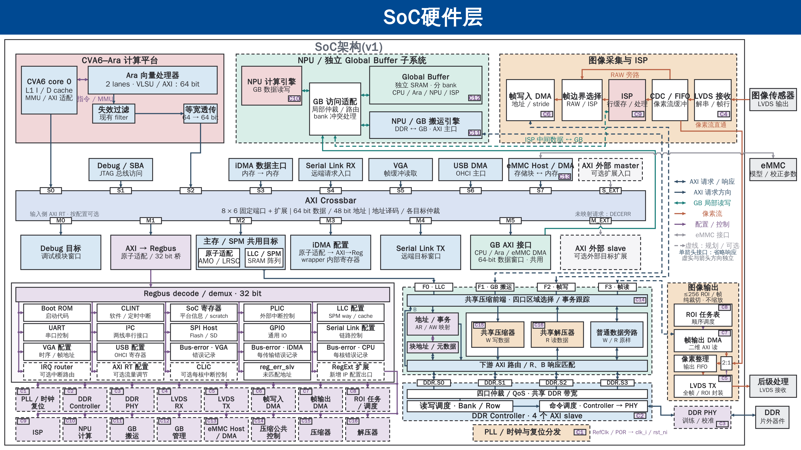

# SoC v1：最小像素流直通修改

日期：2026-10-22。重新从原单页 [soc_landscape.pptx](../soc_landscape.pptx)修改，保持 **3600×2025** 画布、主题、字号及主要模块位置。输出沿用本目录；此前右侧扩展布局弃用。

- [原生可编辑 PPTX](soc_lvds_bypass.pptx)
- [完整 PNG](soc_lvds_bypass.png) · [SVG](soc_lvds_bypass.svg)
- [LVDS 设计说明](../../engineering/LVDS_Raw_Bypass_Design.md) · [架构总纲 §4.7](../../engineering/SoC_Architecture_v1_Master_Plan.md#lvds-pixel-bypass)



## 修改内容

1. 从 RX 后 CDC/FIFO 底部引出橙色实线，沿原 SoC 右边界内侧空隙接到输出区，仅标一次“像素流直通”。与 eMMC 交叉处增加一个同风格跨线拱，原有顶点、跨线和两端箭头保留。
2. 输出 FIFO 宽度由 260 改为 190，两行文字左移 35，字号、高度和纵向位置保持；右侧增加 50×60 的 `2:1` MUX。正常 DMA 从上方进入、直通流从右方进入，MUX 向左输出给 FIFO。
3. TX 顶边到 MUX 底边用一条短紫色控制箭头，沿用 C5 标记，表示 **LVDS TX 内配置寄存器选源**。外部强制入口取消；切换需要 CPU 和配置访问可用。
4. 输出区标题改为“图像输出”，TX 副标题改为“全帧 / ROI 封装”。原正常 RAW/ISP→DDR→ROI、FIFO→TX、TX→后级及其他模块保持。

数据/有效/帧行标志共同选择、DDR 支路反压隔离、跨域和缓冲、初始化及切换恢复条件见专题。本图只表达功能关系；本轮不定义寄存器地址、位号、默认值或实施 RTL。

## 输入、差异与历史

原始输入 SHA-256：`a4a552ca74684711df8ce78528c7b50d923d77b47e5f299b16918bd8208fe2d0`；仓库 HEAD：`c9abbb48946fe3a7244bfb3159919b7c9731cb59`，含其他任务未提交修改。

原图 558 个原生对象，交付版 564 个：**551 个原对象不变、7 个局部修改、6 个新增、无删除**。仅 `ppt/slides/slide1.xml` 改变；页面尺寸、主题、母版、布局、备注及其他包内内容逐字节保持。原始单页 PPT 和旧九页 PPT 未修改。

[输入及保护记录](evidence/minimal_input.json) · [对象差异](evidence/minimal_edit_report.json) · [检查结果](evidence/minimal_validation.json)

[修改前备份](evidence/before_minimal_v1_revision.tar.gz)包含被弃用的宽版 PPT/SVG/PNG、旧修订脚本及本轮涉及文档的原内容。此前的串行版、`pixel_*.json` 和 `pixel-*.png/svg` 均保留作历史，不再作为当前交付。恢复前比较当前文件，不能用历史备份覆盖后续修改。

## 实际检查

从最终交付 PPT 导出 SVG/PNG，实际查看整页和下列三处局部；本地子 Agent 对相同哈希候选独立核对语义、显示及对象差异。

| 局部 | 核对内容 |
| --- | --- |
| [RX 分流](evidence/final-preview/minimal-input.png) | 从 CDC/FIFO 出口取流、短标注与原线间距 |
| [MUX / FIFO / TX](evidence/final-preview/minimal-output.png) | 两路输入、一条像素输出、一条寄存器控制，原 FIFO→TX 保持 |
| [eMMC 交叉](evidence/final-preview/minimal-emmc.png) | 一处新增跨线拱，没有新增连接点 |

同时检查原生箭头/文本、对象 ID、无整页图片、保存重读和内存副本文字编辑、受保护文件哈希及修改文档的本地链接。原生路径未绑定模块端口，后续移动模块需检查连线。

预览使用既有 DrawingML 解析器及本地字体，属于本地排版近似。**Office 显示/编辑未实测；RTL、硬件仿真、板测、综合与电气时序未验证。** 资源专题 v1.5 的预算保持；CDC/FIFO 和全帧吞吐仍需工程验证。

## 复现

使用已安装的 `industrial-svg-pptx` 与 `svg-pptx-diagrams-native` 后端。在本目录执行，输出目录须尚不存在：

```sh
python3 -B revise_lvds_bypass.py \
  --input ../soc_landscape.pptx \
  --out-dir <临时输出目录> \
  --native-skill-root <已安装的svg-pptx-diagrams-native目录>
```

本轮使用 native skill 虚拟环境；预览复用 `../2026-10-16_soc_landscape_m5_gb/preview_deck_colours.py --deck ... --out-dir ...` 和现有 CairoSVG。脚本锁定本次原图哈希，不能用于覆盖用户随后修改过的输入。
