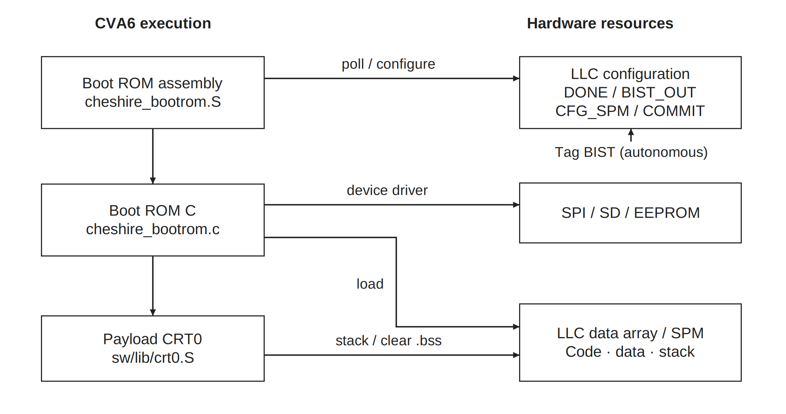
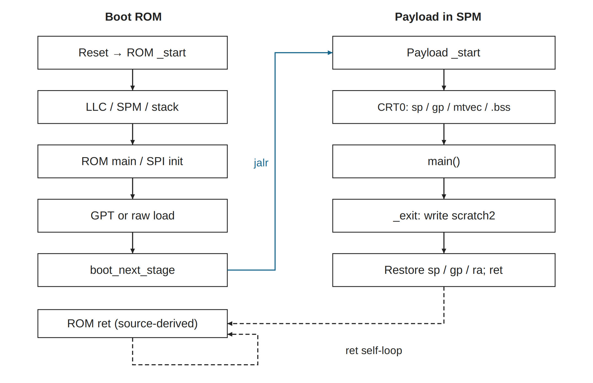

# 2026-10-08_boot_initialization · 新版图稿

使用 publication-figures；旧目录原样保留。所有图宽182 mm，英文短标签/中文图注。源图、PDF和PNG各自保持比例；PPT页宽182 mm，组内统一页面高度。

[可编辑 PPTX](export/diagrams.pptx) · [导出报告](export/export_report.json)

## initialization_hw_sw

[SVG](initialization_hw_sw.svg) · [PDF](export/initialization_hw_sw.pdf) · [PNG](export/initialization_hw_sw.png) · [灰度](export/initialization_hw_sw.gray.png)

Bootrom=1、PlatformRom=0、内部 LLC 启用时的初始化对应关系。左侧各软件阶段由同一个 CVA6 执行；右侧为所访问的硬件资源。箭头按标签表示读取、配置或装载。LLC tag BIST 为硬件自主过程，DONE 仅表示完成，错误由 BIST_OUT 表示；不覆盖数据 SRAM。

内容映射：硬件/软件对应关系→本图；ROM与CRT0具体顺序→program_execution_flow；测试边界、平台钩子→图注。

原图：[旧母版](../2026-10-08_boot_initialization/initialization_hw_sw.svg)

## program_execution_flow

[SVG](program_execution_flow.svg) · [PDF](export/program_execution_flow.pdf) · [PNG](export/program_execution_flow.png) · [灰度](export/program_execution_flow.gray.png)

SPI NOR 自主启动（boot_mode=2）的代表控制流。ROM 经 GPT/raw 装载载荷后调用入口，载荷 CRT0 建立环境并调用 main。正常返回由 CRT0 写 scratch2=(返回值<<1)|1，再恢复入口 sp/gp/ra 并 ret。虚线返回段为当前源码推导的 ROM 返回缺陷，不是期望的停机过程，也不是实测轨迹。

内容映射：ROM→GPT/raw→载荷CRT0→main→_exit→ROM返回点→本图；观察者、返回契约区别→图注。

原图：[旧母版](../2026-10-08_boot_initialization/program_execution_flow.svg)

## 随图补充

Boot ROM地址0x02000000，其S/C预编译为ROM内容。复位前有效时钟和复位由外围平台提供。ROM S配置整数环境、等待LLC DONE并提交全SPM；ROM C测频、选boot_mode、驱动介质并装载。CRT0还执行FP环境初始化；.bss清零不等于SRAM制造自测。DONE与错误位分开，tag BIST不测试data SRAM。PlatformRom=0跳过钩子，非零普通返回的S01-B01缺陷仍未修复。

当前boot_next_stage在jalr前未保存上层ra，普通载荷返回后可形成ret自循环；不应画成正常进入ROM _exit。main可以不返回；若返回，scratch2是完成通知，仿真TB/调试器可观察它，TB可结束仿真；CPU不会因此自动停机、复位、断电或换权限。JTAG直接改PC、UART invoke、OS退出属于不同契约。本组为源码推导，未新增目标运行证据。

## 来源与验证边界

技术事实沿用原目录正式母版、README及对应交接，不升级依赖、不改RTL。实际重绘/导出测试见本组JSON及[总交付](../2026-10-10_publication_figure_research_new/README.md)。没有重新编译/仿真/板测；Office实际外观与编辑未验证。

复现：使用总交付内 build_figures.py --out-root <新临时目录> 生成全部SVG，再用新skill的 scripts/run.py --width-mm 182 --render 导出；命令所用Python需安装对应依赖。
