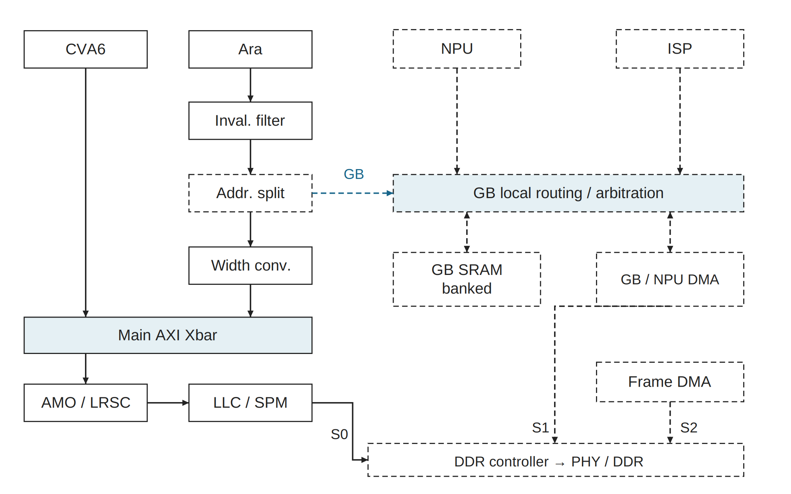
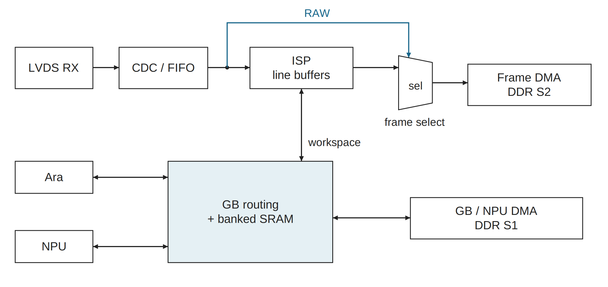

# 2026-10-10_ddr_lvds_isp_gb · 新版图稿

使用 publication-figures；旧目录原样保留。所有图宽182 mm，英文短标签/中文图注。源图、PDF和PNG各自保持比例；PPT页宽182 mm，组内统一页面高度。

[可编辑 PPTX](export/diagrams.pptx) · [导出报告](export/export_report.json)

## ddr_interconnect

[SVG](ddr_interconnect.svg) · [PDF](export/ddr_interconnect.pdf) · [PNG](export/ddr_interconnect.png) · [灰度](export/ddr_interconnect.gray.png)

2026-10-10 候选互连，虚线模块/路径为新增。CVA6 与 Ara 的普通地址保持主 AXI→原子适配→LLC/SPM→DDR S0。Ara 的 GB 地址在现有失效过滤之后新增分流，经 GB 路由访问独立 SRAM。NPU、ISP 与统一搬运器也是 GB 客户端。GB/NPU 搬运经 S1，图像帧 DMA 经 S2；三个端口共享 DDR 控制器。

内容映射：系统主路径/Ara新增分流/GB客户端/DDR三口→本图；RAW/ISP/CDC与帧选择→image_gb_dataflow；三口条件和缓存维护→图注。

原图：[旧母版](../2026-10-10_ddr_lvds_isp_gb/ddr_interconnect.svg)

## image_gb_dataflow

[SVG](image_gb_dataflow.svg) · [PDF](export/image_gb_dataflow.pdf) · [PNG](export/image_gb_dataflow.png) · [灰度](export/image_gb_dataflow.gray.png)

新增图像与 GB 数据流的展开。像素经 LVDS 接收和 CDC/FIFO 后分出 RAW 路径与 ISP 路径，在帧边界选择其一进入帧 DMA→DDR S2。当前假设不同时录制 RAW/处理帧。ISP 保留必要行缓冲，并可经 GB 路由访问中间数据；NPU 与 Ara 并行使用 GB，搬运器在 DDR S1 与 GB 之间读写。

内容映射：RAW旁路、ISP行缓冲、帧选择、DMA、GB与各客户端→本图；具体容量与带宽假设→图注。

原图：[旧母版](../2026-10-10_ddr_lvds_isp_gb/ddr_interconnect.svg)

## 随图补充

三口成立条件：NPU与GB共用S1搬运出口；若保留独立NPU master与GB DMA，可增加S3，不能强行串行化。DDR控制器候选最多8个AXI Slave，内部仲裁/QoS与DRAM Bank/Row调度共享DDR带宽。该组为候选，新增分流、GB、NPU/ISP/图像路径均未实施。

GB是独立分bank SRAM，不是LLC/SPM；容量、bank数、位宽、频率均未冻结。GB路由包含局部仲裁与访问适配，真实并行能力取决于端口、bank冲突和SRAM带宽。ISP工作区、NPU/Ara活跃区及DMA双缓冲是用途示意，不是固定分区。ISP保留必要行缓冲。帧DMA处理地址/stride/打包并生成AXI写；RAW/处理帧按帧切换，当前假设不同时录制。GB/NPU DMA与计算NPU不合并成一个IP。

系统图的箭头表示逻辑请求关系，双向GB线表示本地读写，返回通道省略；数据流图的箭头表示像素或数据移动。控制寄存器、中断、CDC细节、缓存维护与所有权协议另行设计；GB不自动一致，旁路写与原子观察域仍需验证。

## 来源与验证边界

技术事实沿用原目录正式母版、README及对应交接，不升级依赖、不改RTL。实际重绘/导出测试见本组JSON及[总交付](../2026-10-10_publication_figure_research_new/README.md)。没有重新编译/仿真/板测；Office实际外观与编辑未验证。

复现：使用总交付内 build_figures.py --out-root <新临时目录> 生成全部SVG，再用新skill的 scripts/run.py --width-mm 182 --render 导出；命令所用Python需安装对应依赖。
