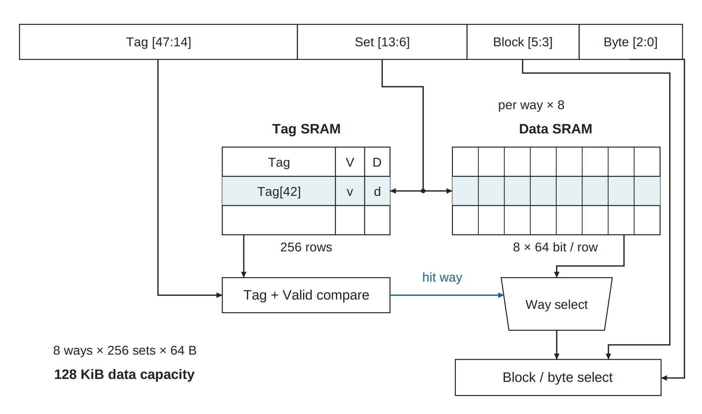
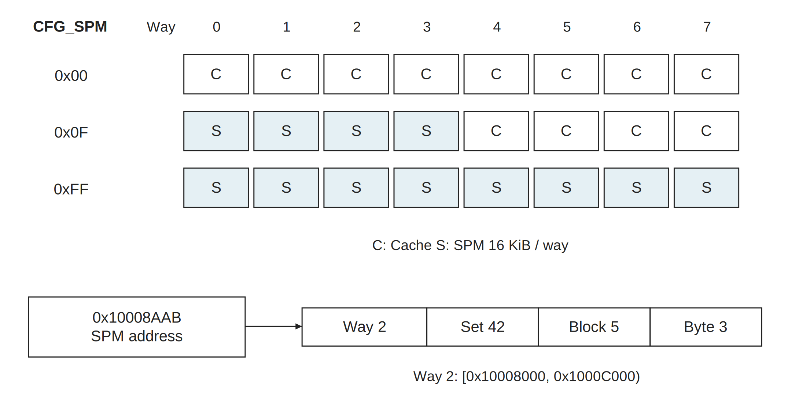
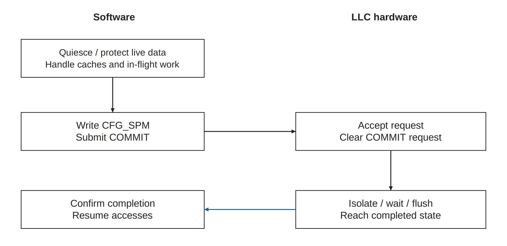

# 2026-10-10_llc_cache_spm · 新版图稿

使用 publication-figures；旧目录原样保留。所有图宽182 mm，英文短标签/中文图注。源图、PDF和PNG各自保持比例；PPT页宽182 mm，组内统一页面高度。

[可编辑 PPTX](export/diagrams.pptx) · [导出报告](export/export_report.json)

## llc_cache_access

[SVG](llc_cache_access.svg) · [PDF](export/llc_cache_access.pdf) · [PNG](export/llc_cache_access.png) · [灰度](export/llc_cache_access.gray.png)

全 Cache 基线的访问机制：48-bit 地址分成 Tag[47:14]、Set[13:6]、Block[5:3]、Byte[2:0]。Set 同时索引各 way 的 tag 与 data，Tag/Valid 比较产生命中 way，选择相应数据。图示仅展开代表 way，其余以 ×8 标注；tag 与 data 是分立 SRAM。Set 42 / hit Way 6 仅为教学例子。

内容映射：地址字段/索引/Tag+Valid比较/way选择/独立阵列→本图；用途位图与SPM寻址→llc_spm_mapping；转换→llc_mode_transition。

原图：[旧母版](../2026-10-10_llc_cache_spm/source_final/llc_cache_spm.svg)

## llc_spm_mapping

[SVG](llc_spm_mapping.svg) · [PDF](export/llc_spm_mapping.pdf) · [PNG](export/llc_spm_mapping.png) · [灰度](export/llc_spm_mapping.gray.png)

同一 128 KiB 数据阵列按 way 分配给 Cache 或 SPM。CFG_SPM 位为 1 表示 SPM，0 表示 Cache；每 way 为 16 KiB。SPM 固定槽不随位图压缩重排，已配置的 SPM 槽按地址直接选 way，不做 LLC Tag 比较。颜色和 C/S 标签共同编码用途。

内容映射：0x00/0x0F/0xFF、容量守恒、固定地址槽、0x10008AAB示例→本图；别名/L1/错误返回→图注。

原图：[旧母版](../2026-10-10_llc_cache_spm/source_final/llc_cache_spm.svg)

## llc_mode_transition

[SVG](llc_mode_transition.svg) · [PDF](export/llc_mode_transition.pdf) · [PNG](export/llc_mode_transition.png) · [灰度](export/llc_mode_transition.gray.png)

运行期 Cache/SPM 切换的逻辑次序。软件先保护/迁移代码、栈与数据，管理上游缓存副本和在途访问，再写 CFG_SPM 并提交。硬件执行隔离、等待和必要刷新；软件按实际寄存器/FSM 契约确认完成后恢复访问。COMMIT 请求清零仅表示接受，不能当作全部刷新完成。

内容映射：软件准备/配置提交/硬件协调/完成确认→本图；容量非复制、反向转换、全SPM外存旁路→图注。

原图：[旧母版](../2026-10-10_llc_cache_spm/source_final/llc_cache_spm.svg)

## 随图补充

参数来自当前DefaultCfg：48-bit地址、64-bit数据、8 way、每way256行、每行8×8 B=64 B；每way16 KiB，共128 KiB数据，不含tag存储。Cache way由命中或替换选择，不是cache地址中的字段。miss选择替换way，必要时写回脏行并从下游refill；为突出命中路径，图中未展开miss FSM。

CFG_SPM=0x00全Cache，0x0F为64 KiB Cache+64 KiB SPM，0xFF全SPM（ROM等待BIST后提交）。固定槽base+way×0x4000，Way2为[0x10008000,0x1000C000)，地址0x10008AAB→Way2/Set42/Block5/Byte3。访问未配置为SPM的槽返回SLVERR。全SPM且完成提交后，DDR流量从LLC旁路，SPM地址仍访问同一阵列；0x14000000未缓存别名重映射到同一SPM，上游L1属性/共享协议需独立核对。

切换不自动复制数据，也不新增RAM；必须保护代码/栈/数据并处理上游缓存和在途事务。SPM→Cache后原SPM内容不再保证固定驻留。COMMIT请求清零不等于全部刷新完成，须按实际完成契约确认。官方历史文档有把way称set的情况，本图采用常见cache术语：8way×256set。

## 来源与验证边界

技术事实沿用原目录正式母版、README及对应交接，不升级依赖、不改RTL。实际重绘/导出测试见本组JSON及[总交付](../2026-10-10_publication_figure_research_new/README.md)。没有重新编译/仿真/板测；Office实际外观与编辑未验证。

复现：使用总交付内 build_figures.py --out-root <新临时目录> 生成全部SVG，再用新skill的 scripts/run.py --width-mm 182 --render 导出；命令所用Python需安装对应依赖。
