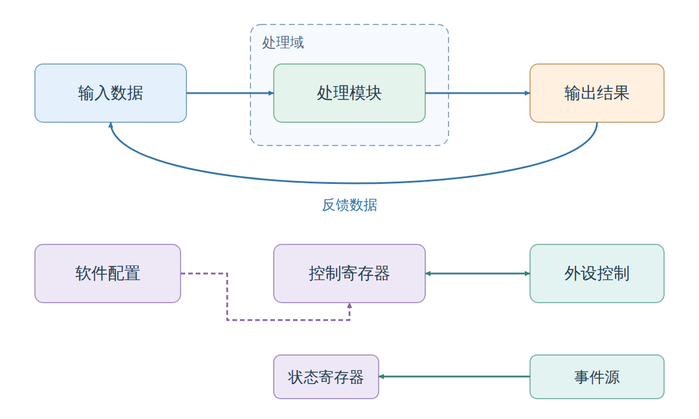

# 独立修正版：SVG 与原生箭头 PPTX

> 2026-10-13 仅修复归档后的导航路径；下文验证记录仍对应原日期与输入，未重新验收图稿。

2026-10-11。根据用户最新选择，从旧 `svg-pptx-diagrams` 独立派生 `svg-pptx-diagrams-native`。**没有修改旧 skill**；`publication-figures` 与已归档图稿也保持原样。本次只交付新 skill 和验证示例，没有重新生成全部工程图。

## 使用与切换

- 新版已安装：[svg-pptx-diagrams-native](/home/zhaowenyao/.codex/skills/svg-pptx-diagrams-native/SKILL.md)，调用 `$svg-pptx-diagrams-native`。
- 旧版继续用 `$svg-pptx-diagrams`，目录与源文件未改动。
- [独立 ZIP 源包](svg-pptx-diagrams-native.zip) · [仓库源码快照](skill/svg-pptx-diagrams-native/SKILL.md)。源包不含虚拟环境，可复制到其他机器的新技能目录，再按说明安装依赖。

本次安装在 Linux/WSL 用户目录，未另外安装 Windows 用户技能目录。不是修改旧 skill 的开关；两个技能目录并存，可以显式选择。

## 查看示例

[打开可编辑 PPTX](export/diagrams.pptx) · [SVG 母版](skill/svg-pptx-diagrams-native/assets/native_example.svg) · [规范化 SVG](export/native_example.editable.svg) · [PNG 预览](native_example.png) · [导出报告](export/export_report.json)



这是概念演示，不代表具体 SoC 连接：蓝色为数据与反馈，紫色为配置，绿色为控制/状态。配色、圆角和自由画布保留；图外不再自动生成解释框。论文尺寸与字号规则仅在明确要求论文插图时适用，概念图没有出版尺寸阈值。

## 对象修复结果

| 内容 | 新版 PPT 对象 |
| --- | --- |
| 直线箭头 | 一个原生连接线对象，箭头是端点属性 |
| 反向、双向箭头 | 一个线对象，按路径起终点设置一个或两个箭头 |
| 折线/曲线箭头 | 一个自定义几何对象，完整路径及端点属性均在其内部 |
| 虚线矩形/圆角框 | 一个形状对象，虚线是轮廓属性 |
| 虚线箭头 | 一个对象，同时带虚线轮廓与端点属性 |

示例 SVG 总计 **26 个对象**：10 个矩形、10 个文本、4 条直线、1 条曲线、1 条折线。PPTX 自动省略画布背景矩形，保留 **25 个对象**；其中 **6 个完整箭头对象、2 个带虚线属性的对象**（虚线框与虚线折线箭头）。SVG defs 中的三个三角 marker 没有生成额外 PPT 三角形。

这与“把线条和三角形组合”不同：端点直接属于线的属性。标准图形格式/连接线或自由形状可在 PPT 中继续编辑，但本轮实际验证层级是文件与程序化读写，Office UI 行为仍需实测。

仍须区分两个边界：

- 当前没有把线端点绑定到模块端口；拖动模块自动跟随/自动布线不在本轮实现范围。折线/曲线是单个可编辑形状，不是承诺所有折线都具备标准肘形连接器的路由把手。
- 旧 SVG 若已由独立短线和三角形拼成，新导出器不会自动猜测并合并；需按[迁移说明](skill/svg-pptx-diagrams-native/references/legacy-migration.md)重建为 marker 或 dasharray。本轮没有批量改写历史图稿。

## 验证

- 旧格式 4 项回归与新增 3 项原生对象测试全部通过，共 **7 项**；包括端点方向、双向箭头、曲线/折线路径、虚线比例、无效输入拒绝和拒绝覆盖。
- 程序化修改箭头终点、虚线框宽度、曲线位置，保存后重新读取，对象仍完整且箭头/虚线属性保留。这不是 Office UI 实测。
- SVG 规范化再读保留 marker/dash 语义。PPTX 的文字、对象数与 native endpoints/dashes 校验通过，ZIP 完整、无整图嵌入图片。
- 新 skill 的结构校验通过。安装后使用自己的 `.venv` 运行全部测试和 `scripts/run.py`，16 in 自由编辑画布导出成功；交付示例为默认 14 in，均不应用论文栏宽阈值。
- Chrome 渲染了规范化 SVG，已查看 PNG；中文预览使用本机字体回退，PPT 指定 Microsoft YaHei，字体不嵌入。
- [旧 skill 起始哈希](old_skill_hashes.json)与[最终保护/安装核验](validation.json)：旧 skill 12 个源文件不变（不含 .venv / 自动缓存），安装版与仓库快照一致。

**未在 Office 实际打开、编辑或渲染。** 既有签名策略问题未被绕过；浏览器预览不能替代 PowerPoint 验证。原生 SVG marker 当前只支持文档给出的中号实心三角形子集，不承诺任意 marker 或逐像素一致。

复现测试（在新 skill 目录中，使用装有依赖的 Python）：

```sh
python -m unittest discover -s scripts -p 'test_*.py' -v
python scripts/run.py --input assets/native_example.svg --out-dir /tmp/native-export-new
```

源后端基线 SHA-256 为 `a90319fc1d553ff326fc092e48e5aff9f66062c7e4890e105046996b21dfe438`。本机新隔离环境使用 python-pptx 1.0.2、Pillow 12.3.0。DrawingML 属性依据链接见 [SVG profile](skill/svg-pptx-diagrams-native/references/svg-profile.md)。没有修改 RTL/sw、工程配置、原教材引用或既有图稿，没有编译/仿真/板测，也未 Git 提交。

## 2026-10-11 背景处理修正

新版导出自动省略底层全画布普通背景矩形：白色使用 PPT 默认背景，其他实色转为页面背景；内部白色模块和有边框/圆角的图形保留。SVG/PNG 不变。安装版、源码快照、ZIP 和示例 PPT 已同步，10 项回归测试通过；原版 `svg-pptx-diagrams` 未修改。此前的全图重建也已应用修正，见 [native_reconstruction](../../2026-10-11_native_reconstruction/README.md)。
