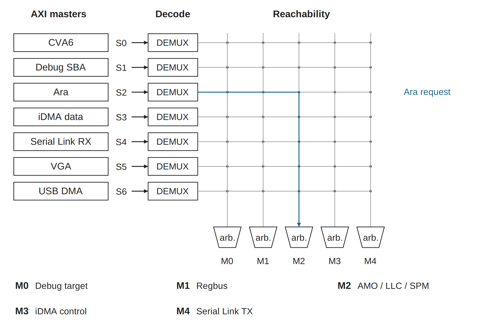
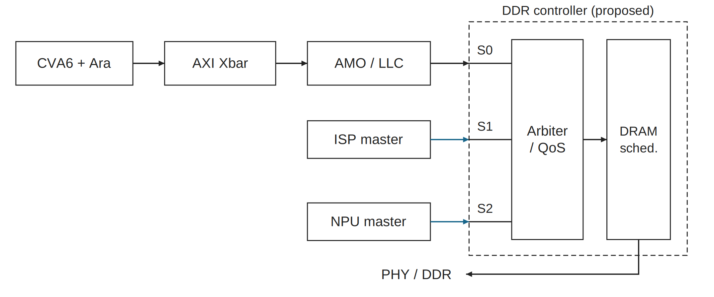

# 2026-10-06_axi_crossbar_ara · 新版图稿

> 2026-10-13 仅修复归档后的导航路径；下文验证记录仍对应原日期与输入，未重新验收图稿。

使用 publication-figures；旧目录原样保留。所有图宽182 mm，英文短标签/中文图注。源图、PDF和PNG各自保持比例；PPT页宽182 mm，组内统一页面高度。

[可编辑 PPTX](export/diagrams.pptx) · [导出报告](export/export_report.json)

## crossbar_ara

[SVG](crossbar_ara.svg) · [PDF](export/crossbar_ara.pdf) · [PNG](export/crossbar_ara.png) · [灰度](export/crossbar_ara.gray.png)

仿真 Ara 配置的 7×5 全连接 AXI Crossbar。每个输入按 AR/AW 地址译码；每个输出独立仲裁。矩阵实心点表示可达连接，蓝色折线是 Ara→主存端口的请求示例；不同输出可并行，同一输出在该处竞争。S 为 Crossbar 从端口，接发起者；M 为主端口，接目标。箭头是逻辑请求方向，R/B 返回通道省略。

内容映射：7个输入、5个输出、每输入DEMUX/每输出MUX、全连接→本图；配置、地址窗口、RT与FPGA差异→图注补充。

原图：[旧母版](../../2026-10-06_axi_crossbar_ara/ppt_editable_final/crossbar_ara_ppt.svg)

## ddr_qos_proposal

[SVG](ddr_qos_proposal.svg) · [PDF](export/ddr_qos_proposal.pdf) · [PNG](export/ddr_qos_proposal.png) · [灰度](export/ddr_qos_proposal.gray.png)

2026-10-06 三端口接入建议的重绘：SoC 经现有原子适配和 LLC 接 S0，ISP 与 NPU 数据分别旁路至 S1/S2。虚线轮廓表示候选控制器边界，内部逻辑为接入抽象；多端口共享同一 DDR 带宽。该历史方案与 2026-10-10 的 GB/统一搬运器方案并列保留，不把两个版本拼成已经实现的架构。

内容映射：三个请求源、LLC旁路、端口仲裁与命令调度→本图；供应商约束和一致性边界→图注。

原图：[旧母版](../../2026-10-06_axi_crossbar_ara/ppt_editable_final/ddr_qos_proposal_ppt.svg)

## 随图补充

配置快照沿用原图：Ara=1、2 lanes/VLEN 2048、AXI 数据64 bit、Cfg.AxiRt=0；不是对当前所有构建的声明。Ara 入端有失效过滤及位宽适配，此配置64→64。M2 经原子适配、cut/别名重映射与LLC，SPM/cache命中可片内完成；128 KiB SPM有 cached/uncached 别名。外存窗口[0x80000000,0x100000000)，M4 Serial Link TX窗口[0x100000000,0x200000000)，M3 iDMA控制从0x01000000起。M1涵盖Boot ROM、CLINT、PLIC、SoC regs与外设控制。未映射地址由每输入错误响应单元处理（图省略）。VCU118旧加源快照SerialLink=0/USB=0/Ara=1对应5×4，不能与仿真7×5混同。

DDR候选依据为原图记录的供应商V2.1授权接口摘要：最多8个AXI端口、端口优先级/QoS、命令调度；独立AXI Urgent接口不支持。精确寄存器、带宽保底、最坏延迟待用户手册确认。多端口不自动保证CPU/LLC缓存一致性或旁路写AMO/LRSC语义，RT是否增加需独立评估。未复制受限datasheet内容。

## 来源与验证边界

技术事实沿用原目录正式母版、README及对应交接，不升级依赖、不改RTL。实际重绘/导出测试见本组JSON及[总交付](../2026-10-10_publication_figure_research_new/README.md)。没有重新编译/仿真/板测；Office实际外观与编辑未验证。

复现：使用总交付内 build_figures.py --out-root <新临时目录> 生成全部SVG，再用新skill的 scripts/run.py --width-mm 182 --render 导出；命令所用Python需安装对应依赖。
