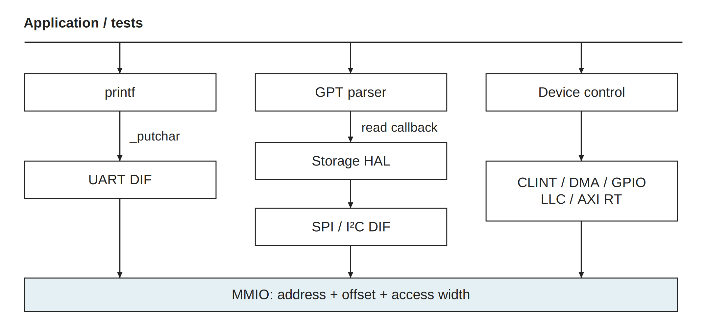
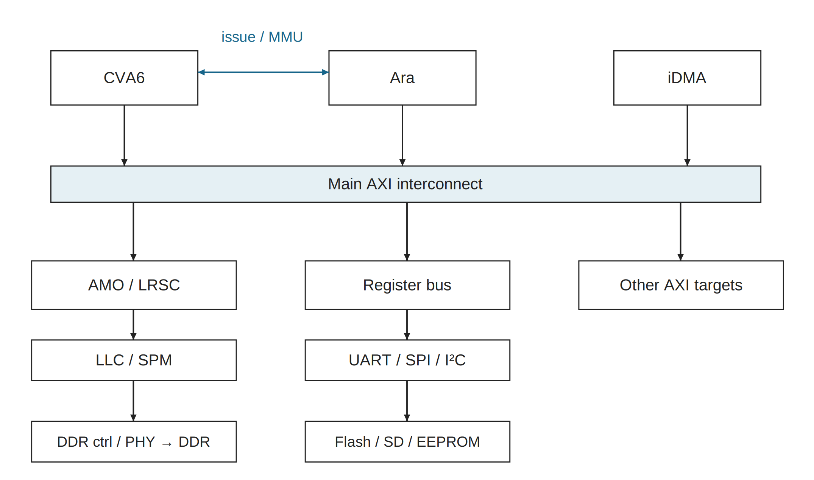
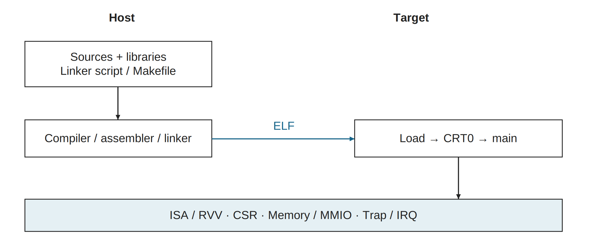

# 2026-10-09_software_hardware_layers · 新版图稿

> 2026-10-13 仅修复归档后的导航路径；下文验证记录仍对应原日期与输入，未重新验收图稿。

使用 publication-figures；旧目录原样保留。所有图宽182 mm，英文短标签/中文图注。源图、PDF和PNG各自保持比例；PPT页宽182 mm，组内统一页面高度。

[可编辑 PPTX](export/diagrams.pptx) · [导出报告](export/export_report.json)

## software_calls

[SVG](software_calls.svg) · [PDF](export/software_calls.pdf) · [PNG](export/software_calls.png) · [灰度](export/software_calls.gray.png)

代表性的裸机调用关系。应用按需调用库，不要求经过全部层次：printf→_putchar→UART DIF，GPT 经 read 回调访问器件 HAL，HAL 再使用 SPI/I²C DIF；HAL 也可能直接使用 MMIO。DIF/HAL 名称遵循本工程职责，libcheshire.a 是归档方式而不是新的调用层。

内容映射：通用功能/器件HAL/DIF/MMIO→本图；执行接口/硬件→hardware_paths；构建与启动侧栏→build_and_execution；OS与规划→图注。

原图：[旧母版](../../../2026-10-09_software_hardware_layers/cheshire_software_hardware.svg)

## hardware_paths

[SVG](hardware_paths.svg) · [PDF](export/hardware_paths.pdf) · [PNG](export/hardware_paths.png) · [灰度](export/hardware_paths.gray.png)

当前 SoC 的执行与访存结构抽象。CVA6 与 Ara 的专用请求/响应及 MMU 交互同 AXI 访存分开；RVV 不是 MMIO 外设启动。主存路径依次经过原子适配、LLC/SPM 和平台 DDR 子系统。箭头为逻辑事务连接，返回通道省略。SPM 使用 LLC 阵列；片外器件按平台配置连接。

内容映射：CVA6/Ara专用接口、独立访存、主存/寄存器/片外器件→本图；规划扩展与FPGA/ASIC边界→图注。

原图：[旧母版](../../../2026-10-09_software_hardware_layers/cheshire_software_hardware.svg)

## build_and_execution

[SVG](build_and_execution.svg) · [PDF](export/build_and_execution.pdf) · [PNG](export/build_and_execution.png) · [灰度](export/build_and_execution.gray.png)

构建产物与运行环境分开：主机工具根据源代码、库和链接脚本生成 ELF；目标端通过启动/调试通路加载，CRT0 建立环境后由处理器执行应用。指令、CSR、内存/MMIO 和异常/中断是软件可见接口，不是四个必须逐层经过的软件模块。

内容映射：工具链、链接/归档、Boot/CRT0、四类软硬件契约→本图；可选OS/ASIC实现维度→图注。

原图：[旧母版](../../../2026-10-09_software_hardware_layers/cheshire_software_hardware.svg)

## 随图补充

三个图分别表达调用、硬件连接、构建/执行，不把所有职责强制堆成一条垂直调用链。应用包括HelloWorld/测试、RVV向量算法、烧写/下载工具；图像推理工作负载为规划。UART debug HAL提供READ/WRITE/EXEC；libcheshire.a覆盖多类职责。MMIO工具包括reg8/reg32和mmio_region接口，寄存器头文件给偏移与位字段。其他专用LLC/AXI RT库属于软件控制。

四类软件可见契约为指令/RVV、CSR、内存/MMIO、异常/中断。IRQ/异常处理含入口与返回；配置接口可在运行时重复访问，Boot/CRT0不是每次设备调用的必经层。可选RTOS提供任务/调度/同步，Linux有用户态/内核/驱动，不默认复用整套裸机HAL，也未声称目标OS已运行。

硬件图省略各外设控制连线、AXI逐通道和详细cache hit/miss。图像传感器/LVDS、ISP、NPU与DDR旁路为规划，未虚构已连通接口；新候选拓扑单列在DDR组。FPGA已有VCU118工程，ASIC的宏、时钟、PAD与物理实现仍待适配；供应商AXI4 DDR子系统未因图示而成为已集成能力。已存在结构不代表所有配置启用、全部功能通过验证。

## 来源与验证边界

技术事实沿用原目录正式母版、README及对应交接，不升级依赖、不改RTL。实际重绘/导出测试见本组JSON及[总交付](../2026-10-10_publication_figure_research_new/README.md)。没有重新编译/仿真/板测；Office实际外观与编辑未验证。

复现：使用总交付内 build_figures.py --out-root <新临时目录> 生成全部SVG，再用新skill的 scripts/run.py --width-mm 182 --render 导出；命令所用Python需安装对应依赖。
