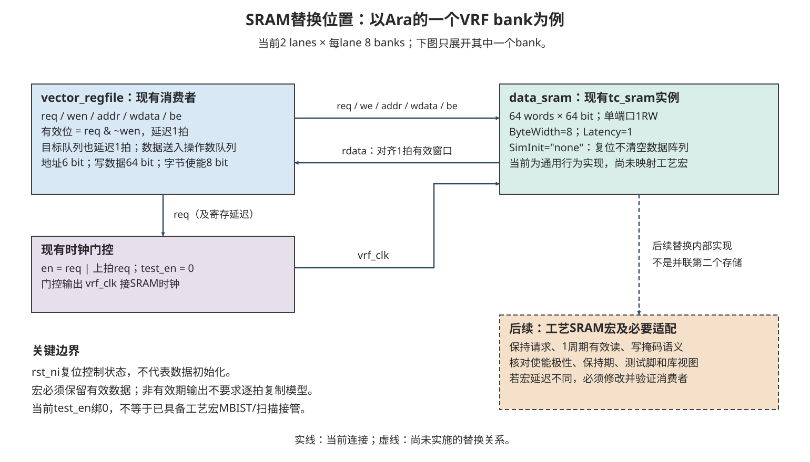

# P01：ASIC 技术适配与验收证据手册

> 现行工程参考；2026-10-11 分类迁入 engineering，正文输入版本与验证边界保持。见[工程参考索引](README.md)。

更新：2026-10-25。**已只读核查正式工程主要SRAM的实际接口；技术宏替换、综合及物理验证仍未实施。** 源码提取与基线仿真已在此前E01完成，不能继续以旧底稿的“未提取”描述当前工程。

本次阅读：[实际存储与接口](#formal-sram-20261025) → [初始化与有效窗口](#sram-semantics) → [宏资料与最小验证](#macro-next-checks)。容量及配置唯一表见[资源指南Q2](Fixed_Vector_SoC_Resource_Guide.md#q2)：本次限定对象为48个逻辑1RW实例，数据/标签/VRF合计159.90625 KiB；不等于整个SoC存储总量或工艺宏数量。服务器只读，无新构建、仿真或综合。

历史底稿：2026-10-08，当时技术替换、源码提取与工程验证未实施。输入分支 `mp/ara-pulp-v2`，HEAD `459f9d6f5748e39063f7bb67e959c2f27859915d`；工作区带已有教材/图稿修改。本手册是定向接口盘点，不宣称已展开完整设计或穷举全部存储实例。

[02 提取交接书](../02_Cheshire_Ara_ASIC_Extraction_Handoff.md)继续负责唯一配置、源码闭包、静态清单和阶段规格。本手册负责替换时要保持的语义、缺失资料及验收责任；原理教学在 [ASIC HTML 入口](../learning/future.html)。现有 [03 平台约定](../03_Platform_ROM_Clock_IP_Configuration.md)的职责和文件名保持不变。原计划 08 无需再创建同内容正文。

## 1. 当前可交付范围与证据等级

2026-10-18 工艺状态补充（输入 `2f0f2d6f85979709fbc99dd4098447cb5587ce5f`）：用户已确认 SMIC55 工艺标识，完整名称、PAD/GB/NPU/面积候选与预算表见[资源与封装预规划](SoC_Resource_and_Packaging_Plan.md)。本次仅更新该输入及入口；原 2026-10-08 源码盘点、验证记录和输入版本保持，不视为重新展开或验证。

- **用户确认**：迁移为独立静态清单工程；DDR 可提供 AXI4；NPU/ISP 要求绕过 LLC；沿 Platform ROM 钩子完成安全启动配置并保留运行时配置接口。原 2026-10-08 盘点时具体工艺未定，已由上述 2026-10-18 用户输入更新；实际 PDK/库配套、宏、PLL/PAD/PHY、封装、频率与域划分仍待核实或冻结。
- **源码确认**：本次正式SRAM依据见第2.1节；第2.2节旧路径、FPGA及其他技术单元描述仍对应2026-10-08历史快照。
- **用户历史报告/已有产物**：VCU118 HelloWorld、既有 ELF 与图形证据按原报告保留，不计为本次新执行。
- **检查方式**：本次只读源码、容量复算、文档/图示和哈希检查；历史底稿曾做文档结构、链接、哈希保护和尺寸复算。未编译/未仿真/未综合/未板测/未做 STA、DFT 或物理签核。
- **方案建议**：接口表、模型测试与准入条件；不产生生产修改授权。

## 2. 先识别资源，不按模块名决定替换

### 2.1 正式工程主要SRAM（2026-10-25）

以下路径相对 `/home/zhaowy24/CheshireAra`。其目录无Git元数据，本次文件SHA256及结束复查保存在[来源快照](../maintenance/E01/reports/evidence/abc_review_20261025.json)；参考工程HEAD `5986ba021e1a0d30dbdb5ecb2cfa230a2c35947c`只作来源定位。有效配置为 `FpgaEn=0/TechnoCut=0`、Cache USER存储关闭；不选FPGA XPM、WB cache或其他未启用实现。

为缩短路径，下表 `C`=`src/cheshire_soc/cva6`，`A`=`src/cheshire_soc/ara`，`L`=`src/cheshire_soc/axi_llc`。数量、深宽和容量详见[统一容量表](Fixed_Vector_SoC_Resource_Guide.md#q2)，这里列匹配工艺宏所需的访问语义。

| 对象 / 逻辑实例形状 | 正式文件、实例定位 | 写掩码及组织 |
| --- | --- | --- |
| L1I数据：4×64×128 bit | `C/core/cache_subsystem/cva6_icache.sv:490`，`gen_sram[i].data_sram` | 16个字节使能均为1，实际整行写；每路一个bank |
| L1I标签：4×64×47 bit | 同文件465，`gen_sram[i].tag_sram` | 6段字节使能全1，末段7有效bit；实际tag/valid整项写 |
| WT L1D数据：4×64×256 bit | `C/core/cache_subsystem/wt_dcache_mem.sv:308`，`gen_data_banks[k].i_data_sram` | 32个字节使能；每bank对应行内一个64-bit word位置，每项横拼4路数据 |
| WT L1D标签：4×64×46 bit | 同文件335，`gen_tag_srams[i].i_tag_sram` | 6段使能全1，末段6有效bit；tag/valid整项写 |
| Ara VRF：16×64×64 bit | `A/hardware/src/lane/vector_regfile.sv:82`，每lane `gen_banks[bank].data_sram` | 8个字节使能；2 lanes×8 banks |
| LLC/SPM数据：8×2048×64 bit | `L/src/axi_llc_data_way.sv:119`，`i_data_sram` | 8个字节使能来自AXI strobe；每way一个bank |
| LLC标签：8×256×36 bit | `L/src/hit_miss_detect/axi_llc_tag_store.sv:270`，`gen_tag_macros[i].i_tag_store` | `ByteWidth=36`，一个整项使能，包含tag/valid/dirty |

这些实例全部是**单端口1RW、posedge接收、高有效req/we/be、读延迟1周期**。WT D模块的3个上层请求端口经仲裁后访问bank，不要求3端口宏；同bank冲突需按现有仲裁重试，跨bank可并发。标签位宽不能擅自按64 bit计入逻辑容量；工艺宏取整或拼接的开销另算。

实际编译入口 `sim/scripts/compile.cheshire_soc.sh:99/910`选择普通 `tc_sram.sv`及 `sram_pulp.sv`。CVA6路径为 `sram_cache → sram_pulp.sv中的sram → tc_sram`（`C/common/local/util/sram_cache.sv:106`、`sram_pulp.sv:43`）；LLC/VRF直接实例化 `tc_sram`。只替换CVA6包装层无法覆盖LLC/VRF，后续应在统一抽象接口选择工艺实现，本轮不增加包装代码。

**时序与初始化为什么必须一起核对？** SRAM没有ready端口，消费者按既定周期使用结果：VRF在原始 `clk_i`下将 `req & ~wen`及目标队列延迟一拍（仅SRAM使用门控 `vrf_clk`）（`vector_regfile.sv:48–56`）；LLC数据路径明确要求 `DataMacroLatency=1`（`axi_llc_data_way.sv:144–146`）；CVA6包装固定Latency=1。两周期宏不能仅换模型后沿用原有效位。

| 消费者 | 复位/初始化与保持要求 |
| --- | --- |
| 通用 `tc_sram` | `SimInit="none"`时复位只清上次读地址，不清数据阵列及读数据寄存器；数据须先由软件、回填或初始化流程写入 |
| L1I | reset进入FLUSH，逐set写tag valid=0，不清data；依据 `cva6_icache.sv:372–390/520` |
| WT L1D | missunit复位到INIT，再由 `init_ni`决定是否清tag valid。`init_ni`来自CPU controller的 `cache_init_no`；冷复位与内部uarch reset路径不同，不能笼统说每次reset均全清。依据 `wt_dcache_missunit.sv:408–418/556–558/598–600`、`cva6.sv:1333/1424`、`controller.sv:121–123/354–355/424` |
| LLC | 上电tag BIST执行模式写读并最终清零；它不覆盖data、VRF或L1，不是完整制造MBIST。坏tag way可改为SPM使用，不等于宏repair。依据 `axi_llc_hit_miss.sv:317–329`、`axi_llc_tag_pattern_gen.sv`及 `axi_llc_config.sv:503–515` |
| VRF | valid/目标队列复位，数据不清。当前VCS分支每bank门控使能为当前req与上拍req的逻辑或，低电平锁存门控使能，`test_en=0`；替换ICG/接DFT时须保持最后一次请求及结果时序。依据 `vector_regfile.sv:64–80`、`tech_cells_generic/src/rtl/tc_clk.sv:31–52` |

**不能只按注释匹配 `no_change` 宏。** 当前 `src/cheshire_soc/tech_cells_generic/src/rtl/tc_sram.sv:115–151`每拍采样当前读地址或保存的上次读地址。读A、写A、再空闲时，空闲拍输出可能变成新A；因此注释“写时输出稳定”不表示无读请求时输出永久保持。本轮没有据此确认功能缺陷。

适配必须保证**有效读窗口和背压保持期**：VRF只消费一拍valid对应数据；LLC数据在输出valid等待ready时阻止新SRAM请求（`axi_llc_data_way.sv:82–115`）。不能把所有无效周期输出都要求逐拍相同，也不能未经消费者检查就宣布真正no_change宏可直接替换。当前为1RW，通用模型的多端口碰撞优先级不是当前接口需求。

`sram_pulp.sv:89–104`在USER关闭分支保留的数组处于 `synthesis translate_off`内，不计为可综合USER存储。Boot ROM组合case、FF寄存器文件、TLB及队列也不因含数组声明就归入上述48个SRAM实例；本轮未穷举全部外设存储。

**下一步需要的资料和最小验证（仅建议）：**工艺标识已确认，但具体宏尚未核验。需要同版本的可用深宽/端口/掩码、读延迟及使能/同址行为、工作角、上电/休眠/保持/测试脚，以及仿真模型、Liberty、LEF和测试修复说明。受限交付只记录授权接口摘要及受控位置，不复制进文档。

后续选定宏后，先验证连续读、同址读写交替、逐字节写及未写字节保持；再验证VRF间歇请求/门控末拍/队列身份、L1冷启动/tag失效/回填与WT冲突、LLC有效返回背压和tag初始化。复用现有启动、访存原子、Ara/RVV及已通过搬运用例，按实际差异补最小检查；不重开共享LLC已知失败的扩展排查。模型功能通过仍不能代替目标库综合、STA或DFT验收。

### 2.2 历史技术单元入口（2026-10-08，非当前正式清单）

以下保留FPGA/时钟/PAD等后续适配背景，不表示本轮重新核查，也不表示XPM/MMCM/MIG参与当前正式仿真。当前CPU/VRF/LLC存储以第2.1节为准。

| 当前资源/来源 | 本地可确认内容 | 替换时必须保持/明确 | 所需资料与责任人 |
|---|---|---|---|
| Ara VRF：[vector_regfile](../../.bender/git/checkouts/ara-2c7b103275a16c87/hardware/src/lane/vector_regfile.sv)、[lane](../../.bender/git/checkouts/ara-2c7b103275a16c87/hardware/src/lane/lane.sv) | 2/2048 快照为 16 个 64×64-bit 1RW bank；一拍有效位/目标队列；8-bit 字节使能 | 端口、延迟、掩码和消费者身份；控制复位与数据初始化分开；测试/保持脚 | P01/宏供应商：宏清单与各视图；V01：接口与消费者回归 |
| LLC data：[axi_llc_data_way](../../.bender/git/checkouts/axi_llc-5fb8850caad4fcfa/src/axi_llc_data_way.sv)；tag：[tag_store](../../.bender/git/checkouts/axi_llc-5fb8850caad4fcfa/src/hit_miss_detect/axi_llc_tag_store.sv) | data 与 tag 是不同消费者；tag 有上电 BIST/初始化 | way/line/block 组织、读写时序、tag 比较与 BIST；SPM 同时服务启动代码/栈 | E01 冻结组织；P01 提供两类宏；S01 明确启动容量；不能只替 data 宣称完成 |
| CVA6 cache：[icache](../../.bender/git/checkouts/cva6-20c9d7cbe0dd6995/core/cache_subsystem/cva6_icache.sv)、[wt_dcache_mem](../../.bender/git/checkouts/cva6-20c9d7cbe0dd6995/core/cache_subsystem/wt_dcache_mem.sv)等 | 本地有 sram_cache 路径，也有其他 cache 实现 | 先按冻结 profile 展开确定实际消费者，再逐实例填写端口/深宽/读延迟/掩码/碰撞 | E01 给唯一展开基线；P01 定向完成其余存储账本；本文不凭文件存在判定全部实例同时启用 |
| XPM：[tc_sram_xilinx](../../.bender/git/checkouts/tech_cells_generic-223c43ccbeb688f9/src/fpga/tc_sram_xilinx.sv) | 1-port 用 xpm_memory_spram，2-port 用 tdpram；READ_LATENCY 传参，no_change，固定零初始化 | 与行为 tc_sram 的默认 SimInit="none" 有区别；不能把 FPGA 初始化特性带入 ASIC 假设 | P01/E01 选择唯一实现；供应商给 ASIC 上电/复位/碰撞语义 |
| Boot ROM：[S 源](../../hw/bootrom/cheshire_bootrom.S)、[生成 SV](../../hw/bootrom/cheshire_bootrom.sv) | 指令内容、取指接口和生成产物成套 | 内容一致、复位入口/地址映射、访问时序；常量逻辑或真实 ROM 宏；制造后不可更新边界 | S01 管内容和生成对应；P01 管实现；S01-B01 修复另有授权门槛 |
| clock gating / mux：[tc_clk](../../.bender/git/checkouts/tech_cells_generic-223c43ccbeb688f9/src/rtl/tc_clk.sv) | 行为 ICG 在低电平锁存使能；普通 mux 明示不保证无毛刺动态切换 | 极性、最小脉冲、门控检查、测试旁路、切换协议；不能把行为 assign 当工艺时钟单元 | PLL/库供应商交可用单元与约束，P01 设计平台协议 |
| MMCM/clkwiz：[FPGA top](../../target/xilinx/src/cheshire_top_xilinx.sv) | clkwiz 输出系统/USB 等时钟；locked 未参与当前连接的启动放行 | ASIC 使用真实参考源、PLL/安全旁路，CPU 最早取指不能依赖尚未执行的 PLL 软件 | P01/IP 供参考范围、稳定/锁定/切换协议；S01 使用可持续访问配置接口 |
| reset / CDC：[rstgen_bypass](../../.bender/git/checkouts/common_cells-7f7ae0f5e6bf7fb5/src/rstgen_bypass.sv)、[cdc_2phase](../../.bender/git/checkouts/common_cells-7f7ae0f5e6bf7fb5/src/cdc_2phase.sv) | 同步释放；普通 CDC 有明确两端复位和路径约束 | 复位源/极性/作用域、时钟有效条件、排空与重新就绪；clearable 不自动解决 AXI 取消 | P01 域表/复位规范；V01 结构和协议验收 |
| MIG/DDR：[dram_wrapper_xilinx](../../target/xilinx/src/dram_wrapper_xilinx.sv) | 位宽/ID 适配，可选 AXI CDC，MIG UI 域；calib 完成输出未参与完整放行 | AXI4、初始化/训练/响应、位宽/ID/地址、控制器/PHY/器件责任；保留训练前可执行存储 | M01+DDR 供应商交授权接口/模型；P01 电源/时钟/PAD；S01 早期固件 |
| USB：[SoC gen_usb](../../hw/cheshire_soc.sv) | OHCI 控制/DMA/IRQ；独立 usb_clk_i、usb_rst_ni；DP/DM 输入/输出/OE | 数字端与实际收发电气、PHY/时钟/复位以及模式责任，不能开配置位就称可用 | 若用户保留 USB，由 P01/IP/板级负责人给 PHY/PAD 与目标验证环境；保留决策未冻结 |
| PAD / IOBUF：[FPGA top](../../target/xilinx/src/cheshire_top_xilinx.sv) | I2C IOBUF 的 T=~en；GPIO/其他 IO 按实际 wrapper 接线 | IO/OE 极性、输入反馈、开漏/三态、上电默认、I/O 电压、封装/板负载 | P01/PAD 供应商+封装/板级团队；I01 给传感器/外设完整接口 |
| scan / MBIST：[SoC Ara 连接](../../hw/cheshire_soc.sv)、[LLC 文档](../../.bender/git/checkouts/axi_llc-5fb8850caad4fcfa/doc/axi_llc.md) | Ara scan 输入绑 0、输出未用；VRF 门控 test_en 绑 0；LLC BIST 针对 tag | 测试接管、时钟复位控制、链/阵列覆盖、宏修复与测试退出；现有端口不等于实现完成 | P01/DFT 负责人供策略、工具和故障模型；供应商供测试/修复接口 |

这张表是定向资源入口。完整生产清单还要在 E01 固定实例后列出 debug 存储、FIFO、寄存器阵列与其他技术单元，确认哪些映射为触发器、哪些映射为宏；不能仅搜索 tc_sram 就宣布全部工艺依赖已覆盖。

## 3. 每个 SRAM/ROM 的最小适配记录

每项记录保留：**逻辑实例路径 → 消费者符号 → 抽象 wrapper → 所选物理宏 → 视图版本**。接收者应能据此回答：

1. 地址单位、深度/宽度、端口类型和可并发访问是什么？
2. 请求在哪个边沿接收，何时给有效数据，是否允许背压？
3. 片选/写使能/字节掩码的有效极性与未选字节行为是什么？
4. 同址访问允许哪些组合，读数据定义如何？复位/上电/休眠是否保持内容？
5. 功能模型、Liberty、LEF/版图、测试/修复、低功耗资料是否属于同一版本？

真实 VRF 例见 [asic-memory#bank-contract](../learning/asic-memory.html#bank-contract)。k+2 宏不能直接接到 k+1 有效位上；如改变延迟，必须重新设计有效位、目标队列、空间预留和门控周期，参见 [具体消费者推演](../learning/asic-memory.html#k-plus-two)。本文没有指定宏拼接方式或写真实适配 RTL。

## 4. 正常配置与平台生命周期契约

平台硬件先建立安全时钟/复位和可取指路径；保留 LLC 时 Boot ROM 准备 SPM/栈；Platform ROM 才能配置依赖这些资源的 IP。运行时同一控制口需要支持再次配置，但任意参数重写是否允许、作用范围和完成状态必须由 IP 规定。详细教学在 [正常调频](../learning/clocks.html#normal-frequency-change)与 [域重启](../learning/reset.html#transaction-reset)。

配置契约至少包含请求拥有者、允许状态、参数合法集合、接收/生效/完成的区别、受影响时钟域、排空条件、配置通路自身时钟、实际频率发布和外设分频更新。若涉及电压、DDR 变频或掉电，另需供应商规定的状态转换与数据保持条件。具体初始频率、独立域、DVFS 表均未冻结。

当前接线的三个边界必须保留：[FPGA top](../../target/xilinx/src/cheshire_top_xilinx.sv) 的 `i_clkwiz.locked()` 未接；[DDR wrapper](../../target/xilinx/src/dram_wrapper_xilinx.sv) 的两种 MIG `init_calib_complete()` 输出未接；[SoC](../../hw/cheshire_soc.sv) 的 `i_dbg_dm_top.ndmreset_o()` 未用。它们说明尚无相应完整控制闭环证据，**不是本轮观测到启动必然失败**。非零 Platform ROM 返回问题继续引用 [S01-B01](../03_Platform_ROM_Clock_IP_Configuration.md#s01-b01)。

## 5. 验证矩阵：保持什么，在哪里观察

| 对象 | 功能/消费者验证 | CDC/RDC/等价 | 时序/物理/制造证据 |
|---|---|---|---|
| VRF SRAM | 连续读、局部写、竞争后重试，数据/valid/队列身份一致；使用前初始化 | 变更前后按明确复位/初始化约束比较；同域不编造 CDC | 宏输入/输出路径、门控时序；实际宏/版图；bank 测试覆盖 |
| ROM/启动存储 | 指令字节、复位入口、栈与默认/非零平台钩子（修复后） | 地址/实现变更的行为对应；复位与接口结构 | ROM/SRAM 时序、初始化/制造不可更新责任 |
| PLL/复位/电源 | 安全启动、合法重配、排空、释放和软件频率一致 | 跨域配置、复位断言/释放、掉电隔离；各模式前后行为 | 时钟约束、脉冲/门控、低功耗库与物理/测试模式 |
| DDR/PHY | 初始化先于使用，地址/宽度/响应、并发和数据结果 | 两侧时钟/复位与在途事务；新互连接口检查 | PHY/PAD/器件时序与板条件；供应商验收和系统回归 |
| PAD/USB/图像输入 | 真实方向/OE、上电状态和正常事务；完整设备条件 | 进入数字域的采样和复位协议 | 电气/ESD、封装/PCB、输入输出预算；工具/实验各有边界 |
| DFT/MBIST | 功能模式不被破坏，测试接管与退出正确 | 插入后的功能模式等价/回归 | scan/ATPG/MBIST 范围、故障模型/排除项、测试时序/功耗与 ATE 数据 |

编译展开只证明结构可接受；功能模型结果不证明物理实现；STA 不证明数据算法正确；DFT 覆盖不等于系统回归通过。每份报告必须对应同一配置/源码/库版本，标实际命令、工具、输入、退出码、排除范围和原始产物。没有运行不填“通过”。

## 6. 输入缺口与解锁条件

| 提供者 | 具体输入 | 现在可做 | 解锁的工程步骤 |
|---|---|---|---|
| 用户/系统负责人 | 最终保留设备、频率/性能/功耗范围、启动介质、复位/低功耗要求 | 整理候选接口与依赖 | 冻结产品配置和接受标准 |
| 工艺方/P01 | PDK/库版本、合法工作角、允许发布的宏/PLL/PAD 摘要及受控资料位置 | 说明所需视图、极性与周期 | 真实宏映射、时钟/IO 实现、物理签核 |
| DDR 供应商/M01 | AXI4/控制器/PHY/器件、初始化、训练状态、模型与工具授权 | 与当前 LLC 出口建立契约 | 控制器替换、初始化软件、真实 DDR 验证 |
| E01 | 正式静态清单/配置及主要SRAM源码映射已提供；目标宏适配后仍需实际展开与差异记录 | 本文第2.1节及资源指南；未穷举所有存储 | 目标宏实例对应、适配后的重建与消费者验证 |
| S01/V01 | 启动修复/软件约定、工具许可/模型、预期输出和回归环境 | 写带条件的测试计划 | 平台软件运行、消费者回归及错误场景 |
| DFT/封装/板级团队 | 测试策略/ATE、封装/板/测试点与供电测量条件 | 制造测试及首硅路线设计 | 测试插入与制造交付、样片启动/功耗测量 |

受限资料不复制进仓库，只记授权接口摘要与受控位置。资料缺失影响具体工程步骤，不阻止完整解释机制；RTOS/Linux 不是这份裸机 ASIC 适配清单的强制前置。

## 7. 接收与后续分工

E01 接收实例/唯一实现选择要求；P01 落实工艺资源与约束；M01 接收 DDR 及多主接口；S01 接收初始化/重复配置和状态交还；V01 接收各层验证判据；I01 提供新增 IP 的流量与物理接口。公共状态/索引由协调者串行汇总。下一步最小工程工作需另行明确授权，不能从本次文档实施推导允许修改生产 RTL、升级依赖、提取源码或启动大型验证。

来源版本和检查记录见 [本轮 ASIC 证据](../learning/evidence/system-implementation-20261008/asic/README.md)与 [实施报告](../maintenance/L01/reports/asic.md)。官方概念与本地实现分别在 HTML 源节引用；在线 latest 只作机制资料，不取代当前消费者快照。
