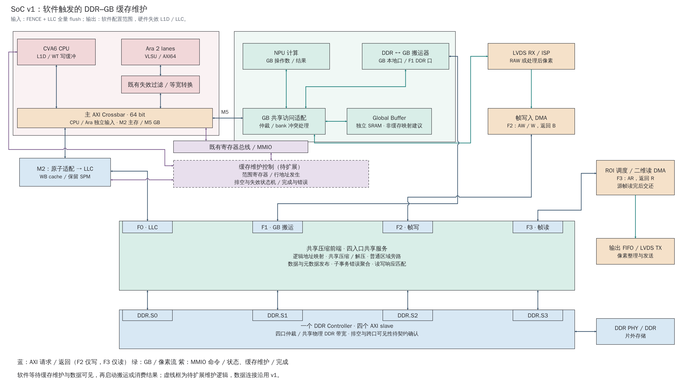
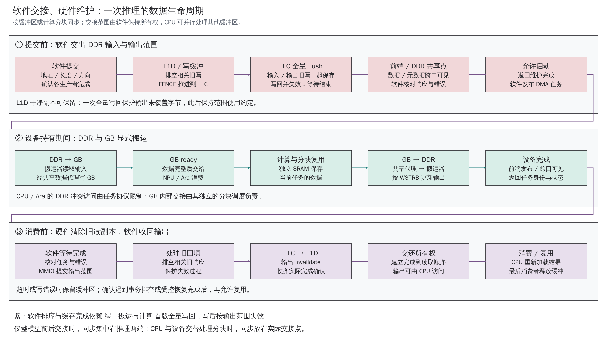
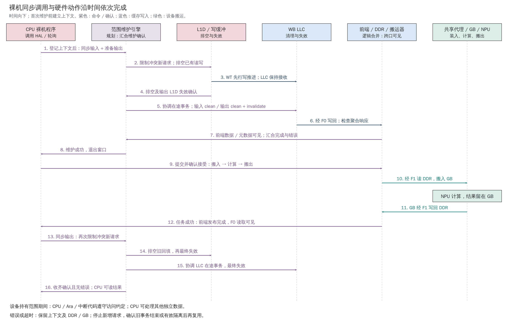
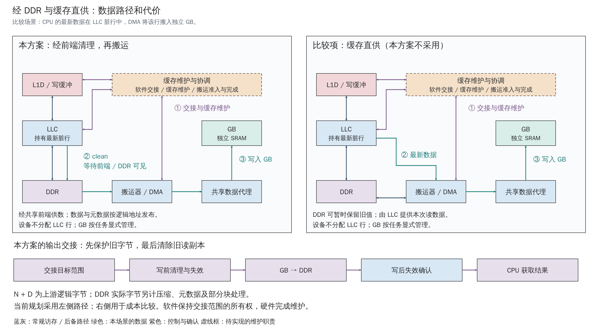

# DDR–GB 缓存一致性：软硬件协同维护方案

主要讲解入口为[《DDR–GB 数据同步设计：从裸机推理到缓存维护》](DDR_GB_Coherence_Design.md)。本页提供实现规划与源码依据；2026-10-20 最新决定为软件触发维护，首版复用全量写回，新增输出范围失效，后续优化范围 clean。F1 监听退出本方案，旧职责时序保留为历史。

返回[工程参考](README.md) · [工业与学术综述](CPU_NPU_Cache_Coherence_Survey.md) · [IP／DDR／GB 契约](IP_DDR_Interface_Contract.md)

2026-10-20 按 SoC v1 修订；2026-10-16 原 L01 规划说明，供 M01/I01/S01/V01 评审。源码输入：`mp/ara-pulp-v2` / `322bd6ce9`。本版落实用户选择的方向：软件显式交接，硬件维护 L1D／LLC，缓存与 GB 的数据统一经 DDR 交换。范围接口、指令形式及实现参数继续细化；当前输入 `c9abbb48`，本次为文档与图稿修订；拓扑以[SoC v1 总纲](SoC_Architecture_v1_Master_Plan.md)为准，原源码记录保留原版本。

**软件告诉硬件“哪块数据、交给谁、何时交接”；硬件完成该范围的排空、清理、失效与完成确认。** CPU 日常保持缓存，设备通过独立 DDR 端口搬运，GB 继续作为 NPU／Ara 共享的独立 SRAM。维护按缓冲区或计算分块批量执行，成本集中在实际交接点。

## 1. 方案定位与数据连接

本方案结合了此前对比中的两个维度：沿用 **E 所示的设备旁路拓扑**，维护方式采用 **B 类软件触发的硬件范围维护**。硬件在交接点查询和维护 CPU 缓存；软件在设备持有期间保持缓冲区所有权。逐笔访存都由硬件透明协调的 I/O 一致性，继续作为能力和成本参照。

| 设计维度 | 本方案采用的方向 | 原因 |
|---|---|---|
| 维护时机 | 软件在推理或分块交接处显式同步 | 软件掌握张量生命周期，可合并维护范围和调用次数 |
| 硬件覆盖 | CVA6 L1D、写缓冲、LLC 及相关在途事务 | 目标地址的最新值和旧副本可能分布在不同层次 |
| 设备数据路径 | 绕过 LLC，连接 DDR 控制器设备端口 | 保留流式带宽路径，避免设备访问分配 LLC 行 |
| 缓存与 GB 交换 | 缓存先清理到 DDR，再由搬运器传输 | 复用现有数据接口；缓存直供仅作成本比较 |
| 设备存储 | 独立 GB，经共享数据代理访问 | 由分块调度决定装入、消费和复用，不引入设备私有一致性缓存 |

图 1：与主说明共用的系统图。CPU/Ara 共享 M5，DDR 数据经 F0–F3 和 DDR.S0–S3；软件通过既有 MMIO 路径触发缓存维护，专用维护控制只连接两级缓存。DMA 的启动和等待由软件负责。[SVG](../diagrams/2026-10-20_ddr_gb_software_maintenance/figures/system.svg) · [六页可编辑 PPTX](../diagrams/2026-10-20_ddr_gb_software_maintenance/export/planning/diagrams.pptx)

CPU/Ara 普通 DDR 访存经主 Xbar M2→原子适配→LLC→F0→共享前端→DDR.S0；GB 搬运使用 F1／DDR.S1；帧写入 DMA 使用 F2／DDR.S2；ROI 二维读 DMA 使用 F3／DDR.S3，再经 FIFO、LVDS TX 输出。CPU 和 Ara2 保留独立 Xbar 输入，经 M5、GB 访问适配与共享数据代理访问独立 SRAM；NPU、ISP 和搬运器也在 GB 侧仲裁。

这些连接是已确认的 v1 目标；GB 目标、共享前端和范围维护仍待实现。此前 Ara 宽侧分流与三口系统图已被替代，原图保留为历史。主 Xbar 保持 64-bit 的既有要求，DDR IP 的实际端口能力、容量和时钟按原契约评审。

F 类“完整缓存代理一致性”的判断依据是设备存在参与探测的同地址私有缓存，而非接口是否连接 L2。综述所核 Gemmini 配置通过 DMA 显式管理 Scratchpad，不能仅凭 L2 接入位置归为 F。本项目采用独立 GB，F 留作文献背景。[Gemmini 固定版本说明](https://github.com/ucb-bar/gemmini/blob/2c98ce3ec634b1d0995080d040aaa32980c0cc12/README.md#architecture)

## 2. 一次推理如何交接输入与输出

维护对象是搬运描述符中的 **DDR 侧物理范围**，即共享前端上游的软件可见逻辑地址；压缩数据与元数据的物理布局由前端管理。需要分别考虑地址是否可缓存、当前是否驻留、是否有脏数据，以及写缓冲／回填／替换是否在途。软件在查询前交出范围并保持所有权约束；硬件在维护期间协调冲突事务，返回实际完成确认。

图 2：首版提交前全量写回，设备完成后按输出范围失效。箭头表示阶段依赖；DMA 和计算可在不同分块间流水重叠。[SVG](../diagrams/2026-10-20_ddr_gb_software_maintenance/figures/ownership.svg)

| 阶段 | L1D／写缓冲 | LLC／DDR | 软件、搬运器与 GB |
|---|---|---|---|
| 输入交给设备前 | 等待 CPU／Ara 生产者完成，执行 FENCE 排空写缓冲；干净副本可保留 | 首版全量 flush，等待 F1／F3 后续读可见（含前端） | 软件交出范围，维护成功后发布描述符和启动 |
| 输出交给设备前 | 同一次 FENCE 排空旧写，L1D 干净副本留待写后失效 | 同一次全量 flush 保存输出旧写并失效 LLC 副本 | 保护部分行未覆盖字节，此后持续禁止冲突访问，无需重复 clean |
| 设备持有期间 | 软件避免 CPU／Ara 通过 DDR 路径访问交接范围 | 输入从 DDR 读取；结果经设备端口写回 DDR | 数据经共享代理进入 GB；CPU 可处理其他缓冲区 |
| 输出交还 CPU 前 | 先排空相关旧回填，再最终 invalidate 输出 | 确认设备写跨口可见，再清除 LLC 旧读副本 | 核对任务身份和错误，完成同步后交还所有权 |

**输入 clean 与输出 invalidate 解决不同问题。** 输入要让设备取得 CPU 产生的新值；输出要让 CPU 放弃设备写入前的旧值。WT L1D 的先行写还可能在缓冲中，必须先推进到下层，随后 LLC clean 才能覆盖这些更新。维护引擎应先让依赖 LLC 接收的上游写入排空，再隔离并维护 LLC，避免循环等待。

输出采用“写前排空并保存旧写，写后失效”的基线。首版复用的 LLC flush 自带失效，L1D 写前不必另做全缓存 flush。写前保存旧写防止迟到覆盖，也保护部分行；写后失效清除旧读副本。完整写前排空可以排除对应的交接前请求，其余允许发生的回填须在最终失效前处理。写后发现冲突脏数据时进入错误处理，不能 clean 旧值覆盖结果。命令被接受也不等于缓存已完成维护。

部分行示例：DDR 的最新逻辑行是 `[A,B,C,D]`，设备只更新第二段为 `X`。先把缓存中的 A/C/D 最新值清理到 DDR，再按 WSTRB 写 X，结果为 `[A,X,C,D]`。基线对完整行也执行相同准备流程；省略完整覆盖行的旧数据回写可作为后续优化，须核对覆盖范围、有效字节、失败语义和所有旧写。

维护和分配边界要覆盖实际缓存粒度。当前 L1D 行为 32 B，默认 LLC 行为 64 B，因此一个 LLC 行涉及两个 L1D 行；共享缓冲区应按所涉及层次的公共对齐粒度隔离，避免与锁、栈或其他对象共用可维护行。后续参数变化时由平台统一更新粒度。

如果整次推理期间只有设备访问该组缓冲区，同步集中在推理两端；CPU／Ara／NPU 交替处理时，按实际分块交接。只读权重在内容和生命周期保持稳定时，可复用已经完成的交接。GB 保存本次搬运的数据，后续需要新的 DDR 版本时重新装入；GB 内部的 Ara／NPU 中间结果交接由本地调度负责。

## 3. 软件接口与硬件完成协议

软件接口建议表达 `sync_for_device(range, direction)` 与 `sync_for_cpu(range, direction)` 这样的语义。它们是拟定的 HAL 职责名称；实现可先通过 MMIO 向范围维护引擎提交命令。Linux 按需要显式同步的 DMA 设备接入，平台维护后端负责调用该引擎；裸机和 RTOS 可直接封装同一底层服务。[Linux 6.5 DMA API](https://docs.kernel.org/6.5/core-api/dma-api-howto.html)

| 接口职责 | 建议携带或返回的信息 | 完成要求 |
|---|---|---|
| 范围命令 | 设备可达的物理范围、方向、操作、任务身份 | 校验权限、边界、对齐和溢出；虚拟地址／DMA 地址转换由平台处理 |
| L1D 维护 | 目标地址／范围、排空与失效请求 | 覆盖写缓冲及冲突回填；完成后旧响应不能重新建立过期副本 |
| LLC 维护 | 范围、clean／invalidate 操作 | 处理命中脏行与在途替换；仅操作 cache way，保留 SPM 内容 |
| 软件搬运排序 | 维护任务与搬运任务的依赖 | HAL 等维护与可见性条件满足后，调用已有设备控制入口启动任务 |
| 缓存结果状态 | 完成、错误、维护范围及请求身份 | 只报告缓存侧实际结果；HAL 再结合搬运与可见性状态判断是否可消费 |

这里需要的是可确认的范围维护服务。L1D 必须参与硬件探测，但探测可集中在软件交接点，而不必对每个 DMA beat 重复执行。范围内部按行处理；小范围可逐地址查询，大范围可评估扫描驻留 tag 并筛选范围内条目。

**软件所有权与硬件维护各有边界。** 软件保证设备持有期间的访问纪律，并在维护成功后启动搬运；硬件负责维护窗口和缓存侧完成。首版采用单任务串行命令。若另加自动拦截 CPU 违规访问的能力，范围检查还需覆盖 L1D 命中路径，作为独立需求评审。

`fence` 用于建立访存与命令发布的顺序；`clean` 推进修改后的数据，`invalidate` 清除副本，`flush` 通常组合 clean 与 invalidate。RISC-V Zicbom 提供标准 CBO 语义，可作为后续指令实现依据。[CMO v1.0，20240411 规范](https://docs.riscv.org/reference/isa/v20240411/unpriv/cmo.html)

当前向量 profile 的 `DcacheFlushOnFence=0`，FENCE 提交包含 WT 写缓冲为空的条件，但没有替代 LLC clean 的系统路径。若采用 CBO 指令，需要补齐译码、权限、统一的软件可见维护粒度、下层传播和完成语义。先以 HAL 封装范围命令，可以将这些实现选择留在平台层。

DDR 的完成点定义为：**其他相关 AXI 端口随后读取该地址，能取得按约定顺序写入的新值。** 供应商需说明成功写响应后的跨口保证，例如 S0 写→S1 读、S1 写→S0／S3 读。项目另负责前端数据／元数据发布、CDC 和错误聚合。若既有响应及契约足够，直接使用；HAL 汇合这些结果与缓存完成，维护控制不另接 DDR、前端或各 DMA 的专用确认线。

共享控制结构建议采用经验证的非缓存映射或 MMIO，启动时初始化维护服务后再允许设备任务；描述符若使用缓存，同样纳入发布同步。LR/SC、AMO 数据与搬运缓冲区优先隔离；确需共享原子数据时，单独定义旁路写的 reservation／原子观察范围。新接口会影响 HAL、驱动、IRQ/轮询和构建清单，具体 CSR 地址、编码、IRQ 编号与初始化次序由实现评审确定。

### 3.1. 首版硬件实现规划

**已有机制承担全量写回，新增逻辑承担软件触发的范围失效。** 输入同步先使用 `fence()` 与 `axi_llc_reg32_flush_all()`；后者在现行 `sw/sw.mk` 中已纳入构建。函数返回只说明提交，HAL 应轮询 `CfgFlush` 归零；RTL 在维护结束时清除此字段，`CommitCfg` 在接受配置时就会清零。`Flushed` 还包含 SPM 配置状态，不能把“所有位为 1”当作本次完成条件。写回成功另受第 5 章所述错误处理缺口约束。

建议沿现有寄存器总线扩展缓存维护控制，内部使用一个串行状态机和行地址计数器。软件配置 DDR 逻辑物理起始地址、字节长度及操作，启动后硬件锁存本次参数，完成前拒绝覆盖。范围要检查溢出、映射和边界，并分别覆盖 L1D／LLC 的完整行；仅维护 cache way，保留 LLC 的 SPM 配置与内容。初版定义范围失效，输入范围 clean 留作后续优化；不冻结寄存器地址或信号编码。

| 实现位置 | 复用部分 | 需要扩展的动作与完成条件 |
|---|---|---|
| 缓存维护控制 | 现有 MMIO 总线、LLC 配置／维护控制 | 保存范围、生成行地址，汇合缓存忙／完成／错误；单任务一次只接受一条命令，空范围直接完成 |
| CVA6 WT 缓存子系统 | `wt_dcache_missunit` 的 DRAIN、失效写端口 | 与 Ara 失效、普通读返回和回填仲裁；先处理已接受事务，再执行失效；反馈有效位实际更新完成 |
| LLC 命中判断／tag 存储 | index／tag 比较、有效位、way 信息和已有隔离机制 | 增加按地址失效模式；未命中直接完成，干净命中清有效位，写后脏命中报错并保留状态，不能走普通替换写回／回填路径 |
| HAL／搬运接口 | FENCE、LLC flush 函数、设备启动／状态访问路径 | 输入维护完成再搬入；结果可见后提交输出失效，成功后交还 CPU；不增加 F1 写监听 |

当前 Ara 的 L1D 入口按索引失效该组全部 way，可作为初版较粗粒度执行方式；这会额外驱逐其他地址的干净副本。精确 tag 匹配可后续优化。其 `inval_ready` 仅是接受握手，接收路径还依赖协处理器的并发约束；新增 MMIO 维护必须处理与普通返回的仲裁，并反馈真正执行完成，不能直接把该握手接成软件 done。

输出维护建议按以下状态推进：

1. **接受范围。** HAL 已确认设备搬出成功且 F0 可见，继续保持输出范围的使用约定。
2. **排空旧事务。** 初版采用短暂全局维护窗口，限制新增缓存请求，让已接受的写入、读响应及回填完成；此时 LLC 保持接收上游排空写入。状态机自主推进，避免依赖被阻塞的 CPU。
3. **失效 LLC。** 在缓存事务稳定后逐行查询目标地址，只清除匹配的干净副本；遇冲突脏行进入错误状态。
4. **失效 L1D。** 清除输出范围涉及的 L1D 副本，等待失效写入实际结束；防止旧响应在完成之后重新建立副本。
5. **返回结果。** 解除维护窗口，报告完成或错误；软件只在成功时恢复输出访问。

这是一项实现建议，不表示上述状态机已存在。实际控制入口及信号复用位置由 RTL 设计确定；错误或超时仍保留任务上下文和资源。关键定向验证包括：WT 写缓冲非空时调用全量 flush、维护期间旧回填返回、L1D 普通响应与失效竞争、LLC 脏命中拒绝成功、部分行邻接字节保留、F1 无监听时仍能完成软件交接。本轮不执行这些硬件测试。

### 3.2. 历史的 16 箭头职责展开

下图及对应表保留 2026-10-20 较早的职责划分：当时用统一服务表示缓存、前端及搬运确认，并单列输入与输出准备。最新首版改用第 3.1 节的软件排序与缓存侧控制；图中跨模块服务连线及写前 L1D 失效，不作为新增接口或必需操作。当前应用主线见[五阶段图](DDR_GB_Coherence_Design.md#1-cpu-与设备通过-ddr-交接数据)。

历史展开图：16 个职责箭头及当时的完成条件；NPU 计算位于 10、11 之间。保留原图和原表供追溯，现行伪代码已合并全量写回。[SVG](../diagrams/2026-10-20_ddr_gb_coherence_v1/figures/timeline.svg)

| 应用阶段 | 箭头编号 | 硬件动作与完成条件 |
|---|---|---|
| 交出输入、准备输出 | 1 | CPU→维护服务：登记范围、操作和请求身份，确认命令接受 |
| 交出输入、准备输出 | 2 | 服务→L1D：限制冲突新请求，排空已接受的相关读写 |
| 交出输入、准备输出 | 3 | 写缓冲→LLC：推进先行写，LLC 保持接收直到上游排空 |
| 交出输入、准备输出 | 4 | L1D→服务：确认相关事务排空、输出 L1D 失效完成；输入干净副本可留 |
| 交出输入、准备输出 | 5 | 服务→LLC：协调在途事务，对输入 clean，对输出 clean＋invalidate |
| 交出输入、准备输出 | 6 | LLC→前端／DDR：经 F0 写回脏数据，检查聚合响应及错误 |
| 交出输入、准备输出 | 7 | 前端／DDR→服务：确认目标端口可见，压缩区包含数据／元数据；汇合缓存完成与错误 |
| 等待准备成功 | 8 | 服务→CPU：返回成功、退出维护窗口，软件继续保持范围使用约定 |
| 提交推理 | 9 | CPU→任务控制：提交搬入、计算、搬出任务，确认接受及身份 |
| 装入并计算 | 10 | 搬运器经 F1 读 DDR→GB：装入成功后启动 NPU，计算结果留在 GB |
| 搬出结果 | 11 | GB→搬运器经 F1 写 DDR：传送结果，等待写入及前端发布完成 |
| 等待结果可见 | 12 | 任务控制→CPU：确认任务成功、结果对 F0 可见；CPU 随后申请输出同步 |
| 交回输出 | 13 | CPU→服务：提交输出范围，再次限制冲突新请求 |
| 交回输出 | 14 | 服务→L1D：处理相关旧响应／回填，再最终失效输出副本 |
| 交回输出 | 15 | 服务→LLC：协调相关在途事务，再最终失效；冲突脏数据进入错误处理 |
| 读取并后处理 | 16 | 服务→CPU：收齐确认且无错误，允许读取输出；实际读取发生在图后 |

历史箭头包含命令、确认和数据传输，并非独立 HAL 调用。“前端／DDR／搬运器”泳道合并了跨模块动作；其可见性要求继续适用，当前由 HAL 按实际接口汇合。

## 4. 维护开销与数据路径取舍

当前向量 L1D 为 **8 KiB、4 路、32 B 行，共 256 条缓存行**。WT 减少了 L1D 脏行供数职责，但查询 tag、更新有效位、排空写缓冲仍会占用资源。当前行写／失效与读授权共享资源；已有 Ara 外部失效按索引清除该组全部 way，扩展时应评估 tag 匹配后的定向失效，以减少无关行被驱逐。

| 开销 | 影响 | 优化方向 |
|---|---|---|
| tag 查询与有效位更新 | 争用 L1D／LLC 访问端口 | 批量命令、合理仲裁与限速，比较逐地址查询和驻留 tag 扫描 |
| 排空与冲突回填处理 | 增加交接延迟 | 在生产者完成后维护，合并相关范围和确认 |
| 失效后重填 | CPU 再次访问时产生 miss | 输入保留干净副本，输出仅维护交接范围 |
| LLC 脏写回 | 消耗 DDR 带宽，推迟设备读取 | 提前准备下一块，双缓冲重叠，稳定权重减少重复同步 |
| 粗粒度 way 维护 | 无关 CPU 请求可能停顿 | 从现有入口隔离改进为范围维护和可证明的局部仲裁 |

1 MiB 范围包含 32768 个 32 B 块，而当前 L1D 只有 256 个驻留位置。扫描驻留 tag 可能减少大范围的检查量；实际周期还取决于 way 并行度、端口竞争和在途事务。LLC 当前按 way 维护并隔离入口，直接频繁调用这一机制可能成为主要停顿来源。上述为结构分析，面积、频率和性能比例需要综合与负载测量。

图 3：以 LLC 持有最新脏行的设备读为例。左侧为本方案，右侧仅比较新增数据通路的潜在收益与成本；两侧均需可靠的交接协议。[SVG](../diagrams/2026-10-20_ddr_gb_coherence_v1/figures/data-paths.svg)

| 维度 | 统一经 DDR：本方案 | 缓存直接供数：比较项 |
|---|---|---|
| 数据接口 | 复用 LLC→F0→共享前端、F1 设备搬运路径 | 增加缓存到搬运器的数据响应、仲裁和背压 |
| 脏行输入 | clean 后从 DDR 读取 | 可直接取得最新缓存数据 |
| 更适合的流量 | 大块流式数据、GB 内高复用、接口复杂度受限 | CPU 刚产生的小块缓存驻留数据、频繁低延迟交接 |
| 主要成本 | DDR 往返和多端口竞争 | 缓存端口竞争、事务匹配与更复杂的验证 |

按完整缓存行计，64 B 脏输入在前端上游逻辑接口需要一次 64 B 写回和一次 64 B 读取；缓存直供能省去当次往返，但脏行以后仍可能写回。对于输入范围 N、交接时需写回的数据量 D，本方案前端上游逻辑数据量约为 `D + N`。首版全量 flush 的 D 还包括范围外被一并写回的脏数据；范围 clean 优化后才收窄到目标范围。压缩区实际 DDR 流量另计压缩数据、元数据、部分块读改写和额外读取；普通旁路区按原样传输统计。若数据已在 DDR 且缓存干净，D 为零；不能把所有模型输入都按双倍流量估算。

当前优先优化范围、调用频率和分块流水。只有实测表明 DDR 往返成为主要瓶颈时，才值得重新比较直供收益与新增端口成本；本版数据连接保持统一经 DDR。

## 5. 源码依据、验收与待定接口

| 当前事实 | 源码入口 |
|---|---|
| WT、L1D 容量／行大小、FENCE 配置 | [向量 profile](../../.bender/git/checkouts/cva6-20c9d7cbe0dd6995/core/include/cv64a6_imafdcv_sv39_config_pkg.sv)、[controller](../../.bender/git/checkouts/cva6-20c9d7cbe0dd6995/core/controller.sv) |
| 写缓冲、全 way 索引失效、行写与读端口竞争 | [wbuffer](../../.bender/git/checkouts/cva6-20c9d7cbe0dd6995/core/cache_subsystem/wt_dcache_wbuffer.sv)、[missunit](../../.bender/git/checkouts/cva6-20c9d7cbe0dd6995/core/cache_subsystem/wt_dcache_missunit.sv)、[cache mem](../../.bender/git/checkouts/cva6-20c9d7cbe0dd6995/core/cache_subsystem/wt_dcache_mem.sv) |
| Ara 失效与专用并发前提 | [SoC](../../hw/cheshire_soc.sv) 的 `i_ara_axi_inval_filter`、[acc_dispatcher](../../.bender/git/checkouts/cva6-20c9d7cbe0dd6995/core/acc_dispatcher.sv)、[wt_axi_adapter](../../.bender/git/checkouts/cva6-20c9d7cbe0dd6995/core/cache_subsystem/wt_axi_adapter.sv) |
| WB LLC、way 维护、入口隔离和默认 64 B 行 | [LLC top](../../.bender/git/checkouts/axi_llc-5fb8850caad4fcfa/src/axi_llc_top.sv)、[LLC config](../../.bender/git/checkouts/axi_llc-5fb8850caad4fcfa/src/axi_llc_config.sv)、[SoC 参数](../../hw/cheshire_pkg.sv) |
| 软件维护函数及构建 | [fence 封装](../../sw/include/util.h)、[LLC flush 函数](../../.bender/git/checkouts/axi_llc-5fb8850caad4fcfa/sw/lib/axi_llc_reg32.c)、[软件构建](../../sw/sw.mk) |
| LLC 地址匹配与有效／脏位 | [tag store](../../.bender/git/checkouts/axi_llc-5fb8850caad4fcfa/src/hit_miss_detect/axi_llc_tag_store.sv)；按范围失效模式尚需实现 |
| 旁路写影响原子观察范围 | [原子适配说明](../../.bender/git/checkouts/axi_riscv_atomics-40ad8d2d0e0daa8b/README.md)、[现行契约](IP_DDR_Interface_Contract.md) |

现有机制可以复用写回路径、AXI 事务跟踪和部分维护控制；首版新增范围失效命令、仲裁及实际完成／错误状态，DMA 启动顺序由软件保持。具体划分见[第 3.1 节](#hardware-plan)。依赖版本和本地差异见[快照清单](../../.bender/SNAPSHOT.tsv)。

最小正确性验收以逐字节参考结果检查三项不变量：**设备取得交接版本；旧脏行和迟到写无法覆盖新结果；部分行未选中字节保持正确。** 用例覆盖干净／脏副本、待完成写、32/64 B 边界与跨行、失效期间回填／替换、输出写后旧副本重取、多设备范围重叠，以及原子域约束。维护完成与 DMA 准入之间应有可观测证据。新增 F2→F3、F1→F3 和 F0→F3 读帧交接，区分 DMA 读取、源帧释放与 TX 完成，具体流程见[主说明第 7 章](DDR_GB_Coherence_Design.md#7-其他数据交接复用相同原则)。CPU/Ara 经 M5 的非缓存 GB 本地交接不套用 DDR 往返，但仍需等待写入可见及使用权转移。

错误路径按部分完成处理。超时或 AXI 错误后停止该任务的新请求，保留 DDR／GB 缓冲及任务身份；确认迟到事务排空，或受控恢复使其无法再写入后，才允许复用。不得仅靠清软件完成标志重新提交相同地址。

既有 LLC 写回路径未消费 B 响应内容，flush 完成计数不能单独证明写回成功；这是新增 GB 前的静态源码发现，系统级报告、修复位置和故障影响仍待核查。维护须自主推进；LLC 入口隔离也会阻塞经此入口的 SPM 访问，CPU 无法执行时，软件轮询不能单独保证故障处理的硬时间上界。详见[主说明第 8 章](DDR_GB_Coherence_Design.md#8-可靠完成后才能消费和复用资源)。

性能测试拆分准备、维护、等待、搬运、计算和输出交接，记录 CPU 停顿、tag 占用、缓存重填、脏写回字节、DDR 流量和多设备尾延迟；比较小块频繁交接、大权重连续搬运和双缓冲并发。测试与综合完成后再给出面积或性能比例。

实施前仍需确定范围粒度与并发任务数、缓存端口仲裁、DDR 跨口可见契约、HAL／指令入口、IRQ/错误恢复及共享原子域。当前未运行上述硬件验收。文档链接、图稿检查和版本记录见[主题交接](../handoffs/L01_cache_coherence_architecture.md)与[图稿目录](../diagrams/2026-10-20_ddr_gb_software_maintenance/README.md)。
