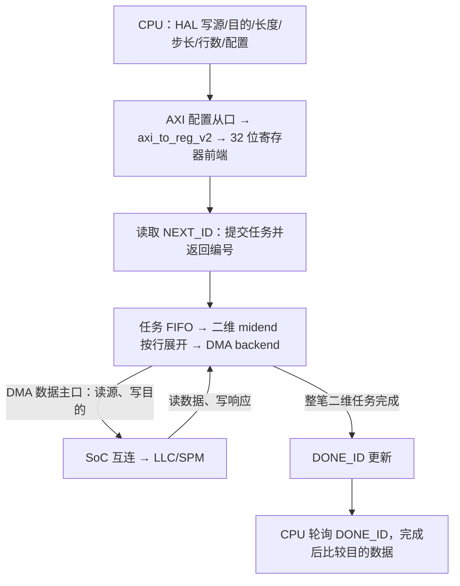

# DMA 控制通路、死锁与软件使用限制

更新：2026-10-21。对象为服务器 `~/CheshireAraPULP`；本地 FPGA 源码未应用这些补丁。本文说明原因和当前使用边界，命令、日志、哈希及完整测试表统一见[参考工程报告](../maintenance/E01/reports/reference_rebuild_check.md)。

## 1. 当前结论

**应用方向：暂停扩展 SPM 内部死锁修复，优先验证 DDR↔GB 等设备通路。** 本轮独立读写存储模型在默认/短突发、两侧不同延迟下通过；现有 SoC 开启 LLC 后的 DDR↔SPM、DDR→DDR 仍有停滞。因此必须落实既定的设备绕过 LLC 路径，不能仅把 SPM 改成 cache。GB/eMMC 与实际 DDR 前端尚未接入，本轮不能替代集成验收。具体范围和结果见[应用测试](../maintenance/E01/reports/reference_rebuild_check.md#dma-cross-memory-20261021)。

**上述 DMA 结论不能推广成“所有设备经过 LLC 都会死锁”。** Serial Link RX 的写数据来自外部，不依赖本地 LLC 先返回源读数据；接收经现有 LLC 写 DDR 的 64 KiB、CPU 并发下 192 KiB、非对齐且间断发送的 8193 B 三项均通过。第二项接收期间发生了 LLC 替换写回。测试每次仅一个 RX 写突发在途，未覆盖多突发反压压力或正常 L1D 缓存交接，详见[测试范围](../maintenance/E01/reports/reference_rebuild_check.md#slink-rx-llc-ddr-20261021)。

| 问题 | 当前状态 |
| --- | --- |
| iDMA AW 许可与反压控制 | **已回移 #80＋#204 并定向验证**；不代表通用无死锁，见第 7 节 |
| CPU 访问 DMA 寄存器：编号读错、64 位字段丢高半部 | **已修复**：官方转换器补丁＋HAL 访问宽度修正，原失败用例通过 |
| 默认模式下长搬运“读挡写” | #80/#204 后复查仍失败，读挡写循环未消除 |
| AW 解耦后的失败布局 | #80/#204 后复查仍有写挡读、行锁等待；具体组合见报告第 9 节 |
| CVA6 未使用字节含 X 导致读断言误报 | **另一位 Agent 已修复并测试，本轮已核对**；见第 6 节 |

此前修复范围：**只回移 iDMA #80 和直接相关的 #204 修复；LLC、硬件参数及其他依赖不改。正常方案仍须一次提交完整二维任务，CPU 不逐块介入。** 第 5 节改为分析现有硬件自动短突发及容量条件；CPU 逐块等待仅保留为诊断方案。当前尚无已验证的通用软件限制；stub 测试继续勿用。 **最新复查明确：三变量全为 32 B 倍数仍有反例；24 B、123 B 行长又各有通过组合，不能用统一倍数划定合法域。** AW=1 的全 64 B 对照通过，但没有通用保证。具体起点、行长、步长和行数见[14 组前后对照](../maintenance/E01/reports/reference_rebuild_check.md#dma-llc-recheck-after-pr80-204)。

## 2. 一笔 DMA 的控制、数据与完成通路



- 配置访问和数据搬运是两条接口。CPU 负责设置，DMA 自己发起内存读写。
- DMA 基址 `0x01000000`。**读取 NEXT_ID 有提交副作用**，不能为了打印而额外读取。当前第一笔编号为 2、初始完成编号为 1。
- wrapper 的 `issue_id = req_valid & req_ready` 表示入队；`retire_id = rsp_valid & rsp_ready` 表示整笔任务退休，不是每行单独退休。
- 此前 SPM 测试使用非缓存别名：`0x140…` 在 LLC 内对应 `0x100…`。CPU 初始化和校验也走该别名；源、目的不重叠。不能把这些结果当作 DDR 或缓存一致性验收。

固定输入及主要代码：

| 工程 | 固定提交 | 阅读位置 |
| --- | --- | --- |
| Cheshire | `e040b7bbc7851a37faff3c4657ff8d656cc6e20a` | `sw/tests/dma_2d.spm.c`、`sw/include/dif/dma.h`、`hw/cheshire_idma_wrap.sv` |
| iDMA | `c12caf59bb482fe44b27361f6924ad346b2d22fe` | `idma_reg64_2d_top`、`idma_transfer_id_gen`、`idma_legalizer_rw_axi`、`idma_axi_write` |
| LLC | `559bcbd09a5a884dbe31e2d72fd95d024e357f39` | `axi_llc_top`、`axi_llc_burst_cutter`、`axi_llc_read_unit`、`axi_llc_write_unit` |
| CVA6 | `99eac9a649001bdf5b8f9da52e0ca73d5c48db1c` | `load_unit`、`wt_cache_subsystem`、`wt_dcache_ctrl` |

硬件配置保持 `cv64a6_imafdcv_sv39`、Ara 真实 decoder／2 lanes／VLEN=2048、SelectedCfg=3、UseDramSys=0；DMA 当前只有一个有效寄存器通道和一个 stream。SelectedCfg 不能单独证明 CPU profile。Ara 固定为 `2895ba907e9eb14b3464609dc791a969d159a7c3`，register_interface 为 `ae616e5a1ec2b41e72d200e5ab09c65e94aebd3d`。

## 3. 已修复的控制寄存器错误

CPU 和 AXI 是 64 位，不代表每个设备寄存器也是 64 位。当前 iDMA 寄存器前端实际为 **32 位**。

| 寄存器 | 基址偏移 | 正确访问 |
| --- | --- | --- |
| CONF、STATUS_0 | `0x00`、`0x04` | 单个 32 位 |
| NEXT_ID_0、DONE_ID_0 | `0x44`、`0x84` | 单个 32 位；后续地址是其他通道，不能当高半部 |
| DST、SRC、LENGTH | `0xd0/d4`、`0xd8/dc`、`0xe0/e4` | 每对组成一个 64 位字段 |
| DST_STRIDE、SRC_STRIDE、REPS | `0xe8/ec`、`0xf0/f4`、`0xf8/fc` | 每对组成一个 64 位字段 |

**错误一：编号放错半部。** 读取 `+0x44` 时 CPU 按地址选高 32 位，旧转换器却把编号放在低 32 位：

```text
AXI RDATA                 高 32 位       低 32 位
正确返回编号 2           00000002       00000000
原版实际返回             00000000       00000002
CPU 读取 +0x44           ↑ 因此误读为 0
```

**错误二：64 位字段没有拆写。** 写 SRC=`11223344_55667788` 时，原实现只把低半部写到 `+0xd8`，没有再写 `+0xdc`。正确行为是两次 32 位写。该图样只用于寄存器读回，未作为真实 DMA 地址。

**原短测试为何能过：** 地址和长度都在低 32 位范围内，数据确实搬完；但软件把错误读出的 `NEXT_ID=0` 与 `DONE_ID=0` 比较，无法验证等待是否正确。原源码每行 15 B、4 行，目的行有重叠，累计请求 60 B，最后检查 36 B 数据及 2 B 保护字符；不能把“38 B 比较通过”说成完整控制路径通过。

服务器现有修复：

- **RTL：** 只回移 [PR #203](https://github.com/pulp-platform/cheshire/pull/203) 的 [`bca9aadb`](https://github.com/pulp-platform/cheshire/commit/bca9aadb7588de7046460daf91b39fe863a7a9d1) 转换器改动，采用已有 `axi_to_reg_v2`，`RegDataWidth=32`、`CutMemReqs=1`；加上 [`ef11799d`](https://github.com/pulp-platform/cheshire/commit/ef11799d00d9c7b19d042864529d03cbe41fac5b) 的空 `reg_id_o` 连接。前者作者 Alessandro Ottaviano（共同贡献 Thomas Benz、Paul Scheffler），后者 Philippe Sauter；保留版权。不移植 PR 中独立的 1D 修复或升级依赖。
- **HAL：** CONF、STATUS、NEXT_ID、DONE_ID 指针改为 `volatile uint32_t *`；成对字段保留 64 位访问。高层编号返回类型不变。这是项目单独的软件改进。当前 v2 内部仍可能读取同一 64 位窗口的两个寄存器；32 位 CPU 访问不代表内部只有一次寄存器读，多通道扩展须重新检查副作用。

先只修 RTL、复用原 ELF，再修 HAL 重编：编号、完整 64 位读回、上下半部访问及单次提交检查均通过。详见[控制接口修复结果](../maintenance/E01/reports/reference_rebuild_check.md#dma-fix-20261020)。

<a id="dma-llc-deadlock"></a>

## 4. 此前两类死锁：等待方向不同

本节及第 5 节基于 #80/#204 回移前源码和测试，保留历史原因；回移后 AW=0 的依据已由首 R 改为对应首 W 可用，旧公式不能直接充当新版保证。随后已用同一批原 ELF 复查选定组合，7 通过、7 停滞，判定与回移前一致，见[报告第 9 节](../maintenance/E01/reports/reference_rebuild_check.md#dma-llc-recheck-after-pr80-204)。

LLC 把 AXI 请求按 64 B 边界切成内部描述符，读写共同经过 `i_rw_arb_tree → spill → hit/miss`。堵住的请求不能被后方所需请求越过。有限缓冲下的反压本身正常，**循环等待导致任务永久不完成才是问题**。

| 项目 | 默认模式：读挡写 | AW 解耦后的反例：写挡读 |
| --- | --- | --- |
| DMA 配置 | AW=0、RW=0 | AW=1、RW=0 |
| DMA 状态 | 缓冲满，RREADY=0 | 数据不足，WVALID=0；RREADY=1 |
| LLC 状态 | 读返回 FIFO 满，前面的读停住 | 当前写等数据，读单元空闲 |
| 循环 | 读不完成 → 后面的写进不来 → DMA 数据排不出 → 不再接收读返回 | 当前写等源读 → 源读被后续写挡住 → 后续写等当前写 |

<a id="dma-aw-implementation"></a>

**默认模式的已测绕过：** 按次设置 `DECOUPLE_AW=1`，使写地址不用等读首拍；原 32×256 B、连续三笔搬运通过。服务器已回移 Paul Scheffler 的 [PR #189 / `4c2390f2`](https://github.com/pulp-platform/cheshire/commit/4c2390f25f250c9ea75d314dd107da11a52aa8fa) 配置接口：二维调用传 `DMA_CONF_DECOUPLE_AW`，CONF=`0x401`。没有全局打开解耦；原短测试仍传 NONE。该官方接口不是官方宣称的死锁修复。

<a id="dma-write-wait-confirmed"></a>

**新死锁的具体反例：** 源 `0x14008043`、目的 `0x14010045`，每行 123 B、源/目的步长 139/149 B，14/16 行失败，13 行通过。第 14 行目的 `0x140107d6` 到当前 iDMA 的 2 KiB 分段边界还有 42 B，因此分为 **42＋81 B**。第二段首个写拍 `0x14010800..07` 需要源 `0x1400877c..83`，前后各 4 B 属于不同的 LLC 读块。

实测所需字节掩码 `ff`、已有 `0f`，DMA 必须等后 4 B；LLC 后续写 `0x10010840` 又先于所需读 `0x10008780` 进入，形成循环。只把源起点改成 `…8040`，所需读先进入，搬运通过。因此“非对齐／不同步长”不是充分触发条件。准确时序及单变量对照见[原反例与原因对照](../maintenance/E01/reports/reference_rebuild_check.md#dma-cause-confirmation)。

这是当前 DMA–LLC/SPM 组合的前进性缺陷，不能只归咎于 DMA 的某行代码，也不能仅凭死锁判定违反某条 AXI 规则。原 RTL 同样复现默认死锁，控制寄存器修复不是它的起因。

汇报图描绘**原默认模式**：[SVG](../diagrams/2026-10-20_dma_llc_deadlock/dma_llc_deadlock.svg) · [可编辑 PPTX](../diagrams/2026-10-20_dma_llc_deadlock/export/diagrams.pptx) · [图稿说明](../diagrams/2026-10-20_dma_llc_deadlock/README.md)。新死锁以本节及报告解释，不混称同一等待方向。

<a id="dma-software-alignment"></a>

## 5. 源码推导：参数关系与可保证的执行条件

**2026-10-21 结论：单纯对齐仍不足以给原批量接口建立通用保证；已有寄存器可以让 DMA 自行缩短突发，保留一次提交整笔任务。** 进一步得到“在途读数量×每笔最大拍数不超过返回容量”的条件性证明。当前硬件尚不满足下面的保守容量条件；参数候选未修改、未仿真，不是已发布的软件使用规则。

<a id="dma-source-formulas"></a>

### 5.1 参数如何变成请求

记源/目的起点为 `S0/D0`，步长为 `Ss/Sd`，每行长度为 `L`，行数为 `N`。以下假定地址运算不回绕，长度/步长/行数在当前前端有效位宽内，缓冲区有效且源目的不重叠。

```text
第 i 行：Si = S0 + i×Ss，Di = D0 + i×Sd，0 <= i < N
当前 64 bit、默认不缩短 burst：P = min(256×8,4096) = 2048 B
RW=0、该行已处理 x 字节时：
    b = min(L-x, P-(Si+x)%P, P-(Di+x)%P)
读 AXADDR = 8×floor((Si+x)/8)，读 AX beats = ceil(((Si+x)%8+b)/8)
写 AXADDR、beats 同理；AXLEN = beats-1，AXSIZE = 3
生成本段后，下一段 x ← x+b
```

LLC 再按 **64 B 边界**切分每个 AX burst。每个写描述符的有效目的区间 `[u,v)`，需要的源数据精确为 `[Si+u-Di, Si+v-Di)`；与该区间相交的源读描述符，就是它的数据依赖。行界或 iDMA 段界两边即使落在同一个物理块，也仍是不同请求，不能在推导中合并。

由此能证明：`S0%64=D0%64` 且 `Ss%64=Sd%64` 时，各行源/目的切分位置对应；全 64 B 对齐且 `L%64=0` 时，每个目的块对应一个完整源块。**这些是分块关系，不是请求顺序。** midend 在后端接受一行请求后即可推进下一行，不等待该行搬运完成。

| RTL 条件 | 实际保证 | 没有保证 |
| --- | --- | --- |
| `RW=0` | 每段成对生成相同有效字节数的读写请求 | 两侧同时到达或完成 |
| `AW=0` | 对应读 burst 的**首拍 R 握手**后才放行 AW | 等到 RLAST／整段数据齐全 |
| `AW=1` | 旁路上述首 R 门槛 | 读先于写、每个 64 B 块读写交替 |
| LLC round-robin＋共享 spill/hit-miss | 在可接受请求时仲裁；阻塞时保持已选请求 | 自动绕过阻塞的写，优先放行其所需读 |

所以不能从“对应块数相等”跳到“所需源读一定先执行”；也不能仅凭全 64 B 测试通过，将其升级为软件安全契约。

### 5.2 死锁的公式条件

设 `a` 是进入 LLC 后、已去掉非缓存别名的 SPM 地址，`B=0x10000000`。当前 8 ways、每 way 16 KiB：

```text
index(a) = (a>>6) & 255
way(a)   = floor((a-B)/16384)          // 有效范围 0..7
K(a)     = (index(a)<<8) | (1<<way(a)) // way 是 one-hot
H(K)     = 三个固定 hash 所选桶的集合
A_t      = 已加锁、尚未在 Bloom 中减计数的锁键多重集
C_t(j)   = Σ(K∈A_t) 1[j∈H(K)]
locked_t(K) = (任一桶满/溢出) 或 (H(K) 内每个桶的 C_t 都 > 0)
```

单个写锁 `Kw` 误挡不同源读 `Kr` 的精确条件是 `H(Kr) ⊆ H(Kw)`；多个在途锁则用它们的桶集合并集，不能只逐对比较。**锁键取地址的 index/way，对齐低 6 位本身不能消除这种冲突。** 但冲突也不等于必然死锁，还必须结合数据依赖和先后顺序：

| 循环 | 必须同时出现的阻塞关系 |
| --- | --- |
| 读挡写 | 读返回与 DMA 缓冲无法继续排空；排空需要写；该写又被堵住的读流水挡住 |
| 后续写挡读 | 当前写缺少尚未执行的源读；后续写占住共享前端等待当前写完成；所需读排在后面 |
| 行锁挡读 | 尚未执行的源读被当前写锁（含 Bloom 误判）挡住；该写又必须取得这份源数据才能完成解锁 |

第三类已有实例：`src/dst=0x14008068/0x14010068, L=Ss=Sd=120, N=32`。第 32 行所需源读键 `3c04` 的桶为 `{0,4}`，当前目的写键 `3c10` 的桶为 `{0,4,17}`，包含关系成立，形成循环。16 行对照未到该处；全 64 B 对照虽经过该处却未形成持续等待。**没有采集成功对照的逐拍全部顺序，不能擅自补写“某个请求必然先到”的解释。** 具体采样及全部参数保留在[联合测试报告](../maintenance/E01/reports/reference_rebuild_check.md#dma-joint-alignment-check-20261020)。

<a id="dma-bulk-short-burst"></a>

### 5.3 已有机制：DMA 自动短突发，CPU 只提交一次

CONF 已有 `src/dst_reduce_len`（bit 2/3）及 `src/dst_max_llen`（bit 6:4／9:7）。两侧均启用且 `max_llen=k` 时，5.1 的分段边界改为 `P=8×2^k B`；`RW=0` 仍取源、目的边界距离和剩余长度的最小值。**行长、步长、行数仍由 CPU 一次填写，逐行、逐段由 DMA 硬件推进；整笔结束才更新完成编号。**

| 软件配置（均 AW=0、RW=0） | 内部最大突发 | 传给二维 HAL 的 conf／实际 CONF |
| --- | --- | --- |
| 两侧 reduce_len=1、k=0 | 1 拍＝8 B | `0x00c`／`0x40c` |
| 两侧 reduce_len=1、k=1 | 2 拍＝16 B | `0x09c`／`0x49c` |
| 两侧 reduce_len=1、k=2 | 4 拍＝32 B | `0x12c`／`0x52c` |

服务器已回移的[HAL 补丁](../maintenance/E01/reports/evidence/dma_aw_config_20261020/backport.patch)接受完整 `conf`，内部只加 `ENABLE_ND`，因此不需要新增 API 或修改 HAL；本地旧 HAL 没有这个参数，不能混用。选不带 `blk` 的函数，提交后返回 ID，CPU 可先做其他工作、需要结果时再检查完成；当前 wrapper 没有 DMA 完成 IRQ。

**短突发还不是完整修复。** 单拍＋AW=0 可保证放行 AW 时该写的全部数据已进入 DMA，切断“写等尚未执行的源读”；但当前读 metadata FIFO 深度为 16，LLC R FIFO 仅 8 拍，仍缺少“所有在途读均有返回空间”的保证。若读堵住共同前端，已经备好数据的 AW 也可能排在后面。这里指出的是证明缺口，**尚未实测或证明 `0x40c` 在当前 SoC 必然失败**。

<a id="dma-bulk-capacity-condition"></a>

### 5.4 最小参数候选与容量证明：尚未实施

令 `n=DmaNumAxInFlight`，`b=2^k` 为每笔读的最大拍数，`F=8` 为 LLC R FIFO 容量。限定单个 DMA 任务、初始空闲、有效非重叠 SPM、无其他 LLC 流量／miss／flush／复位／错误，SRAM、响应接收和解锁正常前进。以下是**充分条件，不是所有可行组合的必要条件**：

```text
源/目的起点按 8 B 对齐；行长和两侧步长为正的 8 B 倍数，步长 >= 行长，行数 > 0
AW=0，RW=0，两侧 reduce_len=1、max_llen=k；0 <= k <= 2
n × 2^k <= 8，且 n > 1（现有 RTL 明确拒绝 n=1）
```

| 硬件参数 n（当前为 16） | 最大突发 | 软件布局粒度 | 状态 |
| --- | --- | --- | --- |
| 8 | 8 B | 起点、行长、步长均 8 B | 源码条件候选，未测 |
| 4 | 16 B | 同上 | 源码条件候选，未测 |
| 2 | 32 B | 同上 | 源码条件候选，未测 |

这只需要**评估改变现有 `DmaNumAxInFlight` 配置字段**，无需改写 LLC/iDMA 状态机或新增缓冲；但属于硬件配置变更，必须重建和回归，当前没有修改。表中未选定性能最优项。以 n=2、32 B 为例，原行长 120 B 仍可保持 120 B，源、目的模 32 不必相等，硬件自动处理两端边界和尾段；不是要求行长改为 32 B 倍数。

证明要点：

1. 每个已生成读保留一项 metadata，直到其 **RLAST 被 DMA 接收**才释放，所以尚未接收完的读不超过 n 笔，未接收数据不超过 `n×b` 拍。
2. 若系统停止推进，这些数据仍能全部容纳在 8 拍 R FIFO 中。若还有数据未产生，FIFO 就不可能已被这批数据填满；metadata、SRAM 返回能继续排空。读在最后 SRAM 请求被接受时申请解锁，不依赖 DMA 先接收 RLAST。
3. 突发限制在对齐的 8／16／32 B 窗口内，不跨 LLC 64 B 块；RW=0 使读写搬相同字节，AW=0 又保证该写所需的唯一读描述符已经进入 LLC。写不再依赖被自己挡在后面的新读；其读数据可独立产生，写最终能完成并解除锁。
4. 因而共同前端阻塞和 Bloom 假冲突仅造成暂时等待，不能形成第 5.2 节的三个循环；正常末 B 响应最终推进整笔 DONE。CPU 无须逐块提交或等待。

**范围不能扩大：** 当前 n=16 即使单拍也不满足该保守容量式，不能据此宣布纯软件方案可用，也不能反推其必然失败。CPU 取指/栈、Ara 等若同时进入 LLC，会占用同一 R FIFO；上述证明不能覆盖它们。若其未接收返回的总上界为 O 拍，容量至少需满足 `n×b+O<=F`，同时排除其他请求自身的循环依赖。当前尚未证明这个多主机上界，不能把“CPU 已释放”写成“CPU 可任意并发访问 LLC”。

短突发和降低在途数可能降低吞吐，但不会增加 CPU 提交次数；实际开销未测。n=2 还会选用现有两项 spill 实现替代较深 FIFO，须验证反压和队列边界，不能因只改参数就免除检查。**本轮结果是现有自动机制及一个有条件的最小配置候选，不是仿真通过、形式验证或通用修复。** 后续验证应先检查上述队列上界及旧反例，再检查 CPU 并发；若要求任意主机流量下保证前进，仍需在共享入口处理返回空间与请求准入，不能仅靠地址对齐。

<a id="dma-serial-chunk-condition"></a>

<details>
<summary>前次 CPU 逐块等待方案：保留为诊断，不作为正常使用方案</summary>

2026-10-20 曾推导 `q=min(remaining,64-S%64,64-D%64)`，每块二维 N=1、AW=0/RW=0、等 DONE 再提交；整拍 8 B、同样的隔离前提下，唯一读最多 8 拍，可独立返回并解锁。首行偏移 40 B、长度 120 B 的拆分为 24＋64＋32 B。该构造从未实现或测试。2026-10-21 用户明确要求释放 CPU，本方案每块都需要配置和等待，不符合正常批量搬运目标；即使封装成一次函数调用也不消除内部 CPU 开销，不再作为推荐下一步。

</details>

<details>
<summary>固定 hash 的位公式与源码定位（按需查阅）</summary>

键为 `k[15:0]`，下表数字表示要 XOR 的输入位编号；每个 hash 都有 `h[4]=h[0]、h[5]=h[1]`，集合 `H(K)` 的 64 bit 位图为 `OR(1<<h)`。

| 种子在 `BloomSeeds` 中的文字顺序 | h[0] | h[1] | h[2] | h[3] |
| --- | --- | --- | --- | --- |
| 299034753 / 4094834 | 4,7,1 | 15,6,14 | 3,2,8 | 5,10,11 |
| 19921030 / 995713 | 12,8,13 | 3,0,9 | 4,7,11 | 15,5,1 |
| 294388 / 65146511 | 15,13,10 | 0,6,9 | 5,14,4 | 7,1,8 |

因此固定配置实际选取 64 桶中的 16 个桶值；不能据此单独宣称必然死锁。计数先对同一个键的重复 hash 桶去重再加 1，3 bit 桶计数到 7 为满。公式由固定置换/XOR 展开，以零输入和 16 个基向量核对全部线性系数，并核对原两例实测掩码；没有进行地址/长度扫描。置换数组为 `int unsigned`，初值按二态整数默认 0；类型与默认值依据 [IEEE 1800-2012 第 6.8／6.11 节](https://ece.uah.edu/~gaede/cpe526/2012%20System%20Verilog%20Language%20Reference%20Manual.pdf#page=106)。

下列均为第 2 节固定依赖；完整路径/哈希见[源码核对摘要](../maintenance/E01/reports/evidence/dma_aw_config_20261020/source_analysis_20261020.json)。2026-10-20 经 WSL SSH 只读核对 27 文件，26 份与本地相同，wrapper 仅有已知转换器回移差异。2026-10-21 本地 27 份哈希仍一致；本轮未重新连接服务器，不把已保存的 HAL 补丁称为今日现场核查。

| 公式或保证 | 源码位置 |
| --- | --- |
| 逐行推进、不等上一行完成 | iDMA `idma_nd_midend.sv:89–118,164–198` |
| 2048 B 共同分段、AX 地址与拍数 | `idma_legalizer_page_splitter.sv:31–59`；`idma_legalizer_rw_axi.sv:169–238,307–338,382–399` |
| 首 R 门控／AW 旁路 | `idma_channel_coupler.sv:90–91,130–174` |
| CONF 短突发字段、直接传入硬件 | `sw/include/regs/idma.h:24–37`；`idma_reg64_2d_top.sv:118–123`；`idma_legalizer_page_splitter.sv:31–59` |
| 在途上界 n、最后 R 才释放；n=1 不允许 | `idma_backend_rw_axi.sv:416–417,499–513,692–693`；`idma_axi_read.sv:175–177`；`hw/cheshire_pkg.sv:638` |
| n=2／n>2 的现有队列实现 | common_cells `stream_fifo_optimal_wrap.sv:50–127` |
| 读返回容量 F=8 | `axi_llc_read_unit.sv:218–233`，深度 `Cfg.NumBlocks`，对应当前配置 8 |
| 64 B 切分、独立双 splitter、共享仲裁 | LLC `axi_llc_burst_cutter.sv:97–144`；`axi_llc_chan_splitter.sv:67–130`；`axi_llc_top.sv:536–574` |
| 锁键与判锁、固定 hash | `axi_llc_hit_miss.sv:180–184,374–380`；`axi_llc_lock_box_bloom.sv:67–70,144–164`；`cb_filter.sv:104–105,138–169,195–197`；`axi_llc_pkg.sv:202–215`；`sub_per_hash.sv:67–88,97–174` |
| 读单块可独立完成并解锁 | `axi_llc_read_unit.sv:128–150,179–220`；`axi_llc_ways.sv:163–178`；`axi_llc_data_way.sv:87–115` |
| 写解锁与完成编号 | `axi_llc_write_unit.sv:143–165`；iDMA `idma_axi_write.sv:264–272`、`idma_backend_rw_axi.sv:463–474`、`idma_nd_midend.sv:205–211`；服务器 wrapper `retire_id` 与 `idma_transfer_id_gen.sv:46–64` |

</details>

## 6. 读断言误报：已修复，与死锁分开

原事件是 CPU `lwu` 读取栈地址 `0x1001ff44`，实际只用返回字 `00000000_xxxxxxxx` 的高 32 位，结果正确为 0。旧断言对整个字归约 OR，既可能因未使用的 X 误报，也可能漏掉其他位为 1 时的 X；打印未用 `$sampled`，还显示了下一条读取的值 2。

另一位 Agent 只修改服务器 CVA6 的 `wt_cache_subsystem.sv` 和 `wt_dcache_ctrl.sv`：移除外层整字检查，在读控制器按已保存的地址偏移和宽度用 `$isunknown` 检查实际读取字节，打印采样值。改动位于现有仿真区域，没有新增功能寄存器或改变功能逻辑。

**前次已只读确认：** 两份文件及新 simv 哈希与交付一致；去掉仿真区域后的功能源码与固定原版相同。54 项定向检查摘要及完成日志一致；三项旧 ELF（长 DMA、HelloWorld、向量复制）的服务器日志均成功、无读断言警告，CPU trace 哈希与修复前一致。此处是复核已有运行，不冒称本轮重跑了这三项。完整补丁与测试见[断言修复结果](../maintenance/E01/reports/reference_rebuild_check.md#read-assertion-fix-20261020)。

<a id="dma-upstream-fixes"></a>
<a id="dma-unlock-options"></a>

## 7. 已回移的官方修复与剩余边界

**第 5.4 节的参数候选与通用 RTL 修复分开：** 前者只论证受限 SPM 流量。后者仍可评估在共享仲裁之前为读预留返回容量，写等对应数据收齐；现有 R/W FIFO 为 8/6 拍，须处理子请求超过容量。计数、AW/W 接收依赖和响应拆分均可能引入新问题，不能省略 B 反压、cache miss/回填/逐出、行锁、flush 和多主机验证。这两类候选仍未实施；本次授权仅覆盖以下官方 iDMA 局部修复。

**2026-10-21 已实施：** [iDMA #80](https://github.com/pulp-platform/iDMA/pull/80) 将 AW 许可改为对应写突发首拍可用；[#204](https://github.com/pulp-platform/iDMA/pull/204) 加上空队列保护、每笔写的解耦标志及正确许可计数。只改服务器固定版本的通道控制及对应接口/生成文件，未升级依赖。旧版 #115 反例、仅 #80 的 AW 反压断言，均在配套补丁后通过；六项 SoC 回归通过。原后端平台为 29/30，唯一比较失败原版也存在，定位为测试重叠判定漏掉“完全包含”，仅修测试副本后通过。具体场景、差异与限制见[报告第 8 节](../maintenance/E01/reports/reference_rebuild_check.md#dma-pr80-204-20261021)。

**没有查到官方确认 #204 新增 bug 的记录，但不能保证无新 bug。** 后续 [#221](https://github.com/pulp-platform/iDMA/issues/221) 明确是旧读错误路径问题；尚未合并的 [#227](https://github.com/pulp-platform/iDMA/pull/227) 提议在发读前预留全部返回容量，[#273](https://github.com/pulp-platform/iDMA/pull/273)明确突发边界耦合不能避免所有死锁。这说明 #80＋#204 的修复范围有限，不是它们引入这些剩余问题的证据。本轮未实施 #227/#273，也未证明其适用于当前 LLC。

此前调查入口保留：[Cheshire #219](https://github.com/pulp-platform/cheshire/issues/219) 的 DMA–SPM 死锁报告、[#294](https://github.com/pulp-platform/cheshire/pull/294) 的 iDMA 0.7.0 集成、[#295](https://github.com/pulp-platform/cheshire/pull/295) 的可选 AXI cut，均未在本项目验证为通用解法；CVA6 [`e606cdfe`](https://github.com/pulp-platform/cva6/commit/e606cdfe36b49d09c8f60975fd10f88948677c6d)未覆盖当前 WT 实现，本项目采用第 6 节局部断言修正。这是历史调查范围，不表示本轮重新验证了这些方案。

尚未完成：通用无死锁证明、DDR/cache 流量、多通道、编号回绕、在线中止恢复、1D 问题及完整规定回归。已经提交的任务锁存配置，事后改 CONF 不是已验证的解锁方法。TB 可能在目标失败时仍退出 0，必须同时检查目标返回、完成日志和主机状态。

官方补丁注明来源，不重复作为新贡献；HAL 改进已有针对上游 `6c6dd5e8` 的补丁草案，尚未在最新上游完整验证或提交 PR。原日志和失败产物保留服务器；此前精简只去除重复叙述，详细记录仍以报告和其链接产物为准。
