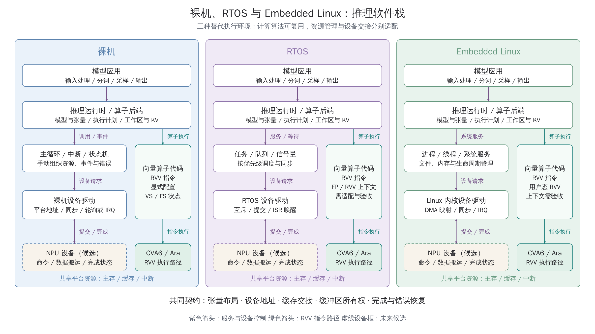
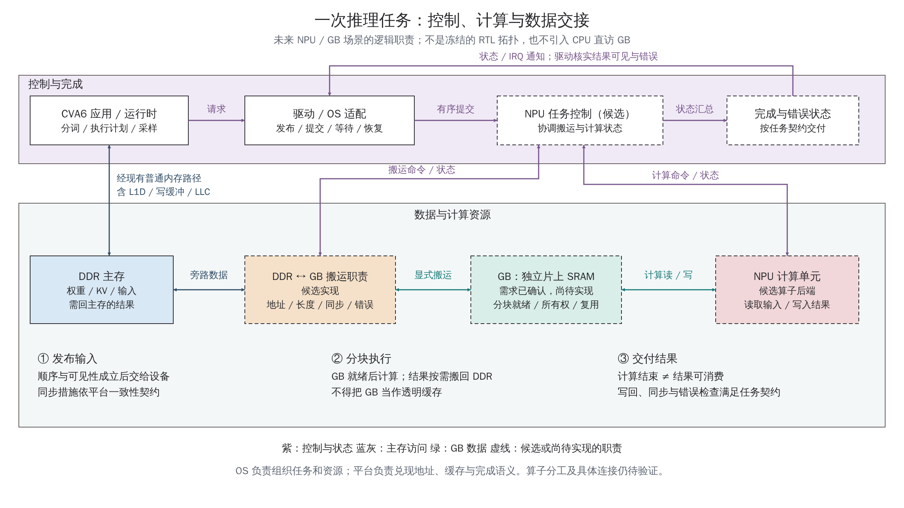

# 边缘大模型推理的操作系统选择

返回[工程参考](README.md) · 配套[软硬件分层与工具](../software/LAYERS_AND_TOOLS.md) · [DDR/GB 接口契约](IP_DDR_Interface_Contract.md)

2026-10-15，L01。输入：`mp/ara-pulp-v2` / `322bd6ce964c96cd4337ceb98e5ce89d1bb478d8`，含既有未提交文档；具体输入见[图稿证据](../diagrams/2026-10-15_edge_llm_os/evidence/input.json)。本篇将当前工程与官方平台资料对照，提供选型建议；没有实施 OS 移植、加速器集成或目标运行。

**本项目建议保留裸机作为硬件验证和性能基线，优先评估精简 Embedded Linux 承载完整模型应用；模型与功能固定、实时约束明确时，再优先评估 RTOS。** 这是设计建议，用户尚未冻结产品 OS、模型或运行时。Linux 不是推理计算的必要条件，它主要降低部署、资源管理和维护成本。

## 1. 讨论对象与参考平台

以下以单设备、低并发、量化后的约 0.5B～3B 自回归语言模型为例；`B` 在参数量中表示十亿。这是便于比较的假设，不是项目需求。视觉编码器、扩散模型、MoE 等需重新预算；不能把某个参数量直接换算为固定内存或速度。

本篇跨越基础软件、应用软件与必要的软硬件接口：比较执行环境怎样管理模型、任务和设备，不接管 SoC 拓扑设计。训练、量化和格式转换可在开发主机完成，目标端只部署所需运行时和模型。

| 平台与官方入口 | 软件与硬件组织 | 可借鉴的部分 | 适用边界 |
|---|---|---|---|
| [Berkeley Gemmini](https://github.com/ucb-bar/gemmini) | RISC-V CPU、脉动阵列、显式管理的 scratchpad、DMA；提供裸机和 Linux 测试/应用入口 | 同一加速器可以同时保留裸机基线与 OS 工作负载；算子库与系统支持分别组织 | RoCC/TileLink、地址翻译及存储连接不等同于本工程；它不是当前 CVA6 的现成可插拔 NPU |
| [Arm Ethos-U 驱动](https://arm-software.github.io/CMSIS-Ethos-U/main/driver/index.html) | 默认同步实现支持单线程裸机；可通过互斥量、信号量等钩子适配 RTOS；模型命令流由配套工具准备 | 复用设备操作与命令提交，把同步、缓存、地址和平台管理放在明确的适配边界 | 用来说明软件组织方式，不表示任意 Ethos-U 配置支持任意小型 LLM；仍须检查模型与算子支持 |
| [JetPack 平台](https://developer.nvidia.com/embedded/jetpack-sdk-514)与 [TensorRT Edge-LLM](https://github.com/NVIDIA/TensorRT-Edge-LLM) | Linux 平台配合驱动、计算库和推理运行时；Edge-LLM 提供边缘平台 C++ 推理实现 | 完整应用平台包含部署工具、运行时、驱动和硬件适配，Linux 只是其中一层 | JetPack 链接采用已发布的 5.1.4 资料说明分层；不作为最新版本推荐。NVIDIA 后端不能直接用于本项目 NPU |

这些先例证明可采用不同执行环境，不构成跨平台性能对照。模型、精度、硬件和内存系统不同，不能直接引用其中的吞吐量预测本项目性能。

## 2. 裸机、RTOS 与 Embedded Linux

RTOS 在此以 FreeRTOS 一类轻量内核为代表，不涵盖所有商业 RTOS。Embedded Linux 是按产品裁剪的内核、根文件系统、驱动和必要服务，不要求桌面、Python 或容器。



图 1：三种替代执行环境的逻辑职责，不表示三个 SoC 同时存在。向量算子经 RVV 指令路径执行；NPU 任务经设备驱动提交。图中 NPU 是未来候选设备，已有 Ara 源码也不等于本轮验证通过。[SVG 母版](../diagrams/2026-10-15_edge_llm_os/software-stacks.svg) · [两图原生 PPTX](../diagrams/2026-10-15_edge_llm_os/export/diagrams.pptx)

| 维度 | 裸机 | RTOS | Embedded Linux |
|---|---|---|---|
| 程序组织 | 主循环、中断、状态机 | 任务、优先级、队列、信号量 | 进程、线程、系统调用和服务 |
| 推理运行时 | 移植或编写精简实现，补齐所需依赖 | 计算代码可复用，但需适配任务与同步 | 较容易复用依赖文件、线程和 POSIX 接口的实现 |
| 内存 | 静态布局、内存池或自管堆 | 常用静态分配、内存池、受控堆 | 虚拟地址、进程隔离、映射和动态分配 |
| 设备访问 | 应用调用驱动，管理平台地址和中断 | 驱动结合任务等待、互斥与 ISR 通知 | 用户态运行时配合内核驱动，管理资源、DMA 和 IRQ |
| 文件/网络/更新 | 可实现，需自行集成组件及更新流程 | 可集成文件系统、网络和更新组件 | 标准机制较丰富，适合持续迭代与远程维护 |
| 时延与调度 | 路径可精简；长循环、关中断仍会阻塞其他工作 | 易表达优先级和截止时间，仍需执行时间分析 | 普通配置存在调度、缺页和后台任务抖动，需专门约束和测量 |
| 故障隔离 | 常见单地址空间配置下可影响整个程序 | 常见轻量配置中任务共享地址空间；保护能力依赖实现 | 用户进程通常可隔离、退出和重启；内核或 DMA 故障仍可影响系统 |
| 系统资源 | 可做到最小 | 通常较低，增加任务栈和内核状态 | 通常更高，取决于裁剪、驱动和服务；不预设固定开销 |
| 工程成本 | 应用复杂后需自建更多公共机制 | BSP、调度、同步和完整上下文适配 | 启动链、BSP、驱动、系统维护和运行时适配 |

三者共享模型数学、张量布局、量化约定、算子结果和设备事务契约；可复用计算核心、模型转换工具及部分底层驱动逻辑。等待方式、内存分配、地址映射、错误生命周期与启动接口则不能不经适配直接互换。Linux 下不宜照搬裸机 HAL 的物理地址指针；也不应让每个用户进程重复管理中断控制器。

**它们不是必须逐级升级的阶梯。** 裸机诊断程序可长期与 Linux 应用并存。加入 RTOS 应当解决具体调度或产品约束，而不是仅为了经过一个中间阶段。

## 3. 对小参数量大模型推理的影响

### 3.1 模型部署与运行时

完整应用需要读取权重和配置、分词、管理工作区/KV、执行算子、采样并输出。裸机能够实现这条链，模型也可以独立存放于存储介质，不必全部编进固件；但相应解析、加载、升级和诊断都要有明确实现。

Linux 的价值在于较容易复用文件、线程、网络与进程管理，尤其适合反复换模型、调上下文或并行运行其他应用。目标端可只保留 C/C++ 推理程序，把训练、量化、格式转换放在开发主机。裁剪时应按实际依赖删除服务，不能把“Embedded Linux”理解成必须运行完整桌面发行版。

[llama.cpp 官方实现](https://github.com/ggml-org/llama.cpp)可作为运行时候选参考，包含量化与 RISC-V 优化路径。它的 RISC-V 支持不证明本地 CVA6/Ara 的指令子集、编译器、ABI 和数值路径已匹配。需要选定代码版本，检查实际启用的扩展与算子后端；未来 NPU 仍需命令生成、算子划分和驱动适配。Linux 本身不会识别一个新增 AXI NPU 后自动加速模型。

### 3.2 权重与 KV 内存预算

理想紧凑存储下，权重字节数约为：

```text
M_weights = 参数量 × 每参数位数 / 8
1B × 4 bit / 8 = 500,000,000 byte ≈ 500 MB ≈ 476.8 MiB
```

这只是权重载荷，不含量化 scale/zero-point、混合精度张量、打包/对齐、运行时副本。4-bit 存储也不保证硬件直接进行 4-bit 运算；解包、反量化与实际计算精度都可能带来额外成本。

对具有统一层配置的常见 MHA/GQA 自回归 Transformer，KV cache 可估算为：

```text
M_KV = 2 × L × B × T × H_KV × D × s
```

`2` 表示 K/V 两组张量；`L` 是层数，`B` 是批大小/独立序列数，`T` 是缓存 token 数，`H_KV` 是 KV 头数，`D` 是每头维度，`s` 是每元素字节数。GQA 使用 KV 头数而非查询头数。滑动窗口、分层配置、压缩或量化 KV 需按实际实现重算。[Hugging Face KV 内存说明](https://huggingface.co/blog/kv-cache-quantization)

假设 `L=24, B=1, T=4096, H_KV=8, D=64, s=2`：

```text
2 × 24 × 1 × 4096 × 8 × 64 × 2
= 201,326,592 byte = 192 MiB
```

这是独立的教学算例，不对应已选择的 1B 模型；不能不核实结构就把两例相加作为产品容量。上下文预算应计入输入与生成部分，并区分有效使用量和预分配容量。

完整预算至少是 `权重 + KV + 激活/算子工作区 + 搬运缓冲 + 程序/系统开销`，还应检查峰值重叠、对齐、碎片和重复副本。裸机/RTOS 可减少系统开销，但不会消除模型需求；Linux 虚拟内存不是额外物理 DDR，不能把频繁换页当作满足推理时延的容量方案。

**KV cache 是算法张量，L1D/LLC 是硬件缓存；GB 又是另一块显式管理的 SRAM。** 三者应分别预算。KV 张量所在的 DDR 地址可以被硬件缓存，但这不改变它的算法身份。

### 3.3 Prefill、decode 与性能

Prefill 处理输入序列，通常可组织较大的矩阵运算；decode 逐 token 生成，低批量时常受权重/KV 搬运带宽和阵列利用率影响。它们是不同工作阶段，不能只报一个矩阵乘峰值或总 TOPS。[NVIDIA 推理优化说明](https://developer.nvidia.com/blog/mastering-llm-techniques-inference-optimization/)

这是通用趋势，不是当前 SoC 的实测瓶颈。对本工程，应分别测 DDR 有效带宽、GB 分块复用、计算与搬运重叠、主机提交开销和未加速算子占比。64-bit 主 Xbar 是已确认方向，但其位宽本身不能推算 tokens/s；NPU 旁路、工作频率、控制器效率及共享争用仍影响结果。

同样算子与数据流下，裸机可能减少控制开销；Linux 能复用的优化运行时也可能让端到端更快。**当前证据不足，无法给出 Linux 固定损失多少性能。** 比较必须约束硬件、频率、模型、精度、上下文、批大小、缓存状态和算子实现，区分 OS 开销与后端优化收益。

### 3.4 实时性、抢占与故障恢复

[FreeRTOS 默认调度](https://www.freertos.org/Documentation/02-Kernel/02-Kernel-features/01-Tasks-and-co-routines/04-Task-scheduling)以固定优先级抢占为基础，但是否满足截止时间还取决于中断、锁、DDR 争用和最坏执行时间。裸机也可能实现可靠的固定时序；实时性不能只由 OS 名称决定。

Linux 的 [PREEMPT_RT](https://docs.kernel.org/core-api/real-time/theory.html)通过可抢占锁和线程化中断等降低延迟，但这不证明本地历史内核及驱动已经支持或通过实时验收。缺页、内存分配、后台服务和设备执行时间都需要约束。

CPU 线程被抢占，不代表 NPU 任务可以抢占。设备取消、上下文保存、分块边界和恢复能力必须由硬件/驱动规定。Ara 则通过 RVV 指令使用；多个任务使用向量/浮点状态时，RTOS 或 Linux 必须正确管理完整上下文。拥有整数任务切换代码不足以证明 RVV 抢占安全。

进程退出也不等于 DMA 已停止。发生设备超时后，应停止新提交、记录任务身份与部分完成范围、隔离相关缓冲，按设备协议取消、排空或复位；确认不会有迟到写后才能回收。这个责任在三种环境下都存在。

## 4. 一次推理任务的软硬件协作



图 2：未来 NPU/GB 方案的逻辑职责和交接过程，不是冻结的 RTL 连线图。数据箭头表示双向搬运/访问能力，并不表示同时执行；任务控制代表驱动与设备约定的职责，不预设独立控制器 IP。CPU 的 DDR 访问仍经现有普通内存路径；图不引入 CPU 直访 GB。[SVG 母版](../diagrams/2026-10-15_edge_llm_os/inference-flow.svg)

以一次有代表性的张量任务解释；完整模型会按执行计划重复这些阶段，并可能重叠不同块的搬运与计算：

1. **准备与发布。** CVA6 上的应用/运行时准备张量、设备可用地址和任务信息。驱动依据平台契约保证输入可见、描述符有序，才允许设备消费。权重等只读数据可复用，不要求每个任务重新加载整个模型。
2. **搬运与计算。** 需要的数据从 DDR 显式搬入 GB；确认块就绪后 NPU 才能使用。NPU 对 GB 的读取和写入受所有权约束，CPU/Ara 不得在交接期间产生未协调的冲突访问。哪些算子交给 NPU、Ara 或 CPU，需要后端支持和实际收益证明。
3. **结果交付。** 结果若由后续设备继续消费，可按约定留在 GB；本图选择需回 DDR 的场景。搬回、必要同步和错误检查完成后，才交付 CPU。单独的“计算结束”、AXI 响应或 IRQ 均不能替代整个任务定义的完成条件。

| 环节 | 裸机 | RTOS | Embedded Linux |
|---|---|---|---|
| 内存与地址 | 链接布局/分配器提供设备可达区域 | 分配器配合任务所有权 | 驱动管理 DMA 映射及缓冲生命周期，不直接把用户指针交普通 AXI master |
| 等待完成 | 轮询或中断驱动状态机 | ISR 通知，任务等待事件/信号量 | 驱动完成机制与用户态等待接口 |
| 并发协调 | 显式状态机及临界区 | 队列、互斥、优先级策略 | 进程/线程同步加设备提交队列管理 |
| 错误处理 | 固件记录并受控恢复 | 唤醒关联任务，传播错误 | 返回应用错误，保持资源隔离，处理关闭/退出时的在途工作 |

[Linux 6.5 DMA API 指南](https://docs.kernel.org/6.5/core-api/dma-api-howto.html)区分 CPU 虚拟地址、物理地址和 DMA 地址，并区分 coherent/streaming 映射。即使一致性内存也可能需要屏障保证描述符发布顺序。DMA API 是平台应实现的语义契约，调用它不会凭空增加硬件能力。

Linux 可以使用非硬件一致性设备，但 BSP、内核与驱动必须提供正确的缓存维护或不缓存映射。不能仅填写 `dma-coherent` 属性就认定硬件一致；CPU MMU 也不会自动替独立 AXI DMA 翻译用户虚拟地址。需要评估设备地址能力、映射与隔离，不能把 IOMMU 视作所有 Linux 系统必备或本工程已有能力。

本项目需同时处理 CVA6 L1D/写缓冲、LLC 和旁路设备的观察关系。[现行一致性比较](Cache_Coherence_Architecture.md)仍是待选型方案，不能将其“逐行 I/O 一致性优先评估”变成已实现能力。即使未来 DDR 侧实现硬件一致性，GB 保存的独立快照也不会随源 DDR 修改自动更新；块所有权与完成协议仍不可省略。

## 5. 当前工程具备什么，还缺什么

以下来自当前本地文件定向核对；依赖目录后缀不是上游提交号，来源身份见 [.bender 快照说明](../../.bender/README.md)及[快照清单](../../.bender/SNAPSHOT.tsv)。主仓库内容还包含本地修改。

| 对象 | 当前证据与入口 | 仍需确认/验证 |
|---|---|---|
| CPU 基础 | [向量 profile](../../.bender/git/checkouts/cva6-20c9d7cbe0dd6995/core/include/cv64a6_imafdcv_sv39_config_pkg.sv) 设置 `VExtEn=1`、`MmuPresent=1`、`RVS=1`、`RVU=1` | 必须确认实际编译 profile 和 SoC 配置；profile 存在不等于当前运行镜像使用它 |
| Ara 官方路线 | 本地 [Ara README](../../.bender/git/checkouts/ara-2c7b103275a16c87/README.md) 的 FPGA/Linux 节描述 VCU118/VCU128、2 lanes；[集成 README](../../.bender/git/checkouts/ara-2c7b103275a16c87/cheshire/README.md) 提供构建/加载流程 | 上游描述不替代本工程板测；示例板型、存储、DTS 和镜像需逐项匹配 |
| Linux 应用构建 | [cva6-sdk.mk](../../.bender/git/checkouts/ara-2c7b103275a16c87/cheshire/sw/cva6-sdk.mk) 设置 `RVV_LINUX=1`，包含 Buildroot 工具链、`%-linux` 和 `linux-img` 入口 | 规则包含子模块更新、补丁或复制等副作用，不作为只读探针执行；本轮未运行 |
| 内核配方 | [普通配方](../../.bender/git/checkouts/ara-2c7b103275a16c87/cheshire/sw/cva6-sdk/configs/buildroot64_defconfig) 请求 `v5.10.7`；[V 配方](../../.bender/git/checkouts/ara-2c7b103275a16c87/cheshire/sw/cva6-sdk/configs/buildroot64_V_defconfig) 请求 `v6.5` | 配方版本、已展开源码和已有镜像不是同一证据；不据此冻结产品内核或升级依赖 |
| 官方启动组织 | [Cheshire 软件说明](../../docs/um/sw.md) 描述 ZSL→OpenSBI/U-Boot→Linux；[平台约定](../03_Platform_ROM_Clock_IP_Configuration.md)规定本项目早期初始化方向 | DDR 就绪、DTB、固件、根文件系统和完整启动仍待验收；Platform ROM 的既有缺口另行修复 |
| RTOS / Linux 状态 | [OS 主题交接](../handoffs/L01_OS_implementation.md)和[共享状态](../PROJECT_STATE.md)记录教学交付与运行缺口 | 无已交付验收的 RTOS port；Linux 启动、镜像溯源和 FP/RVV 抢占仍未验收 |
| NPU/GB/旁路 | [IP/DDR 契约](IP_DDR_Interface_Contract.md)明确主 Xbar 64-bit、独立 GB 和设备旁路需求 | 尚无完整新 NPU 驱动/算子后端和真实新拓扑验收；具体连接不由本文冻结 |

用户报告的 VCU118 HelloWorld 只支持其对应结果，不证明大模型推理、Linux、Ara 或 DDR 全功能验收。现有 iDMA 的控制宽度/完成语义疑点也不能被新的推理流程图绕过，见[接口专题](../software/interfaces/markdown/cases.md)及[交接](../handoffs/L01_software_hardware_interfaces.md)。

## 6. 对本项目的建议

### 6.1 保留裸机基线，优先评估精简 Linux 应用

**裸机承担首次硬件验证。** 从小张量 golden 对照、GB/DDR 搬运、缓存交接和错误注入开始，再扩大到代表性模型片段及完整模型。它提供少依赖、易定位的诊断入口，长期保留用于首硅、回归和故障恢复。

**精简 Linux 承担完整模型应用的优先评估。** 当需要文件化模型、网络交互、日志、模型替换和多个实验程序时，Linux 更符合当前项目的研究与应用迭代方向。先复用本版本官方启动/SDK 路线验证 OS 与 RVV，再选择推理运行时并适配新增 NPU；不把 Linux 移植设为固定 ASIC 提取的前置条件。

算法层建议保持模型解析、张量描述和算子实现与 OS 适配分离；为分配/释放缓冲、同步交接、提交、等待和错误恢复建立稳定职责边界。裸机/RTOS 与 Linux 分别实现适配层。本文不定义新的 C ABI、寄存器表或 ioctl 编码，具体接口需在硬件任务协议确定后设计。

### 6.2 何时优先选择 RTOS

如果模型长期固定、输入/输出流程有限、资源预算紧且控制任务有明确截止时间，可优先评估 RTOS。它适合组织“采集—预处理—推理—控制”的任务关系，但仍要承担运行时、存储和模型加载的移植成本。

若持续替换 LLM、处理多种模型格式、接入网络服务是主要工作，额外维护 RTOS 运行时可能超过节省的系统资源。不能仅以参数量小，就认定 RTOS 总成本更低。

有硬实时要求时，先确定哪些动作必须按时完成、最坏执行时间和可接受丢帧/超时行为。可由硬件流水线承担确定性动作；只有独立实时资源和需求明确后，才讨论 Linux＋RTOS 异构组合，不假定当前单核配置已有第二个控制核。

## 7. 决策输入与最小验收

| 待提供输入 | 对选择的影响 |
|---|---|
| 模型结构、参数量、权重/KV 精度、质量底线 | 算子覆盖、反量化成本、实际容量和数值验收 |
| 最大输入/输出长度、并发与批大小 | KV 峰值、延迟、调度和内存池大小 |
| 首 token、逐 token、控制截止时间 | 区分交互体验、吞吐目标与硬实时约束 |
| DDR 容量/有效带宽、GB 资源、NPU 能力 | 决定可运行规模和分块/旁路策略，不能由 OS 补足硬件缺口 |
| 模型更新频率、网络/文件需求、维护年限 | 影响 Linux 生态收益和裸机/RTOS 自维护成本 |
| 软件团队、供应商驱动/工具、启动介质 | 决定复用路径、交付风险和恢复方式 |

选择一个代表模型与固定输入，先定义质量与失败判据；不为比较 OS 同时改变量化和计算后端。最小验收分为：

1. **正确性与能力。** 核对 tokenizer/模型/算子版本；与参考输出按容差或模型质量指标比较。分别检查 CPU、Ara、NPU 路径；语义一致不要求不同数值实现逐位相同。
2. **内存与启动。** 测量加载、prefill、decode 的峰值 DDR/GB 占用及启动到可服务时间；记录冷启动与预热状态，不把模型文件大小当峰值内存。
3. **性能与资源。** 测量首 token 延迟、逐 token 延迟分布和尾部、tokens/s、CPU 占用、DDR 字节数、搬运/计算重叠及能耗。说明 token 定义、输入长度和测量边界。
4. **并发与上下文。** 对 FP/RVV 任务切换、设备并发、缓存/写缓冲及同址竞争做定向测试；OS 名称不能替代这些验证。
5. **失败与恢复。** 注入总线错误、超时、请求取消或应用退出；检查失败结果不被消费、迟到 DMA 不写入已回收缓冲，恢复后新任务结果正确。

这些是未来 V01/S01/I01/M01 的评估输入，不是本次已运行用例。本次只交付文档、图稿及其静态/视觉检查；结果和复现入口见[主题交接](../handoffs/L01_edge_llm_os_architecture.md)。
