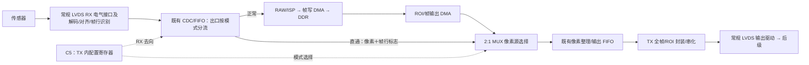

# LVDS 像素流直通：模式、控制与实现注意事项

更新：2026-10-26（RX 改为 64 数据＋4 时钟；直通拓扑沿用 2026-10-22 决定）。责任：I01 图像接口设计，S01/V01 配合控制及验证，P01 配合常规 LVDS 电气接口与物理实现。

**当前决定：从原单页 v1 图作最小修改，RX 解码后的像素流经 2:1 MUX 送入既有输出 FIFO 和 TX，由 LVDS TX 内配置寄存器选源，沿用 C5。** 用户已取消串行/模拟 pin-to-pin 方案、右扩展图及 CPU 卡住时外部强制切换要求。本文保留原文件名以维持链接；2026-10-22 交付为架构图和设计说明，本轮仅同步接口预算，不表示 RTL、LVDS 宏、吞吐或故障切换已验证。

## 1. 输入与交付位置

| 项目 | 本轮输入或目标 |
| --- | --- |
| 仓库输入 HEAD | `c9abbb48946fe3a7244bfb3159919b7c9731cb59`，含其他任务未提交修改 |
| 本轮输入 PPT | [soc_landscape.pptx](../diagrams/soc_landscape.pptx)，原单页 v1，画布 3600×2025 |
| 本轮输入 SHA-256 | `a4a552ca74684711df8ce78528c7b50d923d77b47e5f299b16918bd8208fe2d0` |
| 更新后的 PPT | [soc_lvds_bypass.pptx](../diagrams/2026-10-22_soc_lvds_bypass/soc_lvds_bypass.pptx) |
| 更新后的 SVG / PNG | [SVG](../diagrams/2026-10-22_soc_lvds_bypass/soc_lvds_bypass.svg) / [PNG](../diagrams/2026-10-22_soc_lvds_bypass/soc_lvds_bypass.png) |
| 交付与检查说明 | [现有图稿目录 README](../diagrams/2026-10-22_soc_lvds_bypass/README.md) |
| 架构与预算入口 | [v1 实施总纲](SoC_Architecture_v1_Master_Plan.md)、[资源与封装预算](SoC_Resource_and_Packaging_Plan.md) |

在现有图稿子文件夹内更新产物，不新增子文件夹。以原 v1 的画布和布局作局部修改；原 RAW/ISP、DDR、ROI 数据通路保留，新增选择只改变直通模式的数据来源和去向，不增加 AXI 主端口。

## 2. 当前功能与通路

目的：在 CPU、配置总线及图像接口正常工作的条件下，通过 LVDS TX 内配置寄存器选择 RX 像素流直接发送，绕过 DDR 缓存，避免另铺 PCB 图像旁路线。DDR 失效后能否切入，还取决于 CPU 与配置访问是否仍可用；本方案不提供 CPU 卡死时的外部切换入口。

上图两条路径均从 RX CDC/FIFO 出口选择产生；直通模式只向 TX 供流。输出选择器位于像素整理/输出 FIFO **之前**，不再放在串化器与模拟驱动之间。

| 模式 | 功能路径 | 后级收到的内容 |
| --- | --- | --- |
| v1 正常输出 | RX → RAW/ISP → 帧写 DMA → DDR → ROI/帧输出 DMA → 像素源选择 → 输出 FIFO → TX 封装/串化 | 原有 ROI 输出协议 |
| 像素流直通 | RX 解码/对齐/帧行识别 → CDC/FIFO → 像素源选择 → 输出 FIFO → TX 全帧封装/串化 | RX 解码后的全帧像素，经 TX 协议重新封装 |

直通绕过 ISP、DDR 及 ROI 调度/读出，仍经过 RX 解码、像素缓冲、TX 封装和串化。后级需要支持 **TX 的全帧格式**；不要求保持传感器原始串行编码、空闲字或原始时钟相位。已有“RAW bypass”只是绕过 ISP、仍写 DDR，不能代替本模式。

**RX 改为 64 数据＋4 时钟、4 组 1C16D**（2026-10-26 用户因面积限制确认）；TX 保留 128 数据＋暂定 16 时钟、1C8D。每数据对 500 Mbit/s、12288×12288 灰度/14 bit 和 30 FPS 目标保持。RX 为 136 个信号 PAD，TX 为 288，双向 LVDS 为 424；沿用其余接口假设后条件信号小计 592，比 v1.6 减少 136，电源地及额外端另计。**RX 仅 32 Gbit/s，不能满足 30 FPS 的 63.41787648 Gbit/s 净需求；无开销上限约 15.137688 FPS**，目标与容量的取舍待决定。 若保持逐行相邻像素分配，RX 为每次 64 像素、192 次/行、12288 行；缩减后的映射须与传感器重新确认。SDR/上升沿/LSB 先发仍只是此前绘图约定，旧 128-lane 图为历史输入，见[当前接收预算](SoC_Resource_and_Packaging_Plan.md#lvds-rx-timing)。RX/TX lane 数不同，应在像素流层整理为 TX 格式，不作物理 lane 一一透传；内部接口宽度、CDC 和缓冲待设计。

## 3. 像素接口、反压与缓冲

选择器必须同时选择像素数据、有效信号、帧开始/行边界等标志，以及 TX 所需的尺寸和格式信息；不能只切换数据总线。若接口使用 ready/valid，反向 ready 只交给当前源，数据与标志按同一握手传递。具体接口宽度、每拍像素数和标志编码待前后级接口确定，本图不冻结 AXI4-Stream 协议。

**DDR 支路不能反压阻塞直通。** TX 内模式配置同时控制 RX CDC/FIFO 出口去向与 TX 选源，直通时不再同时向 RAW/ISP/帧写 DMA 广播并等待两个接收端。配置请求到达后，切入要解除旧 DDR 路径对公共出口的占用，必要时丢弃公共 FIFO 中的旧帧残留；不等待写 DMA、读 DMA 或 ROI 任务完成。原有在途 AXI 事务另行恢复，不能阻挡旁路供流。

TX 全帧发送的尺寸、格式与使能须来自已有效的接口配置或 RX 可提供的信息，不能要求 CPU 临时提交 ROI 描述符或等候 DDR 帧完成通知。配置的来源及保持方式仍需实现时确定。

优先复用图中的 RX CDC/FIFO 和 TX 输出 FIFO，但须确认：

- RX 出口与 TX 像素入口属于哪些时钟域；现有 FIFO 是否真正覆盖该跨域边界。若未覆盖，需在既有缓冲的适用位置增加跨域能力，不能把多位像素总线直接接到另一时钟域。
- FIFO 的宽度、深度和帧行标志存储是否适合直通；切换时能否同时清除数据和对应标志。
- 连续输入的峰值、行平均与帧平均速率，TX 封装后的实际消耗速率，以及两端时钟频差。FIFO 可吸收短时不匹配，持续速率差会不断积累，不能靠任意有限深度解决。

若传感器不能接受反压，RX/FIFO 满时必须有明确丢弃不完整帧及重新对齐行为；不能假定 ready 拉低会停止外部传感器。实际需求是否允许丢帧须与接口方确认。

当前 RX/TX 物理容量分别为 32/64 Gbit/s。RX 在未计协议开销时即无法输入目标全帧 30 FPS，像素直通及 DDR 前压缩都不能修复输入带宽缺口。TX 单独承载该目标时仅约 0.91% 容量余量；16-bit 线上容器则需 72.477573 Gbit/s，超过两端容量。需按最终传感器输出和 TX 封装核算持续吞吐，不能通过有限 FIFO 保证未满足的输入目标，详见[资源预算 §3.2](SoC_Resource_and_Packaging_Plan.md)。

## 4. TX 寄存器选源与切换

**选源只由 LVDS TX 内配置寄存器控制，沿用 C5 配置入口。** 正常模式选择帧输出 DMA，直通模式选择 RX 解码后的像素流。寄存器地址、位号和默认值留待具体实现确定，本轮不新增寄存器表或 RTL。

切换需要 CPU 与配置总线可用。配置域到图像域的请求须正确同步，再协调 RX 出流方向、TX 像素选源和 FIFO 状态。涉及多个图像时钟域时，需要协调其切换与清空，防止一端已换源而另一端还输出旧帧；不能把异步配置直接接到多位数据 mux。收到有效请求后，图像域的切换不等待 DDR 就绪或旧 DMA 完成。

建议切换顺序为：停止旧输出的有效帧 → 丢弃旧 FIFO 残留及当前不完整帧 → 完成选源和输出状态准备 → 等到 RX 下一个完整帧起点后重新发送。帧中切换允许截断旧帧，后级需要丢弃不完整帧并重新建立帧行同步；不承诺无缝切换。具体清空及切换延迟应按所用 FIFO 和 TX 接口确定，不依赖故障 DMA 排空。

退出直通也应按切换顺序处理，重新确认正常输出链及帧缓冲有效状态，不能立刻续发旧 ROI 任务或 DDR 中可能无效的帧。

**本方案依赖 RX/TX 已正常初始化、RX 已完成所需对齐/锁定，以及相关图像时钟、复位、供电和 FIFO 正常。** CPU/配置总线不可用时不能保证切入；上电未初始化、RX 失锁、图像域停钟或被复位时也不能保证透传。芯片断电透传、自动 DDR 故障检测和自动故障切换不在本次范围内。

## 5. 后续实现与验证项目

| 项目 | 必须确认的结果 |
| --- | --- |
| RX/TX 像素接口 | 像素宽度/顺序、每拍数量、有效与帧行标志、尺寸/格式来源一致；TX 具有不依赖 ROI/DDR 描述符的全帧发送入口 |
| 分流与反压 | 模式配置到达图像域后，直通仅由 TX 消费 RX 出流；DDR 停顿或 DMA 卡住不能阻塞图像域切换和持续供流；公共 FIFO 旧数据有丢弃路径 |
| 吞吐与 CDC | 按实际 RX 突发、TX 封装、时钟频差确认持续吞吐与缓冲深度；跨域数据、标志和切换控制保持一致 |
| 寄存器选源与恢复 | 确认 C5 配置可达及跨域生效；检查帧中切换、旧缓存清除、下一完整帧、退出直通和旧任务恢复 |
| 运行边界 | 确认图像接口初始化、时钟/复位/电源状态；故障恢复不能连带关闭仍需运行的旁路图像域 |
| 常规 LVDS 电气连接 | 两端分组、P/N 与 lane 映射、终端、共模/摆幅、数据与时钟时序及 PAD/PHY 模型按正常收发接口核对；无需解串前串行分支或模拟 RX→TX 开关 |

本轮未执行 RTL 仿真、故障注入、综合、STA、SI/PI 或板级测试。图稿预览与保存重读检查的实际结果由交付目录 README 记录；Office 显示/编辑未实测。

## 6. 依据与决策历史

本项目的旁路位置、C5 寄存器选源和 DDR 支路反压隔离要求，来自用户需求与本次架构选择。AMD UG934 的[缓冲要求](https://docs.amd.com/r/en-US/ug934_axi_videoIP/Buffering-Requirements)说明峰值、行平均和帧平均速率决定缓冲需求，持续吞吐不足不能靠增加缓冲解决；[帧行标志传播](https://docs.amd.com/r/en-US/ug934_axi_videoIP/Propagating-SOF-and-EOL-Signals)说明标志必须与对应像素及处理延迟匹配。2026-10-22 查阅，仅借鉴流式视频设计原则，不表示选用 AMD IP 或已确定 AXI4-Stream 为本工程接口。

| 时间与决定 | 记录 |
| --- | --- |
| 2026-10-22 初版：解串前串行旁路 | 已被用户取消。保留[旧 PPT](../diagrams/2026-10-22_soc_lvds_bypass/evidence/build-02/soc_lvds_bypass.pptx)作为决策历史；其串行选择、电气节点与旧参数不再作为当前实现要求 |
| 2026-10-22 中间方案：右扩展像素旁路图与外部强制 | 已被用户取消；不再以宽版图作为编辑基线，也不保留 CPU 卡死时外部切换的现行要求 |
| 2026-10-22 当前：原 v1 最小像素旁路改图 | 从原 3600×2025 单页 v1 增加 RX→2:1 MUX→既有输出 FIFO→TX 通路，只由 TX 内配置寄存器选源；切换要求 CPU、配置总线及图像接口可用 |
| 2026-10-26 RX 数量修订 | RX 改为 64 数据＋4 时钟，TX 保持；直通仍在解码后的像素流层进行。仅同步文档，既有图稿与 RTL 未改；30 FPS 输入容量冲突待决定 |
