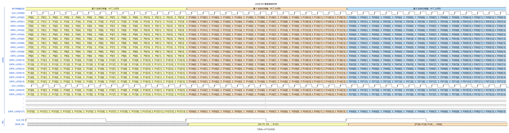
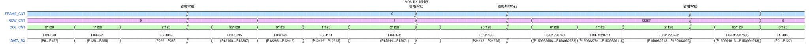

# SoC 资源预算与 WireBond 封装预规划

返回[工程参考](README.md) · [SoC v1 总纲](SoC_Architecture_v1_Master_Plan.md) · [团队分工与排期](Team_Responsibilities_and_Tapeout_Schedule.md) · [ASIC 适配参考](ASIC_Adaptation_and_Evidence.md) · [本主题交接](../handoffs/P01_soc_resource_packaging.md)

版本：v1.6，2026-10-23。责任：P01，关联 I01/M01。输入 `mp/ara-pulp-v2` / `c9abbb48946fe3a7244bfb3159919b7c9731cb59` 及已有未提交修改。本次依据合作方经用户确认的逐行读出、RX 最少 8 时钟要求更新预算，并交付两张 [WaveDrom 接收时序图](../diagrams/2026-10-23_lvds_rx_timing/README.md)。TX 仍按原暂定 16 时钟；历次输入与检查保留在[交接](../handoffs/P01_soc_resource_packaging.md)。

**PAD 周长确实可能撑大裸片，但裸片增大不必然使键合线变长。** 面积利用率与信号/电源完整性分别核算，再联合选择容量、算力和封装。本文提供候选与算例，不冻结产品参数，不代表综合、布局、封装仿真或硬件性能已通过。

## 1. 输入、结论等级与使用方法

| 等级 | 当前输入 / 结论 | 使用边界 |
| --- | --- | --- |
| 用户确认，2026-10-18 | 工艺标识：`smic55ll_ulp_rf_09121825_1P9M_7Ic_1TMc_1MTTc_ALPA1_oa_cds_v1.16_2` | 记录用户提供的完整名称；未检查实际 PDK 文件、许可或配套库。不能由名称推断电压、PAD 节距、宏尺寸或 PHY 兼容性 |
| 用户确认，2026-10-18 补充 | DDR 外部 DQ 位宽已确定为 x64 | 不再将 x32 列为现行候选；DDR 类型、速率、Rank、容量、PHY 实际端点及 AXI 口参数仍分别核实 |
| 用户转交合作方确认，2026-10-23 / v1.6；速率沿用 v1.4 | 每向 128 数据对、每对 **500 Mbit/s**；**RX 至少 8 对时钟，本次按 1 Clk : 16 Data、8 组计算**；TX 仍暂定 1 Clk : 8 Data、16 组 | 最低时钟要求不等于冻结最终数量；TX 分组待后级确认。500 Mbit/s 及分组输入不等于本工艺宏已验证 |
| 用户确认目标，2026-10-22 / v1.5 | **12K＝12×1024＝12288；灰度图像 12288×12288、14 bit/像素、30 FPS** | 尺寸已确认；2026-10-23 合作方进一步确认每次 128 个相邻像素、96 次/行、逐行读出 12288 行；协议开销见 §3.2。正常 TX 按 ROI 输出，像素流直通需支持 RX 全帧重新封装，不新增 DDR 全帧输出要求 |
| 用户倾向，2026-10-18 | 封装大概率采用 WireBond | 封装型号、基板、线材/线弧、引脚表及电气能力未冻结；WireBond BGA 是本轮评估建议 |
| 用户确认的功能基线 | CVA6＋Ara2、主 Xbar64、CPU/Ara 共享 M5 访问独立 GB；四个 AXI 入口连接一个 DDR Controller | 沿用[总纲](SoC_Architecture_v1_Master_Plan.md)，不据本轮预算改变拓扑；四个 AXI 入口不代表四条物理 DDR 通道 |
| 用户澄清的数据流 | DDR 就绪后 eMMC→DDR；ISP 工作时按需 DDR→GB | 不要求整包参数或全部模型常驻 GB；S7→M5 可达性不等于软件采用 eMMC→GB 加载流程 |
| 待输入 | 模型/算子/计算精度、图像传输协议、推理目标 FPS、功耗/面积上限及外设保留表 | 本轮按用户要求给候选档位；旧文档中的 1080p60、DDR 速率/容量、模型规模示例仍非产品指标 |
| 评估建议 | 先比较 1/2/4 MiB GB、256/1024/4096 INT8 MAC；优先评估 2 MiB＋1024 MAC | 选择评估起点，不证明应用满足；频率、DDR 速率/组织、总 PAD 数和裸片尺寸继续收敛；DQ x64 已确定 |
| 示例假设 / 外部参考 | 本文算例、其他 IP 的封装指导和历史工艺资料 | 每处写明假设及适用范围；不替代本工艺、采购 PHY、封装厂的交付规定 |

第 2～8 节为建议和条件计算；[第 9 节](#budget-tables)为实际项目记录。**不得直接把算例数字抄入实际确认值。** 来源依次采用当前工程契约、适用版本的工艺/IP/封装资料和可追溯测量；公开资料只支持机制或比较。单位约定：1 MiB＝2²⁰ Byte，1 MB＝10⁶ Byte，1 GB/s＝10⁹ Byte/s，1 TOPS＝10¹² op/s；GB 在本项目中表示 Global Buffer，容量统一写 MiB。

## 2. 首轮资源候选与选择顺序

| 资源 | 首先评估 | 对照候选 | 决定取舍所需证据 |
| --- | --- | --- | --- |
| GB 有效数据容量 | 2 MiB 仍作映射对照起点 | 1 MiB、4 MiB | 按新图像规模重算条带；§6.2 的 32 行双参数块已超过 2 MiB，不能照搬旧分块；最终由驻留量、bank、宏面积/功耗决定 |
| NPU | 1024 INT8 MAC，如 32×32 阵列 | 256 MAC 如 16×16；4096 MAC 如 64×64 | 算子映射、精度/质量、有效利用率、供数及真实库实现结果；阵列形状也只是例子 |
| NPU 预算频率 | 用 200～300 MHz 计算 | 实际可达频率待输入 | 匹配 PVT 条件的综合、宏时序和布局后 STA；不据此设定 CPU/Ara 或其他时钟域 |
| 外部 DDR | **DQ x64 已由用户确定** | 速率、容量、Rank、器件组织待选；x32 仅作历史比较 | 全 SoC 最坏流量、采购 PHY 能力、PAD/供电及封装板级条件 |
| PAD 数 | 按 RX 8 时钟、TX 暂定 16 时钟：双向 LVDS 560，条件信号小计 728 | RX 最少 8 时钟；最终分组、电源地/控制/专用端待输入 | [第 3 节](#pad-budget-example)给组成及边界；728 不是最终总 PAD 或焊球数 |
| 裸片草案 | 按新通道总数、真实 IO/供电与核心重新确定 | 原 7×7 mm、9×9 mm 草案撤出当前评估起点 | [第 4 节](#pad-perimeter)只给几何敏感性，不给最终投片尺寸 |
| 封装 | 按新增通道规模核实 WireBond BGA 可行性 | 同步评估 Flip-Chip 对照，不预判 WireBond 一定不可行 | 实际供电、SI/PI、热、封装/PCB 可制造性和包含裸片的总成本 |

建议先取得应用与接口输入，同时获取宏/IO/PHY 的尺寸和模型，再用同一组工作负载比较候选。容量、MAC 数和 DDR 速率/组织分别评估，不要求上表各档一一绑定；本轮不重新开放已确定的 DQ x64。不能仅凭“PAD 环内还有空白”决定扩容或增加计算单元。

<a id="pad-budget-example"></a>

## 3. IO PAD 与外部接口预算

### 3.1 当前 RX：128 数据对、至少 8 时钟，逐行读出

2026-10-23 合作方经用户确认：正在共同研发的传感器为 **12288×12288 灰度、14 bit/像素**，128 条 lane 一次并行发送 128 个相邻像素，每行发送 96 次，再依次发送 12288 行。RX 时钟最少 8 对，本次按 **8 组、每组 1 Clk : 16 Data** 绘图和计算。线速与帧率沿用 2026-10-22 确认的 **500 Mbit/s/数据对、30 FPS**。

| 项目 | 当前输入 / 绘图约定 | 使用边界 |
| --- | --- | --- |
| RX 数据 | 128 个物理数据差分对；每对串行发送 14-bit 像素 | 128 条 lane 共同承载一幅灰度图，不是 128 幅图像 |
| RX 时钟 | 最少 8 对；本次取 8 对，每对服务 16 条数据 lane | 最终数量、组间相位与封装映射仍待确认 |
| RX 位时序 | 用户指定先按 SDR、上升沿采样、LSB→MSB 绘制 | 当前绘图约定，尚非合作方完整协议确认；像素图使用相对周期，不固定频率 |
| 行帧同步/消隐 | 仅已知逻辑边界；物理承载方式、训练和消隐长度待定 | 不预设控制对、标记码值、CRC 或固定控制字数量 |
| TX 数据/时钟 | 仍为 128 数据对、500 Mbit/s/对，暂定 16 时钟（1 Clk : 8 Data） | 后级另行确认，不随 RX 改为 8 时钟 |
| PAD / wire / pin或ball | 信号终端、键合线、封装端点分别计数 | 电源地、控制/专用端、多线连接及实际单元宽度另核 |

LVDS 电气层与串并转换、像素映射、行帧协议分别定义。[TI 官方说明](https://www.ti.com/video/6341196942112)中对电气层的解释不替代双方协议。CMV12000 的 64 数据＋1 时钟＋1 控制结构保留为机制实例，不作为本项目规格。[官方 DS000603 v6-00，§7.3.1](https://look.ams-osram.com/m/206ab59c8585c685/original/CMV12000-12Mp-High-Speed-Machine-Vision-Global-Shutter-CMOS-Image-Sensor.pdf)

<a id="lvds-rx-timing"></a>

#### 像素、行和帧的对应关系

以下从 0 编号，仅用于图像坐标和图内信号命名，不是封装管脚编号：

```text
Clk[g] 对应 Data[16g]…Data[16g+15]，g＝0…7
Data[l] 第 k 次发送 P[y,128k+l]，l＝0…127，k＝0…95
每行：k＝0 → 1 → … → 95
每帧：y＝0 → 1 → … → 12287
每行：96×128＝12288 像素，无尾填充
```

例如，行首 k＝0 时 lane 0/127 分别传列 0/127；k＝1 时传列 128/255；k＝95 时传列 12160/12287。随后下一行重新从列 0 开始。每组 `B[y,k,g]` 代表同一字时间内的 16 个像素，列范围为 `128k+16g` 至 `128k+16g+15`；它是图中的聚合表示，不是外部 224-bit 并口。



像素图采用相对周期，显示 CLK_LVDS[0]、CLK_LVDS[1]，展开 DATA[0…17] 与 DATA[127]；省略 DATA[18…126] 及 CLK_LVDS[2…7]，其中 DATA[127] 属于 CLK_LVDS[7]。以第0行连续传输为例，lane j 完整展开 P[0,j]、P[0,128+j]、P[0,256+j]，图内三批传输期间时钟和数据连续运行。位框 Pc[b] 表示像素 P[0,c] 的 bit b，每框为一位串行数据；不同像素数值可以相同。保持 SDR、上升沿采样、LSB先发约定，每字占14个 T_LVDS，不固定具体频率。差分对只画逻辑值，P/N互补。

底部 CLK_RX 满足 T_RX＝14×T_LVDS；DATA_RX 为解串和组间对齐后的128×14-bit逻辑聚合，首批收齐前未定义，随后在示意 CLK_RX 上升沿之后图中仅显示 {P0,…,P127}、{P128,…,P255} 两组输出，分别与第二、第三批串行接收重叠。观察窗口止于第三批输入结束，不留第四批空间，也不展示第三批输出；不表示接收器丢弃数据或停钟。画面的沿后间隔仅说明先后，实际相位、解串及对齐延迟仍待确认；不能据此承诺零延迟、组间零偏斜或直接分频即可实现接收。



帧图按 8 组展示已对齐的图像位置；8 个物理时钟的相位并未因此确定。行首、行尾、帧首、帧尾只是注释，未新增物理同步信号。省略区域和待定间隔不按画面宽度计时；行间/帧间间隔允许为 0，实际值由合作方帧时序确定。[JSON5、PNG、离线 HTML 与图例](../diagrams/2026-10-23_lvds_rx_timing/README.md)保留可编辑源。

RX 先在各组时钟下采样和解串，再按同一帧、同一行、同一 k 对齐 8 组数据，才能向 ISP 提供连续 128 像素的逻辑向量（128×14＝1792 bit）。实际内部并行宽度、输出频率、跨域方式和延迟仍待设计；不能把图中聚合总线写成已实现的 RTL 接口。训练码、字边界取得方式、允许组间偏斜和恢复方法由双方确认；FIFO 容量按实际偏斜及下游最长停服时间计算，不能由“8 组”直接给出容量。

### 3.2 500 Mbit/s、30 FPS 的有效载荷与 DDR 流量

128 对数据的单方向物理容量为 `128×500M＝64 Gbit/s＝8 GB/s`；时钟对不计入数据容量，RX 减少时钟对数不改变此容量。以 14-bit 紧凑净像素计算：

```text
B_pixel [bit/s] = W × H × 30 × 14
R_lane_required [bit/s] = B_pixel / (128 × η_link)
η_link_min = B_pixel / (128 × 500M)
```

η_link 是净像素占整个传输时间内线速能力的比例，含编码、填充、控制和空闲/消隐等影响，不能与 DDR 效率混用。下表先按均匀分担、全部 128 lane 可用计算；帧周期为约 33.333 ms，行突发/有限输出窗口仍需单独检查。

| 项目 / 单位 | 12288×12288 |
| --- | --- |
| 总像素率（Gpixel/s） | 4.529848 |
| 14-bit 净数据率（Gbit/s） | 63.417876 |
| 每对所需最低线速，η_link＝1（Mbit/s） | 495.452160 |
| 用户确认每对物理线速（Mbit/s） | 500 |
| 最低净载荷效率 η_link_min | 99.090432% |
| 物理容量中可用于额外开销/空闲的比例上限 | 0.909568% |
| 若 η_link＝0.8，所需每对线速（Mbit/s，仅反例比较） | 619.315200 |
| 平均有效像素字速率/路（Mpixel/s） | 35.389440 |

**30 FPS 是用户确认目标；以上只证明 14-bit 净像素容量可容纳，尚未证明具体协议可达。** 12288² 仅有约 0.91% 的总线速容量余量；不能继续沿用 80% 效率而声称达标。合作方已确认逐行分配，12288/128＝96 像素/lane，无行尾填充；协议字对齐及消隐仍须确认。独立控制对另计 PAD；带内控制字计入开销，不能重复或漏计。

若线上每像素固定占 16 bit，则 12288×12288 在 30 FPS 下需 72.477573 Gbit/s，超过 64 Gbit/s，哪怕不计额外开销也不足。需以实际传感器打包方式确认，不能将 16-bit 内存容器直接作为可行线上格式。

以下为独立的 **500 Mbit/s、SDR** 预算算例：对应500 MHz转发bit clock、周期2 ns，每个像素占14个周期；像素图本身只规定相对周期。14-bit 连续解串字速率为 `500M/14≈35.714286 Mword/s`，控制/空闲期间不发布有效像素，不能将该频率当成全芯片系统频率。DDR 的 250 MHz 关系仅为另一种采样方式的对照，不用于本次图稿。

| RX 时间预算（500 Mbit/s、30 FPS） | 算式 / 结果 |
| --- | --- |
| 每 lane 一个像素字 | 14×2 ns＝28 ns |
| 每行纯像素 | 96×28 ns＝2.688 μs |
| 每帧字时间数 | 96×12288＝1,179,648 |
| 全帧纯像素发送 | 1,179,648×28 ns＝33.030144 ms |
| 帧周期 | 1/30 s≈33.333333 ms |
| 全部额外开销/消隐可用时间 | 33.333333…−33.030144≈0.303189333 ms＝303.189333 μs/帧 |
| 均摊行周期，仅为预算 | 1/(30×12288) s≈2.712673611 μs |
| 上述余量均摊每行 | 约 24.673611 ns；不是已确定的行消隐 |

**每行新增一个所有 lane 共同占用的完整 14-bit 控制时隙就需要 28 ns，已经超过平均余量。** 该格式即使没有其他开销，也需 33.374208 ms/帧，即至少 500.61312 Mbit/s/数据对；固定 500 Mbit/s 时最高约 29.963258 FPS。若控制通过独立控制对与像素并行传输，应另计端点而不是重复扣除同一时间；具体方式未定。

此前对话的“每行 4 个控制时隙＋帧头尾共 32 个时隙”仅为旧自定义讨论算例，未获传感器确认，不纳入当前协议；在当前 30 FPS 下该算例需 516.10944 Mbit/s/数据对。实际训练、控制、编码及消隐分别按真实占用核算，同一时段不能重复计费。启动训练不默认逐帧重复；303.189333 μs 只是总余量，不能承诺足够覆盖尚未确定的格式。

128 路像素有效时，聚合峰值为 64 Gbit/s＝8 GB/s；平均净像素为约 7.927235 GB/s。行间均匀留空与整帧集中读出的服务要求不同；没有实际间隔分配与下游最长停服时间，不能据平均吞吐宣布 FIFO 或 ISP 已满足期限。

正常 TX 继续按 ROI 总量及协议计算；像素流直通从 RX 解码后取流，经 TX 重新封装全帧，不占用 DDR 读出带宽。它不再原样转发传感器串行数据/时钟，须单独核对 TX 全帧协议开销、RX/TX 时钟域与持续吞吐；FIFO 不能弥补持续速率差。两种模式的后级格式兼容性分别确认。

帧写入的**压缩前逻辑流量**如下；MB、GB/s 均为十进制，帧容量不因帧率降低而减半：

| 图像存储格式 | 12288×12288：每帧 MB / 逻辑写入 GB/s |
| --- | --- |
| 14-bit 紧凑打包 | 264.241152 / 7.927235 |
| 每像素占 16 bit | 301.989888 / 9.059697 |

**既定 DDR 前共享无损压缩/解压路径保持。** 按用户当前讨论的 DDR x64、1333 MT/s 场景，原始共享峰值为 `64/8×1333M＝10.664 GB/s`。30 FPS 时上述单写流量小于该峰值，但不能据此宣布整个系统满足或取消压缩；此前 60 FPS/1600 MT/s 的不足比较不再作为当前帧率结论。

DDR 服务预算应满足 `B_write_physical＋B_read_physical＋B_metadata＋B_other ≤ 10.664×η_DDR [GB/s]`。若压缩比 C 定义为逻辑字节/压缩后数据字节，完整块写的数据项可用 `B_write_logical/C` 估算；元数据、部分写读改写、ROI 跨压缩块的读放大及不可压缩块分别计入，避免重复记账。实际 C、效率和最坏服务间隔均待验证，不能套用平均压缩率保证每帧期限。[总纲压缩前端与服务预算](SoC_Architecture_v1_Master_Plan.md#63-共享压缩前端与四口可见性)

片内 DDR 前的压缩器不降低传感器进入 SoC 的 LVDS 线速；压缩器的输入吞吐、输出量和 DDR 服务分别检查。四个 AXI 入口仍共享一个 Controller，不代表四条物理 DDR 通道。

### 3.3 信号 PAD、额外端与电源地分开计数

以一个物理信号终端占一个信号 PAD，按 **RX 恰取最低 8 时钟、TX 仍暂定 16 时钟** 的条件计算：

```text
N_RX = (128 + 8) × 2 = 272
N_TX = (128 + 16) × 2 = 288
N_LVDS = 272 + 288 = 560
```

2026-10-22 修订为[LVDS 像素流直通](LVDS_Raw_Bypass_Design.md)：取消解串前串行分支及模拟 pin-to-pin 切换，在 RX 解码及 CDC/FIFO 后分流、TX 输出 FIFO 前选源，继续使用常规 RX/TX 电气接口和原有管脚，不重复增加上述 LVDS 信号端。用户随后取消外部强制入口，选源改由 LVDS TX 内配置寄存器控制（C5）；切换要求 CPU 与配置访问可用，直通功能本身不另占 GPIO/PAD。本节按新的 RX 分组计算为 560/728；数字分流/选择、CDC 与缓冲需求另按实际接口核算，不预设新增 FIFO 或模拟开关宏。

其余接口沿用条件假设：DDR3/DDR3L、单 Rank、无外部 ECC；DQ 64＋DQS 16＋DM 8＝88，公共部分 A[15:0] 16＋BA 3＋RAS/CAS/WE 3＋CS/CKE/ODT/RESET 4＋CK 2＝28，共 116。**DDR 只有 DQ x64 已确认**；类型、地址数量、Rank/ECC、时钟副本和专用端以实际 PHY 为准。eMMC 暂为 DAT[7:0]、CMD、CLK、RESET、DS 共 12，DS 预留不表示已选 HS400；其余调试/低速等仍先占 40，逐脚保留表待输入。

| 接口 | 当前信号 PAD 数（个） | 来源 / 状态 |
| --- | --- | --- |
| LVDS RX 数据＋时钟 | 272 | 按 128 数据＋最低 8 时钟；最终时钟数未冻结 |
| LVDS TX 数据＋时钟 | 288 | 保留 128 数据＋暂定 16 时钟；TX 与 RX 分别计数 |
| DDR DQ | 64 | 已确认 x64 |
| DDR DQS＋DM | 24 | 上述 DDR3 条件假设 |
| DDR 地址/命令/控制/时钟 | 28 | 上述单 Rank 公共部分假设 |
| eMMC | 12 | 含 DS 的预算假设 |
| 调试、低速、启动、参考时钟/复位、测试等 | 40 | 占位，不假定已经覆盖新增图像控制端 |
| **条件信号小计** | **728** | 560＋116＋12＋40；不是完整总 PAD 或焊球数 |
| 额外控制/帧同步/校准/专用端/预留 | 待输入 | 需实际接口逐项确认，避免与 40 个占位重复 |
| 电源/地 PAD | 待输入 | 按各域电流、回流与物理实现确定 |

```text
N_total = N_signal_actual + N_aux_spare + N_PG
本节条件成立时：N_total = 728 + N_aux_spare + N_PG
```

若 RX/TX 各增加一对独立控制信号，则多 4 个 PAD，条件信号小计变为 732；这是附加算例，不是已确认端点。已有 PAD 暂时不活动并不省去物理连接。核心、DDR、LVDS、其他 IO 和模拟域的电源地须按实际宏电流、PAD/键合线承载能力、回流、IR drop、电迁移及动态噪声确定；不按固定百分比，也不沿用旧版 150～200 等占位来宣布总数。

Synopsys 历史 DDR3 WireBond 资料中的 SSTL 信号∶电源∶地比例仅属于其特定设计场景，不能用作当前采购 PHY、LVDS 或全芯片统一配额。[官方说明](https://www.synopsys.com/dw/dwtb.php?a=ddr32_phy_high_data_rates)

### 3.4 RX 分组时序与待确认的 TX 分组

RX 本次按 8 组、每组 16 数据＋1 时钟；TX 保留原暂定 16 组、每组 8 数据＋1 时钟。组内数据/时钟偏斜、组间像素对齐、训练与字/帧边界分别确认，不能假定 8 组同相，也不能因共用图像位置就直接合并时钟。像素流直通不保持输入时钟相位。[ADI 源同步实现与偏斜说明](https://www.analog.com/en/resources/app-notes/an-1177.html)

在500 Mbit/s的独立SDR算例下，位时间为2 ns、采样时钟为500 MHz，解串字速率约35.714286 MHz；像素图不固定这些频率。外部线速、输入采样、解串后逻辑及 ISP/压缩器吞吐分别核对。实际 SMIC55LL 配套收发宏、采样/PLL、PVT、抖动/偏斜、延迟调整能力、负载及 WireBond/PCB 时序尚无本项目验证资料；工艺名称和 NPU 200～300 MHz 预算不证明或限制这些频率。

每向 128 数据不变时，`N_signal＝680＋2(C_RX＋C_TX)`；本次按 C_RX＝8、C_TX＝16 得 728。合作方确认的是 RX 最少 8 时钟，若后续增加，应据实际数量重算。增加时钟组不会增加数据容量；增加数据 lane 需要发送端支持，当前未作该变更。

TTY 与合作方确认 RX 时钟/位序正式约定、训练/字对齐、组间相位与偏斜、帧行同步载体和消隐；与后级分别确认 TX 分组及 ROI/全帧格式。HYH/队长按实际调度核对 ISP、FIFO 及直通吞吐。正常 ROI 与 RX 解码后全帧直通保持既有功能，TX 不直接选择 RX 随路时钟。

### 3.5 历次口径的替代记录

| 历史输入 / 结果 | 当前状态 / 替代原因 |
| --- | --- |
| v1.0 比较 DDR x32/x64；少量 LVDS，约 260～330／350～420 PAD、7×7／9×9 mm 草案 | DQ x64 后续确定；小通道预算和尺寸草案不适用于当前接口 |
| v1.1 每方向共 128 对含时钟，双向 512 LVDS PAD、680 条件信号 | 被后续讨论替代；v1.4 是每向 128 数据对另加 16 时钟对，不是同一计数口径 |
| v1.2 每方向 128 组、每组 1 时钟＋N 数据；1192/1704/2728 等信号数及周长表 | 同日 v1.3 曾改为每向 128 数据＋1 时钟（684 信号），随后又被 v1.4 的 128 数据＋16 时钟（744 信号）替代；原各档不再沿用 |
| v1.2 暂按 16-bit 像素、25 Mpixel/s/组的示例 | 当前图像预算为 12K×12K、14 bit、30 FPS；16 bit 只在内存占用对照或明确历史算例中使用 |
| v1.3 每向 128 数据＋1 时钟、60 FPS；516 LVDS、684 条件信号，4/8 时钟仅比较 | v1.4 改为每对 500 Mbit/s、30 FPS，暂定每 8 数据配 1 时钟；当时为每向 16 对时钟、576 LVDS、744 条件信号 |
| v1.4/v1.5：500 Mbit/s、30 FPS，RX/TX 都暂按 16 时钟；576/744 | v1.6：合作方确认逐行 96×128 像素，RX 至少 8 时钟，本次按 8；TX 仍暂定 16，条件计算为 560/728；SDR/上升沿/LSB 先发仅当前绘图约定 |

各版原输入与检查记录保留在[主题交接](../handoffs/P01_soc_resource_packaging.md)，旧算例通过不代表新规格或硬件通过。

<a id="pad-perimeter"></a>

## 4. PAD 周长与裸片面积

### 4.1 当前信号规模下的单排几何敏感性

按真实占边宽度求和：`4L ≥ Σwᵢ＋全周留白`。方形、单排且四边均分时近似为：

```text
L_PAD ≈ N_PAD × p_eff / 4 + c
A_PAD-envelope ≈ L_PAD²
```

`c` 为折算到每边的角区/边缘附加长度，`p_eff` 为受 IO 单元和键合排列约束的等效占边宽度，不等于 PAD 开口或封装球距。下表统一假设 `c＝0.6 mm/边`；60/80/100 μm 不是本工艺已确认参数。

| PAD 样点 | p_eff＝60 μm：边长 / 面积 | p_eff＝80 μm：边长 / 面积 | p_eff＝100 μm：边长 / 面积 |
| --- | --- | --- | --- |
| 728：仅条件信号 | 11.52 mm / 132.71 mm² | 15.16 mm / 229.83 mm² | 18.80 mm / 353.44 mm² |
| 900：假设总数样点 | 14.10 mm / 198.81 mm² | 18.60 mm / 345.96 mm² | 23.10 mm / 533.61 mm² |
| 1100：假设总数样点 | 17.10 mm / 292.41 mm² | 22.60 mm / 510.76 mm² | 28.10 mm / 789.61 mm² |

**728 未计电源地与额外端；900、1100 只作敏感性样点，不构成“总数预计 900～1100”或供电充分的配置。** 15.16 mm 也只是 80 μm 示例下的信号周长结果，不是建议投片边长。相对 v1.3，本次 RX 8/TX 16 条件增加了双向共 44 个时钟 PAD；最终仍须比较真实 GB/NPU/CPU/PHY 面积，不恢复旧 7×7／9×9 mm 草案。

实际逐边核算 DDR 字节组、LVDS 宏形状、单元宽度和供电隔离；矩形、交错 PAD 或 bump/RDL 均按真实规则重算。Amkor 公布的单排/交错键合能力不能直接替代项目 IO 库的等效节距。[Amkor 工艺资料](https://amkor.com/cn/wp-content/uploads/2018/02/SilverWirebond_TS108.pdf)

以 728 个条件信号为起点取得完整端点表、各域电流和真实 PAD/宏尺寸，再比较 WireBond BGA 与 Flip-Chip。信号小计不证明 500 Mbit/s 的 LVDS 分组、直通或 DDR 服务已满足；容量、计算、压缩和片外带宽分别核算。

### 4.2 怎样判断面积是否浪费

如果满足宏、布线通道、电源/时钟、去耦、隔离及 ECO 所需空间后，核心仍明显小于 PAD 围出的区域，才有依据说设计主要受 PAD 限制。初步综合门面积小，不足以作此判断。

建议依次检查实际外设保留/复用需求、合法紧凑 IO 或交错排列、已定 DDR x64 的速率/器件组织、封装与裸片联合成本。复用必须核对同时工作、上电和测试条件；不为省 PAD 破坏已确认功能。剩余空间可改善布局和供电条件，但新增 GB/NPU 仍带来漏电、动态电流、时钟、测试及验证成本，应由工作负载收益驱动。

## 5. WireBond 电气影响与封装比较

### 5.1 裸片尺寸不直接决定键合线长度

键合线连接芯片边缘 PAD 与封装内的键合指。若键合指位置固定，裸片变大、PAD 向外移动可能缩短线；若同时换大封装，或线弧/逃线规则不同，则未必。核心逻辑到 IO 的片上连线是另一段路径，应通过模块摆放、缓冲和时序约束处理，不与封装键合线混为一谈。

实际核对线弧高度、长度分布、相邻线耦合、供电回路、封装走线及 PCB，重点包括信号完整性（SI）、电源完整性（PI）、同时开关输出（SSO）、数据/DQS 偏斜和热条件。不能只用传播距离判断能否工作。

TI AN-1205 第 7 页表 7 中，1 mm 键合线在 CSP/LLP 对应的线电感列为 0.78 nH；其他封装采用考虑线与封装引脚/走线耦合修正的有效电感列，示例为 1.09 nH。两列适用条件不同，**不能相加、不能当作同一封装的上下界，也不是当前封装参数或统一的每毫米常数**。[TI AN-1205](https://www.ti.com/lit/an/snoa405a/snoa405a.pdf)

用假设的 `L＝1 nH`、`ΔI＝0.1 A`、`Δt＝1 ns` 代入 `ΔV＝L×ΔI/Δt`，得 0.1 V。这个算例说明电流变化和回流电感的重要性，不预测本芯片噪声幅度；实际需含互感、去耦、供电网络和负载波形。NPU 突发活动与 DDR/LVDS 活动同时出现的场景应纳入分析。

### 5.2 封装选择的条件

| 候选 | 本轮建议 | 必须取得的证据 |
| --- | --- | --- |
| WireBond BGA | 保留用户倾向，优先核实当前高通道数的连接与供电可行性；同步比较其他方案 | 实际 PAD/焊球映射、可制造线弧、寄生、供电/热能力；PHY 与封装板级联合 SI/PI |
| 其他 WireBond 封装 | 仅在 IO 数、回流、热及板级条件适合时比较 | 不因标称引脚数足够就判可用；需要具体结构、模型和成本 |
| Flip-Chip | 保留对照，评估当 PAD 周长或供电/信号约束严重时的收益 | 工艺/IP 的 bump/RDL 支持、封装/测试供应链、重新布局工作量，以及裸片＋封装＋PCB 总成本 |

DDR PHY、IO 排列、封装键合指与 PCB 拓扑应共同设计。Synopsys 的历史资料支持短供电回路、回流平面和完整系统分析的重要性，但其频率及线长例值不构成本项目通用上限；目标速率须由实际采购 PHY 和封装模型验证。[Synopsys 官方说明](https://www.synopsys.com/dw/dwtb.php?a=ddr32_phy_high_data_rates)

## 6. GB 容量、分块与服务能力

### 6.1 以同时存活的数据计算

候选 1/2/4 MiB 指 **GB 有效数据容量**，不含尚未决定的 ECC/冗余位。物理容量、宏外围和测试开销另外记录。容量预算为各时刻实际驻 GB 数据量之和的最大值，加明确用途的余量：

```text
C_GB ≥ max_t Σ C_对象(t) + C_明确预留
对象：NPU 输入/权重/输出或累加分块，ISP 参数/中间数据，CPU/Ara 结果等
```

只对确实重叠的搬运与计算配置双缓冲，不机械把所有对象乘 2。明确累加精度及累加器位于 PE 本地、局部 SRAM 还是 GB。LLC/SPM、Ara VRF、ISP 行缓存、NPU 局部存储、压缩缓冲另记面积；若对象已计入 GB，不再重复计入另一份容量。

### 6.2 图像校正参数条带算例

以下保留 **2048×2048、每像素占 16 bit 存储、gain 和 offset 各 16 bit**的教学算例，便于追溯原条带思路；它不是当前 12K×12K、14-bit 图像参数。

| 对象 | 算式 | 容量 |
| --- | --- | --- |
| 完整图像 | 2048×2048×2 Byte | 8 MiB |
| 完整校正参数表 | 2048×2048×4 Byte | 16 MiB |
| 32 行参数块 | 2048×32×4 Byte | 256 KiB |
| 两块参数交替 | 2×256 KiB | 512 KiB |

该例说明不必把整个参数表放进 GB；像素行缓冲和 NPU 数据仍要另算。若再假设 30 帧/s 且每帧完整读取一次参数表，则仅参数读取平均流量为 `16 MiB×30＝480 MiB/s≈0.503 GB/s`，尚未含图像和其他访问。平均值不能保证预取成功，还要检查每条带到期前的最大等待与有效搬运量。

当前已确认宽度为 12288；若仍假设每像素 gain/offset 各 16 bit，32 行参数块为 `12288×32×4 Byte`：单块 1.5 MiB、双块 3 MiB。**双块方案超过 2 MiB，尚未计 NPU/其他驻留数据。** 需根据预取期限缩小条带或重新评估容量；参数精度和双缓冲必要性并未确认，不据此直接冻结 4 MiB。

### 6.3 1/2/4 MiB 的评估方法

1 MiB 用作小容量对照，观察是否因分块过细增加搬运；2 MiB 为首个映射点；4 MiB 在能显著减少外部流量或改善期限、且面积/功耗允许时采用。不能仅凭整帧大于 GB 判断容量不足，也不能仅凭某个条带能放下判断系统一定满足。

当前 128 数据对共同分担一幅图像，不按 128 份独立完整帧或参数表计算；按图像分块和同时驻留量决定容量。串并转换、字/lane 对齐、跨时钟 FIFO 的存储和面积另记，不能遗漏或全部重复记入 GB。

容量与带宽分别验收：NPU 激活/权重读取、搬运写入、ISP 和 CPU/Ara 访问可能同时竞争 bank。按真实单端口/简单双端口宏能力设计访问分布、仲裁和有界等待，不默认存在任意大容量真多端口 SRAM。实时像素链的局部 FIFO/行缓存应按到达峰值、最长无服务时间及在途量确定，不依赖平均帧率或无竞争假设。

## 7. NPU 峰值算力与实际吞吐

### 7.1 统一计数口径

下面假设每个 MAC 每拍完成一次 **INT8 乘加**，1 MAC＝2 op，频率仅取 200/300 MHz 作预算；不含稀疏加倍或其他精度折算。

`P_peak [TOPS]＝2×N_MAC×f [Hz] / 10¹²`

| MAC 数 / 示例形状 | 200 MHz | 300 MHz | 建议 |
| --- | --- | --- | --- |
| 256 / 16×16 | 0.1024 TOPS | 0.1536 TOPS | 小规模功能验证与实现成本对照 |
| 1024 / 32×32 | 0.4096 TOPS | 0.6144 TOPS | 优先评估，不代表应用足够 |
| 4096 / 64×64 | 1.6384 TOPS | 2.4576 TOPS | 有工作负载、供数及功耗证据后评估 |

真实阵列可以采用其他形状；INT16/FP16、累加宽度、尾块/小通道、非 MAC 算子和数据布局分别评估。NVDLA 官方说明指出，存储带宽及层形状与 MAC 并行组织的匹配影响有效利用率。这里引用设计原则，不直接迁用其 buffer 容量、工艺面积或实现参数。[NVDLA Hardware Architectural Specification](https://nvdla.org/hw/v1/hwarch.html)

### 7.2 从应用反推，并核对供数

若已知实际算量及匹配工作负载的有效利用率 `η`，可作初步计算：

`P_peak_required ≥ NPU 承担的每帧 op 数 × 目标 FPS / η`

例如假设 10 GOP/帧、30 FPS、η＝40%，需要约 0.75 TOPS 峰值；因此上述 1024 MAC 档不能据“小模型”三个字承诺达标。应说明 η 包含哪些等待、填充和调度开销；CPU/Ara 后处理、不支持算子和端到端期限另外核对，避免漏算或重复扣减。很小 LLM 的单 token 场景还需统计权重/KV 流量，不能只用 MAC 峰值估计速度。

NPU 256-bit AXI 发起端是当前接口需求，**不是计算阵列宽度、SRAM 宏宽度或算力指标**。假设 AXI 时钟 250 MHz，则每方向原始上限为 `256/8×250 MHz＝8 GB/s`；背压、访问组织及竞争会降低实际值。DDR 共享数据总线的读写能力不能把该两方向上限直接相加。GB 内部激活/权重供数还要按每拍需求、本地复用和 bank 能力单独核算。

## 8. 芯片面积收敛与布局重点

### 8.1 SRAM 面积必须来自可用宏

在没有匹配 compiler 输出前，用符号式表达纯 bitcell 情景：

`A_bitcells [mm²]＝容量 [Byte]×8×a_bit [μm²/bit] / 10⁶`

纯 bitcell 不包含译码、感放、写驱动、冗余/ECC、外围/测试和布局间隔；宏面积采用真实宏宽×高，GB 子系统另计适配、仲裁等逻辑及物理空间。不同端口、速度、bank 划分和深宽会改变面积，不能由节点名称直接换算“每 MiB 固定多少 mm²”。

历史 SMIC 精确 bitcell 值的原始资料核对状态见[来源记录](#sources)。在原页尚不能核实时，本文不采用此前讨论的精确 bitcell 数值作为计算输入，不发布当前工艺的 SRAM 面积估值；上述公式中的 `a_bit` 待实际资料填入。

### 8.2 分开统计宏、逻辑与布局空间

```text
A_core ≈ ΣA_hard_macro + A_standard_cells / u + A_channels_keepouts
```

硬宏包括实际采用的 SRAM/ROM、PHY/PLL 等；标准单元面积来自目标库综合，`u` 仅作用于扣除硬宏及独立禁布空间后的标准单元可放置区域，不对硬宏面积再统一除一次利用率。通道/halo 等与宏外形、工具面积口径统一，避免重复计数。IO 环、边缘/密封环等再按工艺规则计入裸片；若 PHY 已包含 IO 单元或 PAD，其面积在硬宏与 IO 环中只计一次。

该式为预算分解，不保证宏能拼成任意形状。最终尺寸同时满足逐边 PAD、核心布局、PHY 外形及电源/时钟条件；不能把 PAD 包络面积与核心面积简单相加，也不能只取一个面积最大值就忽略 IO 环厚度和可用内部区域。

LVDS 面积除差分收发单元外，还需按实际实现计入串并转换、时钟生成/采样、对齐和跨域缓冲；共享一对外部时钟不等于片内只需一段直接连线；缓冲、采样相位和 PLL/DLL 的实际配置由宏能力与各路时序决定。

布局优先核对 DDR PHY 与对应 PAD/字节组关系，将 GB banks 与 NPU/ISP 的主要使用路径协调摆放，缩短高流量片上连接；同时保留 PLL/敏感模拟区域的工艺隔离、供电和布线要求。具体边向、宏位置和 keepout 由真实 IP 约束决定，本文不画未经验证的固定 floorplan。

### 8.3 收敛所需交付

队长汇总代表性模型、图像并发和 PPA 边界，HYH 给 ISP/压缩及制造测试需求，TTY 汇总 IO/封装与物理结果，职责沿用[团队排期](Team_Responsibilities_and_Tapeout_Schedule.md)。先形成 PAD 表和真实宏/逻辑面积表，再对候选做初步布局和工作负载分析；DDR/LVDS 的 SI、供电 IR/电迁移/瞬态、热和制造测试满足真实提供方的门槛后，才形成参数冻结决定。当前不调整投片日期，不把这些未来检查写成已通过。

<a id="budget-tables"></a>

## 9. 实际项目预算表

以下六类表供持续维护，**不继承上文算例为实际值**。每次填写保留单位、来源/版本、责任人和确认状态；实际值未知填“待输入”。候选若需记录，明确标注“候选”，并保留实际确认值待输入。状态采用“待输入／候选待评估／已确认待验证／已验证”，已验证必须链接具体证据。重大取舍在表 F 保留决策日期和被替代值，避免直接覆盖历史结论。

### 表 A：PAD 与封装映射

同组存在不同电压、PAD 类型或分侧时拆行；信号、电源和地分开计数。PAD 数、wire 根数和 ball 数分别填，不能自动相等。

| 接口 / 供电域 | 信号/专用端数（个） | 电压（V）与 PAD 类型 | PAD 数（个）/占边宽度（μm） | 分侧 / wire 根数 / pin或ball映射 | 来源 / 版本 | 责任人 | 状态 |
| --- | --- | --- | --- | --- | --- | --- | --- |
| DDR DQ | 64；已确认 x64 | 待输入 | 信号终端 64；实际单元/占边宽度待输入 | 待输入 | 用户 2026-10-18 补充 | 队长/M01＋PHY 方；TTY 汇总 | 位宽已确认；物理实现待验证 |
| DDR 其余数据伴随/命令/时钟/校准 | 待输入；§3 的 52 为条件算例 | 待输入 | 待输入 | 待输入 | 待输入 | 队长/M01＋PHY 方；TTY 汇总 | 待输入 |
| LVDS RX 数据/时钟（实施时拆行） | 数据 128 对＋时钟至少 8 对；每对数据 500 Mbit/s | 待输入 | 按 8 时钟评估信号终端 272；实际数量/占边宽度待输入 | 待输入 | 用户转交合作方确认 2026-10-23 / v1.6 | TTY＋接口/IP 方 | 最低分组要求已确认；最终时钟数/协议及物理待确认验证 |
| LVDS TX 数据/时钟（实施时拆行） | 数据 128 对＋时钟 16 对；每对数据 500 Mbit/s | 待输入 | 当前评估信号终端 288；实际单元/占边宽度待输入 | 待输入 | 用户 2026-10-22 确认速率、暂定 1 Clk : 8 Data / v1.4 | TTY＋接口/IP 方 | 速率已确认；分组待两端单位确认，物理待验证 |
| LVDS 额外控制/帧同步/参考端 | 待输入；不含在 RX 128 数据＋按 8 时钟、TX 128 数据＋暂定 16 时钟中 | 待输入 | 待输入 | 待输入 | 实际接口协议待输入 | TTY＋接口/IP 方 | 待输入 |
| eMMC / 低速外设 / 启动调试（分别展开） | 待输入 | 待输入 | 待输入 | 待输入 | 待输入 | TTY，队长审核保留表 | 待输入 |
| Scan/MBIST/ATE 外部端 | 待输入 | 待输入 | 待输入 | 待输入 | 待输入 | HYH＋DFT 指导；TTY 汇总 | 待输入 |
| 核心/DDR IO/LVDS IO/其他 IO/模拟电源与地（逐域拆行） | 待输入 | 待输入 | 待输入 | 待输入 | 待输入 | TTY/P01＋库/PHY/封装方 | 待输入 |
| 预留及总计 | 待输入 | 待输入 | 待输入 | 待输入 | 待输入 | TTY 汇总，队长确认 | 待输入 |

### 表 B：GB 同时驻留与服务预算

每条记录必须包含驻留起止阶段；容量采用 Byte/KiB/MiB，吞吐采用 Byte/拍或 GB/s，搬运期限采用 μs/ms。局部存储注明位置，避免重复计入 GB。

| 数据对象 / 存放位置 | 精度 / 分块尺寸 | 同时驻留量 / 缓冲份数 | bank/端口/吞吐需求 / 搬运期限 | 来源 / 版本 | 责任人 | 状态 |
| --- | --- | --- | --- | --- | --- | --- |
| NPU 输入/权重（分别展开） | 待输入 | 待输入 | 待输入 | 待输入 | 队长/I01 | 待输入 |
| NPU 输出/累加（注明 GB 或本地） | 待输入 | 待输入 | 待输入 | 待输入 | 队长/I01 | 待输入 |
| ISP 参数条带/中间数据 | 输入净像素 14 bit；16-bit 内存容器仅对照，参数/中间精度与分块待输入 | 待输入；不直接填 §6.2 条带算例 | 待输入 | 用户 2026-10-22 图像预算 / v1.4 | HYH，队长配合搬运 | 输入预算更新；存储/参数待输入 |
| CPU/Ara 结果 / 描述符 | 待输入 | 待输入 | 待输入 | 待输入 | 队长，TTY 配合软件 | 待输入 |
| 明确预留 / GB 峰值总量 | 待输入 | 待输入 | 待输入 | 待输入 | 队长/M01 | 待输入 |

### 表 C：NPU 工作负载与吞吐

每个代表性模型/输入尺寸或并发场景各列一行；算子尾块、CPU/Ara 分工及 unsupported 算子附在来源中，不由模型名称推测。

| 模型/算子及输入 | 精度 / 每帧 GOP / 目标 FPS与期限 | MAC 数 / MHz / 峰值 TOPS | 有效利用率 / 实际 FPS / GB与DDR带宽 | 来源 / 版本 | 责任人 | 状态 |
| --- | --- | --- | --- | --- | --- | --- |
| 首片代表性图像模型 | 待输入 | 待输入 | 待输入 | 待输入 | 队长/I01 | 待输入 |
| 若纳入首片：小 LLM 场景 | 待输入（另记 token/s、上下文长度） | 待输入 | 待输入 | 待输入 | 队长/I01 | 待输入 |
| ISP/NPU/CPU/Ara 与帧/ROI 并发 | 待输入 | 待输入 | 待输入 | 待输入 | 队长汇总，HYH/TTY 分项 | 待输入 |

### 表 D：面积与布局预算

统一使用 mm、mm²；宏表注明含 ECC/冗余的物理组织及有效容量，综合报告写明库、PVT、时序约束和是否已含 DFT。试排结果另记拥塞/时序问题，不能只填面积。

| 模块 / 资源 | 宏数量及宽×高 / 综合标准单元面积 | 布局利用率或通道/halo口径 | IO/PHY约束 / 试排结果 | 来源 / 版本 | 责任人 | 状态 |
| --- | --- | --- | --- | --- | --- | --- |
| GB SRAM 与适配/仲裁 | 待输入 | 待输入 | 待输入 | 待输入 | 队长＋P01/宏方；TTY 布局 | 待输入 |
| CVA6/Ara/LLC 与各自存储 | 待输入 | 待输入 | 待输入 | 待输入 | 队长/E01/P01 | 待输入 |
| NPU 与局部存储 | 待输入 | 待输入 | 待输入 | 待输入 | 队长/I01 | 待输入 |
| ISP/压缩/ROI/DMA/FIFO 等 | 待输入 | 待输入 | 待输入 | 待输入 | HYH、队长分项；TTY 汇总 | 待输入 |
| DDR Controller/PHY、LVDS、PLL、外设 | 待输入 | 待输入 | 待输入 | 待输入 | 对应 IP 方＋队长/TTY | 待输入 |
| DFT/时钟/电源/物理辅助单元 | 待输入 | 待输入 | 待输入 | 待输入 | HYH/TTY，队长审核 | 待输入 |
| IO 环、边缘与最终裸片 | 待输入 | 待输入 | 待输入 | 待输入 | TTY/P01＋封装/工艺方 | 待输入 |

### 表 E：封装与电气输入

| 输入项 | 实际确认值 / 单位 | 所需交付或分析 | 来源 / 版本 | 责任人 | 状态 |
| --- | --- | --- | --- | --- | --- |
| 封装方案/尺寸/基板/焊球 | 待输入（mm、层数、个） | 具体型号、结构和逃线规则；用户仅倾向 WireBond | 待输入 | TTY＋封装方 | 待输入 |
| 线材、直径、线长与线弧 | 待输入（μm、mm） | PAD/键合指映射、最大及分布、可制造性 | 待输入 | TTY＋封装方/IO 方 | 待输入 |
| 分域供电及动态电流 | 待输入（V、A、A/ns） | P/G 分配、IR/电迁移、寄生与去耦网络、瞬态负载 | 待输入 | 队长/TTY＋IP/封装方 | 待输入 |
| DDR/LVDS/eMMC 电气条件 | LVDS 数据每对 500 Mbit/s；DDR/eMMC 及其余条件待输入 | 确认速率不是签核结果；匹配 SMIC55LL 宏、封装/PCB 模型，核对采样/直通时序和并发干扰 | 用户 2026-10-22 / v1.4；模型待输入 | TTY＋PHY/器件/封装方，队长审核 | LVDS 速率已确认，物理待验证 |
| 功耗与热条件 | 待输入（W、°C、°C/W） | 工作负载、结温/环境/板条件、热模型与散热方案 | 待输入 | 队长/TTY＋封装方 | 待输入 |
| 成本、测试及服务能力 | 待输入（计价条件、数量、日期） | 裸片/封装/PCB/测试联合报价与交期、量产和首硅测试条件 | 待输入 | 队长协调，TTY/HYH 分项 | 待输入 |

### 表 F：未决项、关闭条件与决策记录

| 缺失输入 / 决策 | 影响 | 提供者 / 团队责任人 | 关闭所需证据 | 来源 / 版本 | 状态 / 决策日期 |
| --- | --- | --- | --- | --- | --- |
| 已选平台的实际 PDK、库与视图配套 | 宏映射、面积和时序 | 工艺/库方；队长/TTY | 版本兼容、授权、视图与工具流程可用；工艺名称确认不能替代 | 用户工艺标识见 §1；资源交付待输入 | 平台标识已确认 2026-10-18；资源待输入 |
| 图像协议/存储、模型与 PPA 边界 | GB/MAC/DDR 最终选择 | 用户/算法/接口方；队长汇总、HYH/TTY 分项 | 明确编码/消隐、内存格式、ROI 总量、参考结果及并发场景 | 用户 2026-10-22：12288×12288、14 bit、30 FPS / v1.5 | 分辨率已确认；协议/存储等仍待输入 |
| 实际 PAD 保留表与供电配置 | 周长、封装与可靠性 | 库/PHY/DFT/封装方；TTY/HYH | 表 A/E 完整，分侧合法，电气和供电分析满足提供方要求 | 待输入 | 待输入；决策日期待输入 |
| DDR x64 的速率/器件/容量与四口交付 | 流量服务和接口实现 | DDR 方；队长/M01 | 最坏流量与服务、模型/manifest、封装板级验证 | 用户 2026-10-18 确认 DQ x64；其余交付待输入 | DQ 位宽已确认；其余待输入 |
| RX 至少 8 时钟、TX 暂定 16 时钟的 LVDS 协议 | PAD、吞吐、时序、供电和直通兼容 | 前级传感器及后级处理单位；TTY 协调，HYH/队长配合 | RX 逐行 96×128 像素已确认；双方分别确认最终分组、采样位序、同步/消隐、训练/对齐；实际宏、封装和板级时序满足 | 用户转交合作方 2026-10-23 / v1.6；SDR/上升沿/LSB 为绘图约定 | 灰度/尺寸/逐行顺序已确认；30 FPS 的协议开销与物理结果待验证 |
| GB 容量、宏组织与 NPU 规模 | 面积、功耗和应用期限 | 宏方/算法；队长、HYH 配合 | 表 B/C/D 和映射/综合/性能结果支持取舍 | 待输入 | 候选待评估；最终决策日期待输入 |
| 封装、裸片尺寸与物理余量 | 可制造性、成本、时序和供电 | 工艺/PHY/封装方；TTY、队长 | 真实宏试排、SI/PI/热、DFT及签核约束与风险关闭 | 待输入 | 候选待评估；最终决策日期待输入 |

正式参数变更由队长汇总，补来源、日期、旧值/新值及影响后同步总纲或所属契约。表格不是实施授权；未关闭项不自动取消 v1 拓扑，也不自动改变团队排期。

<a id="sources"></a>

## 10. 依据、核对范围与维护记录

v1.6 依据用户转交合作方信息、用户绘图约定及本地重新计算更新；未新增供应商能力结论或重新核查公开器件资料。v1.4 及更早版本的公开资料沿用此前核对范围。官方资料按日期记录：2026-10-18 的 TI/CMV4000 等资料沿用原检查；2026-10-22 原记录已读 ADI AN-1177、CMV12000 §7.3.1，并重读 Synopsys/Amkor；相关公开说明与原算例按当时范围保留。正文使用公开机制摘要与自有算例，不保存受限交付、密钥或授权材料；受控资料到位后只记录允许传播的接口摘要及受控位置。

| 来源 | 本文采用范围 | 适用限制 / 本轮核对状态 |
| --- | --- | --- |
| [Synopsys DDR3/2 PHY WireBond 技术说明](https://www.synopsys.com/dw/dwtb.php?a=ddr32_phy_high_data_rates) | SSO/供电回路与封装联合设计、特定 SSTL 域比例参考 | 已读官方正文；历史 DesignWare/65 nm 示例，不是采购 PHY 或 SMIC55 的验收规定 |
| [ADI AN-1177](https://www.analog.com/en/resources/app-notes/an-1177.html) | 多路源同步、时钟分配、偏斜与采样相位 | 2026-10-22 已读官方正文；不是本项目宏的时序/可靠性结果 |
| [ams OSRAM CMV12000 DS000603 v6-00](https://look.ams-osram.com/m/206ab59c8585c685/original/CMV12000-12Mp-High-Speed-Machine-Vision-Global-Shutter-CMOS-Image-Sensor.pdf) | §7.3.1 印刷页 28：64 数据对共用 1 时钟，另有控制对 | 2026-10-22 已读官方 PDF 对应文本；不是 128 数据对或 12K×12K 的可用性证明 |
| [TI LVDS 物理层说明](https://www.ti.com/video/6341196942112)、[SN65LVDS93](https://www.ti.com/product/SN65LVDS93)/[94](https://www.ti.com/product/SN65LVDS94) | 电气层与协议的区别、并串/串并及转发字时钟示例 | v1.2 已读官方文字；不是本项目器件选型或像素协议 |
| [ams OSRAM CMV4000 DS000728 v8-01](https://look.ams-osram.com/m/5ddf0ec561bcbdcc/original/CMV4000-Global-shutter-CMOS-image-sensor-for-machine-vision.pdf) | §7.1.3、§7.3.1～2、§7.3.3.2，第 22、38～39、42 页；串行像素、数据/时钟/控制差分对与 bit clock 示例 | v1.2 已读官方 PDF 对应文本；10/12-bit 示例，不代表项目已选传感器、当前 14-bit 模式或宏能力 |
| [TI AN-1205，Rev. A](https://www.ti.com/lit/an/snoa405a/snoa405a.pdf) | RLC/回流机制及第 7 页表 7 的线电感示例 | 已读官方 PDF 文本；2004 年示例封装，不能当作本项目寄生模型 |
| [Amkor Silver Wirebonding](https://amkor.com/cn/wp-content/uploads/2018/02/SilverWirebond_TS108.pdf) | 单排/交错能力需要与芯片结构配合 | 已读官方资料；不采用最小工艺能力替代项目等效 PAD 占边宽度 |
| [NVDLA 架构说明](https://nvdla.org/hw/v1/hwarch.html) | 带宽、MAC 利用率及缓冲复用原则 | 已读 Direct Convolution / Convolution Buffer 相关内容；不外推本项目面积或模型性能 |
| [SMIC 历史 2Q18 公开资料](https://www.smics.com/uploads/2Q18.pdf) | 历史 bitcell 数值的待核对来源 | 官方原 PDF 在 2026-10-18 返回 HTTP 403，未核实原页；搜索摘要不能替代原文，精确值不进入本专题算例，实际工艺宏资料仍待输入 |
| [SoC v1 总纲](SoC_Architecture_v1_Master_Plan.md)、[ASIC 适配参考](ASIC_Adaptation_and_Evidence.md)、[团队分工与排期](Team_Responsibilities_and_Tapeout_Schedule.md) | 当前拓扑、输入/验证边界和职责 | 工程文档与用户本轮输入优先；原始历史输入版本及验收记录保持 |

| 日期 / 版本 | 修改 | 证据边界 |
| --- | --- | --- |
| 2026-10-18 / v1.0 | 新建资源/封装观点、条件算例与六类实际预算表；登记用户确认工艺与 WireBond 倾向 | 文档与算例检查结果见[交接](../handoffs/P01_soc_resource_packaging.md)；没有综合、布局、STA、SI/PI、封装或性能实测 |
| 2026-10-18 / v1.1（LVDS 口径已被 v1.2 替代） | 当时将 RX/TX 各 128 通道含时钟理解为每向 128 对，更新 512/680 及周长算例；DDR DQ x64 确认保持 | 原检查仅对当时输入有效；后续用户纠正，不沿用为现行接口预算 |
| 2026-10-18 / v1.2（口径已被 v1.3 替代） | 当时每向 128 组、每组 1 时钟＋N 数据、16-bit 像素预算；增加串并/吞吐说明及 PAD/周长算例 | 原记录保持；不作为当前接口预算 |
| 2026-10-22 / v1.3（已被 v1.4 替代） | 按每向 128 数据＋1 时钟、12K×12K/14 bit/60 FPS 更新；516 LVDS、684 条件信号，增加分组时钟比较，重算线速/DDR/条带和周长 | 12K 精确整数、协议、供电及封装能力待输入；仅文档与算例检查，无综合/布局/性能验证 |
| 2026-10-22 / v1.4 | 确认 500 Mbit/s/对、目标 30 FPS；暂按 1 Clk : 8 Data 重算 576/744 PAD、周长及协议余量，更新直通及压缩 DDR 预算 | 前后级分组/协议待确认；仅文档与算例检查，未修改图稿/RTL或验证硬件 |
| 2026-10-22 / v1.5 | 用户明确 12K＝12×1024＝12288，当前线速、帧容量、DDR 逻辑流量和 GB 条带表统一使用 12288×12288 | 关闭尺寸歧义；其余速率/帧率/暂定分组保持，仅文档与算例检查 |
| 2026-10-22 / 像素流直通同步（控制已被下项替代） | 用户取消解串前/模拟直连，改为 RX 解码后到 TX FIFO 前选源；当时仍保留外部强制 | 保留 v1.5 全部预算数值；当时方案及检查已留存历史，硬件未验证 |
| 2026-10-22 / TX 寄存器选源 | 用户取消外部强制控制，在原 v1 画布增加直通线和 2:1 MUX，选源归属 C5/TX 配置寄存器；不另占 GPIO/PAD | v1.5 数值保持；图稿与文档检查见 [LVDS 交付说明](../diagrams/2026-10-22_soc_lvds_bypass/README.md)，硬件未验证 |
| 2026-10-23 / v1.6 | 合作方确认灰度逐行 96×128 像素/行、12288 行、RX 至少 8 时钟；按 RX 8/TX 16 重算 560/728，新增像素/帧 WaveDrom 图和开销时间预算 | SDR/上升沿/LSB 先发为用户指定绘图约定；同步格式待定，文档/图稿检查不代表硬件时序或 30 FPS 已验证 |
