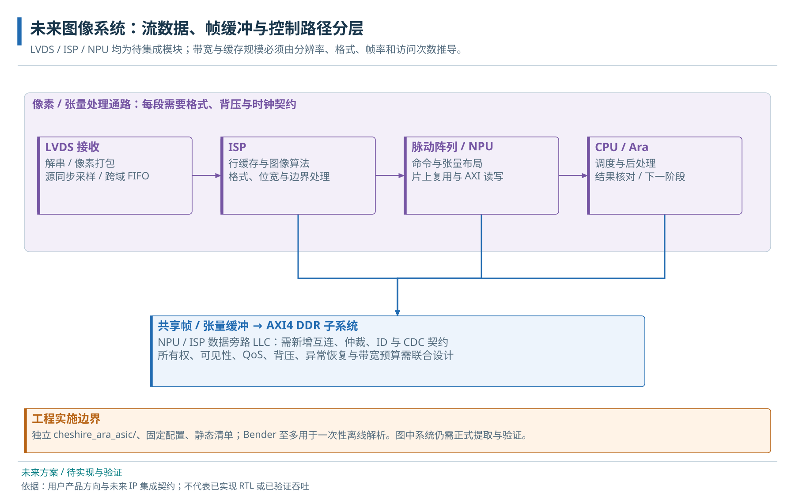
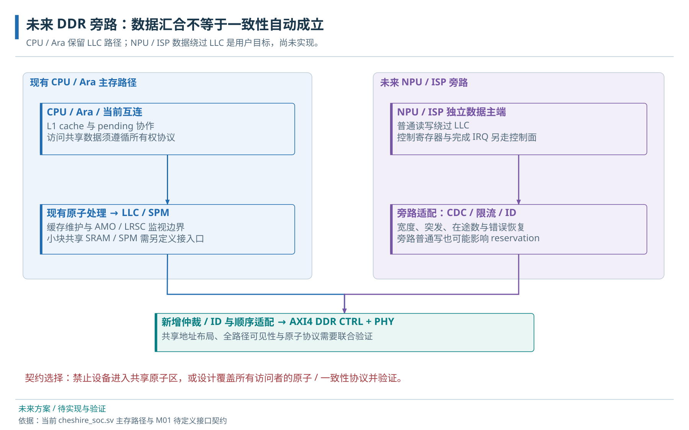

# 31 · LVDS、ISP、NPU 与外部 DDR 集成

图像处理 IP 的接口、缓冲、跨域与集成条件。

> 自动生成的 Markdown 阅读版；正文只维护 [HTML 内容源](../content/accelerators.html)，导航维护 [pages.json](../scripts/pages.json)。[本章 HTML](../accelerators.html) · [阅读路线](index.md)

- [31.1 LVDS、ISP 与 NPU 的接口约定](#image)
  - [31.1.1 图像采集与模型计算的系统协作流程](#frame-walkthrough)
- [31.2 AXI4 DDR 与设备旁路](#ddr)
- [31.3 NPU / ISP 旁路 LLC 的系统接入规划](#npu-topology)
  - [31.3.1 独立 Global Buffer 与 Ara 共享数据](#global-buffer)
  - [31.3.2 各类 IP 的数据与控制接口交付](#ip-contracts)
  - [31.3.3 分阶段验收](#staged-checks)
- [31.4 IP 集成交付的共通要求](#delivery-contracts)
  - [31.4.1 IP 控制寄存器与软件接口](#control-registers)
  - [31.4.2 时钟、复位、中断与带宽](#lifecycle-contracts)
- [31.5 数据率与 FIFO、DDR 带宽需求](#stream-budget)
  - [31.5.1 帧流量、服务间隔与缓冲容量预算](#buffer-lifetime)

**本章任务**

沿一帧从采集到结果回收，解释每次数据、控制和事件交接。 前置：[29 · 自定义 IP 的控制、数据和中断接入](integration.md)、[13 · CPU、Ara、DMA 与 NPU 的共享数据](sharing.md)、[30 · DDR 控制器、PHY 与 AXI4 接入](ddr.md)。

## 31.1 LVDS、ISP 与 NPU 的接口约定

LVDS 描述低压差分电气传输，图像接入还需传感器的 lane 数、位时钟、字对齐、帧行同步和像素格式。ISP 要声明输入输出格式、边界处理、帧缓冲与背压；NPU 要声明 tensor 布局、精度、任务描述符、DMA、完成和错误。控制寄存器、数据口、中断以及复位恢复由同一任务契约约束。

图像吞吐先用宽×高×每像素字节×帧率估算，再乘上实际读写遍数。例如 ISP 写一遍、NPU 再读一遍已经是两次存储流量，乒乓缓冲还增加容量。输入是否能等待决定缓冲如何吸收正常服务间隔，和VGA的有期限消费形成对应。

### 31.1.1 图像采集与模型计算的系统协作流程

下面把已有控制、数据和事件接口放进一个未来工作过程。假设 LVDS 接收一帧图像，ISP 做前处理，NPU 做主干计算，Ara 做部分向量算子；这些新 IP 及协议尚未接入当前工程，具体算子划分也需模型评估。

1. CPU 为采集分配帧缓冲区并设置格式、行长和容量。LVDS 接收端在自己的采样域完成解串及帧界定，跨域队列向 ISP 输送数据；数据率决定队列必须吸收的停顿。
2. ISP 取得输出缓冲区的写权限，经自身 AXI 口写入处理结果。帧结束标记到达时仍可能有写响应未返回，完成状态必须覆盖这些在途写与错误。
3. CPU 收到中断后核对任务编号、实际长度和错误码，建立可见性，再将物理地址、张量布局和量化参数提交给 NPU。中断只提示状态变化，描述符才定义任务内容。
4. NPU 从共享内存读取输入并写结果；Ara 按调度执行适合的向量阶段。跨设备切换按[所有权协议](sharing.md#handoff)处理每个缓冲区，避免边写边读未完成数据。
5. 最后消费者完成读取并释放缓冲区，下一帧才可以重新使用同一空间。应用可以用两个不同缓冲交替采集和计算，但每个缓冲仍必须遵守相同的所有权交接。

这段推演给 IP 选型提供具体问题：ISP 能否承受下游背压，NPU 是否只读写 DDR，DDR 仲裁能否保证采集不溢出，CPU 是否需要保存每帧元数据，以及哪一层在断电后恢复任务。它们应进入接口规格和验证计划，而不是等接完线才交给驱动补救。

本例是未来集成方案，没有当前可执行的NPU/ISP驱动。帧结束与写完成的区别属于正常使用条件；超时、迟到写、丢帧及恢复细节见[系统诊断](system-debug.md#frames)。

## 31.2 AXI4 DDR 与设备旁路

用户已确认供应商可提供 AXI4 DDR，旧 AXI3 桥规划不再是必选项。接口契约需列地址/数据/ID/USER 宽、容量映射、burst 与窄访问、最大在途、顺序、错误响应、时钟复位及初始化完成。现有 FPGA 的 64→512 位、ID 适配和 MIG UI CDC 是板级实现，后续应按供应商 AXI 接口重新核对。

用户要求 NPU/ISP 数据绕过 LLC，减少其分配和替换压力。可在 DDR 上游增加互连，把 CPU/Ara 普通内存访问的 LLC 出口与设备数据口汇合；这仍共享 DDR 带宽。CPU/设备共享区域要统一缓存属性、所有权和通知协议，旁路写还需考虑上游 AMO/LRSC 的观察范围。把原子单元移位置并不会自动生成全系统一致性。

DDR 旁路候选图；仅画普通主存流量，独立 GB 支路见下文。没有为新 IP 冻结地址、控制器位宽、时钟或最终软件栈。

## 31.3 NPU / ISP 旁路 LLC 的系统接入规划

用户规划让 NPU/ISP 数据流绕过 LLC，并与 LLC 下游在 DDR 前合流。新增一层互连需要合并 ID 空间、保存 W 路由和读写顺序、限制各端在途量，并定义背压与带宽保障。当前 SoC 的外部 master 入口通常仍进入原系统拓扑，接到该入口不自动等于实现 DDR 旁路。

DDR 合流拓扑候选，尚未修改 RTL；本图不包含后续讨论的独立 GB。控制、IRQ、缓存副本和原子边界分别验收。

### 31.3.1 独立 Global Buffer 与 Ara 共享数据

2026-10-09 的项目需求记录已将 Global Buffer（GB）明确为独立片上 SRAM，供 NPU 与 Ara 共享中间结果；近期主 AXI Crossbar 保持 64 位。GB 不是 DDR 中划出的一个地址区，也不是自动缓存 DDR 的透明 cache。DDR 与 GB 之间需要搬运引擎显式读写，GB 的容量、bank、端口、时钟和 CPU 是否直访仍待确认。需求与候选范围见[M01 接口契约第 12 节](../../M01_IP_DDR_Interface_Contract.md)。

当前 Ara 只有一套 VLSU/AXI 出口。若以后采用 4 lanes，该局部口按现有公式变成 128 位；候选做法是在已有失效过滤器之后、128→64 转换之前按物理地址分流。普通地址继续走主 Crossbar/LLC，GB 地址走新端口到 SRAM 适配与仲裁。此连接尚未实施，4 lanes 与 VLEN 也未冻结；分流并不会增加第二个独立向量访存引擎。

| 数据交接 | 谁发事务、数据落在哪里 | 必须定义的使用条件 |
| --- | --- | --- |
| DDR → GB | NPU 自有或另行确定的搬运引擎读 DDR，再写 GB SRAM | 长度/布局、搬运错误和到达共享可见点；不能把现有 iDMA 控制缺口当作已解决 |
| Ara → GB 读写 | 向量普通 load/store 使用 GB 的合法物理窗口；拟从宽侧支路访问 SRAM | 翻译/权限、地址边界、byte lane、同 ID 返回顺序、反压和 bank 仲裁；不因新路由新增指令 |
| NPU 与 Ara 交接块 | 两者分阶段拥有相应 SRAM 块，数据就绪后再通知消费者 | 独占/双缓冲、完成与错误、迟到写和复位恢复；现有 Ara 写失效不会自动观察 NPU 写 |

GB 的 SRAM 端口服务能力需要单独预算：同一单口 bank 不能同周期同时完成多个竞争访问。128 位 Ara 接口、规划中的 256 位 NPU DDR 主口与 SRAM 的原生端口宽度是不同契约，不能相加当作 GB 带宽。若 CPU 也需初始化或检查 GB，另提供实际可达且属性正确的访问路径；不能让同一物理地址对 CPU 表示 DDR、对 Ara 表示另一块 SRAM。

首版共享候选采用经验证的不缓存映射与分块所有权。它仍要保留数据完成→通知→消费→释放的顺序，并处理 Ara 当前写 B 错误上报缺口；一次 fence、中断到达或接口共用都不是自动一致性证明。完整共享规则在[共享数据章](sharing.md#handoff)，这里确定拓扑和存储职责。

### 31.3.2 各类 IP 的数据与控制接口交付

| 模块 | 数据与控制接口 | 接入前需要的规格 |
| --- | --- | --- |
| NPU | AXI 主端搬张量；Reg/AXI-Lite 控制；状态/IRQ；可选本地 SRAM | 算子、数据类型、布局、地址位宽、描述符/队列、错误与取消、对齐、支持的 burst、量化与数值规则 |
| ISP | 流输入/输出或 DDR 缓冲；控制寄存器 | 像素格式/位深、行/帧边界、stride、裁剪、背压或丢帧规则、最大突发与缓冲量 |
| LVDS 接收 | PAD/PHY → 解串 → 字/行/帧恢复 → CDC FIFO | 电气与速率、lane 数、时钟方式、训练、码字对齐、帧协议；LVDS 本身不规定图像包格式 |
| DDR AXI4 IP | 共享从端 + 控制面 + PHY | 见[DDR 接口表](ddr.md#ddr-subsystem)；端口容量和响应约束成为上游设计输入 |

### 31.3.3 分阶段验收

分阶段验收：先用独立内存模型验证设备描述符和结果；再接 Reg/IRQ、检查只提交一次及错误传播；然后接共享 SPM 或预留 DDR 区、执行所有权交接；最后增加多主竞争、长背压、复位中断与错误注入。每阶段记录配置、事务数/字节数、数值比对和超时恢复，不能只看 DONE。

描述符控制区、完成邮箱和数据区应按用途分配，但本轮不分配生产地址。驱动必须知道设备可见地址、长度上限、layout/quant 版本、完成 token 与 epoch；缓存和所有权协议见[共享数据章](sharing.md#sharing)。Ara/NPU 任务划分与完整教学案例见[模型协作章](models.md#model-case)，拓扑方案不能替代算子和性能实测。

## 31.4 IP 集成交付的共通要求

### 31.4.1 IP 控制寄存器与软件接口

NPU/ISP 应交付寄存器偏移、允许访问宽度、RO/RW/W1C、复位值、保留位、启动和忙状态的合法操作；LVDS 接收应定义训练/字对齐/帧状态，DDR 应定义初始化与故障状态。基址、IRQ 编号尚待本工程分配。软件提供完整 init→submit→wait/error→stop/recover 流程和实际结果校验，不能仅给一张宏列表。

### 31.4.2 时钟、复位、中断与带宽

| IP | 时钟/复位与事件 | 数据边界与验收 |
| --- | --- | --- |
| LVDS | 传感器源同步域→解串/CDC；失锁、错码、丢帧通知 | lane/字/帧同步模式，输入不接受背压时的溢出策略 |
| ISP | 行/帧状态与系统域交接；复位后从明确帧边界重启 | 输入输出像素格式、stride、边缘算法、每帧读写量和黄金图像 |
| NPU | 任务队列、完成/错误/超时；复位与取消不混淆旧 token | 算子、精度、布局、实际长度、最大在途量与独立数值参考 |
| DDR | 控制器/PHY 时钟、训练与校准、失锁和 ECC 事件 | 容量/地址映射、AXI 限制、刷新压力、错误模型与供应商约束 |

设备是否有内部 SRAM、是否可保持状态、哪一类错误可恢复，都待实际 IP 规格确认。共同的软件共享规则集中在[所有权与元数据契约](sharing.md#handoff)。

## 31.5 数据率与 FIFO、DDR 带宽需求

只作算例：1920×1080、每像素 2 字节、60 帧/秒，单向有效载荷为 248,832,000 B/s；一帧约 3.96 MiB。写一次再读一次至少 497,664,000 B/s，不含 blanking、padding、协议和中间结果。若输入不能背压，100 μs 的下游停顿要吸收至少 24,884 字节有效数据，还需裕量。设计 FIFO 深度时应采用最大连续到达率和最坏停顿，而不是只用平均帧率。

ISP 若产生多份中间图、NPU 若多次读权重，上述流量继续增加。先画每块数据的写读次数和生存期，再决定行缓冲、tile、双缓冲或整帧 DDR。已完成与仍由设备持有的帧必须分开，不能提前复用。

### 31.5.1 帧流量、服务间隔与缓冲容量预算

先从一帧算起：1920×1080×2=4,147,200字节，行有效数据为3840字节；两份完整帧缓冲至少需要8,294,400字节，尚未包含stride、元数据和中间张量。双缓冲只能让不同帧的阶段重叠，不能把单帧中“先生产后消费”的依赖消掉。

再计算数据经过DDR几遍。若ISP把处理图写入DDR、NPU读取一次，就是每帧两遍；NPU输出、中间层、权重和CPU读取分别加上，不能把像素输入率直接当DDR总流量。短时间FIFO深度由最大到达率乘最长不能服务的间隔决定，还需容纳已有在途数据及实现裕量。上文100μs只用平均速率得出的24,884字节是下界；若有效行集中到达、仲裁暂停更长，真实需求会更大。最大到达率和最长服务间隔必须来自传感器/IP与DDR仲裁契约，当前未冻结。

正常运行时记录每个阶段的开始、结果可见与缓冲释放事件，并分别度量一帧延迟和稳定吞吐。旁路LLC不会隔离下游DDR竞争，也不自动解决缓存或AMO/LRSC观察。具体计时设计见[测量边界](measurement.md#boundaries)，完整字段与责任分工由M01接口契约承接。

**源码与进一步阅读**

[当前平台适配参考](../../../target/xilinx/src/dram_wrapper_xilinx.sv)；[gen\_ext\_reg\_slv / gen\_ext\_axi\_mst / IRQ](../../../hw/cheshire_soc.sv)；[外部 Reg / AXI 规则](../../../hw/cheshire_pkg.sv)

**NPU 旁路 LLC 后，CPU 的 DDR 服务就不受影响了吗？**

两者仍竞争下游互连及 DDR；旁路减少的是 LLC 内的分配/替换压力，带宽仲裁、数据可见性和原子观察仍需独立设计。

---

[上一页：DDR 控制器、PHY 与 AXI4 接入](ddr.md) · [下一页：模型任务划分与容量带宽预算](models.md)
