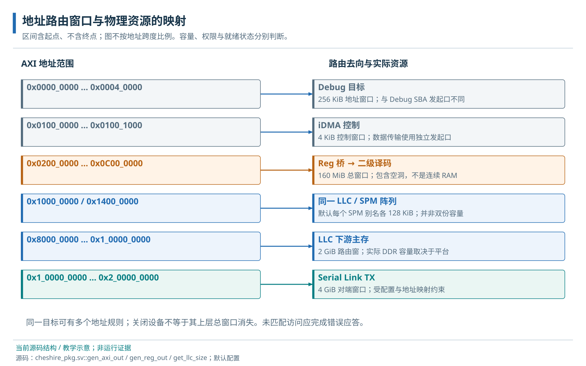

# 05 · 地址空间与访问属性

地址路由窗口、实际资源容量与 CPU 访问属性。

> 自动生成的 Markdown 阅读版；正文只维护 [HTML 内容源](../content/address-map.html)，导航维护 [pages.json](../scripts/pages.json)。[本章 HTML](../address-map.html) · [阅读路线](index.md)

- [5.1 地址路由、资源容量与访问属性](#spaces)
  - [5.1.1 路由、物理存储和 CPU 属性](#routing)
  - [5.1.2 地址访问与路径解析示例](#address-translation-example)
  - [5.1.3 外部窗口的分配流程](#allocation)
- [5.2 默认地址范围、真实容量与访问属性](#address-map)
  - [5.2.1 AXI 与 Reg 的实际默认窗口](#windows)
  - [5.2.2 缓存、执行和非幂等属性](#attributes)

**本章任务**

分别核对路由窗口、实际容量和 CPU 属性。 前置：[01 · 整体架构与平台边界](architecture.md)、[工具链、链接与 ELF](build.md)。

## 5.1 地址路由、资源容量与访问属性

### 5.1.1 路由、物理存储和 CPU 属性

一个 CPU 指针首先对应软件约定；地址译码决定事务发到哪里；目标设备才决定该偏移有什么作用。路由覆盖 2 GiB 不表示安装了 2 GiB DDR，CPU 将一段地址标为可执行也不会在那里创造 RAM。对每段地址同时记录窗口、实际资源、访问宽度、缓存属性、执行许可与软件用途。

### 5.1.2 地址访问与路径解析示例

以机器态裸机程序读 `0x03002014` 为例，它落在 UART 窗口中，偏移为 `0x14`，对应当前 UART 的 LSR 状态寄存器。C 指针提供地址，CPU 依据访问属性处理这次 load，Crossbar 将它送到 Reg 桥，Reg 译码选择 UART，UART 按偏移返回发送/接收状态。每一层都使用地址，但回答的问题不同。

物理存储属性（PMA，Physical Memory Attributes）描述区域是否可缓存、可执行及是否允许具有副作用的访问。UART 的读可能观察不断变化的硬件状态，数据/FIFO 寄存器还可能在读时产生动作，因此不能用普通内存的推测和重复读取方式解释所有 MMIO。物理内存保护（PMP）则管理访问许可；页表/MMU 在启用时还增加虚拟地址到物理地址的转换。裸机直接使用物理布局不等于后两种机制已经配置完成。

“幂等”表示重复执行相同操作不增加额外效果。普通 RAM 读可以重复获得存储值，而 FIFO 出队寄存器每读一次可能移走一个元素，属于有副作用的访问。这是地址属性影响硬件行为的具体原因。将设备错误地归入缓存区，可能让第二次读取停在旧缓存副本中；将一个地址归入可执行区，也仍需真实设备能返回指令。

本地依据：[gen\_cva6\_cfg 的 PMA 规则与 gen\_reg\_out](../../../hw/cheshire_pkg.sv)、[UART\_LINE\_STATUS\_REG\_OFFSET](../../../sw/include/dif/uart.h)；概念对照[CVA6 PMA 手册](https://cva6.readthedocs.io/en/latest/01_cva6_user/PMA.html)。当前 CPU 的实际访问许可仍取决于特权状态及最终配置。

### 5.1.3 外部窗口的分配流程

新设备先选无重叠窗口，再核对 AXI 与 Reg 两层规则、软件链接符号、CPU 属性及故障响应。参数生成的内部索引可以压紧，物理地址未必变化；因此不能拿端口下标计算软件基址。具体路由实现见[Crossbar 译码](interconnect.md#decode)。

## 5.2 默认地址范围、真实容量与访问属性

下表把当前 cheshire\_pkg::DefaultCfg 代入 gen\_axi\_out/gen\_reg\_out 计算，区间均为 \[起点,终点)。Cfg 是传给 SoC 的配置结构；目标封装可以覆盖它，因此下表不是所有构建目标的最终地址承诺。关闭设备会移除其规则；外部扩展由有效 Cfg 添加。官方架构图的一些范围表示预留空间，本地代码只映射实际计算出的窗口。例如默认 SPM 是 128 KiB，不能照抄历史图中的 64 MiB 预留值作为容量。

范围不按比例；主存和 Link 的路由跨度不是已安装存储容量。

### 5.2.1 AXI 与 Reg 的实际默认窗口

| 对象 | 区间（十六进制） | 实际解释 |
| --- | --- | --- |
| Debug / DMA ctrl | 00000000–00040000 / 01000000–01001000 | 256 KiB 调试目标；4 KiB 控制窗口 |
| Reg 总窗口 | 02000000–0c000000 | 160 MiB 路由空间，内部有未映射洞 |
| ROM / CLINT | 02000000–02040000 / 02040000–02080000 | 各 256 KiB 窗口；ROM 镜像实际长度另查 |
| Router / AXI RT（可选） | 02080000–020c0000 / 020c0000–02100000 | 各 256 KiB 预留路由，寄存器只占其中一部分 |
| SoC、LLC、UART、I2C、SPI、GPIO、Link、VGA、USB | 03000000 + n×1000，n=0…8 | 每项 4 KiB；内寄存器偏移见各章及索引 |
| BusErr | 03009000 + j×40，长度 40 | 单核默认 3 单元，共 0xc0 字节；不能按整个 4 KiB 推出寄存器均存在 |
| PLIC | 04000000–08000000 | 64 MiB 窗口；source/context 尺寸另定 |
| CLIC（可选） | 08000000 + hart×40000，长度 40000 | 每核 256 KiB |
| SPM 低 / 高 | 10000000–10020000 / 14000000–14020000 | 同一 128 KiB 阵列的两个别名 |
| LLC 下游 / Link | 80000000–100000000 / 100000000–200000000 | 2 GiB / 4 GiB 路由窗口，平台决定容量与有效远端 |

### 5.2.2 缓存、执行和非幂等属性

CPU 的 cached、executable、non-idempotent 属性是另一组规则，不等于 Crossbar 译码。本地低 SPM 和主存可缓存；高 SPM 用作非缓存数据别名。当前执行属性把低 SPM 从起点覆盖 2×SizeSpm，即默认到 0x10040000，超过实际低窗口，且不包含高别名；多出的属性范围不会创造 RAM。调试/ROM/主存另有执行规则，设备空间按非幂等处理。生成地址、PMA 属性、链接脚本三者应逐项对照。

**源码与进一步阅读**

[Crossbar 与 Reg 桥](../../../hw/cheshire_soc.sv)；[两级地址规则](../../../hw/cheshire_pkg.sv)；[译码与分流](../../../.bender/git/checkouts/axi-ecdc900686449c15/src/axi_xbar_unmuxed.sv)；[来源 ID 与 W FIFO](../../../.bender/git/checkouts/axi-ecdc900686449c15/src/axi_mux.sv)；[ID 跟踪](../../../.bender/git/checkouts/axi-ecdc900686449c15/src/axi_demux_simple.sv)；[顺序及切分说明](../../../.bender/git/checkouts/axi-ecdc900686449c15/doc/axi_xbar.md)

---

[上一页：工具链、链接与 ELF](build.md) · [下一页：AXI 通道、突发与握手](axi.md)
