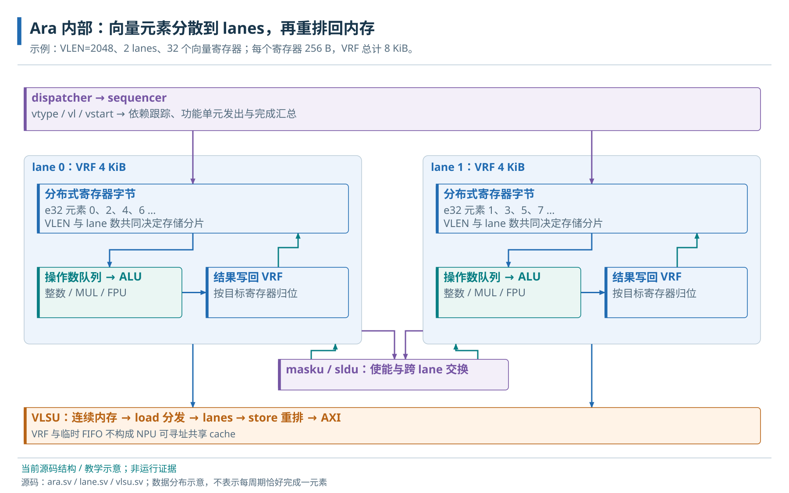
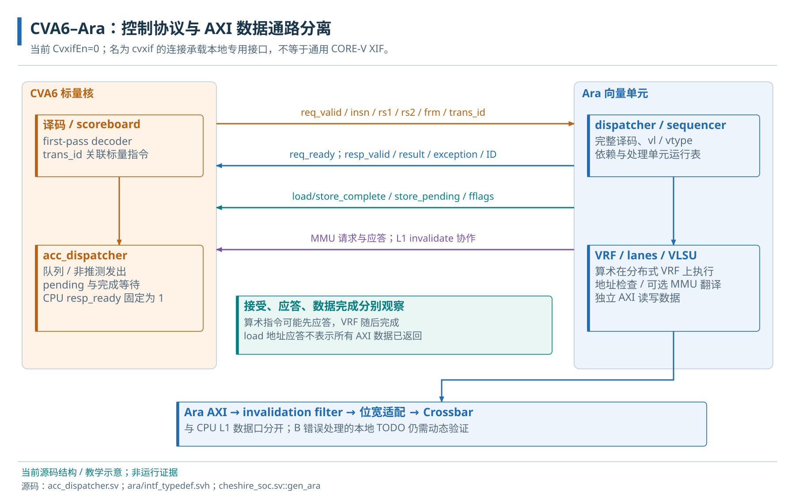
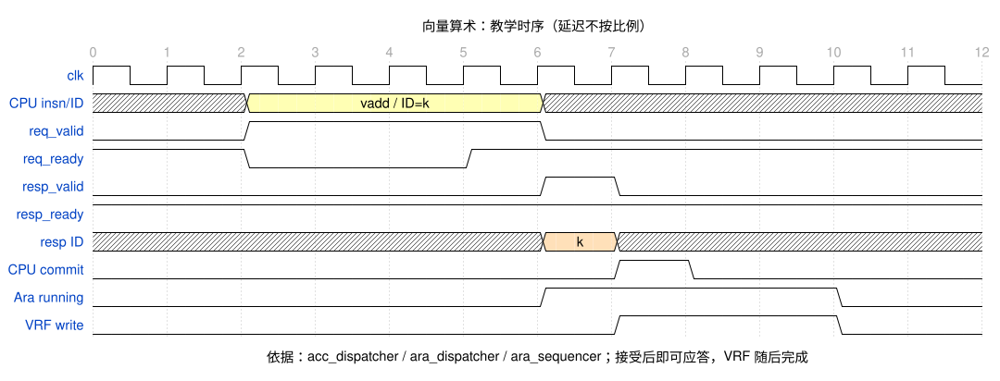
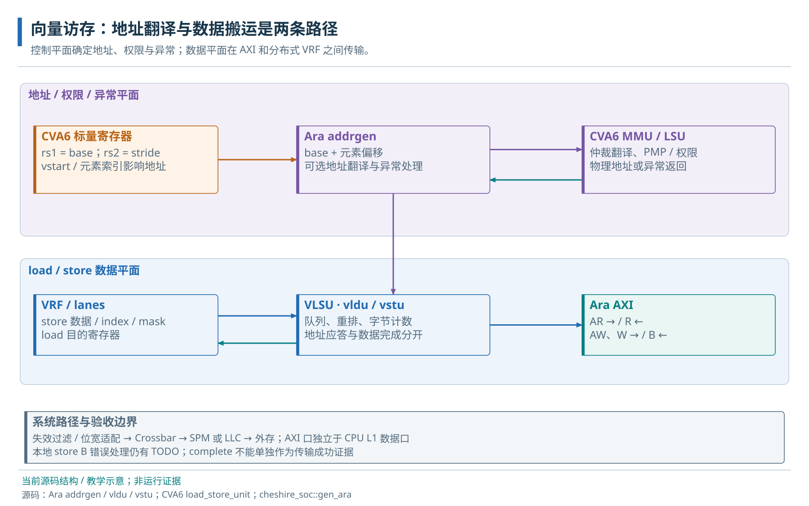
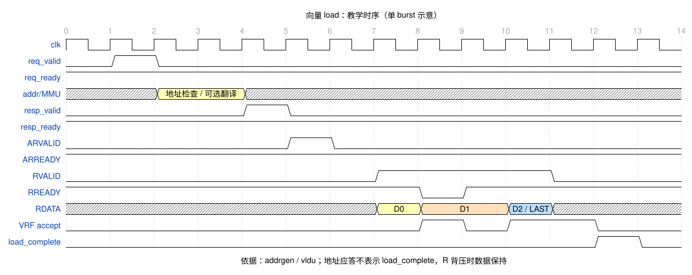

# 11 · Ara 结构与 CVA6 协处理器接口

向量请求、应答、CPU 提交与执行完成的协作关系。

> 自动生成的 Markdown 阅读版；正文只维护 [HTML 内容源](../content/ara.html)，导航维护 [pages.json](../scripts/pages.json)。[本章 HTML](../ara.html) · [阅读路线](index.md)

- [11.1 数组计算中的标量与向量分工](#array-task)
- [11.2 向量寄存器容量、执行长度与元素类型](#integer-model)
- [11.3 Ara 顶层接口与本地连接](#external-ports)
- [11.4 Ara 存储容量与并行执行资源](#capacity)
- [11.5 Ara 加载、计算与存储的数据流](#internals)
  - [11.5.1 Dispatcher、Sequencer 与执行单元](#dispatch-sequence)
  - [11.5.2 Lane、VRF 与加载—计算—存储](#lane-layout)
- [11.6 CVA6 译码与 Ara 请求分派](#interface)
  - [11.6.1 初译码、标量操作数与非推测发出](#first-pass)
  - [11.6.2 请求字段、握手与标量返回值](#handshake-fields)
  - [11.6.3 专用接口与通用扩展接口的边界](#interface-boundary)
- [11.7 接受、应答、提交与运算完成](#completion)
  - [11.7.1 CPU 提交与 Ara 实际完成](#early-response)
  - [11.7.2 标量返回、地址应答与访存完成](#response-types)
  - [11.7.3 正常依赖等待与异常边界](#stalls-errors)
- [11.8 向量数组循环的 CVA6–Ara 协作流程](#walkthrough)
- [11.9 向量地址与独立数据通路](#vector-memory)
  - [11.9.1 地址生成、翻译和权限](#address-translation)
  - [11.9.2 独立 AXI 数据通路与实现限制](#data-completion)
  - [11.9.3 向量事务的地址目标与最终存储](#memory-destinations)
- [11.10 Ara 结果写入与 CPU 数据交接](#buffer-handoff)

**本章任务**

分清请求、应答、CPU 提交和实际完成。前置：[CVA6 功能](cva6.md)、[AXI 事务](axi.md)和[存储层次](memory.md)。参数修改时再查[系统配置](configuration.md)。

## 11.1 数组计算中的标量与向量分工

我们沿已有 journey.c 计算137个 uint32\_t：a\[i\]=i、b\[i\]=2\*i+1，c\[i\]=a\[i\]+b\[i\]，独立期望是3\*i+1。标量循环每轮处理一个元素；RVV用一条向量加法描述一批元素，硬件再分多次完成这一批。整数加法按2³²取模，本例范围内没有回绕。

CVA6负责取指、分支、标量地址/计数和程序顺序；Ara接收CVA6发出的向量指令及必要标量值，执行向量运算并通过自身AXI访存。Ara没有另一个独立程序计数器在内存取这段程序，也不是写某个MMIO启动寄存器才开始的外设。先从软件所见的一批元素出发，再看这种分工怎样实现。

## 11.2 向量寄存器容量、执行长度与元素类型

软件可见 v0–v31 共32个向量寄存器。VLEN是每个寄存器的实现位数，不能用CSR指令改变；当前为2048 bit，即256字节。SEW是本次运算选择的元素位宽，e32表示32 bit；LMUL表示一组操作数占用的寄存器容量倍数。e32,m1的单组最大元素数 VLMAX=LMUL×VLEN/SEW=64。

AVL是软件提出的“还剩多少元素”，单位为元素。vl是硬件实际选取的活动元素数，范围0..VLMAX；软件每次按返回vl前进。EEW是某个操作数的有效元素位宽：本例vle32的内存EEW与SEW同为32，到了宽化或索引指令才可能不同。本地常用SEW为8/16/32/64 bit；LMUL编码为mf8/mf4/mf2/m1/m2/m4/m8（1/8到8），不能与任意SEW自由组合，必须满足实现可容纳及指令分组约束。lane是物理处理分片，不是另一个软件寄存器，也不决定指针每次加多少。

| 类别 | 名称、单位与访问方式 | 使用与影响 |
| --- | --- | --- |
| 实现能力 | VLEN=2048 bit；NrLanes=2；ELEN=64 bit；Ara AXI=32×NrLanes=64 bit | 生成硬件时确定；ELEN是最大元素位宽，不是每条指令当前位宽。SoC未覆盖的参数取ara.sv默认：FPUSupportHalfSingleDouble（16/32/64位浮点）、FPExtSupportEnable、FixedPointEnable、SegSupportEnable；具体指令和组合仍核FUNCTIONALITIES与译码。 |
| 架构寄存器 | v0–v31，各VLEN bit；向量指令读写 | 保存元素；m2/m4/m8占连续2/4/8个，基号需相应对齐且不能越过v31。 |
| 整数主线CSR | vl为元素数、vtype为编码、vlenb=VLEN/8为字节数；CSR只读查询，vl/vtype由配置指令更新 | vtype含vsew/vlmul/vta/vma/vill；非法组合不能当作可执行配置。 |
| 恢复/进阶CSR | vstart：起始元素索引，CSR可读写；vxrm\[1:0\]、vxsat\[0\]及合并vcsr：可读写 | 正常新任务从vstart=0开始，正常向量指令执行规则会清零；非零恢复和定点舍入/饱和见进阶部分。 |
| CPU相关状态 | mstatus.VS/FS：2bit许可及上下文状态；frm：3bit；fflags：5bit | VS与FS的0/1/2/3为Off/Initial/Clean/Dirty；执行V前VS非Off，浮点另需FS及舍入状态；它们不决定VLEN。 |

vsetvli用标量寄存器给AVL、指令立即数字段给vtype；vsetivli用5位立即数AVL（0..31）；vsetvl用两个标量源分别给AVL和vtype，适合恢复保存的配置。它们按合法性与AVL选择vl，更新vl/vtype，并把vl返回rd。普通csrw不能把只读vl/vtype写成任意值。rs1/rd为x0的特殊形式有专门规则，入门循环使用显式剩余数和非零目的寄存器，避免混淆。

第一轮 vsetvli t0,a3,e32,m1,ta,ma 令t0接收实际vl；随后加载a到v0、b到v1，vadd写v2，vse32写c，标量把剩余数减t0、三个指针加4×t0。当前dispatcher取min(AVL,VLMAX)，137分64、64、9；RVV规范在VLMAX&lt;AVL&lt;2×VLMAX时允许其他受约束分块，所以程序必须依返回值推进。完整可跟读汇编在[下一章](vector.md#loop)。本例ta/ma只允许未使用的尾部/掩码关闭位置不保留旧值，有效结果仍须全部定义。

## 11.3 Ara 顶层接口与本地连接

| 端口（以Ara为参照） | 方向/功能 | cheshire\_soc实际连接 |
| --- | --- | --- |
| clk\_i / rst\_ni | 输入；系统时钟/低有效复位 | 直接接SoC clk\_i/rst\_ni；不在Ara实例边界建立独立PLL或CDC。 |
| acc\_req\_i : cva6\_to\_acc\_t | 输入；指令请求、标量值、MMU响应/翻译使能 | acc\_req来自CVA6；结构里不仅有请求，还含CPU提供的翻译响应。 |
| acc\_resp\_o : acc\_to\_cva6\_t | 输出；接受/应答、标量结果、异常、访存完成及MMU请求 | acc\_resp返回CVA6；向量数据本身不在result逐元素传送。 |
| axi\_req\_o / axi\_resp\_i | 输出/输入；Ara数据总线请求/响应 | 先经axi\_inval\_filter，再经位宽转换接SoC AXI；当前数据64bit，地址宽由Cfg.AddrWidth决定。 |
| scan\_enable\_i / scan\_data\_i / scan\_data\_o | 输入/输入/输出；扫描相关端口 | 两输入绑0，输出未用。端口存在不证明扫描链插入、ATPG或DFT验收。 |

复位清控制状态、队列有效位和向量配置状态，并不等于将VRF数据逐字清零。VRF由tc\_sram实现，软件先用load定义v0/v1，再计算定义v2，不能依赖未写寄存器的数据。lane内部有bank局部门控，但不由此推断SoC已经完成时钟/低功耗签核。

## 11.4 Ara 存储容量与并行执行资源

每个寄存器2048/8=256字节，32个共8192字节=8KiB；两lane各4096字节。e32,m1/m2的VLMAX为64/128，e64,m1为32，e16,mf2为64；分数LMUL只有在SEW/ELEN等合法条件满足时使用。扩大LMUL占用更多架构寄存器组，不会增添物理VRF。

| 只改变什么 | 可推导的变化 | 不能直接推出 |
| --- | --- | --- |
| VLEN增加、lane不变 | 单寄存器及总VRF容量同比增加，VLMAX增加，每lane分片变大 | 每周期处理更多或程序同比加速 |
| lane增加、VLEN不变 | 总VRF不变、每lane容量减少，执行资源/连线变化；本SoC AraAXI位宽也随lane变化 | 内存带宽无限、任意lane/VLEN组合均可用 |
| 运行时SEW/LMUL变化 | VLMAX、分组、活跃元素数、操作数宽度/布局改变 | 改变物理lane数、VLEN或系统时钟 |

本地ara.sv检查lane非零、为2次幂且不超过MaxNrLanes；VLEN非零、为2次幂且≥ELEN。lane/VRF深度、shuffle支持、接口位宽和整机profile还有约束，顶层几条assert不是任意组合已验收的证明。CPU profile中的VLEN字段在此表示虚拟地址宽度，与AraVLEN不是同一个量。必须同时核对CPU向量profile、SoC Cfg.Ara、真实decoder/实例、编译ISA/ABI与运行时VS；SELCFG=3不能包办这些条件。详见[有效组合](configuration.md#combinations)。

## 11.5 Ara 加载、计算与存储的数据流

### 11.5.1 Dispatcher、Sequencer 与执行单元

dispatcher 保存 vl/vtype/vstart 等向量状态，检查编码及寄存器分组，必要时发起元素宽度重排。sequencer 追踪寄存器读写冲突、功能单元队列和在途指令。每条 lane 包含 VRF 分片、操作数请求/队列、整数与乘除/浮点资源；masku 向各单元提供每元素使能，sldu 处理跨 lane 数据移动及部分归约协作，VLSU 包含 addrgen、vldu、vstu。

本地结构的分层教学图；源码依据 ara.sv、ara\_sequencer.sv、lane.sv、vlsu.sv。

沿结构图先看load：dispatcher把软件编码变为操作描述，sequencer为它记录寄存器依赖并送给VLSU；地址生成/AXI取回的数据经shuffle进入lane的VRF。add随后申请VRF的两个源，操作数队列暂存读出值，使bank读与运算单元消费能分别前进；整数ALU将结果写回目的分片。store的操作数请求器读取这些分片，VSTU重新拼成内存顺序。masku提供元素使能，slide单元为跨lane移动/归约提供通路；本例无掩码、无slide，不能要求所有操作都经过同一算术流水线。

### 11.5.2 Lane、VRF 与加载—计算—存储

以两 lane、e32、vl=4 为小例子，内存中 a\[0..3\] 连续排列；load 后，元素 0/2 放到 lane0 的两个 32 位位置，1/3 放到 lane1。vadd.vv 分别读取相同 lane 的 a/b 分片，结果写回目的向量寄存器；store 再组合成 c\[0\],c\[1\],c\[2\],c\[3\] 的自然内存顺序。这个e32映射对应本地ara\_pkg::shuffle\_index在2 lane、EW32的表：前16字节中元素0/2映到lane0，1/3映到lane1。每lane有8个64位单口bank，操作数请求器仲裁读写；bank内地址与元素宽度相关。更窄元素需要字节 shuffle，变化 EEW 时还可能需要 reshuffle；软件依赖架构元素顺序，不依赖物理 bank 地址。

VRF 是由指令显式寻址的 32 个架构寄存器，当前共 8 KiB，每 lane 分摊 4 KiB。其 bank 冲突、操作数 FIFO、load 结果队列和 store 队列会造成背压。这些临时存储不提供按主存地址查 tag 的通用数据缓存。在当前 ara.sv → vlsu → AXI 的路径中没有独立 Ara 数据 cache；CPU L1、LLC、LLC 的 SPM ways 与外部 DDR 各有不同地址、容量及一致性责任。未来 NPU 无法凭同在片上就直接访问 Ara VRF。

## 11.6 CVA6 译码与 Ara 请求分派

### 11.6.1 初译码、标量操作数与非推测发出

以 `vadd.vv v2,v0,v1` 为例，CVA6 取得 32 位编码后，在 decoder 的加速器分支调用 Ara 提供的 `cva6_accel_first_pass_decoder`。这一步识别向量操作、标量源/目的寄存器、load/store 类别，并检查 VS；涉及向量浮点还检查 FS。它把功能单元标为 ACCEL，把原始指令保留下来，完整的向量合法性检查交给 Ara dispatcher。初译码能认出某类编码，尚不能证明 Ara 实现该操作的全部变体。

CVA6 读出需要的标量操作数并维护 scoreboard，即记录未完成指令及其依赖的表。`acc_dispatcher` 有深度 3 的指令队列和后续 spill register；队列满附近会停止接收新的加速器指令。指令只有到达可非推测发出的提交边界，才通过请求寄存器送给 Ara。这防止一条后来会被分支冲刷的指令提前改变向量状态；变量名 acc\_commit 在这里表达“允许非推测发出”，应与最终 commit\_ack 区分。

当前源码连接，教学抽象省略流水级。控制方向和 AXI 数据方向独立；依据 cheshire\_soc::gen\_ara、acc\_dispatcher 和 ara/intf\_typedef.svh。

### 11.6.2 请求字段、握手与标量返回值

请求结构的 insn 携带编码，rs1/rs2 携带实际标量值，frm 携带浮点舍入模式，trans\_id 关联 CPU scoreboard 项。req\_valid 与 req\_ready 同时成立才接受请求；等待期间请求保持稳定。应答携带 resp\_valid、同一个 trans\_id、result 和 exception；CPU 本地把 resp\_ready 固定为 1。无标量目的寄存器的 vadd.vv 不把整个向量结果装进 result；它的目的数据写入 Ara VRF。vsetvli 的实际 vl、vmv.x.s 或浮点标量传送才需要相应的标量返回值。

### 11.6.3 专用接口与通用扩展接口的边界

当前接口还携带 store\_pending、load\_complete/store\_complete、fflags 和失效通知，外层结构另有 acc\_mmu\_req/resp 及翻译使能。`gen_cva6_cfg` 明确 CvxifEn=0，由 RVV 派生 EnableAccelerator；SoC 将这些自定义结构传给名为 cvxif\_req/resp 的端口，消费者是专用 acc\_dispatcher 和 Ara。通用 CORE-V XIF 的 issue/commit/result 协议及适配能力不能从这个端口名推出。新增 NPU 通常先走系统控制/数据接口，而非把它接到这里冒充另一种 Ara。

## 11.7 接受、应答、提交与运算完成

### 11.7.1 CPU 提交与 Ara 实际完成

合法算术指令经 Ara 解码、后端具备接收条件后可以很快应答 CVA6；此时 lane 可能仍在分批运算。CPU 以应答更新 scoreboard，按程序顺序提交，随后可推进无依赖的标量工作。Ara sequencer 为内部指令分配运行标识，记录各处理单元的 vinsn\_running 和寄存器读写依赖；后继向量消费者必须等待所需结果，而不是依赖 CPU 已提交这一事实。

教学时序，横轴为示意时钟，延迟不是性能数据。对应 acc\_dispatcher 请求寄存器、ara\_dispatcher 应答与 ara\_sequencer 运行状态。 · [WaveDrom 源文件](../assets/waves/vector-arithmetic.json)

### 11.7.2 标量返回、地址应答与访存完成

带标量返回值的向量指令，要等返回值准备好才应答。load/store 还需要地址生成及异常判断：ara\_sequencer 的 WAIT 状态收到 addrgen\_ack 后把异常或正常应答送回 dispatcher。物理地址、连续访问路径与开启翻译的路径等待条件不同；翻译开启时 addrgen 等最后一次翻译完成或异常。这个应答仍与所有数据已到 VRF、所有写响应已回收分开。

vldu 在结果队列内容被 lane 接收、该指令提交字节计数归零时产生 load\_complete；vstu 按写数据/地址队列进展和 B 应答回收指令，产生 store\_complete。异常终止路径也会发完成通知以回收 pending 计数。因此 complete 表示跟踪项可以结束，是否成功还要结合 exception 和结果判断。CPU 的 speculative/dispatched load/store 计数、Ara 的内部运行表和 AXI 在途队列各自管理不同层。

### 11.7.3 正常依赖等待与异常边界

| CPU 遇到的条件 | 当前 acc\_dispatcher 的行为 |
| --- | --- |
| 新的 ACCEL 指令，队列容量不足 | issue\_stall 阻止继续接收 |
| 一致性模式开启，标量 load 前仍有向量 store | 等待向量 store pending 清除 |
| 一致性模式开启，标量 store 前仍有向量 load/store | 等待这些向量访存完成 |
| store barrier 已提交，Ara store\_pending 仍置位 | wait\_acc\_store 驱动 ctrl\_halt，直到存储排空 |
| 返回非法指令/翻译异常 | 按 trans\_id 回到 scoreboard，经提交异常流程建立 mepc/mcause/mtval 等状态 |

当前实现的错误上报/访问边界见[诊断参考](vector-debug.md#local-limits)；本例限定对齐整数连续访问，不据完成通知单独认定成功。

## 11.8 向量数组循环的 CVA6–Ara 协作流程

① CVA6取到vsetvli，等标量剩余数可用且允许非推测发出；Ara检查配置并返回vl，CPU把它写入t0。② 两条vle32的指令和基址沿专用接口过去，地址检查应答与数据到VRF分开；sequencer保留v0/v1的生产依赖。③ vadd可被接收和应答，lane必须等本批所需操作数可读后执行，CPU提交不等于所有元素已写v2。④ vse32取v2并经AXI写c；地址阶段应答后仍可能有W/B在途。⑤ CVA6用已返回t0执行sub/slli/add和分支；这些标量动作可与Ara后端工作重叠，下一轮向量依赖仍由队列与sequencer约束。

对照算术WaveDrom，先找req握手、再找resp/CPU提交、最后看lane运行结束；对照访存WaveDrom，在应答之后继续跟R数据和VRF接收。图上距离只说明允许重叠和先后，不能当固定拍数。返回标量结果的vmv.x.s必须等值真实产生，不能照抄普通向量算术的早应答。

## 11.9 向量地址与独立数据通路

### 11.9.1 地址生成、翻译和权限

`vle32.v v0,(a0)` 的 a0 值由 CPU 放入请求 rs1，addrgen 按基址、vl、元素宽度形成地址；跨步访问另取标量 stride，索引访问从 VRF 取得偏移。它把地址请求交给 CVA6 的 MMU 协作端口，load\_store\_unit 中的仲裁选择标量或加速器翻译，返回物理地址、DTLB 命中信息或异常。页表权限与 PMP 的作用取决于有效配置：本教程机器态主线没有建立页表，且 SoC 默认 NrPMPEntries=0，不能宣称已有 NPU/IOMMU 隔离。

当前源码数据/控制路径。依据 ara/vlsu、CVA6 load\_store\_unit、cheshire\_soc 中 invalidation filter 与位宽转换。

教学时序：应答、R 握手和 VRF 写入之间只表达因果，实际延迟和 burst 数由配置/地址/背压决定。 · [WaveDrom 源文件](../assets/waves/vector-load.json)

### 11.9.2 独立 AXI 数据通路与实现限制

AR/R 直接在 Ara 自身 AXI 上传输数据，load 数据经重排和结果缓冲写入各 lane；store 从 VRF 读取，重排成内存字节顺序，经 AW/W/B 完成。两个 lane 时 Ara AXI 为 32×2=64 位，之后仍有显式位宽转换以适配系统。向量元素不经 CPU 的标量 result 总线逐项传送，也不借 CPU L1D 作为向量数据接口。

当前实现的错误上报/访问边界见[诊断参考](vector-debug.md#local-limits)；本例限定对齐整数连续访问，不据完成通知单独认定成功。

### 11.9.3 向量事务的地址目标与最终存储

CPU 交给 Ara 的基址决定访问对象，VLSU 是 AXI 事务发起者。默认路径依次为 `VLSU → axi_inval_filter → axi_dw_converter → AxiIn.ara → 主 Crossbar`；随后由物理地址规则选择目标。失效过滤器只提供本地 CPU/Ara 配合，不是可自动吸收其他设备的完整一致性网络。

| 向量访问目标 | 当前请求经过的路径 | 数据落点与使用前提 |
| --- | --- | --- |
| SPM，含本例 0x14000000 高别名 | 主 Crossbar → LLC/SPM 目标及其前置适配 | 已经分配为 SPM 的 LLC 数据阵列；按容量保留独占范围，避开 ROM/应用栈与缓存别名 |
| 主存窗口 0x80000000 起 | 主 Crossbar → 原子适配 → LLC → 平台内存出口 | 配置为 cache 的 way 可命中/分配；未命中或无 cache way 时继续下游，平台模型或 DDR 必须实际就绪 |
| 新增独立 GB | 当前尚无该译码/支路；拟从 Ara 宽侧分流到片上 SRAM | 需要新窗口、端口/仲裁、缓存属性和完成契约；见[GB 接入规划](accelerators.md#global-buffer) |

若仅把 lanes 从 2 增至 4，当前公式使 Ara 出口变为 128 位，后续转换仍接 64 位主总线。更多 lane 和更宽局部出口不自动增加 DDR 带宽；系统位宽又会影响 CPU AXI、LLC 容量、DMA 与 Debug，不能把两类改动合并为一个性能旋钮。具体参数与验证表见[Ara 参考](../../configuration/ARA.md)。

路径依据：[gen\_ara / i\_ara\_axi\_inval\_filter / i\_ara\_axi\_dw\_converter / gen\_llc](../../../hw/cheshire_soc.sv)，[gen\_axi\_in / gen\_axi\_out / get\_llc\_size](../../../hw/cheshire_pkg.sv)。这里是源码连接与拟议支路的区分，没有新增目标访存结果。

## 11.10 Ara 结果写入与 CPU 数据交接

本例CPU仅经非缓存SPM高别名准备三个独占数组，fence后调用向量内核，返回后再fence，并在当前CPU/Ara pending及barrier机制下消费c。函数ret只完成控制流返回；最后store的排空条件来自协作机制，不是C函数语法。启动必须保持全SPM、正确栈边界及CSR\_ACC\_CONS开启等[共享区前提](sharing.md#ownership)；不混用缓存别名，不并发DMA改写。然后逐元素核对3\*i+1和守卫，再归还缓冲。

VRF存显式向量寄存器，CPU L1存内存副本，LLC/SPM是系统存储路径，DDR是外部容量层；本例不用DDR。当前生产仿真列表还有profile/decoder匹配门槛，实验E目标运行未完成，见[执行条件](vector-debug.md#configuration)。

**源码与进一步阅读**

[CPU 队列、非推测发射、pending 与 barrier](../../../.bender/git/checkouts/cva6-20c9d7cbe0dd6995/core/acc_dispatcher.sv)；[初译码与 VS/FS](../../../.bender/git/checkouts/ara-2c7b103275a16c87/hardware/src/cva6_accel_first_pass_decoder.sv)；[专用接口字段](../../../.bender/git/checkouts/ara-2c7b103275a16c87/hardware/include/ara/intf_typedef.svh)；[内部运行表与地址应答](../../../.bender/git/checkouts/ara-2c7b103275a16c87/hardware/src/ara_sequencer.sv)；[地址/翻译/对齐限制](../../../.bender/git/checkouts/ara-2c7b103275a16c87/hardware/src/vlsu/addrgen.sv)；[load 完成](../../../.bender/git/checkouts/ara-2c7b103275a16c87/hardware/src/vlsu/vldu.sv)；[store 完成和 B 错误缺口](../../../.bender/git/checkouts/ara-2c7b103275a16c87/hardware/src/vlsu/vstu.sv)；[MMU 与保护消费者](../../../.bender/git/checkouts/cva6-20c9d7cbe0dd6995/core/load_store_unit.sv)；[本地支持声明与 ELEN](../../../.bender/git/checkouts/ara-2c7b103275a16c87/FUNCTIONALITIES.md)；[RVV 类型与编码](../../../.bender/git/checkouts/ara-2c7b103275a16c87/hardware/include/rvv_pkg.sv)；[随附官方 VRF/重排说明](../../../.bender/git/checkouts/ara-2c7b103275a16c87/docs/source/lane.rst)；[Ara 实例与失效通路](../../../hw/cheshire_soc.sv)；[dispatcher / sequencer / lanes / VLSU](../../../.bender/git/checkouts/ara-2c7b103275a16c87/hardware/src/ara.sv)；[csr\_vl\_d 分块选择](../../../.bender/git/checkouts/ara-2c7b103275a16c87/hardware/src/ara_dispatcher.sv)；[Ara 写失效](../../../.bender/git/checkouts/ara-2c7b103275a16c87/hardware/src/axi_inval_filter.sv)；[VS 与 acc\_cons 状态](../../../.bender/git/checkouts/cva6-20c9d7cbe0dd6995/core/csr_regfile.sv)

---

[上一页：iDMA、流量管理与总线错误](dma.md) · [下一页：RVV 编程与结果验证](vector.md)
