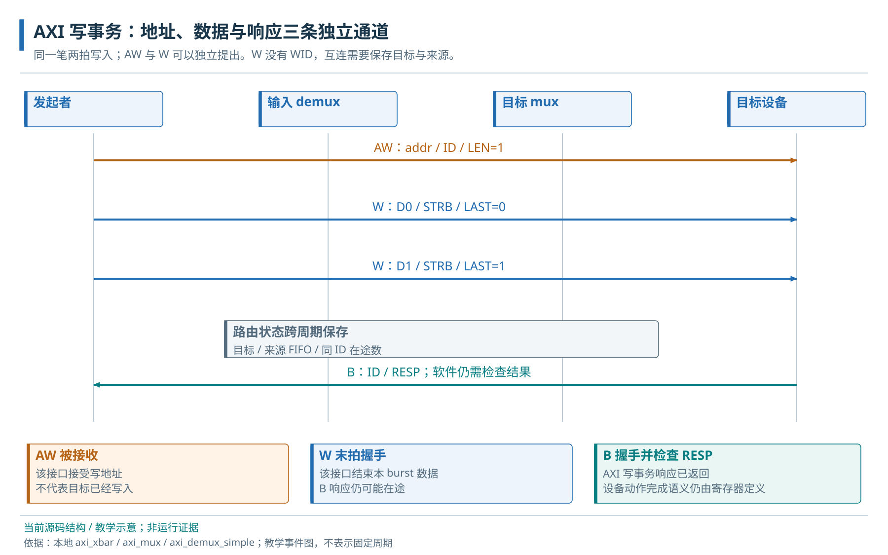
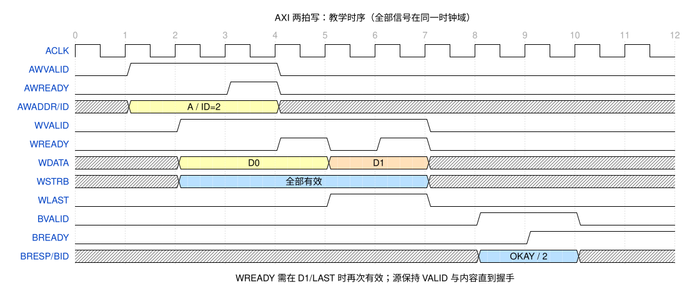

# 06 · AXI 通道、突发与握手

AXI 读写事务的通道握手与完成语义。

> 自动生成的 Markdown 阅读版；正文只维护 [HTML 内容源](../content/axi.html)，导航维护 [pages.json](../scripts/pages.json)。[本章 HTML](../axi.html) · [阅读路线](index.md)

- [6.1 五条通道与一次传输](#handshake)
  - [6.1.1 拍数、字节使能和事务标识](#burst)
  - [6.1.2 写地址、写数据与响应分别完成](#write-lifecycle)
  - [6.1.3 AXI 背压的 WaveDrom 时序示例](#timing)
- [6.2 AXI 协议语义与验证观察点](#read-write-evidence)
  - [6.2.1 读事务的接受与返回](#read-lifecycle)
  - [6.2.2 在途量和错误响应](#transaction-error)

**本章任务**

沿真实握手语义理解一笔读写事务。 前置：[05 · 地址空间与访问属性](address-map.md)。

## 6.1 五条通道与一次传输

AXI 是本工程的内存映射互连接口。读事务用 AR 传地址、R 传数据和状态；写事务用 AW 传地址、W 传数据、B 返回状态。每条通道有 VALID 和 READY：发送端准备好有效内容后置 VALID，接收端能接收时置 READY，二者在同一个时钟边沿为 1 才完成这一拍。接收端暂时拒收形成背压，发送端需保持 VALID 和对应内容，不能等到 READY 才首次提出 VALID。

### 6.1.1 拍数、字节使能和事务标识

一笔请求可以包含多个数据拍，称为 burst。LEN 编码拍数减一，SIZE 编码每拍字节数的二进制对数；WSTRB 逐位指定有效写字节，LAST 标记最后一个数据拍。ID 标记事务身份，让同时在途的请求和返回能够关联；BRESP/RRESP 携带成功或错误状态。

### 6.1.2 写地址、写数据与响应分别完成

发送方可以先提出 W，也可以 AW 和 W 错开到达。AW 握手表示接受地址，W 最后一拍握手表示数据传完，B 握手才结束写响应。这个区别决定了何时能释放路由状态，也决定了设备报告任务完成前要等待哪些响应。

写事务通道与路由流程图；具体握手见下面的 WaveDrom 教学时序。

### 6.1.3 AXI 背压的 WaveDrom 时序示例

教学时序，非仿真波形。两拍 W 分别成交，WLAST 只标记第二拍；B 等待接收时也保持 BID/RESP。 · [WaveDrom 源文件](../assets/waves/axi-backpressure.json)

按图逐拍检查：AW 等待时地址/ID 不变；第一拍 W 等到 WREADY 才推进；第二拍即使已经 LAST，也必须等自己的握手；BVALID 后若 BREADY 尚未开放，响应继续保持。一个验证器应同时检查稳定性、拍数、LAST、ID 和响应，不能只计 AW 次数。规范语义参照 [Arm AMBA AXI 官方资料](../OFFICIAL_SOURCES.md)，本地队列行为以源码为准。

## 6.2 AXI 协议语义与验证观察点

### 6.2.1 读事务的接受与返回

AR 握手接受地址、长度、尺寸和 ID；目标随后通过 R 返回数据、RID、RRESP，并在最后一拍标 RLAST。RVALID 遇到 RREADY=0 时，数据和状态保持到成交。CPU cache 命中时不一定有出核 AR，必须先定位实际请求边界再计数。

### 6.2.2 在途量和错误响应

已接受但尚未返回的事务占用队列和路由状态；允许多个在途不等于允许任意顺序。错误响应也必须完成协议要求的拍数与关联，事务终止后软件仍须检查数据结果。Crossbar 怎样保存这些状态见[Crossbar 事务状态](interconnect.md#crossbar)，设备怎样记录错误见[总线错误诊断](dma.md#errors)。

**源码与进一步阅读**

[Crossbar 与 Reg 桥](../../../hw/cheshire_soc.sv)；[两级地址规则](../../../hw/cheshire_pkg.sv)；[译码与分流](../../../.bender/git/checkouts/axi-ecdc900686449c15/src/axi_xbar_unmuxed.sv)；[来源 ID 与 W FIFO](../../../.bender/git/checkouts/axi-ecdc900686449c15/src/axi_mux.sv)；[ID 跟踪](../../../.bender/git/checkouts/axi-ecdc900686449c15/src/axi_demux_simple.sv)；[顺序及切分说明](../../../.bender/git/checkouts/axi-ecdc900686449c15/doc/axi_xbar.md)

---

[上一页：地址空间与访问属性](address-map.md) · [下一页：AXI Crossbar 结构与事务路由](interconnect.md)
