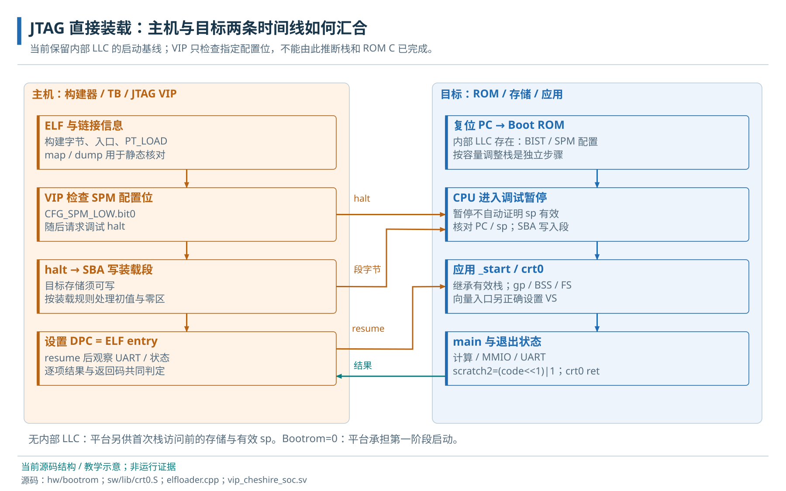
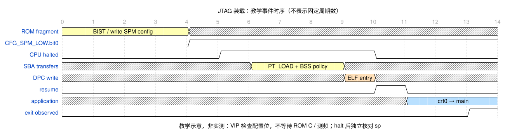

# 15 · JTAG 与程序加载调试

外部调试、程序装载与执行接管条件。

> 自动生成的 Markdown 阅读版；正文只维护 [HTML 内容源](../content/boot-debug.html)，导航维护 [pages.json](../scripts/pages.json)。[本章 HTML](../boot-debug.html) · [阅读路线](index.md)

- [15.1 程序描述与目标调试连接](#debug-workflow)
- [15.2 调试传输与模块职责](#transport)
- [15.3 主机与目标的两条时间线](#timelines)
- [15.4 JTAG 装载前置条件](#takeover)
  - [15.4.1 CFG_SPM_LOW.bit0 与暂停应答](#vip-ready)
  - [15.4.2 装载条件与应用入口条件](#stack-handoff)
- [15.5 JTAG、Debug Module 与实际装载](#debug)
  - [15.5.1 基于 SBA 的 ELF 段装载](#elf-load)
  - [15.5.2 设置 DPC 与恢复执行](#entry-resume)
  - [15.5.3 ELF 段装载与 BSS 清零的责任划分](#loader-limits)
- [15.6 数组程序的断点、寄存器与内存观察](#observe-program)
  - [15.6.1 CPU 暂停期间的系统运行状态](#halt-boundary)
- [15.7 Debug 的寄存器地址空间与复位责任](#debug-contract)
  - [15.7.1 DMI 地址、字段和副作用](#dmi-registers)

**本章任务**

用同一 ELF 解释装载、控制执行和观察状态，再核对本地调试接管条件。 前置：[14 · Boot ROM、启动模式与应用初始化](boot.md)。

<a id="debug-workflow"></a>

## 15.1 程序描述与目标调试连接

我们要在 journey 的 main 处停住，检查 seed 与 result，再让计算完成。GDB 在主机上读取 ELF 的符号和调试信息，把 `main`、源行和目标地址联系起来；调试服务器把它的请求转换为目标调试操作；探针/传输把请求送到芯片。只打开 ELF 时，GDB 知道变量“应在哪里”，还没有读取或写入这块目标 RAM。

板上常见的路径为 `GDB → OpenOCD → JTAG 探针 → DTM → DMI → Debug Module → CVA6/系统存储`。仿真 VIP 则直接驱动 JTAG 任务，无需把 GDB/OpenOCD 插进当前测试。两者使用相同目标调试概念，但当前 VIP 的 SBA 装载流程不能直接当成 OpenOCD 的访问配置。

<a id="transport"></a>

## 15.2 调试传输与模块职责

JTAG 是调试传输链路。调试传输模块（DTM）在 JTAG TCK 域接收调试操作，再通过 调试模块接口（DMI）访问系统域的 Debug Module（DM）。DM 可以停止/恢复 hart（一个硬件执行线程），执行寄存器访问命令，还能通过 SBA，即系统总线访问，主动读写目标内存。DMI 地址属于调试协议空间，不是 CPU 的 MMIO 地址。

<a id="memory"></a>

<a id="lab"></a>

<a id="timelines"></a>

## 15.3 主机与目标的两条时间线

主机可以在启动模拟器之前完成软件构建。目标 CPU 的复位逻辑只知道 BootAddr，默认指向 0x02000000 的 Boot ROM；它不会自行读取主机路径里的 ELF。仿真启动后，VIP 先提供时钟和复位，ROM 开始执行，另一边的加载任务等待目标存储达到可装载状态。两条时间线在装载和入口交接处汇合。



对应 BOOTMODE=0、PRELMODE=0 的当前 JTAG 路径。ROM 的 C main 与应用 main 分属不同程序。

<a id="takeover"></a>

## 15.4 JTAG 装载前置条件

<a id="vip-ready"></a>

### 15.4.1 CFG\_SPM\_LOW.bit0 与暂停应答

jtag\_elf\_halt\_load 在 DutCfg.LlcNotBypass 为真时轮询 LLC CFG\_SPM\_LOW.bit0，然后写 DMCONTROL.haltreq，并轮询 DMSTATUS.allhalted。它既不等待 ROM C main，也不等待 clint\_get\_core\_freq 返回。该位来自软件写配置，不能单独扩大成所有初始化完成标志。

<a id="stack-handoff"></a>

### 15.4.2 装载条件与应用入口条件

Boot ROM 在写 SPM 配置/COMMIT 后还有扩展 sp 的指令。实际 halt 落在哪条指令要看目标 PC，尤其当应用 spm.ld 通过零栈符号继承进入时栈时，应检查 DPC、sp 和可用栈范围。VIP 没有显式等待这些后续步骤，因此“能开始 SBA 装载”和“应用已有正确栈”应分别验收。

这里的栈检查区分三处边界：ROM 设置早期 sp、ROM 自己调用 C、应用 crt0 调用应用 main。它们使用的指令序列不同，不能由最后一处对齐推出前两处也满足相同条件。具体源码缺口统一保留在[软件诊断](software-debug.md#stack-handoff)。

本节依据：[jtag\_elf\_halt\_load / jtag\_elf\_run](../../../target/sim/src/vip_cheshire_soc.sv)；[SPM 配置后扩展栈的实际顺序](../../../hw/bootrom/cheshire_bootrom.S)。

<a id="debug"></a>

## 15.5 JTAG、Debug Module 与实际装载

<a id="elf-load"></a>

### 15.5.1 基于 SBA 的 ELF 段装载

TB 从 `+BINARY` 取得主机 ELF 路径。C++ 的 elfloader 通过 DPI（SystemVerilog 与 C/C++ 互操作接口）向 VIP 提供 entry 和装载段：用 p\_paddr 作为地址，从文件取 p\_filesz 字节。VIP 请求 hart0 停止，写 SBADDRESS/SBDATA，DM 便发出 AXI 事务，经过互连写入 SPM。这条路径可以检查真实总线应答。

<a id="entry-resume"></a>

### 15.5.2 设置 DPC 与恢复执行

装载后，VIP 通过 DATA 和 COMMAND 写 DPC（调试状态中的恢复执行地址）为 ELF entry，再发 resumereq。应用开始从 \_start 执行。对应字段见[DMI 寄存器表述](#dmi-registers)；每一步检查 busy、错误与完成应答。

<a id="loader-limits"></a>

### 15.5.3 ELF 段装载与 BSS 清零的责任划分

ELF 文件提供 p\_filesz 字节，目标段需要 p\_memsz 字节；当前应用的 BSS 初值由 crt0 清零，不应依赖调试器碰巧写了零。当前 VIP 按 8 字节写段的循环还存在段尾越界风险，未修复或动态复现；它影响把任意 ELF 视为安全装载输入，完整证据与专项判据见[软件诊断](software-debug.md#loader-tail)。



教学事件时序，时间不按比例。真实仿真需另保存 TCK/DMI/SBA、CPU PC 和 UART 波形。 · [WaveDrom 源文件](../assets/waves/boot-phases.json)

<a id="observe-program"></a>

## 15.6 数组程序的断点、寄存器与内存观察

先使用团队已确认的板级下载/接管流程，或仿真相应的暂停控制。本地 `util/openocd.hs2.tcl` 对应 HS2 探针；Genesys2 脚本使用另一组 FTDI 配置，文件存在不代表适用于当前 VCU118 接线。公共配置为 `reset_config none`、`riscv set_prefer_sba off`，因此连接 OpenOCD 不会自动复位全部系统，也不能承诺访存必经 SBA。板级调用协议见[现有操作参考](../../software/RUNTIME_AND_DEBUG.md#61-优先沿用-boot-rom-的调用协议)。

下面是一组 GDB 观察步骤，前提是符号来自目标将执行的同一 ELF，目标连接、装载和 Boot ROM 交接条件已经成立，CPU 暂停在应用 \_start 或 main 之前，main 断点由该目标支持。此处不重复发起下载，不保证任意调试服务器导出全部 CSR；未在本轮连接目标运行。

```
info files
break main
continue
info registers pc sp ra
print seed
x/8uw result
disassemble /r make_value
stepi
info registers pc
```

停在 main 入口时，seed 应为 1，result 的初始字节应为 0；此时应用循环还没有覆盖数组，所以这次检查有确定含义。`disassemble /r` 将函数地址与机器指令关联，`stepi` 按机器指令推进，和按源行 step 不同。优化器可能让一行对应多条指令、让局部变量暂存在寄存器或不可直接显示；不能因看不到一个 C 变量的固定 RAM 地址就推断硬件丢数据。

继续到计算完成但返回之前的已确认位置，result\[0\] 应为 1、result\[136\] 应为 409，全部 137 项求和为 28085。再让程序执行 printf、flush 和返回，检查 UART 文本与 SCRATCH2 的退出码。断点或单步改变执行时序，测性能时应移除这类干预；Linux 用户程序调试还涉及进程地址空间，见[Linux 章](linux.md)。

<a id="halt-boundary"></a>

### 15.6.1 CPU 暂停期间的系统运行状态

halt 请求使选定 hart 进入调试状态，并不意味着 SoC 时钟停止。本地 SoC 没有由 Debug Module halt 状态统一冻结 UART、CLINT、DMA 或 Ara 的全局接口；RTC 可继续推进，已提交设备工作也可能继续完成。读取设备寄存器时仍需遵守读取副作用和访问宽度；软件断点还可能修改指令字节。观察数组 RAM 与观察 FIFO 读取口不是同一种操作。

<a id="debug-contract"></a>

## 15.7 Debug 的寄存器地址空间与复位责任

<a id="dmi-registers"></a>

### 15.7.1 DMI 地址、字段和副作用

本地 riscv-dbg 的 README 声明 Debug 0.13.1；JTAG DTM 承载 DMI，DM 支持 abstract register、program buffer 与 SBA。DMI 地址是调试寄存器编号，不是 CPU MMIO 的字节偏移。DMCONTROL(0x10) 控制 dmactive/haltreq/resumereq，DMSTATUS(0x11) 查询 halted/running 等；ABSTRACTCS(0x16)/COMMAND(0x17) 管理抽象命令，SBCS(0x38)/SBADDRESS0(0x39)/SBDATA0(0x3c) 管理系统总线访问。

调试程序应先激活 DM、轮询目标状态，再执行命令；busy 时不重发，cmderr/sberror 应按字段语义清除并记录。读取 SBDATA 若启用 read-on-data 会触发后续读，不能把调试窗口自动刷新当成无副作用。复位时 DM 状态、hart reset 和系统 rst\_ni 是不同边界；本地 ndmreset 未接入系统复位，需未来 wrapper 明确实现。

SoC 的 16 个 scratch 是普通 RW、复位为 0；BOOT\_MODE/RTC\_FREQ/HW\_FEATURES 等由硬件输入和参数提供，是 RO，不应把 RO 的初始显示值当成可编程时钟控制。应用退出的 scratch2 编码是软件/VIP 约定，不是调试规范。可用 scratch6/7 做隔离的教学写读验证，但应先确认没有与当前固件约定冲突。

工具概念参照 [GDB 官方文件与符号说明](https://sourceware.org/gdb/current/onlinedocs/gdb.html/Files.html)；本文只使用通用 file/symbol/load 的职责区分，不据在线版本假定本地调试服务器能力。当前目标实现声明 Debug 0.13.1，端口连接和脚本按本地版本核对。

**源码与进一步阅读**

[启动选择与 scratch 协议](../../../hw/bootrom/cheshire_bootrom.c)；[GPT/raw 读取](../../../sw/lib/gpt.c)；[DMI 寄存器及字段](../../../.bender/git/checkouts/riscv-dbg-1a98531d53bb4602/src/dm_pkg.sv)；[SoC 寄存器属性](../../../hw/regs/cheshire_regs.hjson)；[ROM 初始化](../../../hw/bootrom/cheshire_bootrom.S)；[ELF 解析](../../../target/sim/src/elfloader.cpp)；[JTAG / UART / Link 加载](../../../target/sim/src/vip_cheshire_soc.sv)；[应用入口和退出](../../../sw/lib/crt0.S)

**主机生成 ELF 时，CPU 已经执行了 \_start 吗？**

尚未发生目标执行。ELF 只是主机文件；只有目标完成复位准备、程序字节装载和入口交接后，CPU 才能执行其中的 \_start。

---

[上一页：Boot ROM、启动模式与应用初始化](boot.md) · [下一页：异常、中断与上下文](traps.md)
