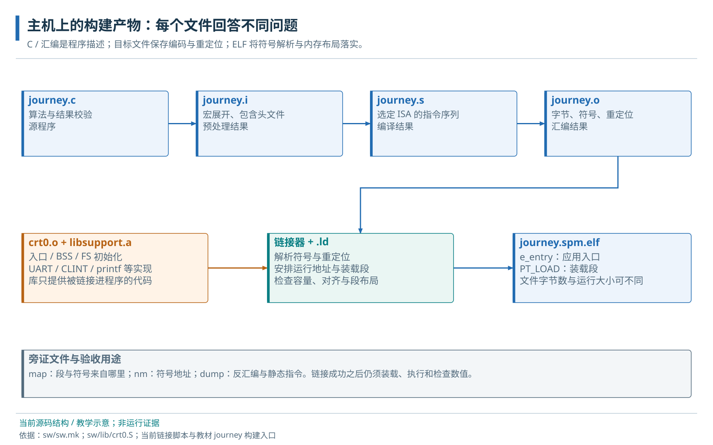
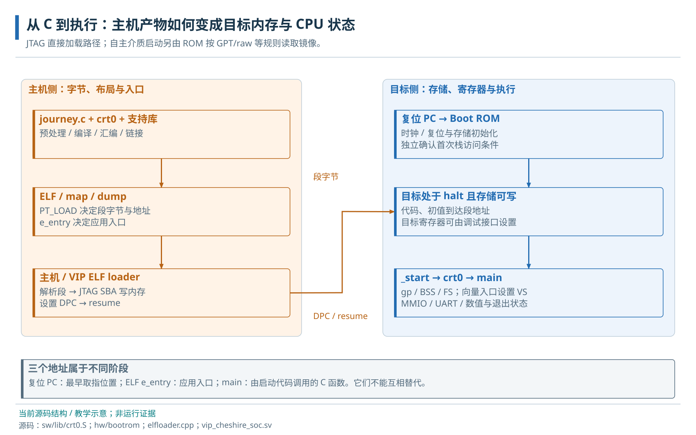

# 04 · 工具链、链接与 ELF

源文件、对象文件、链接布局与 ELF 装载产物。

> 自动生成的 Markdown 阅读版；正文只维护 [HTML 内容源](../content/build.html)，导航维护 [pages.json](../scripts/pages.json)。[本章 HTML](../build.html) · [阅读路线](index.md)

- [4.1 主机工具与目标程序](#tools)
- [4.2 预处理、编译、汇编与链接](#stages)
  - [4.2.1 翻译单元、对象文件与最终映像](#translation-units)
- [4.3 ELF 的代码数据与装载信息](#elf)
- [4.4 C 对象与链接地址布局](#layout)
- [4.5 软件构建选项及其作用](#options-reference)
  - [4.5.1 原 Make 入口的配置选项](#software-options)
- [4.6 隔离构建与产物验证](#practice)
  - [4.6.1 软件构建、装载与执行的责任交接](#source-to-hardware)
  - [4.6.2 隔离输出与产物检查](#build-practice)

**本章任务**

让同一数组程序形成可解释的装载产物。前置：[裸机 C 程序运行模型](runtime.md)。本章先说明编译所需的 ISA/ABI 条件，完整硬件配置关系在后续[配置章](configuration.md)查阅。

<a id="tools"></a>

## 4.1 主机工具与目标程序

我们在开发主机上运行交叉编译器，生成供 RISC-V CPU 执行的机器码。工具名字 `riscv64-unknown-elf-gcc` 描述目标体系；它本身运行在主机。`g++` 则用于编译仿真器调用的主机 C++ 加载器，两者的输出用途不同。

教材构建脚本 [build\_journey.sh](../scripts/build_journey.sh) 只取本地 crt0、UART、CLINT 和 printf 的必要源文件，在新输出目录生成产物。它采用原软件入口的基本 ISA/ABI 与链接约定，关闭自动向量化并省略 LTO（链接期优化），以保留容易观察的编译单元边界。生产入口仍在 `sw/sw.mk`；原 Make 规则会在 sw 和部分依赖目录旁写产物，主线实验采用隔离输出。

<a id="stages"></a>

## 4.2 预处理、编译、汇编与链接

<a id="translation-units"></a>

### 4.2.1 翻译单元、对象文件与最终映像

预处理先展开 `#include` 和宏，得到 `journey.i`。头文件告诉编译器函数叫什么、参数是什么，以及寄存器偏移等常量；函数实现仍需从源文件或库中取得。编译阶段依据 ISA、ABI 和优化选项把 C 语义变成汇编，得到 `journey.s`。汇编阶段把指令编码成机器字节，形成 `journey.o`，同时保留符号与尚待解决的地址引用。

例如编译 main 时，编译器知道要调用 uart\_init，却未决定它最终位于哪个目标地址。对象中的重定位记录告诉链接器在哪里补地址。`ar` 将 uart.o、clint.o、printf.o 打包成静态库 libsupport.a；链接器把应用、crt0 和所需库对象组合起来，解析调用目标，并按链接脚本安排空间。只增加头文件搜索路径 `-I` 无法补上缺失函数实现。



主机上的构建流程。map、dump 和符号表用于解释同一份 ELF，均不是硬件执行记录。

本例 C 和支持库使用 `-march=rv64gc_zifencei -mabi=lp64d -mcmodel=medany`。march 限定指令，mabi 约定调用，medany 选择代码寻址方式。`-nostartfiles` 让项目 crt0 承担启动；`--gc-sections` 删除不可达的节。后续仅 RVV 汇编对象使用带 V 的 ISA，进入它之前由标量代码打开 VS。

<a id="elf"></a>

## 4.3 ELF 的代码数据与装载信息

仅有机器字节还不够：加载器需要知道写到哪里、占多大空间、从哪里开始。ELF（Executable and Linkable Format，可执行与可链接格式）把这些信息和代码数据放在一个文件中。对当前流程最有用的是入口地址，以及描述可装载区间的 program headers。调试符号和源码信息帮助定位，但不会全部装入目标存储。

链接用的 section 组织用途，加载用的 segment 描述连续装载区间；一个 PT\_LOAD 段可以覆盖 .text、.misc 等多个节。`p_offset` 是文件内偏移，`p_filesz` 是文件提供的字节数，`p_memsz` 是目标内存需求。BSS 使后者可能更大。`e_entry` 指向应用 \_start，由它建立 C 环境后调用 main。ELF 中的 main 符号只是函数位置；将入口直接改成 main 会跳过应用启动责任。

运行地址称 VMA，镜像中内容的装载地址称 LMA。当前 spm.ld/dram.ld 用于直接装到运行位置；本地 JTAG ELF loader 具体使用 `p_paddr`。rom.ld 则把 SPM 运行内容安排在外部镜像布局中，供 Boot ROM 搬运。应按加载器的规则选文件。供主机解析的 ELF 含头与段描述；供介质启动的 raw 镜像是约定布局的连续字节，CPU 不会替它寻找 ELF entry。objcopy 可以生成字节镜像，但能否启动仍由链接布局、搬运目标和入口契约共同决定。

<a id="layout"></a>

## 4.4 C 对象与链接地址布局

当前 spm.ld 从 0x10000000 安排 .text，并先放 .text.\_start；.rodata/.data 等进入 .misc，result 的 548 字节进入 .bss。common.ldh 给 SPM 应用 64 KiB 链接预算，令 `__stack_pointer$=0`，表示由启动汇编继承已存在的栈。栈容量需要结合物理 SPM 和调用深度检查。

链接到 DRAM 时入口移到 0x80000000，预算为 8 MiB，栈符号是 0x807ffff8。重新链接能改变程序地址，但真实外存模型或 DDR 必须覆盖所有装载段与栈。原 crt0 没有通用 .data 拷贝循环，加载器或介质加载流程负责把有初值内容放到运行位置。

读取 map 时，从 `.rodata.greeting` 或相应小数据节找到 greeting 的输入来源，再看它落在哪个输出节；从 symbols.txt 找 seed、result、\_start、main。dump 是 objdump 生成的反汇编文本，可把 PC 对回机器指令与函数，不能作为 BINARY 交给加载器。当前 common.ldh 丢弃最终 ELF 的 .riscv.attributes，ISA 还需看对象属性和构建日志。

<a id="options-reference"></a>

## 4.5 软件构建选项及其作用

<a id="software-options"></a>

### 4.5.1 原 Make 入口的配置选项

工具链前缀定位主机上可执行的编译器、汇编器和链接器；编译选项决定它们生成什么。两者要分别检查。当前 `sw/sw.mk` 从 `CHS_SW_GCC_BINROOT` 拼接工具路径，默认取 PATH 中 `riscv64-unknown-elf-gcc` 所在目录。换工具版本时，既要确认命令确实指向新版本，也要检查它提供的库是否支持所选 ABI。

| 配置入口 | 本地消费者与默认含义 | 修改时一起检查 |
| --- | --- | --- |
| CHS\_SW\_GCC\_BINROOT | GCC、objdump、objcopy 等目标工具路径 | 路径、版本、同套 binutils 和 LTO 插件；路径应指向工具所在目录 |
| CHS\_SW\_FLAGS | 公共 ISA/ABI、优化、静态链接、分节及 LTO 选项 | 覆盖整个变量会替换全部默认 flags；更换 ISA 后所有参与对象/库须匹配 |
| CHS\_SW\_CCFLAGS | 公共 flags 加 medany、调试信息、显式重定位等 | 代码寻址范围、优化对调试的影响；不能只看 C 表达式猜指令 |
| CHS\_SW\_LDFLAGS | 公共 flags 加 nostartfiles、gc-sections 和脚本搜索路径 | 启动对象、实际链接脚本、所需库是否进入最终 ELF |
| CHS\_SW\_LD\_DIR / CHS\_SW\_LINK\_MODES | 脚本目录及由其中 \*.ld 得到的链接模式 | SPM、DRAM、ROM 镜像采用不同装载契约 |
| CHS\_SW\_INCLUDES | 项目与依赖头文件搜索路径 | 寄存器头版本要与当前 RTL 相同；头文件不能替代实现库 |

本地包含 `-DOT_PLATFORM_RV32` 这样的依赖库宏，同时实际目标 ISA 是 RV64；宏名属于特定库的适配接口，CPU 位数由 `-march` 和硬件决定。原规则还默认使用 LTO，需要兼容的编译器和链接插件。教材独立脚本刻意保留 .i/.s/.o 以便学习，其完整命令见实验 A；原 Make 与独立教学脚本的选项不能混称为同一次构建。

本地寄存器头由 HJSON 和 `REGTOOL --cdefines` 规则生成。新版在线说明使用的 RDL/PeakRDL 流程不适用于当前输入文件。查配置时应沿当前 Make 规则找到生成器，再确认它消费的寄存器定义；详细入口见[构建与 SDK 手册](../../software/BUILD_AND_SDK.md)。

<a id="practice"></a>

## 4.6 隔离构建与产物验证

<a id="source-to-hardware"></a>

### 4.6.1 软件构建、装载与执行的责任交接



当前 JTAG 直接加载路径的教学流程。自主介质路径在启动章单独说明；图中先后为责任依赖，不表示固定周期。

ELF 的生成和芯片的复位可以发生在不同时间。两条流程在“目标存储可写、装载内容已准备好”时汇合：加载器解析 ELF 段并写入内存，设置调试入口后恢复 CPU；CPU 执行的是 \_start 的机器码，随后才进入 main。本地 JTAG 的 SPM 标志轮询不保证早期栈已建立；使用继承栈的链接模式时，还需确认该启动前提，见[实际接管条件](boot-debug.md#takeover)。应用打印出正确文本仍应配合逐项结果和退出码，防止只证明执行过输出代码。

<a id="build-practice"></a>

### 4.6.2 隔离输出与产物检查

以下是[实验 A](labs.md#lab-a)的入口，Bash 工作目录为仓库根。先用 `command -v riscv64-unknown-elf-gcc` 确认工具，构建只写预先创建的空目录。

```
LEARN_OUT=$(mktemp -d "$PWD/docs_codex/learning/evidence/journey.XXXXXX")
JOURNEY_OUT="$LEARN_OUT" timeout 60 bash docs_codex/learning/scripts/build_journey.sh scalar spm
cat "$LEARN_OUT/readelf.txt"
rg -n '(_start|main|make_value|seed|result|greeting|__bss|__stack_pointer)' "$LEARN_OUT/symbols.txt"
rg -n '\.misc|\.bss|greeting|seed' "$LEARN_OUT/journey.map"
```

期望得到 .i/.s/.o、支持库、journey.spm.elf、map、dump 和检查文本。[第 15 章](boot-debug.md)把这份 ELF 装到目标，而不是重新寻找某个旧文件。把同一目录的 ELF、map、dump、工具版本和命令一起保存。产物检查应能指出 result 位于哪段 RAM、seed 初值由哪些文件字节提供、入口为什么是 \_start。构建错误与已有告警的定位见[软件诊断](software-debug.md#build-errors)；这里的命令是实验入口，本轮文档修改没有执行它。

**源码与进一步阅读**

[原构建规则与 flags](../../../sw/sw.mk)；[SPM 布局](../../../sw/link/spm.ld)；[DRAM 布局](../../../sw/link/dram.ld)；[镜像装载布局](../../../sw/link/rom.ld)；[入口、基址和链接预算](../../../sw/link/common.ldh)

**readelf 看不到独立 .data，seed=1 去哪里了？**

先在 map 中查看输入节到输出节的合并。本地脚本把初始化数据收进 .misc，加载责任没有因此消失。

---

[上一页：裸机 C 程序运行模型](runtime.md) · [下一页：地址空间与访问属性](address-map.md)
