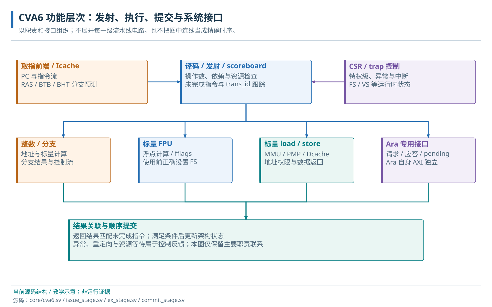

# 02 · CVA6 与 RISC-V 程序使用模型

指令集、处理器状态、特权级与存储接口。

> 自动生成的 Markdown 阅读版；正文只维护 [HTML 内容源](../content/cva6.html)，导航维护 [pages.json](../scripts/pages.json)。[本章 HTML](../cva6.html) · [阅读路线](index.md)

- [2.1 指令能力与 CPU profile](#isa)
- [2.2 程序执行与软件可见状态](#functional-units)
  - [2.2.1 数组赋值中的通用寄存器与 PC](#programmer-state)
  - [2.2.2 M、S、U 特权级与执行权限](#privilege)
  - [2.2.3 执行资源与系统行为](#functional-overview)
  - [2.2.4 CSR、异常和中断](#csr-trap)
  - [2.2.5 访存、MMU 与 PMP](#memory-protection)
  - [2.2.6 整数、FPU 与协处理器](#compute-state)
- [2.3 CPU profile 与实现资源参考](#implementation-reference)
  - [2.3.1 可选配置的类别与适用范围](#configuration-families)
  - [2.3.2 两组 profile 与最终有效配置](#profile-effective-values)
  - [2.3.3 CVA6 资源配置的结构影响](#resource-consequences)

**本章任务**

判断程序所需指令、状态、权限和存储条件，并解释 CVA6 与设备/Ara 的边界。 前置：[01 · 整体架构与平台边界](architecture.md)。

## 2.1 指令能力与 CPU profile

指令集架构（ISA）规定处理器能够识别哪些机器指令，以及指令对寄存器和存储的作用。RISC-V 通过扩展组合表达能力：RV64I 的整数寄存器为 64 位；M 增加乘除，A 增加原子操作，F/D 增加单/双精度浮点，C 提供压缩指令，V 提供向量指令。常见的 G 简写包含 IMAFD、Zicsr 和 Zifencei，后两者分别涉及控制状态寄存器访问和指令获取同步。

profile 是编译时选入的 CPU 配置包。根 `cheshire.mk` 默认选择 `cv64a6_imafdchsclic_sv39_wb`，其 RVV=0；向量组合使用 `cv64a6_imafdcv_sv39`，其 RVV=1。两者还选择不同的缓存和可选能力。此刻只需核对程序所需的扩展；缓存大小和完整覆盖表保留在本页末尾的配置参考。

控制状态寄存器（CSR）是 CPU 内部管理执行状态的专用寄存器，以 CSR 指令访问。它与 MMIO 的设备地址不同。硬件有浮点或向量能力后，软件还要在 `mstatus` 的 FS/VS 字段中启用相应状态。这里先建立“硬件能力”和“运行许可”的区别，启动及向量章会解释操作顺序。

## 2.2 程序执行与软件可见状态

### 2.2.1 数组赋值中的通用寄存器与 PC

执行 `result[i] = 3*i+1` 时，PC 指定当前指令地址，整数寄存器暂存 i、地址和计算值，load/store 把值与存储器交换。RV64 的 x0 恒为 0，x1…x31 是 64 位整数寄存器；ra、sp、a0、s0 等是 ABI 为这些寄存器约定的名字。它们不是内存映射地址，也不会因在地址表中寻找它们而出现。函数如何借用和归还寄存器，见[调用约定](runtime.md#abi)。

程序读 UART 状态用的是普通访存指令，目标地址选择设备寄存器；读取 `mstatus` 用的是 CSR 指令，由 CPU 自身解释。浮点 f0…f31、向量 v0…v31 又是独立的架构寄存器组。整数程序先只需要整数状态；本地 crt0 的浮点初始化使 F/D 和 FS 成为额外启动前提，向量状态则到 Ara 章再展开。

### 2.2.2 M、S、U 特权级与执行权限

复位后的启动固件和本书裸机例子在机器态 M 执行。M 态可以管理机器级 CSR 和平台资源；监管态 S 通常承载操作系统内核；用户态 U 通常承载受隔离的应用。同一个 hart 在这些权限下执行不同软件。权限切换必须按 trap/返回规则建立入口和状态，不是普通 C 函数换个名字。

硬件支持 S/U 与程序真的进入 S/U 是两回事；profile 含 sv39 也不表示裸机指针已经过页表。当前数组例子直接使用既定物理布局。以后内核建立页表后，一个用户指针的数值还需要结合所属地址空间解释，见[虚拟内存](virtual-memory.md)。

### 2.2.3 执行资源与系统行为

CVA6 功能层次教学图；表示职责与主要依赖，不是逐级流水电路图。依据本地 core/cva6.sv、issue\_stage.sv、ex\_stage.sv、commit\_stage.sv。

取指前端依据 PC 与预测取得指令，译码识别操作，发射检查操作数及执行资源，再把任务交给整数、浮点、访存或专用 Ara 接口。结果可以在不同时间返回；提交阶段按架构顺序确认可见更新，并与异常/中断控制协作。标量 load/store 经地址翻译与保护检查及数据缓存路径；Ara 的独立数据口见[向量访存章](ara.md#vector-memory)。

### 2.2.4 CSR、异常和中断

对熟悉 MIPS 的读者，可以先把 CSR 理解成管理处理器状态的寄存器组，而不是外部总线上的设备。异常由当前指令引起，中断来自异步事件；两者都通过 trap 入口转交软件。mepc 保存返回位置，mcause 表达原因，mtval 提供相关信息，mtvec 指定入口。硬件记录原因并不替软件保存完整整数、浮点或向量上下文。普通函数调用、异步中断的现场保存，以及 mret 返回的完整过程见[异常与上下文](traps.md#call-versus-trap)；设备中断编号在外设章解释。

### 2.2.5 访存、MMU 与 PMP

MMU 把虚拟地址翻译成物理地址并检查页表权限；PMP 对物理区域实施访问保护；地址属性又决定区域是否可缓存、可执行或有设备副作用。这三个机制回答不同问题。本地向量 profile 有 MMU，裸机实验却没有建立页表；profile 原有 8 个 PMP 条目还被 SoC 默认 Cva6NrPMPEntries=0 覆盖。不能根据文件名含 sv39 就推断应用已启用虚拟存储或隔离。

### 2.2.6 整数、FPU 与协处理器

CVA6 既执行控制和地址计算，也承担适合标量指令的通用整数、浮点计算；不能把它仅视为设备启动器。FPU 提供标量浮点，是否存在由 profile 能力决定，还受 FS 状态门控。Ara 通过专用接口接受向量指令并独立访存，VS 管理向量状态许可。当前 crt0 使用双精度浮点初始化，即使应用 C 没有浮点表达式，也不能随意关闭 F/D。

## 2.3 CPU profile 与实现资源参考

至此已经能够说明程序需要哪些指令、怎样访问设备、如何处理事件，以及 Ara 接受什么工作。下面的配置族和资源尺寸用于核对现有工程或评审配置变化；首次学习可以先继续下一章，无需把 scoreboard、预测表或流水组织作为运行数组程序的前置。

### 2.3.1 可选配置的类别与适用范围

CVA6 的“可配置”包含三层含义：配置结构能表示某个选项，RTL 存在消费该选项的实现，以及某个平台已经验证一组组合。本地 `cva6_user_cfg_t` 有 88 个字段，`core/include` 还保存面向不同平台的多个 profile。Cheshire 的当前集成以 RV64 为基础；目录中出现 RV32 profile，只能证明 CVA6 仓库含有它，不能把它直接选入当前 SoC。

| 配置族与本地字段示例 | 改变的能力或资源 | 选择时的约束 |
| --- | --- | --- |
| XLEN、RVF、RVD、RVV、RVH、RVC | 整数宽度，浮点/向量/虚拟化/压缩指令能力 | 与译码、执行单元、异常处理及软件 ISA 配套；本地启动代码也要求 F/D |
| MmuPresent、RVS、RVU、NrPMPEntries | 地址翻译、特权级及物理访问保护 | 裸机和操作系统需要不同运行状态；PMP 数还会被 Cheshire 覆盖 |
| IcacheByteSize、DcacheByteSize、各自 SetAssoc/LineWidth | 缓存容量、路数与一次填充的行宽 | 影响 SRAM、命中路径和外部流量；参数须满足实际 cache 实现的尺寸约束 |
| DCacheType | WB、WT、HPDCACHE\_WT、HPDCACHE\_WB、HPDCACHE\_WT\_WB 五个枚举实现选择 | 枚举是可选代码分支；Ara 一致性适配、依赖清单及回归仍需逐组合核对 |
| NrScoreboardEntries、NrCommitPorts、NrLoadBufEntries | 指令跟踪、提交能力和未完成读访问容量 | 增大资源可能改变面积和时序，性能收益取决于实际瓶颈 |
| RASDepth、BTBEntries、BHTEntries | 函数返回与分支预测资源 | 以平台覆盖后的值为准；与软件正确性所需 ISA 能力分开判断 |
| SuperscalarEn、CvxifEn、DebugEn、Axi\*Width | 发射实现、扩展/调试接口及总线类型 | 存在实现之间的组合约束；Cheshire 强制若干接口字段，不能任意改 profile 来绕过 |

字段全集保留在[CVA6 配置字典](../../configuration/CVA6.md)。学习时先问选项改变了“指令语义、存储结构还是接口契约”，再看精确值。例如 WT（write-through，写穿）会把写流量向下游推进；WB（write-back，写回）允许修改先留在脏缓存行中。两者影响 CPU 与设备交换缓冲区的方式，不能只按 cache 容量选择 profile。

### 2.3.2 两组 profile 与最终有效配置

<table><tr><th>项目</th><th>默认标量 profile</th><th>本地向量 profile</th><th>进入 Cheshire 后</th></tr><tr><td>文件名主体</td><td>cv64a6_imafdchsclic_sv39_wb</td><td>cv64a6_imafdcv_sv39</td><td>同次编译选入一个同名包定义</td></tr><tr><td>RVV / RVH</td><td>0 / 1</td><td>1 / 0</td><td>由 profile 提供；RVV 参与派生 EnableAccelerator</td></tr><tr><td>I-cache / D-cache</td><td>16 / 32 KiB，WB</td><td>4 / 8 KiB，WT</td><td>保留相应缓存实现与尺寸</td></tr><tr><td>NrPMPEntries</td><td>8</td><td>8</td><td>默认 Cfg.Cva6NrPMPEntries=0 覆盖为 0</td></tr><tr><td>RVSCLIC</td><td>1</td><td>0</td><td>取 Cfg.Clic；默认 0</td></tr><tr><td>总线与扩展接口</td><td colspan="2">profile 原值只是配置输入</td><td>gen_cva6_cfg 设置 AXI 宽度、地址属性、CvxifEn=0、DebugEn=1 等</td></tr></table>

因此，“标量 profile 名字含 CLIC”与“系统中存在 CLIC”不是同一证据。CPU 内部的 `build_config` 还会根据用户字段计算内部常量；学习本地实现时应顺着 profile、平台覆盖、派生配置、模块 generate 四步追踪。后续的[系统配置章](configuration.md)再把这些 CPU 条件与 Ara、SoC 和软件组合起来。

源码静态确认：[cva6\_user\_cfg\_t / cache\_type\_t](../../../.bender/git/checkouts/cva6-20c9d7cbe0dd6995/core/include/config_pkg.sv)、[build\_config](../../../.bender/git/checkouts/cva6-20c9d7cbe0dd6995/core/include/build_config_pkg.sv)、[cache 实现选择](../../../.bender/git/checkouts/cva6-20c9d7cbe0dd6995/core/cva6.sv)、[gen\_cva6\_cfg](../../../hw/cheshire_pkg.sv)。[在线参数手册](https://cva6.readthedocs.io/en/latest/01_cva6_user/Parameters_Configuration.html)用于解释配置类别；其中新增字段不直接纳入本地 88 字段清单。

### 2.3.3 CVA6 资源配置的结构影响

scoreboard（指令记分牌）保存已发射指令、依赖和结果就绪状态，帮助把异步返回结果关联到原指令；commit ports（提交端口）限制每周期能够确认的指令数量；load buffer（读请求缓冲）容纳尚未完成的读访问。写缓冲用于暂存待处理写，和保存缓存行的 Dcache 阵列是不同资源。

取指侧 RAS（返回地址栈）预测函数返回目标，BTB（分支目标缓冲）预测跳转去向，BHT（分支历史表）帮助预测分支是否发生。预测错误会触发纠正并丢弃错误路径的推测工作；容量增加的实际收益仍取决于程序分支行为。

| 本地向量 profile 的资源 | 结构后果 | 软件与验证关注点 |
| --- | --- | --- |
| Icache 4096 B、Dcache 8192 B；DCacheType=WT | 缓存阵列、行大小、缺失和写缓冲路径变化 | 工作集、访问属性和设备共享协议；WT 仍可能有旧读副本 |
| NrScoreboardEntries=8，NrCommitPorts=2 | 未完成指令跟踪与提交接口尺寸 | 不代表任意程序每周期提交两条；停顿取决于依赖及功能单元 |
| WtDcacheWbufDepth=8，NrLoadBufEntries=2 | 不同类型的在途存储资源 | 长背压时的排空、异常和顺序，不能把这些深度当 cache 容量 |
| AxiIdWidth=4，系统输入默认 2 位 | 出核后通过 ID serialize 适配 | 同号事务、来源与返回关联不能截位处理 |
| RVV=1，CvxifEn=0 | 本地 build\_config 派生加速器路径 | 选择真实 first-pass decoder；专用接口不是任意扩展单元插槽 |

RAS/BTB/BHT 是返回地址和分支预测资源，本地 SoC 会再次覆盖其尺寸。缓存容量与流水队列、分支表是不同资源；调整后先看有效配置和展开端口，再看执行与性能。完整字段见[CVA6 配置参考](../../configuration/README.md)；配置传递和约束集中在[配置字段与消费者](configuration.md#fields)。

本节依据：[向量 profile 的资源原值](../../../.bender/git/checkouts/cva6-20c9d7cbe0dd6995/core/include/cv64a6_imafdcv_sv39_config_pkg.sv)。

本节依据：[gen\_cva6\_cfg 的平台覆盖](../../../hw/cheshire_pkg.sv)。

**源码与进一步阅读**

[默认选源](../../../cheshire.mk)；[四种 TB 配置](../../../target/sim/src/tb_cheshire_pkg.sv)；[配置及覆盖函数](../../../hw/cheshire_pkg.sv)；[CPU 派生配置](../../../.bender/git/checkouts/cva6-20c9d7cbe0dd6995/core/include/build_config_pkg.sv)；[实例消费者](../../../hw/cheshire_soc.sv)

**提交端口有两个，为什么缓存缺失时仍可能没有指令提交？**

端口数是吞吐上限；较早指令未就绪、依赖或异常处理可能阻止提交。增加端口不会消除访存延迟和顺序约束。

**profile 写了 PMP=8，为什么应用仍不能依此配置 8 个保护区域？**

进入 Cheshire 后 gen\_cva6\_cfg 用 Cfg.Cva6NrPMPEntries 覆盖该字段，默认有效值为 0。应追踪最终配置，再决定软件可用功能。

---

[上一页：整体架构与平台边界](architecture.md) · [下一页：裸机 C 程序运行模型](runtime.md)
