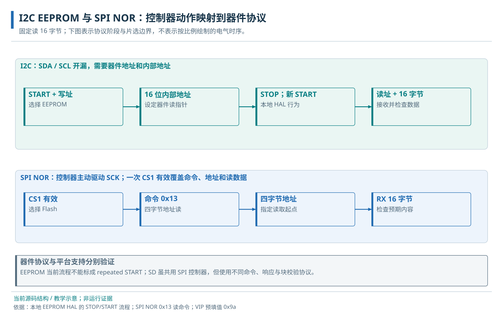

# 19 · I2C 与 EEPROM

I2C 线路、FIFO、控制寄存器与 EEPROM 读取。

> 自动生成的 Markdown 阅读版；正文只维护 [HTML 内容源](../content/i2c.html)，导航维护 [pages.json](../scripts/pages.json)。[本章 HTML](../i2c.html) · [阅读路线](index.md)

- [19.1 EEPROM 用途与读取任务](#purpose)
- [19.2 开漏线路与字节应答](#lines)
- [19.3 EEPROM 读取流程](#device)
  - [19.3.1 EEPROM 地址与 I2C 总线事务](#transaction)
- [19.4 I2C 控制器的字节传输](#controller)
  - [19.4.1 寄存器接口与命令状态机](#structure)
  - [19.4.2 关键寄存器的访问语义](#register-contract)
  - [19.4.3 初始化与频率换算](#init)
  - [19.4.4 EEPROM 读取的软件调用链](#software)
  - [19.4.5 EEPROM 只读示例的适用范围](#limits)
- [19.5 完整操作与预期结果](#result)
- [19.6 I2C Target 模式与 SoC 访问接口](#target-mode)

**本章任务**

读出 EEPROM 地址 0 开始的 16 字节，并分清设备地址、内部地址和 CPU 地址。先掌握[MMIO/FIFO 的基本语义](uart-gpio.md#registers)。

## 19.1 EEPROM 用途与读取任务

EEPROM 在掉电后保存少量参数，适合校准值或板卡信息。本章只读已有内容，不改写介质。当前 VIP 实例名 M24FC1025 对应 24FC1025 系列模型；Microchip 官方 24FC1025 为 1 Mbit，即 128 KiB 的 I2C EEPROM。系列名不是完整订货型号，也不能据仿真模型认定 VCU118 板载了同一芯片。

数据手册的器件能力与本地软件不同：器件系列可支持到 1 MHz，本地 HAL 采用 Fast mode 400 kHz。依据见[厂商产品页](https://www.microchip.com/en-us/product/24FC1025)和[DS20001941M](https://ww1.microchip.com/downloads/en/DeviceDoc/24AA1025-24LC1025-24FC1025-1024-Kbit-I2C-Serial-EEPROM-20001941M.pdf)；本章实现以仓库 HAL 和模型为准。

## 19.2 开漏线路与字节应答

I2C 使用 SCL 时钟线和 SDA 数据线。开漏输出只主动拉低，逻辑高由释放线路和上拉共同形成，因此输入值要看所有参与者的实际驱动。host 发起 START 并发送地址，target 在应答位给出 ACK；释放形成的 NAK 表示未应答。器件还可能拉低 SCL 延长等待，称为时钟拉伸。

`Cfg.I2c` 选择控制器及 0x03003000 窗口。SoC 引出 scl/sda 的值、输出使能与输入，平台负责三态、上拉和器件连接。VIP 有 24FC1025 EEPROM 模型，VCU118 当前没有启用 I2C 引脚宏；同一驱动在这两个环境中的可验证范围不同。

最小连接是 host 与 EEPROM 共用 SCL、SDA、参考地，两条线有适当上拉；电压、上拉和总电容须满足所选器件及 PAD。SoC 的 scl\_i/sda\_i 读取实际线路，scl\_o/sda\_o 与对应 en\_o 控制三态驱动，均为单 bit，方向以 SoC 为参照；不把逻辑高当成推挽强驱动。VIP 经三态适配和 pullup 接两片模型，A0 分别为 0/1，A1=0、A2=1，chip0 的 WP=1。模型 RESET 端口是仿真接口，不能据此给真实器件增画复位脚。

## 19.3 EEPROM 读取流程

### 19.3.1 EEPROM 地址与 I2C 总线事务

硬件控制器不知道“EEPROM 内部第几个字节”，HAL（硬件抽象层）把这个要求翻译成器件协议，DIF（设备接口函数）再写控制器寄存器。当前读取顺序是 START → 写方向控制字 → 地址高字节 → 地址低字节并 STOP → 新 START → 读方向控制字 → 收 len 字节 → CPU 取 RX FIFO。此实现使用 STOP 后再 START，而非一律采用 repeated START。

两种只读事务的层次对照。CPU 寄存器地址、器件内部地址和 RAM 缓冲区地址分别属于不同空间。

HAL 中 0xa0 是含读写方向位的线上控制字基值，和通常讨论的 7 位设备地址不是同一个数。block/chip 选择也进入控制字。调用 `i2c_24fc1025_read(&dev, bytes, 0, 16)` 时，0 是 EEPROM 内部地址，bytes 指向目标 RAM；CPU 实际 MMIO 仍访问 0x03003000 附近。

图中先看 I2C 一行：CPU 所说的“读地址 0”先变为写地址阶段，之后器件才知道从哪里返回数据。每个字节后都有应答位，最后读完以结束条件释放总线；RX FIFO 暂存已经从 SDA 收到的字节。图是教学事务示意，不是本轮实测波形。

## 19.4 I2C 控制器的字节传输

### 19.4.1 寄存器接口与命令状态机

控制器的 host 命令排入格式 FIFO（FMT），接收字节进入 RX FIFO；target 模式另有采集请求的 ACQ 和回复数据的 TX FIFO。软件写 FDATA 是排入“下一步做什么”的命令，状态机随后产生 START、位时钟和 ACK 检测。这种解耦让软件不用逐个系统周期翻转 SCL。

CTRL(+0x10) 的 bit0/bit1 启用 host/target；FDATA(+0x1c) 的低字节存数据或长度，START/STOP/READ/RCONT/NAKOK 分别在 bit8..12；RDATA(+0x18) 读取并弹出 host 接收字节。FIFO\_CTRL/STATUS(+0x20/+0x24) 管复位和队列深度，TIMING0..4(+0x30..0x40) 则规定时序计数。

### 19.4.2 关键寄存器的访问语义

CTRL 和 TIMING 为配置，FDATA 为写命令，RDATA 为读弹出窗口；FIFO\_CTRL 清队列属于有副作用的初始化动作，不能用于运行中的普通回读。Reg32 访问宽度为 32 bit，完整字段见[I2C 寄存器组](registers.md#group-3)。先确认空闲再初始化，便不会把两个任务的数据混在同一 FIFO。

### 19.4.3 初始化与频率换算

初始化函数 i2c\_24fc1025\_init 禁用 host、复位四个 FIFO，用 core\_hz 换算纳秒到周期，配置 Fast mode 的 2500 ns SCL 周期及 100/300 ns 上升/下降假设，再启用 host。硬件参数提供队列资源，运行时计数落实外部时序；真实板上的上拉、负载和器件条件还要满足这些假设。

gen\_i2c/i\_i2c 使用系统 clk\_i 和低有效 rst\_ni；复位后 CTRL 的 host/target/loopback 均关闭，软件随后配置时序并开启 host。SCL 是状态机依据系统周期计数产生的协议时钟，并非新的控制寄存器时钟域。FMT/RX/ACQ/TX 本地各 64 项；15 类事件送到中断系统，但本例采用轮询，控制器没有独立系统 AXI DMA 数据口。外部 EEPROM 按数据手册上电就绪，控制器复位并不替代外部器件上电等待。

### 19.4.4 EEPROM 读取的软件调用链

应用 [storage\_read.c](../examples/storage_read.c) → [i2c\_24fc1025.h](../../../sw/include/hal/i2c_24fc1025.h) / [器件 HAL](../../../sw/lib/hal/i2c_24fc1025.c) → dif\_i2c 的格式命令与 FIFO 访问 → MMIO → 控制器 → EEPROM。HAL 知道 EEPROM 地址编码，DIF 知道控制器寄存器；它们作为 libcheshire 的代码链接进同一个目标程序，主机编译器不参与运行时收数。

本例先由 RTC 参数和 clint\_get\_core\_freq 得到 core\_hz，再 uart\_init；调用 i2c\_24fc1025\_init(&dev,hz) 后调用 read(&dev,bytes,0,16)。hz 单位 Hz；bytes 是可写的 16 字节 RAM 缓冲，0 为 EEPROM 字节地址，16 为字节数。init/read 返回 int，0 表示该函数成功走完；read 阻塞直到接收长度满足并取出数据。HAL 还调用 clint\_spin\_ticks(1)，因此 RTC 必须工作。初始化会重置整个控制器的四个 FIFO，不能给共享总线上的每个器件并发重复执行；同一控制器串行安排事务和参数切换。

### 19.4.5 EEPROM 只读示例的适用范围

只使用对齐 addr=0、len=16；当前 HAL 的短未对齐读可能越界，等待无统一超时，写路径也有未解决问题。本例不授权写介质，端到端运行待验证。详见[I2C 诊断与限制](peripheral-debug.md#i2c)。

## 19.5 完整操作与预期结果

前提是 Cfg.I2c 已启用、VIP 接好 EEPROM 且默认填充仍为 0x9a。依次完成 RTC/频率准备、UART 初始化、EEPROM HAL 初始化、16 字节只读调用，等待函数取满 RX，逐字节检查 bytes\[0..15\]，输出 STORAGE stage=4 bytes=16 errors=0，flush 后返回 0。任一字节不符就不算成功；API 返回与内容正确是两个条件。结束时不改写器件，不复位仍由其他使用者拥有的总线。

这是[实验 D](labs.md#lab-d)已有源码和构建步骤支持的条件运行例。本轮没有重新构建或运行 SoC；VCU118 当前未启用 I2C 引脚宏，不能直接搬到本板执行。

## 19.6 I2C Target 模式与 SoC 访问接口

控制器也有 target 模式：配置 TARGET\_ID(+0x48)、准备 ACQ/TX，再启用 CTRL.target。外部 host 的请求进入 ACQDATA(+0x4c)，SoC 软件按请求填 TXDATA(+0x50)。此时 ACQ 是请求队列而非 EEPROM 读取结果，不能复用上面的 host HAL 当作 target 服务程序。需要另一个 host 模型；现有 EEPROM 本身也是 target。

**源码与进一步阅读**

[I2C 访问属性和复位字段](../../../.bender/git/checkouts/opentitan_peripherals-7b624fb57f78de9a/src/i2c/data/i2c.hjson)；[EEPROM 初始化及事务](../../../sw/lib/hal/i2c_24fc1025.c)；[时序与格式命令](../../../.bender/git/checkouts/opentitan_peripherals-7b624fb57f78de9a/sw/device/lib/dif/dif_i2c.c)；[FIFO 与状态机](../../../.bender/git/checkouts/opentitan_peripherals-7b624fb57f78de9a/src/i2c/rtl/i2c_core.sv)；[模型与预填充](../../../target/sim/src/vip_cheshire_soc.sv)

**0xa0、0x03003000 和 bytes 是同一种地址吗？**

分别是含方向位的器件线上控制字基值、CPU 控制器 MMIO 基址和 RAM 缓冲指针；另有 EEPROM 内部字节地址。

---

[上一页：定时器与中断系统](interrupts.md) · [下一页：SPI、NOR 与 SD](spi.md)
