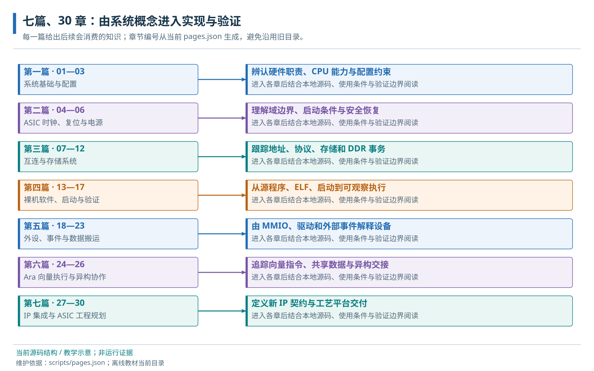

# 阅读路线

程序执行、系统接口、操作系统与 ASIC 实现的学习路线。

> 自动生成的 Markdown 阅读版；正文只维护 [HTML 内容源](../content/index.html)，导航维护 [pages.json](../scripts/pages.json)。[本章 HTML](../index.html) · [阅读路线](index.md)

- [主阅读路径与知识依赖](#route)
- [贯穿示例与各类文档职责](#example)
- [第一篇 · 系统与程序执行](#part-foundations)
- [第二篇 · 地址、互连与存储层次](#part-fabric)
- [第三篇 · 数据搬运、向量计算与共享](#part-vector)
- [第四篇 · 启动、外设与软件运行环境](#part-software)
- [第五篇 · 时钟、复位与工程配置](#part-management)
- [第六篇 · RTOS 与嵌入式 Linux](#part-os)
- [第七篇 · IP、DDR 与系统协作](#part-integration)
- [第八篇 · ASIC 资源与物理实现](#part-platform)
- [第九篇 · 验证、测量与实验记录](#part-verification)
- [当前实现、项目目标与验证边界](#scope)
- [内容维护与历史资料](#reference)
- [故障诊断与已知问题索引](#diagnostics)

这套教材面向具备 RTL、处理器和 C 基础，正在学习 RISC-V 平台软件的工程师。沿一份数组程序，依次建立程序、地址、存储、数据协作、启动和系统配置的关系，再进入操作系统与 ASIC 集成。

## 主阅读路径与知识依赖

推荐顺序是：平台职责与 CPU 使用模型 → C 程序的编译、链接和装载概览 → 地址译码与 AXI → Cache、LLC/SPM 与 DDR 边界 → iDMA、Ara 与共享数据 → 详细启动和外设运行 → 时钟、复位和配置 → OS、扩展集成与验证。前四章先建立从源代码到 main 的全流程；理解存储和事务之后，再解释 Boot ROM 如何准备运行环境、加载器如何放置程序。

首次实践可在编译链接章节完成[实验 A：ELF 布局观察](labs.md#lab-a)；读完启动与 JTAG 接管后，按[实验 B：装载运行](labs.md#lab-b)进入仿真操作。实验页提供直接步骤，不要求先读完 ASIC 章节。当前配置中不具备运行条件的实验会明确给出门槛，预期输出不能当作实测结果。

## 贯穿示例与各类文档职责

[137 项数组示例](../examples/journey.c)贯穿 C 对象、初值/BSS、链接布局、装载、逐项校验和 UART 输出；Ara 使用相同结果规格解释向量分块。OS 章节继续解释同一调用和缓冲区在任务、进程中的变化。LVDS→ISP→NPU→Ara 的帧处理是未来集成案例。

| 阅读任务 | 主要入口 | 内容边界 |
| --- | --- | --- |
| 连续理解机制 | 下方九篇教材；[同步 Markdown 阅读版](../markdown/index.md) | 概念的主要解释位置，正常流程、源码落点和成立条件。 |
| 查询参数、地址、寄存器 | [配置参考](../../configuration/README.md)、[地址空间](address-map.md)、[寄存器索引](registers.md) | 按子系统查字段、默认/覆盖关系与修改影响，不以字典代替教程。 |
| 执行、排错和继续集成 | [实验手册](labs.md)、[软件操作参考](../../software/README.md)、[固定配置提取交接书](../../02_Cheshire_Ara_ASIC_Extraction_Handoff.md) | 环境、命令、预期结果、失败入口和真实证据；工程修改按任务授权。 |

## 第一篇 · 系统与程序执行

1. [01 · 整体架构与平台边界](architecture.md) — 取指、数组计算与字符输出中的 SoC 模块协作。
2. [02 · CVA6 与 RISC-V 程序使用模型](cva6.md) — 指令集、处理器状态、特权级与存储接口。
3. [03 · 裸机 C 程序运行模型](runtime.md) — C 对象、函数调用、初始化与存储布局。
4. [04 · 工具链、链接与 ELF](build.md) — 源文件、对象文件、链接布局与 ELF 装载产物。

## 第二篇 · 地址、互连与存储层次

1. [05 · 地址空间与访问属性](address-map.md) — 地址路由窗口、实际资源容量与 CPU 访问属性。
2. [06 · AXI 通道、突发与握手](axi.md) — AXI 读写事务的通道握手与完成语义。
3. [07 · AXI Crossbar 结构与事务路由](interconnect.md) — 地址译码、仲裁、写数据路由与 ID 响应关系。
4. [08 · 接口适配与 RegBus](adapters.md) — 位宽、协议、ID 转换与跨时钟域接口。
5. [09 · Cache、LLC/SPM 与存储路径](memory.md) — 缓存副本、地址别名与共享物理阵列。

## 第三篇 · 数据搬运、向量计算与共享

1. [10 · iDMA、流量管理与总线错误](dma.md) — 数据搬运提交、完成、流量管理与本地执行条件。
2. [11 · Ara 结构与 CVA6 协处理器接口](ara.md) — 向量请求、应答、CPU 提交与执行完成的协作关系。
3. [12 · RVV 编程与结果验证](vector.md) — 数组运算的汇编、intrinsics 与自动向量化实现。
4. [13 · CPU、Ara、DMA 与 NPU 的共享数据](sharing.md) — 共享数据的可见性、所有权与交接协议。

## 第四篇 · 启动、外设与软件运行环境

1. [14 · Boot ROM、启动模式与应用初始化](boot.md) — ROM 服务、程序装载与应用入口的执行关系。
2. [15 · JTAG 与程序加载调试](boot-debug.md) — 外部调试、程序装载与执行接管条件。
3. [16 · 异常、中断与上下文](traps.md) — 函数调用、异常中断与任务上下文的保存责任。
4. [17 · MMIO 驱动、UART 与 GPIO](uart-gpio.md) — 寄存器访问、设备初始化与引脚行为。
5. [18 · 定时器与中断系统](interrupts.md) — 计时、中断使能、服务、清源与返回流程。
6. [19 · I2C 与 EEPROM](i2c.md) — I2C 线路、FIFO、控制寄存器与 EEPROM 读取。
7. [20 · SPI、NOR 与 SD](spi.md) — SPI 控制器事务与 NOR、SD 设备协议。
8. [21 · Serial Link、VGA 与 USB](stream-io.md) — 串行链路、显示与 USB 的控制、数据和验证条件。

## 第五篇 · 时钟、复位与工程配置

1. [22 · 时钟系统与 PLL](clocks.md) — 时钟域、使能、同步器与平台时钟源。
2. [23 · 复位体系与平台启动条件](reset.md) — 复位、平台就绪与在途事务的生命周期。
3. [24 · Cheshire、CVA6、Ara 与软件配置](configuration.md) — 硬件字段、参数消费者与软件配置的一致性。

## 第六篇 · RTOS 与嵌入式 Linux

1. [25 · RTOS 任务、调度与同步](rtos.md) — 任务运行、阻塞、唤醒与同步的状态转换。
2. [26 · 保护、页表与进程地址空间](virtual-memory.md) — 物理布局、虚拟地址翻译与设备地址语义。
3. [27 · 嵌入式 Linux 启动与用户程序](linux.md) — 平台固件、内核与首个用户进程的启动关系。
4. [28 · 操作系统中的设备与缓冲区](os-devices.md) — 裸机、RTOS 与 Linux 的设备调用和缓冲区管理。

## 第七篇 · IP、DDR 与系统协作

1. [29 · 自定义 IP 的控制、数据和中断接入](integration.md) — 独立 Reg 设备与系统控制、数据及中断接口。
2. [30 · DDR 控制器、PHY 与 AXI4 接入](ddr.md) — DDR 平台初始化、访问放行与接口交付条件。
3. [31 · LVDS、ISP、NPU 与外部 DDR 集成](accelerators.md) — 图像处理 IP 的接口、缓冲、跨域与集成条件。
4. [32 · 模型任务划分与容量带宽预算](models.md) — 明确假设下的 Ara/NPU 协作与数据搬运成本。

## 第八篇 · ASIC 资源与物理实现

1. [33 · 电源域与低功耗规划](power.md) — 现有 RTL 的电源边界与候选低功耗契约。
2. [34 · Ara VRF 与 SRAM 宏接口](asic-memory.md) — VRF 消费者的容量、时序与候选技术映射。
3. [35 · 跨时钟与复位域的事务交接](cdc-rdc.md) — 跨域信号同步、事务传输与生命周期协调。
4. [36 · 外设逻辑接口、PAD 与封装连接](physical-interfaces.md) — I2C 连接的信号方向、电气条件与板级职责。
5. [37 · 时序约束与物理实现反馈](timing-physical.md) — 存储接口路径的时序约束、分析与布局影响。
6. [38 · Scan、MBIST 与制造测试](manufacturing-test.md) — Scan、存储测试与功能验证的交付范围。
7. [39 · 首硅启动与系统可观测性](silicon-bringup.md) — 首硅早期状态观测与存储、计算能力的分阶段验证。
8. [40 · 固定配置工程与 ASIC 集成验收](future.md) — 固定配置、可搬迁输入与 ASIC 分阶段验收。

## 第九篇 · 验证、测量与实验记录

1. [41 · Questa/VCS 仿真与结果验证](simulation.md) — 仿真输入、目标运行、结果数据与退出判据。
2. [42 · 正确性、性能与论文实验记录](measurement.md) — 计时边界、数据条件与可重复的性能比较。

## 当前实现、项目目标与验证边界

CVA6 承担控制与通用计算；Ara 承担向量计算，包括 NPU 不适合的部分浮点向量运算。目标是加入自研 ISP、NPU、LVDS 与外购 AXI4 DDR。当前源码中有 CPU/Ara、互连、LLC/SPM 和 FPGA DDR 集成参考，新 IP、独立片上 Global Buffer、Ara 分流及 DDR 旁路还没有实现。近期主 Xbar 保持 64-bit 的需求与 GB 讨论以[M01 接口契约](../../M01_IP_DDR_Interface_Contract.md)为准，不能据示意图认定已连接。

用户报告的 VCU118 HelloWorld 不等于本轮重新板测，也不能扩展为 Ara、DDR 全功能或 ASIC 就绪。Platform ROM 返回路径、iDMA 控制通路及目标运行缺口保持开放。RTOS/Linux 的教程和上游支持不等于当前镜像已经启动；OS 移植也不是裸机 ASIC 提取的前置条件。当前结果见[本轮文档检查](evidence.md#review-20261011)，历史实验保留原日期和输入。

## 内容维护与历史资料

正文和图片离线可读，源码跳转需要完整仓库。主教程的唯一正文源为 content/\*.html；HTML 与 Markdown 阅读版由同一生成器输出，首页目录、章号、侧栏和上下页共用 pages.json。字段字典及操作参考继续在既有 Markdown 中维护，职责与检查命令见[维护说明](../README.md)。[重构记录](../STRUCTURE_REVISION.md#review-20261011)保存问题、迁移和未验证项。

**历史路线与既有成果**

[最初源码调查](../../01_Cheshire_Ara_Quick_Start.md)保留旧版本和独有案例，[旧站备份](../../learning_backup/index.html)供追溯。下面七篇/30 章图是历史资料，现行阅读顺序由本页目录定义。

历史概念路线图，保留原图与原章号；不表示当前 RTL 连接关系。

## 故障诊断与已知问题索引

[启动与软件](software-debug.md) · [外设](peripheral-debug.md) · [Ara/RVV](vector-debug.md) · [操作系统](os-debug.md) · [平台、集成与测量](system-debug.md)。诊断用于按症状定位；核心机制和必要运行条件仍在对应正文中。

---

[下一页：整体架构与平台边界](architecture.md)
