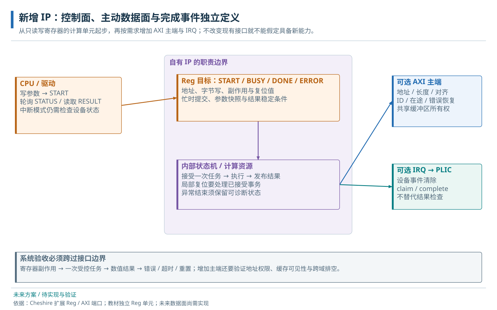

# 29 · 自定义 IP 的控制、数据和中断接入

独立 Reg 设备与系统控制、数据及中断接口。

> 自动生成的 Markdown 阅读版；正文只维护 [HTML 内容源](../content/integration.html)，导航维护 [pages.json](../scripts/pages.json)。[本章 HTML](../integration.html) · [阅读路线](index.md)

- [29.1 Reg 设备的控制流程](#control-path)
  - [29.1.1 寄存器加法设备的操作示例](#unit)
  - [29.1.2 官方集成入口与本地接口类型](#official-instantiation)
  - [29.1.3 Reg 扩展端口接入](#control)
  - [29.1.4 中断接入与完成协议验证](#irq)
- [29.2 主动访存与生命周期](#system-path)
  - [29.2.1 AXI 主接口接入](#master)
  - [29.2.2 时钟、复位与停止过程](#reset)
- [29.3 单元与系统集成的验证层次](#verification)

**本章任务**

从独立 Reg 单元逐步进入系统。 前置：[08 · 接口适配与 RegBus](adapters.md)、[18 · 定时器与中断系统](interrupts.md)。主动访存扩展部分再结合[DMA机制](dma.md)，独立Reg例不依赖本地iDMA运行通过。

## 29.1 Reg 设备的控制流程

### 29.1.1 寄存器加法设备的操作示例

[lesson\_reg\_adder.sv](../examples/hw/lesson_reg_adder.sv) 是教材独立的 32 位 Reg 单元。软件写 A/B，发 START，硬件计算模 2³² 加法，置 DONE 并按 IRQ\_EN 输出电平中断。它没有 AXI burst 或 ID，接入系统时需要已有 AXI→Reg 桥和地址适配。该单元未接入生产 SoC。

先按轮询走完一次普通操作：确认空闲且旧DONE已经消费，写A=7和B=9，写START；START被接受时硬件锁存这两个数并进入BUSY，计算结束后结果寄存器为16、DONE置位。软件读到DONE后再读RESULT，与自己的32位模加法参考比较，最后写STATUS的DONE位清除本次完成，准备下一次任务。这里使用内部偏移，实际SoC基址尚未分配；这是现有独立教学单元的机制推演，目标整机接入未实施。

设计重点是任务生命周期：START 接受时锁存操作数，busy 时禁止改输入和重入；DONE 未清时也拒绝新任务，避免覆盖尚未消费的完成结果。STATUS 中 DONE 用 W1C 清除，新完成与清除同拍时以新事件置位优先。这样软件可以判断每个操作是否被接受、结果是否有效，以及怎样解除中断。

| 单元内部偏移 | 约定 |
| --- | --- |
| 0x00 / 0x04 | A/B，RW，按 WSTRB 更新，busy 写返回 error |
| 0x08 | START，byte0 有效且 bit0=1 时提交 |
| 0x0c | STATUS：BUSY bit0、DONE bit1；写 bit1 清 DONE |
| 0x10 / 0x14 | RESULT 只读 / IRQ\_EN bit0，irq=DONE & IRQ\_EN |
| 未映射或非 4 字节对齐 | 响应 error，无寄存器副作用 |

该单元 valid 时 ready=1，没有请求队列。每个 valid&ready 的边沿都表示一次访问；连续保持 valid 就是连续访问，不能期望只触发一次。独立 TB 覆盖字节写、非法访问、busy/DONE 重入、结果及中断清除，实验 F 用它建立“契约能被正常和错误用例检验”的习惯。

### 29.1.2 官方集成入口与本地接口类型

官方集成方式以一份 Cfg 同时驱动 SoC 实例和接口类型。先在平台包中用函数复制 `DefaultCfg`，覆盖本平台需要的字段，再调用 `CHESHIRE_TYPEDEF_ALL(前缀, Cfg)` 产生配套 AXI/Reg 请求响应类型。这样 ID 位宽等派生量随端口数变化，而不是由 wrapper 另写一组容易漂移的数字。

| SoC 顶层边界 | 请求方向 | 适合连接的对象 |
| --- | --- | --- |
| axi\_llc\_mst\_req\_o / rsp\_i | SoC → 主存系统 | DDR 子系统、仿真主存或新的下游互连 |
| axi\_ext\_mst\_req\_i / rsp\_o | 外部设备 → SoC | NPU/ISP 等主动访存口；受 SoC 已有地址图约束 |
| axi\_ext\_slv\_req\_o / rsp\_i | SoC → 外部 AXI 目标 | 额外存储或需要完整 AXI 的设备 |
| reg\_ext\_slv\_req\_o / rsp\_i | SoC → 外部寄存器目标 | PLL、PAD、NPU 等轻量配置口 |
| intr\_ext\_i | 外部事件 → 中断汇集 | 完成/错误中断；另配源数、生成尺寸和软件编号 |

这些扩展总线在 SoC 侧使用其接口时钟契约。将另一个时钟域的 IP 直接接上同型 struct 并不能完成跨域；需要协议级 CDC、逐域复位与就绪处理。零有效端口在类型声明中有时仍保留占位宽度，未用输入应绑成不会发起请求的值，不能因看到一个数组元素就推断存在可用端口。

依据：[SoC Integration](https://pulp-platform.github.io/cheshire/tg/integr/)，本地[CHESHIRE\_TYPEDEF\_ALL](../../../hw/include/cheshire/typedef.svh)与[顶层端口、gen\_ext\_axi\_mst/slv、gen\_ext\_reg\_slv](../../../hw/cheshire_soc.sv)。以下教学单元用于逐步实现该接口契约。

### 29.1.3 Reg 扩展端口接入

生产接入前要先选择未冲突的地址窗口，再配置 RegExtNumSlv、RegExtNumRules 和 RegionIdx/Start/End。端口数描述接口数量，规则数描述窗口数量；外部规则索引使用局部端口编号。gen\_axi\_out 同时把外部 Reg 窗口送向第一层桥，gen\_reg\_out 再选择外部设备。

wrapper 应检查绝对地址在本设备窗口内，减去基址形成内部偏移，适配请求/响应字段，并为关闭分支和错误访问提供响应。若随意截掉高地址位，会让其他地址别名到同一寄存器。软件头、地址属性与测试模型使用同一分配记录，本教材不预先占用生产地址。

实线展示拟接入的控制关系，虚线为后续主动访存扩展。当前只存在独立教学单元。

### 29.1.4 中断接入与完成协议验证

把 irq 接到明确的外部源，更新 PLIC/Router/CLIC 生成尺寸和软件源号。此单元采用电平中断，直到清 DONE 才消除原因；CPU handler 领取源号、读取 RESULT、清 DONE，再 complete。源同步和 reset 期间电平也要有定义。

独立单元只证明 irq 引脚按约定变化；系统验证还要执行真实 CPU handler，检查被屏蔽、使能、未清、重复事件及异常源号。当前 58 个 PLIC 源由内部向量占用，新增源需要生成配置配合，不能仅接一根外部线就沿用旧表。

## 29.2 主动访存与生命周期

### 29.2.1 AXI 主接口接入

计算单元从两个操作数扩展到数组后，需增加源/目的地址、长度、stride 和任务 ID，控制口仍使用 Reg，数据口从 AxiExt master 主动访存。先声明地址/数据/ID 宽、有限在途、支持的 burst、对齐与 4 KiB 拆分，再定义 R/B 错误如何转成任务失败。

数据口必须在最后一次写响应及约定可见性成立后报告完成。异常超时后的缓冲处置集中在[系统集成诊断](system-debug.md#integration)。接到当前主 Crossbar 时，目标仍由现有地址图决定，访问外部主存会走当前 LLC 路径。NPU/ISP 绕过 LLC 是另一个下游拓扑设计，详见[NPU/ISP 旁路拓扑](accelerators.md#npu-topology)。

### 29.2.2 时钟、复位与停止过程

同域单元可以复用系统时钟；独立频率则需要协议完整的 CDC。停止过程要覆盖“尚未提交”“已接收但未完成”“结果已完成但未消费”。时钟门控应发生在约定的空闲或保持状态，复位后软件要能区分旧任务丢失与新任务。

电源门控还需要隔离、保持和唤醒顺序，当前 SoC 没有完整电源意图交付。后续平台应把外部存储 ready、复位释放、在途排空及失败恢复写成可观测接口。独立单元的异步复位清状态只是其中最小一层。

## 29.3 单元与系统集成的验证层次

实验 F 只编译两份教学 SV 文件，在独立临时工作库运行，并额外注入失败检验日志检查器。之后的系统接入需另测地址首尾、32/64 位 lane、AXI/Reg 背压、PLIC 服务及 CPU/设备并发；加入 DMA 后再补缓冲区守卫、原子可见性和错误恢复。测试随着新增能力扩展，而不是把独立加法 PASS 当成整机证明。

**源码与进一步阅读**

[外部 Reg / AXI 规则](../../../hw/cheshire_pkg.sv)；[gen\_ext\_reg\_slv / gen\_ext\_axi\_mst / IRQ](../../../hw/cheshire_soc.sv)

**RESULT 正确且 irq 拉高后，集成工作是否完成？**

还需证明 CPU 能通过正确地址访问、进入对应 handler、清源并继续执行，以及错误、并发和复位情况下没有遗留事务。

---

[上一页：操作系统中的设备与缓冲区](os-devices.md) · [下一页：DDR 控制器、PHY 与 AXI4 接入](ddr.md)
