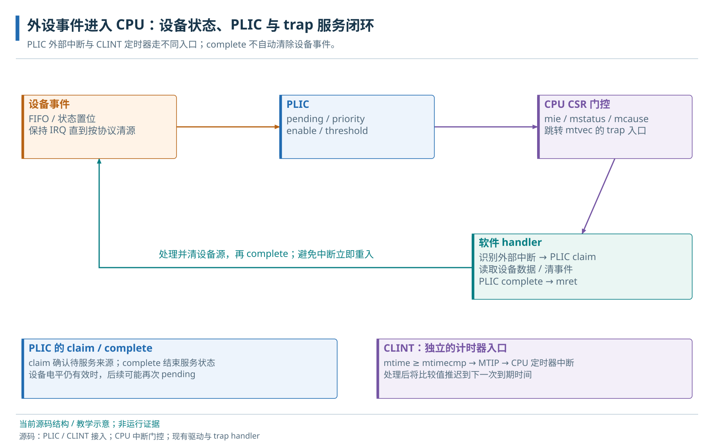

# 18 · 定时器与中断系统

计时、中断使能、服务、清源与返回流程。

> 自动生成的 Markdown 阅读版；正文只维护 [HTML 内容源](../content/interrupts.html)，导航维护 [pages.json](../scripts/pages.json)。[本章 HTML](../interrupts.html) · [阅读路线](index.md)

- [18.1 GPIO 事件与定时器的协同使用](#event-task)
- [18.2 异步事件与中断处理入口](#trap)
- [18.3 CLINT 定时与软件中断](#timer)
  - [18.3.1 CLINT 的计数与比较](#clint)
  - [18.3.2 复位后的定时门控与初始化责任](#timer-registers)
- [18.4 外部中断控制器](#controllers)
  - [18.4.1 PLIC 领取、清源与完成](#plic)
- [18.5 软件初始化与结果判断](#sequence)
- [18.6 可选中断路径的适用条件](#extensions)
  - [18.6.1 可选 IRQ Router 与 CLIC](#clic)

**本章任务**

建立计时、使能、服务、清源与返回闭环。 前置：[02 · CVA6 功能与 RISC-V 系统基础](cva6.md)、[17 · MMIO 驱动、UART 与 GPIO](uart-gpio.md)。

<a id="event-task"></a>

## 18.1 GPIO 事件与定时器的协同使用

本章使用 advanced.c 的 timer 版本：GPIO0 通过 INTR\_TEST 产生一次事件，CLINT 产生至少两次定时器事件，前台检查两个计数后退出。CLINT/PLIC 是片上服务模块，不要求外接设备型号。先理解一个中断怎样被服务，再把 GPIO 和 timer 两条路径并起来；CLIC/Router 留在末尾。

通用现场保存、ret与mret先见[异常与上下文](traps.md#software-context)；本章在这个基础上走GPIO事件和CLINT定时服务，不重复推导OS任务切换。

<a id="path"></a>

<a id="experiment"></a>

<a id="trap"></a>

## 18.2 异步事件与中断处理入口

中断让 CPU 暂停当前控制流，处理外部事件后再继续。硬件进入 trap 时记录 mepc 和 mcause、更新中断状态并跳到 mtvec；被打断程序仍需要它原来的寄存器值，因此入口汇编负责保存现场，C handler 处理原因，末尾用 mret 恢复执行状态。它与普通函数的 ret 不同。

RV64 的 mcause 最高位表示中断；机器软件、定时器、外部中断的 cause 分别为 3、7、11。mstatus.MIE 是全局门，mie 的相应位是分类门，设备与中断控制器还有自己的使能。陷入一次不等于清除事件原因，mret 后源仍有效就可能再次进入。

本地 crt0 的 \_trap\_handler\_wrap 保存整数 caller-save，C ABI 处理被调者保存的整数寄存器。它没有完整浮点/向量现场，也没有本例的嵌套策略。保留示例 [advanced.c](../examples/advanced.c) 用整数 handler 覆盖弱 trap\_vector，在 ISR 中只更新计数和清源，把打印留给前台。

本章 CLINT、PLIC 等控制寄存器经 SoC 的 Reg32 路径访问；CPU 的 mstatus/mie/mtvec 用 CSR 指令访问。CLINT/PLIC 没有供外部接线的串行 FIFO：CLINT 以 rtc\_i 经同步的计数使能推进 mtime，逻辑仍由 clk\_i/rst\_ni 驱动；PLIC 采集 SoC 中断源。当前两者的系统复位均低有效。fixture 的 RTC 由 VIP 驱动，板级 RTC 来自 wrapper；频率声明应与实际源匹配。

<a id="timer"></a>

## 18.3 CLINT 定时与软件中断

<a id="clint"></a>

### 18.3.1 CLINT 的计数与比较

CLINT 提供每核软件中断及基于 mtime 的计时中断。RTC 输入经同步产生计数使能，mtime 本身仍是系统时钟域的寄存器；当 mtime≥mtimecmp，定时器中断条件持续有效。配置 hart 数既涉及 SoC 的 NumCores，也涉及本地生成的 CLINT 包，当前为 1 核。

基址 0x02040000：hart0 MSIP 位于 +0；MTIMECMP 低/高半为 +0x4000/+0x4004；MTIME 低/高半为 +0xbff8/+0xbffc。Reg32 访问一个 64 位计数会跨两次读，若低半恰好回卷，直接拼接可能错一整个高位。因此采用高→低→高，两次高相同才接受。

```
do {
    hi = read_mtime_high();
    lo = read_mtime_low();
    again = read_mtime_high();
} while (hi != again);
/* 更新 compare 前关闭相关中断，避免出现暂态的小比较值 */
write_compare_low(0xffffffff);
write_compare_high(deadline >> 32);
write_compare_low((uint32_t)deadline);
```

以上名字表示访问步骤，完整可编译实现是 advanced.c 的 ticks/compare。handler 将 compare 推到 ticks()+8，消除到期条件并预约下次事件。它统计“至少两次事件”，并非无抖动周期调度。MSIP 写 1 请求软件中断、写 0 清除；这些 CLINT 路径直接进 CPU，不经过 PLIC。

<a id="timer-registers"></a>

### 18.3.2 复位后的定时门控与初始化责任

当前 CLINT 把 mtime、mtimecmp、msip 都复位为 0，因此 mtime≥mtimecmp 可以很早成立。初始化顺序是先关闭相关 CPU 中断门，按上面的分半访问顺序把 compare 设到未来并完成排序，再开放 MTIE/MIE。RTC\_FREQ 只是参考频率声明，写软件变量不会改变硬件 RTC。

多核配置下，每个 hart 只修改自己拥有的 MSIP/compare；偏移分别按 4×hart 和 8×hart 增长，mtime 则是共享时间。应用反复初始化不能重置其他使用者的时间。处理到期事件须推进 compare，否则 mret 后仍可能立即重入。

<a id="controllers"></a>

## 18.4 外部中断控制器

<a id="plic"></a>

### 18.4.1 PLIC 领取、清源与完成

PLIC 将多个外设源按优先级分发给 CPU context，一个 context 表示某 hart 的特权级接收端。当前生成配置为 58 源（含保留 0）、2 context（hart0 M/S）、3 位优先级。外设 pending、目标 enable、priority 高于 threshold 时，PLIC 可向该目标发外部中断。



两条服务协议。PLIC complete 通知网关可以接受下一事件，设备原因仍需先处理。

软件读取 claim 得到可服务源号并消费其待处理状态；处理设备原因后，把同一源号写回 complete，使网关允许下一事件。GPIO0 的源号为 20：先读 claim，写 GPIO INTR\_STATE=1 清该事件，排序后 complete 20。如果电平条件还存在，网关允许后会再次触发。

| 0x04000000 + 偏移 | 当前 context0 操作 |
| --- | --- |
| 4×source | 源优先级，例中设 1 |
| 0x2000 + 4×floor(source/32) | 使能字；source%32 选择位 |
| 0x200000 / 0x200004 | threshold / claim-complete |

当前 packed 源分配为 UART=1，I2C=2..16，SPI error/event=17/18，USB=19，GPIO=20..51，VGA/DMA/CPU 的读写错误为 52..57。源号描述设备身份，cause=11 描述 CPU 接收的中断类别。修改源数或多核结构要同步生成包、连线和软件。

本例依赖原 crt0 的整数 trap 包装，以及 advanced.c 自身的 ticks/compare/trap\_vector；它没有 RTOS 调度器或浮点/向量现场切换。PLIC 软件配置经 params.h 和生成寄存器头完成，无外部器件 HAL。MSIP 是 RW，mtime/compare 的读写按 Reg32 分半进行；PLIC claim 读取有领取副作用，complete 写回同一源号。列表见[CLINT](registers.md#group-5)与[PLIC](registers.md#group-6)。

<a id="sequence"></a>

## 18.5 软件初始化与结果判断

实验 C 的顺序是关闭 CPU 中断门、建立 handler，清旧 GPIO 事件，设 GPIO enable，再设 PLIC 优先级/enable/threshold，设置未来 compare，最后打开 mie 与 MIE，并用 INTR\_TEST 注入 GPIO0。前台等到 GPIO 至少一次、timer 至少两次，关闭中断后输出计数和错误码。正常判据是 GPIO≥1、timer≥2、errors=0 及 JTAG SUCCESS；这是待目标执行的实验 C 判据。软件构建及历史人工日志不是该系统场景已经运行。

结束前关闭本例打开的中断门，前台输出计数并 flush。mtime 是公共时间基准，反复初始化不应重置其他使用者的时间；每个 hart 管理自己的 compare，PLIC 每个 context 的 enable/threshold 应由明确的软件所有者维护。GPIO 的触发位也应只清本次拥有的源。

<a id="extensions"></a>

## 18.6 可选中断路径的适用条件

<a id="clic"></a>

### 18.6.1 可选 IRQ Router 与 CLIC

IRQ Router 默认关闭，关闭时 SoC 直接扇出事件。开启后在 0x02080000 的每源 32 位寄存器（偏移 4×source）选择目标掩码；它负责路由，不提供 PLIC 的完整优先级和领取语义。目标位编号应从生成配置与消费者确认。

CLIC 默认关闭，为每核提供更细的中断控制接口。每核窗口从 0x08000000 起、间隔 0x40000，全局 cliccfg 在 +0，源寄存器在 +0x1000+4×id，包含 pending、enable、触发属性和控制字段。本地 adapter 声明支持正边沿/正电平触发。SelectedCfg=2 选择 SoC CLIC 分支，CPU 对应配置和生成尺寸仍要匹配。

现有 clic\_basic.spm.S 使用 mtvec 模式 3、mtvt 和 mintthresh，属于本地 CLIC 路径；迁移默认 PLIC handler 时需要重新建立向量表和现场协议。它作为实现参考保留，主线的数组与中断实验采用默认 PLIC/CLINT 模式。

Router/CLIC 的正常场景分别是目标分发和门限/向量控制。独立配置、对应示例和当前条件见[三个配置案例](configuration.md#case-baseline)；CLIC 本地开发版 CSR 语义不能直接套用其他版本规范。

[症状排查与当前实现限制](peripheral-debug.md#interrupts)集中在诊断章。

**源码与进一步阅读**

[当前 CLINT 地址与复位实现](../../../.bender/git/checkouts/cva6-20c9d7cbe0dd6995/corev_apu/clint/clint.sv)；[整数 trap 包装](../../../sw/lib/crt0.S)；[原计时驱动](../../../sw/lib/dif/clint.c)；[PLIC 生成尺寸](../../../hw/rv_plic.cfg.hjson)；[中断向量排列](../../../hw/cheshire_pkg.sv)；[CLINT / PLIC / Router / CLIC 连接](../../../hw/cheshire_soc.sv)；[CLIC 本地实例](../../../sw/tests/clic_basic.spm.S)

**PLIC claim 为什么不会给出定时器的源号 7？**

7 是 CPU 的机器定时中断 cause。CLINT 直接产生该类中断，PLIC claim 返回的是另一条外设路径上的 source。

---

[上一页：MMIO 驱动、UART 与 GPIO](uart-gpio.md) · [下一页：I2C 与 EEPROM](i2c.md)
