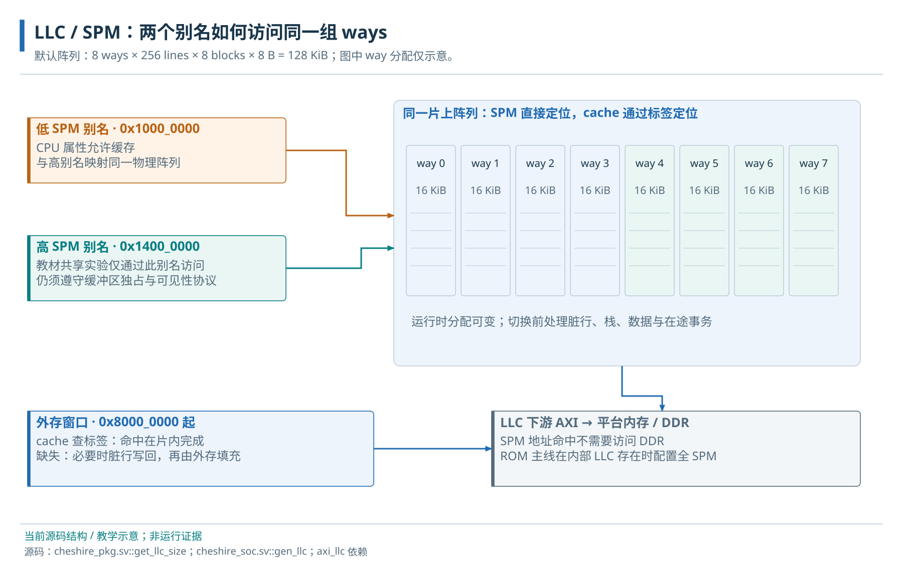

# 09 · Cache、LLC/SPM 与存储路径

缓存副本、地址别名与共享物理阵列。

> 自动生成的 Markdown 阅读版；正文只维护 [HTML 内容源](../content/memory.html)，导航维护 [pages.json](../scripts/pages.json)。[本章 HTML](../memory.html) · [阅读路线](index.md)

- [9.1 地址、缓存副本与物理存储](#cache)
  - [9.1.1 组、路、缓存行与地址映射](#cache-geometry)
  - [9.1.2 同一阵列的缓存与 SPM 用途](#array)
- [9.2 LLC/SPM 的配置和访问路径](#llc)
  - [9.2.1 一次缓存缺失与一次 SPM 访问](#llc-transaction)
  - [9.2.2 容量参数与出口组合](#llc-config)
  - [9.2.3 寄存器提交与 way 切换](#llc-registers)
- [9.3 启动 SPM 与共享缓冲区的使用条件](#usage-contract)
  - [9.3.1 回收一个 SPM way 的软件前置条件](#way-transition-example)
  - [9.3.2 SPM、软件临时缓冲与 scratch 寄存器](#scratch-terms)

**本章任务**

区分缓存副本、地址别名与共享物理阵列。 前置：[05 · 地址空间与访问属性](address-map.md)、[08 · 接口适配与 RegBus](adapters.md)。

## 9.1 地址、缓存副本与物理存储

缓存把数据行保存在近端，用索引选择候选组、标签和有效位判断命中。缺失时从下级取回，写回缓存还可能先把被替换的脏行写下去。写回（WB）允许修改暂留缓存；写穿（WT）把写向下传播，但仍有读副本和写缓冲。外部设备访问同一物理地址时，必须明确这些副本如何同步。

### 9.1.1 组、路、缓存行与地址映射

缓存行（cache line）是缓存保存、填充和替换的一块连续字节。一个组（set）收集所有具有相同索引的候选行；组内每个候选位置称为一路（way）。访问地址先选组，再在该组的各路比较标签（tag）和有效位，匹配的路才保存所需数据。way 不是缓存地址中固定选择的字段，未命中时由替换逻辑选择；SPM 的固定 way 地址选择将在下节单独解释。

数据容量为 `组数 × 每组路数 × 每行字节数`，不包括 tag、valid、dirty 和控制逻辑。Cheshire 的 LLC 参数 `LlcNumLines` 表示每路行数，也就是组数；`LlcSetAssoc` 表示路数。默认是 256 组、8 路、每行 8 个 64 bit block，因此一行 64 B，每路 16 KiB，总数据容量 128 KiB。这里的 block 大小等于 LLC AXI 数据口宽度，并不表示每次窄访问也必须传满 64 bit。

| 默认 LLC 的物理地址字段 | 位段 | 用途 |
| --- | --- | --- |
| block 内字节偏移 | \[2:0\] | 选择 8 B block 内的字节 |
| 行内 block 偏移 | \[5:3\] | 选择一行的 8 个 block 之一 |
| 组索引 | \[13:6\] | 选择 256 组之一 |
| tag | \[47:14\] | 与所选组的各个有效 tag 比较 |

例如 `0x80008AAB` 对应组 42、行内 block 5、block 内字节 3，tag 为 `0x20002`；与它相差 `0x4000` 的地址仍落在组 42，但 tag 不同。在全缓存配置下，该组可同时保存 8 个不同 tag 的行；这不保证任意工作负载都能充分利用全部 128 KiB。L1 I/D-cache 的容量、相联度和行长由 CPU profile 决定，不能把这组 LLC 数值套到 L1；当前向量 profile 的 L1D 为 WT，而 LLC 的缓存用途为 WB。

### 9.1.2 同一阵列的缓存与 SPM 用途

SPM（scratchpad memory）是软件直接管理固定地址的方式，SRAM 是实现存储阵列的技术，两者描述不同层次。当前 LLC 的 128 KiB 数据阵列可按 way 分给缓存或 SPM。启动全部分为 SPM 后，早期栈及装载到 SPM 的程序实际依赖这份阵列；选择 DRAM 链接的应用则在外部主存执行。

当前存储关系。Ara 的失效通知是特定路径，不覆盖全部设备；未来 DDR 旁路见[外部 DDR 集成拓扑](accelerators.md#ddr)。

## 9.2 LLC/SPM 的配置和访问路径

CPU 的低 SPM 窗口从 0x10000000 起，可按地址属性进入 L1；0x14000000 是同一阵列的非缓存数据别名，在 LLC 前重映射回低地址。两个窗口共享物理字节。若先用低别名产生缓存副本，再用高别名访问，不同观察者仍可能看到不同内容。当前高别名未包含在默认 SPM 执行区中，本书把它用于共享数据，代码仍从低地址执行。

LLC 负责片上缓存/SPM 的地址解释和事务处理，不包含 DDR 控制器或 DDR PHY。`[0x80000000,0x100000000)` 是默认可路由的外部主存窗口；窗口的 2 GiB 大小不证明平台接有 2 GiB 实体存储。LLC 向下游发 AXI，平台上的 DDR 控制器/PHY 才负责存储器命令、训练和引脚；仿真平台可以用行为内存模型提供同一 AXI 应答。

### 9.2.1 一次缓存缺失与一次 SPM 访问

先看作为缓存的 way 如何响应一次外部主存访问；仅当地址、事务属性和当前 way 用途允许走缓存路径时，以下过程才成立。

1. **进入与拆分：**访问可缓存的外存地址时，LLC 将 AXI burst 按缓存行边界拆成内部描述符。描述符保存地址、原事务 ID、读写方向及完成标记，避免把一个跨行 burst 当作一次简单 SRAM 读。
2. **标签查询：**标签和有效位决定命中。命中路径可送到读写单元；缺失进入替换/填充路径。是否能超越已有请求还受同 ID 顺序约束。
3. **脏行替换：**如果被替换行已修改，evict 单元先把旧行写回它原来的外存地址，并等待写响应。旧标签用于恢复旧地址，不能误用新请求地址。
4. **填充与访问：**refill 单元从下游读新行并写入阵列，再完成原访问。一次 CPU 读因而可能同时诱发下游写回与读填充；延迟取决于缓存状态和下游应答。

SPM 访问走另一种解释：地址直接选定已分配给 SPM 的 way 和字节，不需要用标签判断“该行是否缓存了某个 DDR 地址”，也不因普通 SPM 读而从 DDR 填充。它复用 LLC 的数据阵列与部分请求路径。启动时所有 way 用作 SPM，外存访问可从 LLC 的旁路通道向下游推进；这解释了“保留 LLC 实例”与“启用外存缓存”为何是两个决定。

默认 SPM 的 way 0 占 `[0x10000000,0x10004000)`，way 1 占随后 16 KiB，依次到 way 7。地址 `0x10008AAB` 固定选 way 2、组位置 42、block 5、字节 3；只有 way 2 已分配成 SPM 时才是有效 SPM 访问。混合模式不会把 SPM 地址自动压紧，也不会把旧缓存内容复制成软件数组：访问未分配为 SPM 的槽会返回 SLVERR。高别名按相同槽布局访问同一物理字节。

源码静态确认：本地[LLC 设计说明](../../../.bender/git/checkouts/axi_llc-5fb8850caad4fcfa/doc/axi_llc.md)的 Transaction Split、Eviction and Refilling；实现为 `axi_llc_top`、`axi_llc_hit_miss`、`axi_llc_evict_unit`、`axi_llc_refill_unit`。Cheshire 用 `get_llc_size` 计算报告容量，以 `gen_llc` 路径连接数据与配置接口。

### 9.2.2 容量参数与出口组合

Cfg.LlcSetAssoc/LlcNumLines/LlcNumBlocks 与 AxiDataWidth 决定阵列容量。LlcOutConnect=1、LlcNotBypass=1 保留 LLC/SPM 和外存出口；1/0 走外存旁路并移除内部 SPM；0/0 关闭该出口；0/1 会导致地址生成与实际实例不一致，应避免采用。取消缓存用途时也要安排原本驻留于阵列的启动空间。

### 9.2.3 寄存器提交与 way 切换

LLC 控制基址为 0x03001000。CFG\_SPM(+0/+4) 是 way 位图，CFG\_FLUSH(+8/+0xc) 选择清理的 way，COMMIT(+0x10) 提交，FLUSHED(+0x18/+0x1c) 表示相应 way 的已清理状态，BIST\_STATUS(+0x48) 表示 tag 阵列自测状态。复位后先等待 BIST 完成，再提交用途配置；BIST 不等于数据阵列已装入应用，也不替代 ASIC 的完整存储测试。

提交后，配置状态机隔离新事务、等待在途访问退出，再按需要清理各 way。COMMIT 在状态机接受请求时就清零，不能只凭它清零判定整个刷新完成；软件要按 FLUSHED、CFG\_FLUSH 及所用操作的契约检查完成。切走 SPM way 前仍应迁移其中代码/栈/数据并停止相关发起者。`axi_llc_reg32_set_spm` 只承担寄存器操作，不替应用迁移栈。

## 9.3 启动 SPM 与共享缓冲区的使用条件

### 9.3.1 回收一个 SPM way 的软件前置条件

假设未来应用希望把高端 way 重新用于缓存。默认 ROM 的早期栈位于 SPM 高端，因此这个 way 可能正保存当前返回地址和局部变量。应用必须先在保留的 SPM 或已就绪的 DRAM 中安排新栈和执行环境，停止其他访问者，再调用切换流程。如果一边执行依赖该 way 的函数，一边让它失去 SPM 用途，即使寄存器写入完全正确，下一次栈访问也会失败。

对于反方向的 cache→SPM，硬件需要处理待替换的脏数据并完成配置提交；软件仍负责确保没有设备继续使用旧解释的地址。容量分配、数据可见性和缓冲区所有权分别解决“空间在哪里”“观察到哪一版值”“谁现在可以写”三个问题。具体操作应先推演这三个问题，再写寄存器。

应用链接区、运行栈和共享缓冲区要在同一物理阵列预算内。运行时切换 way 前迁移占用、排空访问并处理缓存状态；只改 CFG\_SPM 寄存器不能替软件完成这些动作。多个访问者同时使用数据时，进一步阅读[共享数据章](sharing.md#ownership)；DMA 和 Ara 各自的完成语义分别在对应章节。

### 9.3.2 SPM、软件临时缓冲与 scratch 寄存器

scratch 表示临时用途，必须结合对象判断。LLC 的 scratchpad 是按普通内存地址寻址的数据阵列；算法所说的 scratch buffer 只是软件申请的临时工作区，可以放在 SPM，也可以放在 DDR。Cheshire 的 `scratch[0..15]` 则是 SoC 配置窗口中的 16 个 32 位 MMIO 寄存器，用于启动入口、标志或软件约定，不能当作那份 128 KiB 存储。CVA6 的 `mscratch/sscratch` 和调试用 `dscratch0/1` 是核内 CSR，分别服务 trap 或调试上下文；它们也不是 SPM 地址窗口。

**源码与进一步阅读**

[`get_llc_size、AmSpm、gen_cva6_cfg`](../../../hw/cheshire_pkg.sv)；[`gen_llc_atomics、gen_llc` 与别名重映射](../../../hw/cheshire_soc.sv)；[`Cfg` 地址字段推导](../../../.bender/git/checkouts/axi_llc-5fb8850caad4fcfa/src/axi_llc_top.sv)；[`proc_assign_addr_map` 固定 SPM 槽](../../../.bender/git/checkouts/axi_llc-5fb8850caad4fcfa/src/axi_llc_burst_cutter.sv)；[`spm_lock_i` 与 SLVERR](../../../.bender/git/checkouts/axi_llc-5fb8850caad4fcfa/src/axi_llc_hit_miss.sv)；[`FsmIdle/FsmWaitAx/FsmEndFlush`](../../../.bender/git/checkouts/axi_llc-5fb8850caad4fcfa/src/axi_llc_config.sv)；[`CVA6ConfigDcacheType`](../../../.bender/git/checkouts/cva6-20c9d7cbe0dd6995/core/include/cv64a6_imafdcv_sv39_config_pkg.sv)；[SoC scratch 定义](../../../hw/regs/cheshire_regs.hjson)；[scratch CSR 存储与读写](../../../.bender/git/checkouts/cva6-20c9d7cbe0dd6995/core/csr_regfile.sv)。

**把高端 SPM way 改为缓存前，为什么需要核对当前 sp？**

默认早期栈位于 SPM 高端。该 way 可能保存返回地址和局部变量；必须先迁移栈及相关代码/数据并停止访问，再切换用途。

---

[上一页：接口适配与 RegBus](adapters.md) · [下一页：iDMA、流量管理与总线错误](dma.md)
