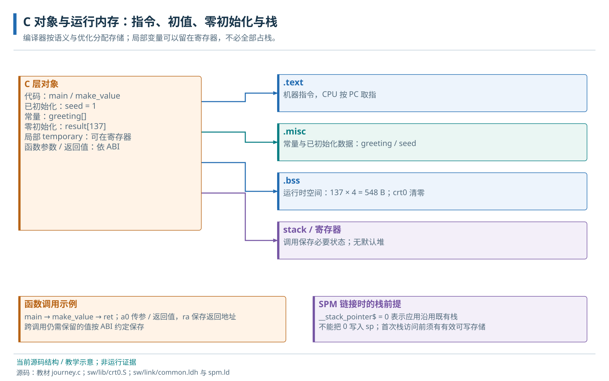

# 03 · 裸机 C 程序运行模型

C 对象、函数调用、初始化与存储布局。

> 自动生成的 Markdown 阅读版；正文只维护 [HTML 内容源](../content/runtime.html)，导航维护 [pages.json](../scripts/pages.json)。[本章 HTML](../runtime.html) · [阅读路线](index.md)

- [3.1 C 程序的编译、装载与执行流程](#execution-chain)
- [3.2 指令与数据的存储需求](#program)
  - [3.2.1 贯穿示例的指令与对象](#program-storage)
  - [3.2.2 程序的组成、构建、启动与运行关系](#software-stack)
- [3.3 函数调用与栈帧](#stack)
- [3.4 ABI 与软件调用边界](#abi)
- [3.5 数据初值装载与零初始化的责任划分](#initialization)
- [3.6 存储用途与节的划分](#sections)
  - [3.6.1 节的初始化属性与访问方式](#section-purpose)
  - [3.6.2 常见节名与本地合并规则](#section-local-mapping)
- [3.7 容量与堆的边界](#heap)
  - [3.7.1 数组、栈与共享缓冲区的使用边界](#object-lifetime)
- [3.8 数组程序的初始化、计算与 UART 输出](#runtime-call)
- [3.9 裸机与操作系统的软件职责](#beyond-baremetal)

**本章任务**

先建立源程序到目标执行的全流程，再理解对象、调用和初始化需要的存储。前置：C 的函数、指针和数组基础，以及 [CVA6 软件可见寄存器](cva6.md#programmer-state)；本章会解释嵌入式运行时所需的新概念。

<a id="execution-chain"></a>

## 3.1 C 程序的编译、装载与执行流程

一份 C 文件从开发主机走到芯片执行，需要连续完成三次交接。主机工具先把源文件变成机器码，并由链接器决定代码和数据的目标地址，生成 ELF 程序文件；加载器再按格式把程序字节写入可用存储，并安排执行入口；CPU 最后从入口取指，执行应用启动代码 crt0，建立 C 运行环境后调用 main。编译链接是文件处理，装载是向目标存储写入字节，执行是 CPU 推进指令；三个动作分别需要证据。

目标还有自己的复位流程：默认先执行片上 Boot ROM，由它准备内部 LLC/SPM 等早期条件。这条流程与主机编译可以独立发生，只有装载时才要求两边都准备好。本文先采用主机经 JTAG 装载 ELF 的裸机路径；自主介质启动时，片上 ROM 改为从 NOR、SD 或 EEPROM 读取约定镜像，代码仍须落到指定运行地址。外部镜像、片上加载器和应用入口不是同一份程序。

后文用同一个数组程序说明每次交接的内容：本章解释应用需要哪些代码、初值和栈；构建章把这些内容对应到对象文件、链接脚本和 ELF；地址与存储机制建立后，启动章再展开 ROM、平台钩子与装载协议。第一次阅读只需知道 SPM 是供小程序使用的片上 RAM，UART 寄存器是程序可访问的设备地址。

<a id="program"></a>

## 3.2 指令与数据的存储需求

本章先沿机器态裸机路径：地址表示 CPU 可访问的位置，SPM 是已准备好的片上 RAM。数组指针选中普通数据，UART 基址选中有读写语义的设备寄存器。此时没有应用页表，不要求先掌握完整 AXI 或地址译码；这些机制在随后地址、互连与存储章节展开。

<a id="program-storage"></a>

### 3.2.1 贯穿示例的指令与对象

CPU 取到的是存储器中的机器码，不是 C 源文件。机器码告诉它执行什么，数据保存被运算的值，两者都需要可达的地址。即使只有一个 CPU、没有操作系统，处理器也要取得循环指令、读取初值并保存结果。寄存器很快但容量有限，而且函数调用会复用它们。

本书使用 [journey.c](../examples/journey.c) 作为贯穿程序：生成 137 个整数、逐个检查并打印总和。下面截取其计算部分；完整文件还包含 UART 初始化和后续向量对照分支。选择 137 是为了以后覆盖向量循环的尾部。

```
#define N 137u
volatile uint32_t seed = 1;
volatile uint32_t result[N];
const char greeting[] = "Hello Cheshire!";

__attribute__((noinline)) uint32_t make_value(unsigned i) {
    uint32_t temporary = 3u * i + seed;
    return temporary;
}
/* main 中的标量阶段 */
unsigned errors = 0;
uint32_t sum = 0;
for (unsigned i = 0; i < N; ++i) result[i] = make_value(i);
for (unsigned i = 0; i < N; ++i) {
    errors += result[i] != 3u * i + 1u;
    sum += result[i];
}
```

`seed` 在整个程序期间存在，启动时必须是 1。`result` 同样具有整个程序的存储期，需要 137×4=548 字节，并按 C 语言规则在进入 main 前为零。`greeting` 是固定内容的字符数组，包含末尾的零字符，输出函数按它识别字符串结束。`N` 是预处理宏，替换成数值后没有一份必须存到 RAM 的“N 变量”。

`i`、`temporary`、`sum` 和 `errors` 用于一次调用或循环。编译器可以把它们放在寄存器，也可能为了跨调用保存、取地址或寄存器不足而放入栈。源码中的局部变量并不都对应固定 RAM 槽，查看机器码才能知道本次构建的选择。volatile 在这里让全局数组访问易于观察，它的完整边界将在驱动章解释。

<a id="software-stack"></a>

### 3.2.2 程序的组成、构建、启动与运行关系

先按“程序由什么组成”看这份源文件：main 是应用；printf 是提供格式化功能的库；UART DIF 是访问本地控制器的驱动；crt0 是在 main 之前执行的启动代码。库是组织和复用代码的方式，驱动是控制硬件的职责，因此驱动也可以被打包进静态库。DIF 在本工程指直接操作控制器的 Device Interface Function；HAL 在 SPI/I2C 介质路径中组合控制器事务以访问外部器件。UART 输出没有额外的器件 HAL，不能为统一层级补出一个。

再按“这些代码怎样形成一个文件”看：主机上的编译器分别处理 C/汇编源文件，归档器把支持对象打包，链接器把应用、启动对象和库组合为 ELF。头文件只给声明和常量，函数实现仍需参与链接。这个构建关系发生在目标执行前，详见[源到 ELF](build.md#translation-units)。

第三种是启动先后：目标复位后先执行 Boot ROM；存储准备好后，装载者放入 ELF 中的程序字节并交接入口；CVA6 从应用 \_start 执行 crt0，建立栈、清 BSS，再调用 main。Boot ROM 和应用 \_start 属于两个程序。加载器也可能在主机端运行，它不属于每次 printf 都会调用的目标代码。

第四种才是运行中的函数调用和硬件事务：main 调 printf，printf 调 \_putchar，\_putchar 调 uart\_write，uart\_write 用 MMIO 读状态、写字节；UART 把这个字节串行发送。在这条链中不再经过编译器、链接器、ELF 解析或 Boot ROM。下面先解释应用的对象和调用环境，随后沿这条真实链走到输出完成。

<a id="stack"></a>

## 3.3 函数调用与栈帧

main 调用另一个函数时，需要保留“回来后从哪里继续”，以及调用结束后仍会使用的值。再发生嵌套调用，就需要保存多层状态。栈为这些状态提供后进先出的空间：进入函数时向下移动栈指针 sp，预留本次调用的栈帧；返回前取回保存状态，并恢复 sp。栈帧还可保存局部数组和溢出到内存的临时值。

RISC-V 用 ra 保存返回地址，a0 等寄存器传参数和返回值。叶子函数若只用临时寄存器，可能没有栈帧；优化器还可以把小函数内联到调用处。完整程序包含 UART、测频和 printf 等调用，因此需要有效栈。为方便跟踪，实际示例的 make\_value 使用 noinline 属性保留调用边界；具体帧大小由反汇编确认。



概念布局。局部变量可以位于寄存器，栈图只示意实际需要保存的调用状态。

<a id="abi"></a>

## 3.4 ABI 与软件调用边界

应用二进制接口（ABI）规定不同编译单元如何相互调用，包括参数、返回值、哪些寄存器由谁保存，以及栈对齐要求。本教材采用 `lp64d`：long 和指针为 64 位，int 为 32 位，浮点参数采用双精度硬浮点调用约定。它决定函数之间怎样合作，AXI 数据宽度仍由硬件配置决定。

调用者保存寄存器的旧值若还需要，由调用者在调用前保留；被调用者保存寄存器若被函数使用，由该函数恢复。常规 RISC-V ABI 的栈有 16 字节对齐要求，启动汇编必须建立能够承接编译器代码的边界。应用 crt0 会在调用 main 前额外使用 24 字节栈空间，因此应在实际调用边界核对 sp；不能把某个早期 sp 值或应用的调整自动推广到 Boot ROM 自己的 C 入口，见[本地栈检查](software-debug.md#stack-handoff)。异步中断可在任意正常指令边界打断程序，不能只套用一次自愿函数调用的保存规则；其现场保存见[trap 入口](traps.md#software-context)。

<a id="initialization"></a>

## 3.5 数据初值装载与零初始化的责任划分

链接器为 seed 分配空间，并把数值 1 的字节保存在待装载内容中。加载器把这些字节放进目标存储，main 才能读到初值。result 的初态全为零，可以只记录所需空间而不在文件中保存 548 个零字节；本地应用启动代码按区间清零。因此“占用目标 RAM”和“占用文件字节”是两件不同的事。

没有操作系统时，由 Boot ROM、主机加载器和应用启动汇编分担这些责任。默认保留内部 LLC 时，Boot ROM 使 SPM 可用并调整初始栈；无内部 LLC 时由平台保证替代存储和栈；加载器放置机器码和初值；应用 crt0 设置调用环境、清零数据、建立异常入口，再调用 main。自定义入口应当完整承担相同的前置条件。

<a id="sections"></a>

## 3.6 存储用途与节的划分

<a id="section-purpose"></a>

### 3.6.1 节的初始化属性与访问方式

分节的目的不是要求读者记住几个缩写，而是让工具分别处理性质不同的内容：指令需要可执行，常量需要保存确定字节，可写初值需要在开始前装入，零初始化区只需预约空间并清零。分组后，链接器可以把代码放在可取指区域，把可写对象放在 RAM；加载器也能避免在镜像中保存大量无意义的零。

这种组织还便于统计容量和定位错误。例如 result 扩大一倍主要增加 RAM 需求，不必同等增加 ELF 中的载荷；增加常量权重数组则同时增加镜像和运行存储。节名本身不构成硬件保护：本地 .misc 混合只读/可写对象，若需要只读保护，还须由布局及实际 PMA/PMP/页表能力落实。

<a id="section-local-mapping"></a>

### 3.6.2 常见节名与本地合并规则

工具把用途相近的内容分组为 section，中文称“节”。函数机器码通常进入 .text；字符串等只读内容进入 .rodata；需要文件提供初值的可写全局对象进入 .data；零初始化的全局或 static 对象通常进入 .bss。static 局部对象也具有整个程序的存储期，和每次调用重新建立的自动局部变量不同。

这些是常见输入节名。当前 `spm.ld` 把 .rodata、.data 及对应的小数据节合并成 `.misc` 输出节，故 ELF 中未必单独列出 .data/.rodata。seed 在 .misc，result 在 .bss；.misc 名称也不表示里面只有只读数据。[构建章的 map 文件](build.md#layout)会展示合并过程。

| 内容 | 存储要求 | 当前责任方 |
| --- | --- | --- |
| make\_value / main 指令 | 可取指的代码字节 | 编译链接生成，加载器放入 .text 对应地址 |
| greeting / seed | 固定字符 / 可写的初值 1 | 链接进 .misc，加载时写入 |
| result\[137\] | 548 字节，启动时为零 | 链接器保留 .bss，crt0 清零 |
| 调用保存状态 | 对齐且容量足够的栈 | 启动建立 sp，函数维护各自栈帧 |

<a id="heap"></a>

## 3.7 容量与堆的边界

堆是供动态分配器管理的存储区域，malloc/free 通过运行时算法分配和归还空间。本程序使用固定全局数组与函数栈，没有调用 malloc，因此无需假设存在正在使用的堆。以后需要动态分配时，应明确区域、边界、失败处理和库适配；链接脚本中的空闲地址不会自行形成分配器。

在本教材默认配置下，应用 SPM 链接预算为低 64 KiB，物理阵列为 128 KiB，Boot ROM 把早期栈设置在阵列高端。链接器检查静态布局，实际栈最深占用由调用关系和中断决定；JTAG 接管时仍须确认这一步已完成。更换 LLC 参数或链接脚本后，应重新计算这三个边界。

<a id="object-lifetime"></a>

### 3.7.1 数组、栈与共享缓冲区的使用边界

journey 的 result\[137\] 由链接器分配在 BSS；后续 RVV 实验的 a/b/c 则指向约定的物理 SPM 区域，不由链接器自动分配。静态区没有越界，不能证明运行栈不会向下侵入共享区。先用同一 ELF 的 map/nm 确定静态布局，再在目标环境观测最大栈使用；扩大局部数组或引入嵌套中断时，需要重新检查余量。

<a id="runtime-call"></a>

## 3.8 数组程序的初始化、计算与 UART 输出

进入 main 后，程序先确认 `seed==1`，再检查 result 的 137 项初值都是 0。第一项验证装载初值，第二项验证 crt0 清 BSS；随后即使把 result 全部覆盖，这两项启动检查仍有独立意义。接着程序读取 SoC 的 RTC\_FREQ 声明，用 CLINT 的 mtime 与 CPU 的 mcycle 变化估算核心频率，再调用 `uart_init(&__base_uart, hz, __BOOT_BAUDRATE)`。hz 与波特率都是每秒的量；地址取 UART 控制器基址，不是发送缓冲区。

UART 初始化使控制器使用当前时钟计算分频，选择 8 数据位、无校验、1 停止位并初始化 FIFO。当前 uart\_init 返回 void，表示这组寄存器写已按函数执行，没有返回远端设备确认。实际接线和对端波特率也须匹配；完整寄存器过程见[UART 章](uart-gpio.md#uart-init)。本例 RTC\_FREQ 必须至少为 2500 Hz，RTC 输入必须继续计数，这是现有测频调用的正常前提。

标量循环随后逐项写入 `3*i+1`。第二个循环重新从 result 读取每项，既逐项比较期望值又累计总和；137 项的和为 `137 + 3×136×137/2 = 28085`。这使“算出总和”与“每项都正确”同时受检查，单独一条打印不能替代数组结果。

```
/* 摘自 journey.c；省略前面的初始化和循环，不是另一份独立程序 */
printf("LEARN sum=%u errors=%u\r\n", sum, errors);
uart_write_flush(&__base_uart);
return errors ? 1 : 0;
```

printf 将 28085 转为五个数字字符，经 `_putchar → uart_write` 逐字输出。驱动先用 8 位 MMIO 读 LINE\_STATUS 的 THR\_EMPTY，再以 8 位写 THR；总线把请求送到 UART，FIFO/移位逻辑将数据变成 TX 帧。uart\_write 返回表示字节已提交给控制器，不表示最后一个停止位已出现在引脚上。最后的 uart\_write\_flush 轮询 THR\_EMPTY 与 TMIT\_EMPTY，使程序在报告结束前等待发送路径空闲；它仍不能证明接收端采到了正确字符。

正常预期为 `INIT seed=1 zeroed=137 errors=0`、`LEARN sum=28085 errors=0`，并由 main 返回 0。控制台的文本、应用逐项检查和启动退出协议分别证明不同环节。当前函数是轮询阻塞实现，本例要求有效时钟和能够推进的设备状态；运行证据、超时和源码限制集中在[软件诊断入口](software-debug.md#no-output)，本轮没有新增目标运行。

<a id="beyond-baremetal"></a>

## 3.9 裸机与操作系统的软件职责

裸机已经需要库、驱动和启动代码。RTOS 在这之上增加任务与调度，Linux 再建立内核/用户边界、进程地址空间和设备接口；它们不会使构建与运行合并成同一个过程。后续先读[trap 与调度的接口](traps.md#syscall-scheduling)，再进入[RTOS](rtos.md)和[Linux](linux.md)。本例自身没有创建任务或进入用户态。

调用边界依据 [RISC-V psABI](https://riscv-non-isa.github.io/riscv-elf-psabi-doc/) 的标准整数/LP64D约定；历史记录在 2026-10-08 引用 1.1 预发布版；2026-10-11 定向复核时网页标为 2.0-rc0（2026-10-08），标准整数调用约定仍要求过程入口及执行期间 16 字节栈对齐。本文只采用既有 LP64D 与寄存器职责，不引入新向量 ABI。实际使用仍以本地编译选项和启动代码核对。

**源码与进一步阅读**

[栈、gp、BSS 与 main](../../../sw/lib/crt0.S)；[输入节合并](../../../sw/link/spm.ld)；[地址与链接预算](../../../sw/link/common.ldh)

**result 后来会被循环覆盖，为什么还讲启动清零？**

零初始化是进入 main 前的语言环境契约，其他分支可能先读它。贯穿例也检查初态，把启动责任与后续计算分开。

---

[上一页：CVA6 与 RISC-V 程序使用模型](cva6.md) · [下一页：工具链、链接与 ELF](build.md)
