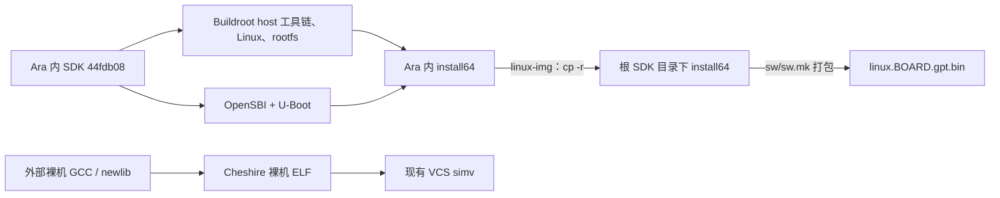

# E01：本地与服务器重建范围对比

调查／更新：2026-10-18（Asia/Shanghai）。职责：E01，结合 S01 软件入口与 V01 仿真证据。**本轮只读查询与文档编写，未安装、下载工程依赖、初始化子模块、运行 Make/Bender、编译、仿真、烧写或修复。**

## 1. 直接结论与证据边界

**服务器已满足“当前固定向量配置下，使用现有工具运行单个裸机 32×32 fmatmul 的 VCS 闭环”这一已验证目标；尚不满足“本地全部环境与产物完整复现”，也未完成完整参考工程／独立提取验收。** 本轮重新读取 `_e01/rvv_fmatmul_04/`：标量参考、向量计算、比较、`Passed.`、`[SLINK] SUCCESS`、`exit.status=0` 均存在；当前 ELF、simv 的 SHA-256 仍与运行输入记录相同。成功依赖服务器用户修改后的 FS=Clean 启动代码；FS 为何未自动变 Dirty 仍未解决。参见[原核查与排障](reference_rebuild_check.md)。

**根 `sw/deps/cva6-sdk` 空，不是当前裸机重建失败的证据。** 两端这个根子模块都未初始化；本地该位置只是另存了 Linux 输出和备份。服务器 Ara 内的另一份 SDK 已初始化且嵌套依赖存在，但未生成 Buildroot 工具链、内核或镜像。裸机软件实际使用外部 `riscv64-unknown-elf-*`，不访问 Linux SDK 工具链。

五步重建复用了服务器 `/opt/riscv`、GCC toolset 和 VCS，完成依赖获取、Python 环境、必要生成文件、向量清单、标量运行和向量软件构建；**没有承诺源码重建 LLVM、Verilator、Spike 或 Linux**。当前 VCS 路线不要求补建这些工具。第 5 步本身不运行向量测试，fmatmul 成功来自其后的单独运行。

与本地相比，服务器缺少本地 Linux 构建输出、镜像、RiVec/Linux 应用产物及 VCU118 适配／bitstream；工具版本、生成脚本配置、软件补丁也不同。反过来，本地当前 VCS 输出目录没有服务器的 simv 和成功运行日志。不能把“本地完整环境”当成已证明完整、正确、可重建的基准。

目前没有证据表明当前单个裸机闭环遗漏了必需的 SDK/LLVM/Verilator 构建；**扩大目标时仍须补相应依赖和验证**：VL/尾部、SPI 自主启动、访存／原子、失败传播、VCS warning 审查、Linux 启动、独立提取均不能由这一例推得。S01-T01 的特定 libgcc 高地址重定位问题保持开放，见[工具链探针](toolchain_preflight.md)。

### 1.1 本轮输入与依据

下文简写：`L`＝本地 `/home/zhaowenyao/RISC_CVA6_prj/cheshire_ara`；`S`＝服务器 `zhaowy24@172.16.0.243:/home/zhaowy24/CheshireAraPULP`；`A`＝各自根目录下 `.bender/git/checkouts/ara-2c7b103275a16c87`；`K`＝`A/cheshire/sw/cva6-sdk`。命令中的 `$CHS_ROOT`、`$ARA_ROOT`、`$SDK` 必须指向同一端的对应绝对路径。

| 对象 | 本轮重新核对的结果 |
| --- | --- |
| 本地根 HEAD | `2f0f2d6f85979709fbc99dd4098447cb5587ce5f`；已有共享／工程／软件文档修改及 E01 未跟踪文件，不修改它们 |
| 服务器根 HEAD | `e040b7bbc7851a37faff3c4657ff8d656cc6e20a`；根已跟踪文件差异为 `sw/lib/crt0.S` |
| Ara，两端 | `2895ba907e9eb14b3464609dc791a969d159a7c3`；本地另有 8 个已跟踪文件相对 Ara 上游的修改，服务器该仓库已跟踪文件无差异 |
| CVA6，两端 | `99eac9a649001bdf5b8f9da52e0ca73d5c48db1c`；本轮依赖 Git diff 未见已跟踪文件差异 |
| 26 项硬件依赖 | 两端逐项 HEAD 一致，见附录 A；这不是所有嵌套依赖、未跟踪文件或全部软件一致的声明 |
| 服务器固定根文件 | `Makefile`、`cheshire.mk`、`sw/sw.mk`、`Bender.yml/lock` 内容与 `e040b7bbc` 一致；服务器锁文件也与本地 `.bender/UPSTREAM.lock` 相同 |
| 当前直接编译源 | 按服务器 VCS 脚本解析出 **716 个独立 `.sv/.v/.vhd` 路径**，本地全部存在且逐文件 SHA-256 相同；18 个 include 目录列于脚本。该检查不覆盖所有传递 include 内容、宏、编译组选项及未选源文件 |

引用优先级：固定 Git 对象／当前工作树与已有日志 → 同版本 README/docs → 当前官网。固定 GitHub 页面本轮有浏览缓存失败，内容通过两端已有 Git 对象和源码核对，没有 fetch。当前 [Cheshire 入门页](https://pulp-platform.github.io/cheshire/gs/) 已写 Python≥3.11、`pyproject.toml/uv`，固定版 [docs/gs.md][CG] 是 Python≥3.9、`requirements.txt`，不升级套用。该页“hw-all 包括 boot ROM”的概述与实际聚合规则不符；固定 [cheshire.mk][C1] 明确将 `CHS_BOOTROM_ALL` 放在独立目标，不纳入 `CHS_ALL`。

当前 [Cheshire 仿真页](https://pulp-platform.github.io/cheshire/tg/sim/) 介绍 Questa/VCS，配置表不含本分支 Ara 配置 3；本项目按固定 TB 与 Ara 集成入口判断。当前 [Ara 文档](https://pulp-platform.github.io/ara/) 也不能替代历史构建配方。固定 Ara README 讲 RVV 1.0，旧 `DEPENDENCIES.md` 仍有 RVV 0.9／Verilator 4.106 描述；实际 [Ara Makefile][AR] 固定 `VERIL_VERSION=v5.012`，不得混装旧建议。

## 2. 两端差异与原因

“需要补齐”针对当前单个裸机 VCS 目标；其他用途明确另列。未查到安装表示“在所查 PATH／约定目录未找到”，不推断整台主机绝不存在。

### 2.1 源码、依赖、配置与产物

| 项目／路径 | 职责 | 本地状态 | 服务器状态 | 版本或来源 | 差异原因 | 对当前目标的影响 | 是否需要补齐 | 证据 |
| --- | --- | --- | --- | --- | --- | --- | --- | --- |
| 根 `hw/`、固定 TB | SoC 功能与验证输入 | 相对基准的根 `hw/` 无修改；有本地 FPGA 修改 | 固定版；选择 Ara cfg3 | `e040b7bbc`；716 源比对 | HEAD 差异主要不能归为 RTL 全改 | 所查编译源一致；清单参数须单独看 | 无批量复制需要 | §1.1、附录 B |
| `Bender.local/lock/yml` | 依赖路径与版本选择 | 26 项相对路径 override；依赖源码纳入主 Git | 原 Git 锁定方式、实际检出 | 本地 `UPSTREAM.lock`＝服务器锁 | 本地后续快照迁移 | 获取／管理方式不同，当前 RTL 不因此不同 | 否；不回退本地快照 | [快照说明][LS]、附录 A |
| 根 `sw/deps/printf` | 裸机 printf | 已初始化、已跟踪工作树干净 | 同左 | 本轮两端重新读取均为 `0dd4b64bc778bf55229428cefccba4c0a81f384b` | 当前必需依赖已具备 | 库构建使用 | 不需重下 | 本轮 Git 查询、[CS] |
| 根 `sw/deps/cva6-sdk` | 外部 Linux 镜像默认存放入口 | 未初始化；仅 `install64` 和备份 | 未初始化、空目录 | gitlink `55c137141b62d4b84722d08e0f5d2b9a5af1e77f` | 未初始化＋本地已有输出 | 裸机规则不使用 | 当前否；Linux 可从 K 复制或显式改镜像输入 | 两端 `submodule status` 为 `-55c…`；[CS] |
| `K` 及嵌套源码 | RVV Linux SDK | 已初始化；源码也随主仓库快照保留 | 已初始化 | `44fdb08ea0d44563ebfc2d5447c5b7e03ea5ea68` | 与根 SDK 原本就是不同提交 | 非裸机前置 | 当前否 | §2.2、[AK]、[SDK] |
| `A/toolchain/{newlib,riscv-gnu-toolchain,riscv-llvm}` | 从源码重建工具链 | 三处空／未初始化 | 同样未初始化 | 固定 gitlink，见附录 A | `.gitmodules` 中 `update=none`；五步未显式获取大工具子模块 | 外部 GCC 可用，无须这些源码 | 源码重建才需 | [AR]、`.gitmodules`、[LS] |
| `A/toolchain/{verilator,riscv-isa-sim}` | 仿真工具源码 | 有源码；未找到默认安装及所查构建可执行文件 | 有源码；无默认 `A/install` | Verilator `7d2d324…`＝v5.012；Spike `5cf439b…` | 初始化源码≠构建工具 | 当前用 VCS，不依赖它们 | Verilator／Spike 路线才需 | 附录 A、[AR] |
| 本地 Ara 软件修改 | RVV 编译与测试适配 | 8 文件变化，见下文 | 固定原版；命令显式 `eew=64 printf=1` | 相对 Ara `2895ba907` | 本地补丁与服务器参数替代 | 对其他测试行为有影响，不能只看 ELF 数量 | 不自动移植 | `git -C A diff HEAD`；[AS] |
| 根 `sw/lib/crt0.S` | 应用启动 FS 初始化 | 固定原版，等于服务器备份 | 用户显式 FS=Clean＋前后 CSR 读数 | backup `b6b305f1…`；现版 `f1731515…` | 用户实际排障修正 | 直接关联当前 fmatmul 成功 | 保留；Dirty 根因待查 | §1、附录 B |
| 根 `sw/sw.mk` | 软件／GPT 模式规则 | 通用 GPT 规则及 GPT 测试聚合被注释 | 固定版 GPT 规则启用 | 本地提交差异 | 本地历史绕过 | 单 SPM ELF 不受影响；`sw-all` 产物和依赖不同 | 当前否 | [本地 sw.mk][LCS] 与 [CS] |
| 根额外测试／头文件 | 本地应用与复制的向量依赖 | 4×4 fmatmul、自定义 CPU MNIST、`tests_wo_ara` 等；67 个测试 ELF | 63 个测试 ELF；五步删除的 C 中，后续恢复的 `fmatmul.c` 当前存在 | 本地提交、Ara copy 规则及旧输出 | 测试集合／生成时点不同，非全部缺失 | `tests_wo_ara` 不被默认 tests 通配式纳入；其他旧 ELF 未必含新 FS 初始化 | 仅选定回归时核对 | [AS]、[CS]、本轮目录／反汇编检查 |
| AXI-RT／CLINT／PLIC／Serial Link 生成文件 | 参数化寄存器 RTL／头文件 | 相对依赖上游共 18 个差异文件 | 同样 18 个 | 当前 `hw-all` 生成链 | 参数生成，不是升级依赖 | 两端其中 17 文件 hash 相同；AXI-RT hjson 仅生成器绝对路径注释不同 | 无需重做以求字节相同 | §2.3；[C1] |
| Boot ROM RTL | 固定启动 ROM | 与服务器相同 | 与基准一致 | `cheshire_bootrom.sv` hash `c6a8f134…` | 五步复用已提交生成物 | 是当前硬件输入；未重编 ROM | 当前否；改启动才需专门重建 | [C1]、附录 B |
| Flash／EEPROM 模型 | 外设仿真 | 两文件存在 | 两文件存在 | 现 VCS 编译源 hash 相同 | 服务器五步③补下载 | 清单生成／仿真输入必需 | 已具备 | `s25fs512s.v`、`24FC1025.v`；[C1] |
| VCS／Questa 生成脚本 | 源顺序、宏与 include | VCS 脚本仍选默认标量 WB profile；不能直接代表本地 FPGA | VCS 为向量 profile、2 lanes、VLEN2048、排除 stub | 两端生成脚本不同 | 不同入口及历史生成状态 | 716 源一致不消除宏／配置差异 | 服务器当前已具备 | [AC]、§1.1 |
| `S/target/sim/vcs` | VCS 工作库与可执行程序 | 本地该目录仅两脚本 | 有 `work.lib++/csrc/simv/simv.daidir`、展开／运行日志 | VCS W-2024.09-SP1 | 服务器实际编译／展开 | 当前闭环证据 | 不为完整性重编 | [原核查](reference_rebuild_check.md)、附录 B |
| `K/buildroot/output,dl` | Linux 工具链、下载／构建输出 | 有 GCC13.2、Linux6.5、rootfs、构建时间日志 | 所查目录不存在 | Buildroot `0473a9b…`，2023.08-rc1 | Linux 尚未构建 | 当前裸机不使用 | Linux 用途才需 | §2.2 |
| 两处 `install64` | Linux／固件输出 | 各 9 个普通文件、逐一 hash 相同；根另有备份 | 两处均无 install64 | 来源关系符合 `linux-img` 复制规则 | 本地历史产物；具体执行命令未确认 | 当前裸机不使用 | Linux 用途才需；先核对容量 | §2.2、§6 |
| `A/apps/bin`／K rootfs | Linux 向量程序与打包 overlay | bin 有 13 个 Linux dump；部分 ELF 被移入 rootfs；未据此证明执行 | bin 不存在，rootfs 是 SDK 源模板 | [AK]/[RV] 的构建／移动流程 | 本地曾进行 Linux 软件准备，执行记录不全 | 与 Cheshire 裸机 tests 是不同集合 | 选定 Linux 应用才需 | 文件清点、[AP]/[RT] |
| FPGA 适配／产物 | VCU118 硬件实现 | 新增 VCU118 规则、XDC、DDR/顶层/Tcl 修改；有 bit/ltx | 固定版只列 genesys2、vcu128；无 out | 本地提交；Vivado 路径不同 | 本地板卡移植及历史构建 | 与当前 VCS 目标独立 | VCU118 复现需另定移植范围 | [本地 FPGA 规则][LCF] 与 [CF] |

本地 Ara 的 8 个差异文件：`cheshire/Makefile` 将默认板改为 VCU118；`cheshire/sw/Makefile` 增加 `eew/printf` 默认值；`include/rvv_test.h` 修正格式和 void 返回；`include/vector_util.h` 改 `enable_rvv` 为 static inline；三个 MMU stub 测试 body 增加地址类型转换；`src/vector_helloworld.c` 加 O0 和显式向量存储。**后者仍有 `printf("%s", str_v)`，本地修改不等于整个测试正确。** 不把这些变化自动应用到服务器。

本地根相对固定版的工程差异还包括：`sw/tests/helloworld.c` 的向量演示修改，FPGA `cheshire_top_xilinx.sv/dram_wrapper_xilinx.sv/phy_definitions.svh`、VCU118 XDC、`common.tcl/impl_ip.tcl/util/flash.tcl`，以及 `util/openocd.hs2.tcl`。它们与文档新增、依赖快照纳入 Git 分开看待；本轮不将本地板级改动回放到服务器。

**当前服务器软件产物不是统一重建批次。** 重新查询确认 `sw/tests/fmatmul.c` 已恢复，与 Ara 原源 hash 均为 `8d028845900ebf4704f1996bac2f58014bb5d4e49524c17e06dade2cd115e106`，不能继续沿用首次排障时“该 C 已删除”的状态。抽查现有 `vector_helloworld.spm.elf`，`0x1000010a` 仍为旧 `csrc mstatus,t1`（t1先设为0x2000），没有新显式 Clean 序列。因此修正 fmatmul 不等于54个向量ELF都已换新启动代码；换测试前须检查所选ELF并按需另行重建，不能只更换文件名就声称修复已覆盖。

### 2.2 两份 SDK 与 Linux 输出的精确关系

根 `.gitmodules` 登记 `sw/deps/cva6-sdk → pulp-platform/cva6-sdk`、`ignore=dirty`；两端根 gitlink 都为 `55c137…`。本地该目录没有源码／独立 Git，只有输出；在这个目录直接执行 `git rev-parse HEAD` 会向上找到根 Cheshire，**不能用这一结果谎称 SDK 已初始化**。本轮结合 `submodule status` 的负号、目录内容及 `--show-toplevel` 判断。根 SDK 的 `55c137…` 工作树未展开，因此没有把 K 的构建细节冒充该版本的实测状态。

Ara `.gitmodules` 单独登记 `cheshire/sw/cva6-sdk → pulp-platform/cva6-sdk`，gitlink 为 `44fdb08…`；两端实际 SDK HEAD 与之相同。K 自身 Makefile／`.gitmodules` 已读取。其嵌套版本为：Buildroot `0473a9b…`，OpenSBI `1156a7b…`，U-Boot `90ec8e2…`，SDK Spike `cc38be99…`，riscv-tests `fbd7e03…`（env `4c356d4…`），vitetris `a922c8b…`。服务器逐个已跟踪工作树检查无差异；本地所查 K／Buildroot／OpenSBI／U-Boot 已跟踪差异为空，不包含 ignored 构建树的全量审计。

实际路径关系如下，箭头是构建／复制关系，不代表本轮执行：



`CHS_CVA6_SDK_IMGS` 默认只指向根目录的 `fw_payload.bin uImage`；根规则将它们视为**外部已构建输入**，不负责初始化／构建根 SDK。`A/cheshire/sw/cva6-sdk.mk` 则使用 K 的 Buildroot Linux GCC，`linux-img` 备份根已有 install64，再复制整个目录。虽然注释写 Softlink，recipe 是 `cp -r`；本地两处 install64 和九个文件均不是符号链接，内容相同。备份目录 `install64.bak_20260410_194946` 与此规则相符，但缺原控制台命令，复制发生的确切操作者／命令仍未确认。

本地 Linux 构建证据比“有镜像”更强，但仍不是启动证据：

- K 的 `buildroot/.config`：RVV=y、GCC13.2.0、内核版本 v6.5；生成的 `linux-v6.5/include/config/kernel.release` 为 6.5.0，`compile.h` 记录 Buildroot GCC13.2.0 / binutils2.40。
- `output/build/build-time.log` 有 Linux configure/build/install-image 阶段记录；`output/images` 有 `vmlinux/rootfs.cpio/rootfs.cpio.gz`。这些是现存历史构建记录，可能随目录搬迁，不能证明本轮／当前路径重新构建过。
- 固定 RVV 配方选 v6.5、glibc、rootfs overlay 和内嵌 initramfs；非 RVV 配方选 v5.10.7。Linux 由 Buildroot 获取到输出树，**不是 K 根目录中缺少一个 `linux/` 子模块**。OpenSBI 是固件，U-Boot 是其 payload，rootfs 是用户空间；它们都不是编译器。
- 本地两处镜像相同的关键 SHA-256：`vmlinux=c7beea98c20818bd66c207e8f76dbde9a94069bd7d2855d0f9193ee9aa8b53e2`，`uImage=639f5c3df656f6652ebf8488e097a1ecd6eef9bb30046db06d95608ca676e08a`，`fw_payload.bin=3c51ca9b55cb7703a457d2bd807541dc0d1c434b15f5db4eefe9c8bce02e1fae`。

### 2.3 生成文件与工具环境

生成差异按依赖内 `git diff HEAD --name-only` 定位后逐文件 hash 对比：AXI-RT 4、CLINT 4、OpenTitan PLIC 7、Serial Link 3，共 18。两端 17 个完全相同；`axi_rt/src/regs/axi_rt.hjson` 只有注释中的生成器绝对路径不同。这里只关闭这 18 个文件的两端内容差异，不宣称所有外设行为已经验证。

| 项目／路径 | 职责 | 本地状态 | 服务器状态 | 版本或来源 | 差异原因 | 对当前目标的影响 | 是否需要补齐 | 证据 |
| --- | --- | --- | --- | --- | --- | --- | --- | --- |
| 主机 OS | 运行 EDA／编译器 | Ubuntu24.04.4、WSL2 6.6.87.2 | Rocky8.10、内核4.18 EL8 | `/etc/os-release`、`/proc/version` | 主机不同 | 二进制／动态库不可默认互换 | 否 | 本轮只读查询 |
| 裸机 GCC | 构建 Cheshire ROM／应用 ELF | `~/riscv_toolchain/bin`，15.2.0 `g5115c7e44` | `/opt/riscv/bin`，13.2.0 `gc891d8dc23e` | 两者 triple 均 `riscv64-unknown-elf`，单 multilib | 不同既有安装；精确安装命令未确认 | 可生成不同代码；服务器所测 SPM 例已通过 | 当前不重建 | `--version/-dumpmachine/-print-multi-lib`；[CS] |
| 裸机 binutils／newlib | 汇编链接、C 运行库 | as/ld2.46；newlib头4.5.0；libc/libgcc 位于上述前缀 | as/ld2.43.1；newlib头4.4.0；libc/libgcc 位于 /opt/riscv | 版本查询／`_newlib_version.h` | 工具与库版本不同 | S01-T01 只涉及已测库成员／地址，不能泛化全部不可用 | 特定高地址用途才处理 | [探针](toolchain_preflight.md)；头版本不等于整个库重建溯源 |
| 主机 GCC/G++ | VCS DPI、工具源码构建 | `/usr/bin` 13.3.0 | `/opt/rh/gcc-toolset-13/root/usr/bin` 13.3.1；系统另有8.5.0 | x86_64 工具链 | 复用系统／toolset 安装 | 不能拿 RISC-V GCC 编译 DPI | 已具备 | 本轮版本查询、已有 elaborate.log |
| LLVM/Clang | Ara standalone apps；主机 Clang 还用于 Verilator C++ | 系统 Clang18.1.3，有 riscv32/64 target；无默认 Ara LLVM install | 所查 PATH 无 clang，A/install 不存在 | `/usr/lib/llvm-18/bin/clang`；[AR]/[RT] | 系统 LLVM 与 Ara 定制前缀不同 | Cheshire GCC 路线不需要；“有 RISCV target”不证明兼容全部 LLVM flags/runtime | standalone apps 才需评估 | `clang --print-targets`；未确认历史源码重建 |
| Linux GCC | Linux 用户程序／内核 | 系统 `riscv64-linux-gnu-gcc`13.3.0；K Buildroot GCC13.2.0 | PATH 未查到 Linux GCC，K 无 output | Buildroot wrapper 指向其 sysroot，glibc；不是 newlib | Linux 尚未构建 | 与当前裸机无关 | Linux 用途才需 | 本轮版本／库路径查询；[RT]/[SDK] |
| VCS | RTL 编译、展开、运行 | 当前 PATH 未查到 | `/eda/synopsys/vcs/W-2024.09-SP1`，已有实际日志 | 商业安装；本轮不启动工具 | 主仿真平台不同 | 服务器已有目标证据 | 不需补 Verilator 替代 | [核查报告](reference_rebuild_check.md)、现有 simv |
| Questa | 另一 RTL 仿真平台 | `~/QuestaSim/questasim`，安装版本标识2024.1 | 所查 PATH 未找到 vsim | 本地安装标识；未重新启动／核许可 | 不同既有安装 | VCS 流不要求 | 切换仿真器才需 | 安装路径；只记录版本，不复制厂商资料 |
| Verilator | 工具自身将 RTL 转 C++；再构建主机模型 | 有 v5.012 子模块源码，无默认安装及所查 verilator_bin/build 证据 | 同样源码已取、无默认安装 | [AR] 的工具目标；[AH] 的 RTL 模型目标 | 源码已初始化、未确认工具安装／历史构建 | 当前无需 | Verilator 路线需要工具与 RTL 模型两阶段 | §3.3、§3.4 |
| Spike 普通／定制版本 | ISA 执行／ideal dispatcher trace | 工具源码存在，未找到默认安装；SDK 内另有不同版本源码 | 同样存在两套来源源码，无默认 Ara install | Ara `5cf439b…`；SDK `cc38be99…`；mod 增加补丁 | 多用途、多来源；源码≠可执行工具 | 当前 VCS 不用；Spike 不验证 Cheshire 总线完整系统 | Spike/ideal 路线才需 | [AR]/[AP]/[SDK] |
| Python／生成包 | 寄存器／模板生成 | 当前 PATH 为 conda Python3.13.5；本轮未逐包重验历史环境 | 系统3.6.8；项目 venv 是3.9.25，pip26.0.1 | 服务器 tclint0.4.2、Mako1.3.12、hjson3.1.0，依赖元数据已查 | 五步②单独准备 venv | 不应使用默认服务器3.6代替项目环境 | 已有环境；不升级 | 本轮 metadata、原 `pip check` 证据 |
| 构建辅助工具 | Make/Bender 调度、CMake/Ninja、DTC/GPT | Bender `/usr/local/bin`；CMake3.28.3、Ninja1.11.1、DTC1.7.0、sgdisk1.0.10 | Bender `~/.cargo/bin`；CMake3.26.5、Ninja1.8.2、DTC1.6.0、sgdisk1.0.3 | 服务器 Make4.2.1/Bender0.32.1 为原检查记录，本轮不运行它们 | 安装来源不同 | 当前环境已产生所查输出；不由版本表推出所有目标可用 | 按路线而定 | 本轮只读版本与[原交接](../../../handoffs/E01_fixed_vector_extraction.md) |
| Vivado | FPGA IP／综合实现／烧写 | PATH 为 `/mnt/d/Xilinx/Vivado/2021.1/bin/vivado` | PATH 指向 ZeBu 附带的2022.1 patched18 | 仅路径／目录标识，未运行 | 主机安装不同；服务器版本不是已验收独立 FPGA 工具 | 与当前 VCS 无关 | FPGA 路线先确认适用安装 | 本轮路径查询、[CF] |

当前 SSH 非交互 PATH 没有自动加入 `/opt/riscv/bin`，因此本轮显式查询该路径；五步命令的 `CHS_SW_GCC_BINROOT` 和 PATH 设置仍重要。主机 C++、交叉编译器、Linux sysroot、Python venv 是四个独立环境，不是设置一个 `RISCV` 就全部正确。

## 3. Make 目标速查

以下以**服务器固定版**为主；本地不同处明确标注。`<app>`、`<mode>`、`<board>` 为需替换的占位符；模式行说明规则，不是让用户原样执行 `%`。每行“执行”列写**本次调查均未执行**，分号后是五步及后续已知历史。`无证` 表示未找到执行证据，不能据现有产物补造完整命令。副作用列仅描述未来执行时的行为。

### 3.1 Cheshire 根与软件／FPGA

根 [Makefile][C0] 的 `all:` 经 `CHS_PHONY` 自动追加转发到 `chs-all`；`hw-all/sw-all/sim-all` 等为同样去掉 `chs-` 前缀的别名。别名仅在根入口建立，其他目录同名目标不可类推。`CHS_ALL=$(CHS_SW_ALL)+$(CHS_HW_ALL)+$(CHS_SIM_ALL)`，**不包含 Boot ROM、DRAMSys、FPGA、SDK/工具链构建，也不运行测试**。

| 执行目录 | 准确命令／目标或模式 | 功能 | 直接及重要传递依赖 | 关键变量 | 主要产物路径 | 是否联网／安装／修改源码 | 是否实际运行仿真 | 本轮是否执行 | 适用场景 | 源码依据 |
| --- | --- | --- | --- | --- | --- | --- | --- | --- | --- | --- |
| CHS 根 | `make all` / `make chs-all` | 聚合 SW/HW/SIM 输入 | 下三类；不保证列表生成前模型已存在 | GCC、Bender、RTL flags | sw、生成 RTL、两类 compile 脚本 | 缺依赖可联网；写生成源 | 否 | 否；五步未用 | 完整默认输入构建，非向量万能入口 | [C0]/[C1] L197–207 |
| CHS 根 | `make hw-all` / `chs-hw-all` | 生成参数化硬件 | iDMA FULL_RTL、SoC regs、CLINT/OTP/AXIRT/VGA/SLINK `.generated` | CLINTCORES、AXIRT_NUM_MGRS/SUBS、REGTOOL | hw/regs、依赖 src/target/sw headers | 可能检出依赖；改生成源／配置副本 | 否 | 否；五步③ | 必要寄存器／外围生成 | [C1] L81–127 |
| CHS 根 | `make sw-all` / `chs-sw-all` | 库、头、测试、烧写工具 | printf、依赖驱动、生成头、各布局 ELF/dump、ROM/GPT memh | CHS_SW_FLAGS/CCFLAGS/LDFLAGS、LINK_MODES | sw/lib、sw/include、sw/tests、flash.spm.elf | 可能先获取 printf；写头/对象；本地无 GPT 测试聚合 | 否 | 否；五步⑤由 Ara 转发 | 软件集合重建 | [CS] L29–196 |
| CHS 根 | `make sim-all` / `chs-sim-all` | 外设模型及脚本 | Bender.yml、模型下载；Questa/VCS 生成规则 | CHS_BENDER_RTL_FLAGS、VLOG_ARGS、VLOGAN_ARGS | target/sim/models、vsim/vcs compile | 模型缺失则联网；不安装仿真器 | 否 | 否；③分开准备模型／脚本 | 仅生成仿真输入 | [C1] L146–176 |
| CHS 根 | `make bootrom-all` / `chs-bootrom-all` | 重编 ROM | ROM S/C、libcheshire、链接脚本→ELF/bin→gen_bootrom.py | 指定编译器、CHS_BROM_FLAGS | hw/bootrom ELF/bin/dump/SV | 覆盖生成 ROM RTL；不安装工具 | 否 | 否；五步刻意复用 ROM | 修改 ROM 后专门重建 | [C1] L129–144 |
| CHS 根 | `make dramsys-all` / `chs-dramsys-all` | 编译 DRAMSys/SystemC | DRAMSys clone/patch、CMake、本机 C++ | DRAMSYS_ROOT/BUILD_DIR | 依赖 dramsys_lib/DRAMSys/build/lib | 联网、删除/重建 DRAMSys 目录、patch | 否 | 否；UseDramSys=0 | 特定 DRAM 模型 | [C1]、[DR] |
| CHS 根 | `make sw/tests/<app>.<mode>.elf` | 单程序编译链接 | `.c/.S→.o`、生成头、libcheshire、link/<mode>.ld | mode=spm/dram/rom；GCC/ISA/ABI | 同位置 ELF；依赖对象／库 | 可能触发依赖生成；无工具安装 | 否 | 否；④helloworld，后续 fmatmul 单例 | 小范围软件构建 | [CS] L90–119 |
| CHS 根 | `<file>.dump/.bin/.memh`、`<file>.dtb` | 格式转换／设备树 | ELF→objdump/objcopy；DTS→dtc | OBJDUMP/OBJCOPY/DTC | 对应后缀 | 仅写输出；可牵引 ELF 构建 | 否 | 否；⑤有 dump/memh | 反汇编、启动输入 | [CS] L119–130 |
| CHS 根 | `<app>.gpt.bin/.gpt.memh` | 裸机 GPT 测试镜像 | `.rom.bin`、truncate/sgdisk/dd、objcopy | ZSL_TGUID | sw/tests 等 .gpt.* | 写镜像；本地规则被注释 | 否 | 否；⑤有 GPT memh | 检查 GPT 启动解析，不是 Linux | [CS] L133–147 |
| CHS 根 | `make "$CHS_ROOT/sw/boot/linux.<board>.gpt.bin"` | Linux 磁盘打包 | zsl.rom.bin、cheshire.<board>.dtb、外部 fw_payload.bin/uImage | CHS_CVA6_SDK_IMGS、DISK_SIZE | sw/boot/linux.<board>.gpt.bin | 写镜像；**不自动构建 SDK** | 否 | 否；服务器无该产物 | Linux 启动介质；先审分区容量 | [CS] L146–162 |
| CHS 根 | `make xilinx-<board>` / `chs-xilinx-<board>` | 单板 bitstream | add_sources、impl_sys、各 IP out.xci、CHS_HW_ALL | VIVADO、板名、RTL flags | target/xilinx/out/cheshire.<board>.bit | 写 IP／实现输出；可能生成依赖 | 否 | 否；本地历史有 VCU118 bit | FPGA 实现 | [CF] L35–63 |
| CHS 根 | `make xilinx-all` / `chs-xilinx-all` | 所列板全部 bitstream | 上项按板聚合 | 固定版 genesys2/vcu128；本地另有 vcu118 | 各板 out bit | 同上，较大构建 | 否 | 否；无全板执行证据 | 确实需要多板时 | [CF]/[C1] |
| CHS 根 | `make xilinx-program-<board>` / `chs-xilinx-program-<board>` | 向硬件下载 bitstream | bit 不存在时先 make；util/program.tcl | HWS_URL、HWS_PATH_<board> | 板上 FPGA 状态／日志 | **操作硬件**，可能先构建 | 否 | 否；本地板测为用户历史报告 | 上板，须另授权 | [CF] L71–98 |
| CHS 根 | `make xilinx-flash-<board>` / `chs-xilinx-flash-<board>` | 写启动介质 | 默认 Linux GPT；缺输入时 make；flash.tcl | CHS_XILINX_FLASH_IMG、HWS_* | 介质内容／日志 | **烧写硬件**，非只生成文件 | 否 | 否；无本次证据 | 明确介质与镜像后 | [CF] L100–102 |
| CHS 根 | `make help` | 打印 CHS_PHONY 别名 | 仍先解析整个 include 链 | BENDER 等 | 终端文本 | 缺 `.chs_deps` 时仍可能检出；并非安全探针 | 否 | 否 | 查接口；本轮静态读取替代 | [C0]/[C1] |
| CHS 根 | `make nonfree-init` / `chs-nonfree-init` | 获取受限扩展 | 指定 remote/commit | CHS_NONFREE_* | nonfree | 联网、检出；非当前必需 | 否 | 否 | 获授权的内部扩展 | [C1] L60–73 |
| CHS 根 | `make clean-deps` / `chs-clean-deps` | 删除依赖／模型并 deinit | 无保护的固定上游 recipe | 根路径 | 删除 .bender 等 | **破坏性**；本地增加拒绝保护 | 否 | 否；禁止作为修复 | 仅说明，不建议执行 | [C1] L54–60；本地差异 |

内部辅助链：`.chs_deps` 缺失可经 `-include` 重建触发 `bender checkout` 和仅 printf 的 recursive submodule update；这解释根 SDK 为什么仍空。`hw-all` 调用 `clint`、`otp`（GPIO/I²C/SPI/PLIC/头文件）、`axirt_regs`、`axi_vga`、Serial Link `update-regs` 及 iDMA 模板／寄存器生成；包括 `cp` 到依赖源树和 `.generated` 标记，不只是生成一个 filelist。iDMA 自身的 lint/doc/独立仿真目标不因此纳入 Cheshire `all`。本轮只展开这些实际进入根构建图的辅助链，未穷举各 IP 独立工程全部目标。

### 3.2 Ara 的 Cheshire 集成入口

| 执行目录 | 准确命令／目标或模式 | 功能 | 直接及重要传递依赖 | 关键变量 | 主要产物路径 | 是否联网／安装／修改源码 | 是否实际运行仿真 | 本轮是否执行 | 适用场景 | 源码依据 |
| --- | --- | --- | --- | --- | --- | --- | --- | --- | --- | --- |
| A/cheshire | `make ara-chs-all` | 先根 all，再强制更新向量脚本 | `make -C CHS all`；`make -B update_vsim_src` | BACKREF_CHS_ROOT、ARA_CONFIGURATION | 根 SW/HW/SIM 产物及向量脚本 | 继承根副作用；不构建工具链/SDK | 否 | 否；五步拆分 | 集成输入构建；不自动复制向量软件 | [AC] L38–41 |
| A/cheshire | `make update_vsim_src` | 依次重生成 Questa、VCS 清单 | 两个绝对文件目标，递归 `-B` | BACKREF_CHS_ROOT、ARA_CONFIGURATION=2_lanes、VLOGAN_ARGS | CHS target/sim 两份 compile 脚本 | 覆写脚本；依赖缺失可能触发检出 | 否 | 否；五步③ | 正确向量 profile/decoder/宏选择 | [AC] L59–61 |
| A/cheshire | `make update_xilinx_src` | 生成向量 Vivado 源清单 | Bender script vivado | BOARD、ARA_CONFIGURATION、BACKREF_CHS_ROOT | add_sources.<board>.tcl | 覆写生成脚本 | 否 | 否；本地有产物，原命令无证 | FPGA 编译输入 | [AC] L55–57 |
| A/cheshire | `make ara-chs-xilinx` | 向量清单＋根单板构建 | update_xilinx_src→chs-xilinx-BOARD | 固定默认 BOARD=vcu128；本地=vcu118 | 对应 bitstream | 大型实现，生成输出 | 否 | 否；五步未做 | 指定板 FPGA | [AC] L43–44 |
| A/cheshire | `make ara-chs-image` | 强制根 Linux GPT 打包 | 递归文件目标 `-B`，仍需 SDK 镜像已存在 | BOARD、BACKREF_CHS_ROOT | linux.<board>.gpt.bin | 重建打包输入；不自动调用 linux-img | 否 | 否 | 镜像已就绪且容量核验后 | [AC] L46–47 |
| A/cheshire | `make ara-chs-xilinx-program` / `ara-chs-xilinx-flash` | 转发根板上操作 | 对应根 program/flash 规则 | BOARD、VIVADO、HWS_URL/PATH | 硬件状态／日志 | **下载／烧写硬件** | 否 | 否 | 经确认的部署 | [AC] L49–53 |
| A/cheshire | `make patch_cheshire_high_perf_hw` | 应用性能补丁 | git apply cheshire_patch_0.diff | BACKREF_CHS_ROOT | 根 RTL／配置变化 | **修改源码／配置** | 否 | 否 | 可选方案，非裸机前置 | [AC] L63–64 |
| A/cheshire | `make clean` | 删除两个位置的生成 Vivado 清单 | BOARD 路径 | BACKREF_CHS_XIL_SCRIPTS | 删除 add_sources | 删除文件，不是依赖修复 | 否 | 否 | 仅说明 | [AC] L66–68 |
| A/cheshire/sw | `make chs-sw-all CHS_ROOT=… eew=64 printf=1` | 复制向量源／头并构建根软件集合 | copy-vector-sw/deps→根 chs-sw-all；成功后删除 C 副本 | CHS_ROOT、ARA_CONFIGURATION、eew/printf、带 V flags | 根 tests ELF/dump/memh、库和头 | **临时复制／删除源、覆盖同名头**；可能生成依赖 | 否 | 否；五步⑤ | Cheshire 裸机 RVV 软件 | [AS] |
| A/cheshire/sw | `make copy-vector-sw` / `copy-vector-deps` | 复制 C/body 或头文件 | src/*.c、src/tests/*.c/body、include/*.h | CHS_ROOT | CHS/sw/tests | 修改目标源目录，非独立输出 | 否 | 否；⑤传递调用 | 上项内部辅助 | [AS] L34–47 |
| A/cheshire/sw | `make <app>-linux`，如 `fmatmul-linux` | Linux app 编译并复制 rootfs | K Linux GCC→apps `bin/<app>-linux LINUX=1 -B` | HOST_TOOLCHAIN_SUFFIX、RVV_LINUX、ARA_CONFIGURATION | A/apps/bin、K/rootfs/<app> | 可能初始化 SDK、构建 Linux 工具链；写软件 | 否 | 否；本地已有 Linux dump，具体命令无证 | Linux 用户程序 | [AK] L25–62 |
| A/cheshire/sw | `make linux-img` | SDK images，并复制 install64 到根 | K/install64/vmlinux、工具链、TARGET_KERNELS | RVV_LINUX=1；CHS_ROOT | K/install64→CHS/sw/deps/cva6-sdk/install64 | 可联网／构建；备份并复制根输出 | 否 | 否；本地有复制一致性证据 | Linux 镜像准备，不运行 Linux | [AK] L71–80 |
| A/cheshire/sw | `make patch_cheshire_high_perf_sw` | OpenSBI LLC 性能补丁 | git apply opensbi_patch_1.diff | K、ARA_ROOT | K/opensbi 源码 | **修改 SDK 源码** | 否 | 否 | 可选；须确认缓存/启动影响 | [AK] L43–44 |
| A/cheshire/sw | `make rivec-bmark-<name>` / `rivec-all` / `rivec-all-small` | RiVec 标量/向量版本及输入集 | %-linux、apps clean、移动 rootfs 文件 | ENV_DEFINES、RIVEC_APPS | K/rootfs/*-scalar/*-vector/input* | 清理软件输出、复制数据；small 删除大输入副本 | 否 | 否；本地有部分产物 | 明确 benchmark 范围后 | [RV] |

易误读处：`.PHONY` 中的 `ara-chs-flash`、`copy_vector_sw`、`rivec-bmark-all` 与真正 recipe 名称不一致，不能当成上述实际命令的等价别名。当前读取的入口没有 `make-all` recipe；`make all` 是 make 命令加目标，`make-all` 若作为单独 shell 命令则还需另一个可执行脚本，本轮相关脚本未发现它。

### 3.3 Ara 根：构建工具本身

| 执行目录 | 准确命令／目标或模式 | 功能 | 直接及重要传递依赖 | 关键变量 | 主要产物路径 | 是否联网／安装／修改源码 | 是否实际运行仿真 | 本轮是否执行 | 适用场景 | 源码依据 |
| --- | --- | --- | --- | --- | --- | --- | --- | --- | --- | --- |
| A | `make all` | toolchains＋普通/定制 Spike＋Verilator | 下列工具目标 | INSTALL_DIR 及子前缀 | A/install/* | 联网、编译安装、reset/patch 等 | 否 | 否；无该完整调用证据 | 重建 Ara standalone 工具环境 | [AR] L63–69 |
| A | `make git-submodules` | 初始化全部及强制大工具模块 | git submodule update；--checkout GNU/newlib/LLVM | ROOT_DIR | toolchain、SDK 等 | 联网并改变检出状态 | 否 | 否；五步 bender 获取不等于调用它 | 工具源码准备，须审批范围 | [AR] L53–59 |
| A | `make toolchains` / `toolchain-gcc` | 两套工具链／GNU 单套 | git-submodules、GNU configure/make | GCC_INSTALL_DIR、CC/CXX；rv64gcv、medlow、multilib | install/riscv-gcc | 删除旧 build、安装新前缀；可能联网 | 否 | 否；当前复用外部 GCC | 明确要重建 GNU 时；默认 medlow 不自动修 S01-T01 | [AR] L67–77 |
| A | `make toolchain-llvm` | Clang/LLD＋newlib＋compiler-rt | main→newlib→rt 及子模块获取 | LLVM_INSTALL_DIR、CC/CXX、CMAKE | install/riscv-llvm | 删除旧 build，编译安装 | 否 | 否；历史重建未确认 | Ara standalone 裸机 apps | [AR] L79–131 |
| A | `make toolchain-llvm-main` / `make toolchain-llvm-newlib` / `make toolchain-llvm-rt` | 上项三阶段 | RISC-V Clang/LLD；C 库；builtins | target=riscv64-unknown-elf，recipe 中固定编译参数 | Clang、库、clang/20/lib 链接 | 源构建、安装；rt 固定目录布局需核对 | 否 | 否 | 分阶段定位，非无条件适配新 LLVM | [AR] |
| A | `make riscv-isa-sim` / `riscv-isa-sim-mod` | 普通＋定制／仅定制 Spike | 普通安装→mod，DTC 获取、补丁 | ISA_SIM*_INSTALL_DIR、DTC_COMMIT、CC/CXX | install/riscv-isa-sim{,-mod} | 联网 DTC；git stash/apply；重建安装 | 否，构建 ISA 模拟器 | 否 | Spike benchmark／ideal trace | [AR] L133–168 |
| A | `make verilator` | **编译安装 Verilator 工具** | 源码、autoconf、主机 Clang | VERIL_VERSION=v5.012、VERIL_INSTALL_DIR、CLANG_CC/CXX/PATH | install/verilator | **git reset --hard/fetch/checkout/clean**，随后安装 | 否 | 否；VCS 替代当前使用需求 | 工具缺失时另定安全构建方案 | [AR] L170–180 |
| A | `make riscv_tests` | 编译测试后请求 Questa 回归 | apps riscv_tests→hardware riscv_tests_simc | 配置／工具前缀 | apps/bin、预期日志 | 会构建软件 | 意图运行，但固定版接线有缺口 | 否 | 当前不直接推荐，见 §6 | [AR] L182–184；[AH] |
| A | `make rvv-bench` | 获取并改造 benchmark | 子模块 a1d7b31…，cp/sed/m4 | ROOT_DIR | apps/rvv、nolibc.h、gen.S | 联网、删除/重建应用目录、改源 | 否 | 否 | 可选性能测试 | [AR] L187–201 |
| A | `make clean` | 删除安装前缀 | 无 | INSTALL_DIR | 删除 A/install | **删除工具安装** | 否 | 否 | 仅说明，不执行 | [AR] L203–206 |

不要用无目标的 `make` 猜测 `all`：Ara 根第一个实际规则是 `git-submodules`；Ara 软件入口还先 include 含 SDK 更新目标的文件。本文统一写显式目标，未通过执行 Make 探测默认行为。

### 3.4 Ara apps 与独立硬件仿真

这里的 `ara_tb/ara_tb_verilator` 与 Cheshire `tb_cheshire_soc` 不是同一完整 SoC 测试平台；apps 的链接脚本也不是 Cheshire SPM 链接脚本。不能把现有 `fmatmul.spm.elf` 不经核对直接交给 standalone RAM loader。

| 执行目录 | 准确命令／目标或模式 | 功能 | 直接及重要传递依赖 | 关键变量 | 主要产物路径 | 是否联网／安装／修改源码 | 是否实际运行仿真 | 本轮是否执行 | 适用场景 | 源码依据 |
| --- | --- | --- | --- | --- | --- | --- | --- | --- | --- | --- |
| A/apps | `make all` | 默认应用集合 | BINARIES 过滤 benchmarks/rivec-bmarks/_*；runtime、data、链接脚本 | config、LLVM_INSTALL_DIR、RISCV_*、ENV_DEFINES | bin/<app>、dump | 写 data.S/common/link.ld；不自动安装 LLVM | 否 | 否 | standalone 默认裸机集合 | [AP] L26–53、[RT] |
| A/apps | `make <app>` / `bin/<app>` | 单应用裸机 | 源、data.S、LLVM runtime、linker_script | config=2_lanes、LLVM flags | bin/<app>、dump | 重生成数据／链接脚本，写对象 | 否 | 否 | standalone 小例 | [AP]/[RT] |
| A/apps | `make bin/<app>-linux LINUX=1` | Linux ABI 程序 | K 的 Linux GCC、glibc/libstdc++ | LINUX、RISCV_PREFIX、config | bin/<app>-linux、dump | 写软件；不等于 SDK 工具链自动已装 | 否 | 否；由 %-linux 转发可调用 | Linux 用户空间 | [AP]/[RT] |
| A/apps | `make bin/<app>.spike` / `bin/<app>.ideal` | Spike 程序／ideal trace 输入 | Spike runtime、patch-spike-crt0；ideal 再执行 mod Spike | RISCV_SIM_MOD、VTRACE_SCRIPTS、config | bin、ideal_dispatcher/{vtrace,log,temp} | patch crt.S＋git assume-unchanged；写 trace | `.spike` 否；`.ideal` 会运行 ISA 模拟 | 否 | 性能／ideal dispatcher | [AP] L66–104 |
| A/apps | `make spike-run-<app>` | 用普通 Spike 跑应用 | bin/<app>.spike、已安装 Spike | RISCV_SIM_OPT ISA/VLEN | spike_runs | 继承编译／patch；不安装工具 | 是，ISA 模拟而非 SoC RTL | 否 | ISA 参考 | [AP] L181–191 |
| A/apps | `make riscv_tests` | 标量／向量 ISA 测试软件 | scalar GCC、vector LLVM、测试枚举／runtime | config、RISCV_CC_GCC/RISCV_CC | bin/rv*-ara-* | 写对象和 ELF | 否 | 否 | 为 RTL 测试准备输入 | [AP] L123–155 |
| A/apps | `make riscv_tests_spike` | 编译并运行 Spike ISA 测试 | patch-spike-crt0→isa make→make run | GCC/LLVM/ISA_SIM_INSTALL_DIR | isa 输出／日志 | patch、构建 | 是，Spike | 否 | Spike 回归 | [AP] L158–165 |
| A/apps | `linker_script`、应用 `data.S` | 内部数据／布局生成 | Python gen_data、align_sections.sh | old_data、def_args、nr_lanes | data.S、common/link.ld | chmod/cp/rm，改生成源 | 否 | 否 | 上项辅助，不是工具安装 | [AP] L56–89 |
| A/apps | `format`、`clean`、`benchmarks_clean`、`riscv_tests_spike_clean` | 格式化／清理 | clang-format 或递归 clean | 工具前缀 | 源／输出改变 | 改源码或删产物 | 否 | 否 | 仅说明；本轮禁用 | [AP] L168–223 |
| A/hardware | `make all` / `compile` | Questa DPI／库／RTL 编译 | dpi、lib、bender、生成 Tcl；编译 recipe 在 Tcl 文件规则内 | config、questa_cmd、CXX、buildpath | build/work、work-dpi、compile_config.tcl | 缺本地 bender 会下载；写编译输出 | 否 | 否 | standalone Questa 构建 | [AH] L117–160 |
| A/hardware | `make sim` / `simc app=<app>` | Questa GUI／批处理运行 | compile、预先构建 app | app/preload、config、questa_cmd | build/transcript 等 | 可触发编译 | 是 | 否 | standalone Questa 运行 | [AH] L162–173 |
| A/hardware | `make verilate config=2_lanes` | **用 Verilator 编译 RTL 模型** | bender、已有 verilator、主机 Clang、libelf、C++ harness | veril_path、veril_top、veril_library、trace | build/verilator/Vara_tb_verilator | 清空本模型输出；缺 bender 会下载 | 否；生成主机可执行模型 | 否 | Verilator RTL 编译阶段 | [AH] L183–238 |
| A/hardware | `make simv app=<app> config=2_lanes` | 执行 Verilator 模型 | recipe 直接调用 V<top>；**不依赖 verilate/app 构建** | app_path、veril_library、trace | 控制台／可选 FST | 运行已有模型 | 是；这里 simv 不是 VCS | 否 | 模型与 ELF 都已准备好后 | [AH] L240–243 |
| A/hardware | `make riscv_tests_simv` | 枚举 ISA ELF 运行 | tests→app_path/rv*；无自动工具安装 | config、app_path | build/<test>.trace | 写日志 | 是，Verilator | 否 | 先确认枚举及各 ELF 存在 | [AH] L245–249 |
| A/hardware | `make bender` / `checkout` / `update` | 本地 Bender 获取／检出／更新 | Bender0.27.3；网络 | BENDER | hardware/bender/deps | 下载；update 还删 deps 并更新锁 | 否 | 否 | 依赖维护；本轮禁用 | [AH] L125–142 |
| A/hardware | `make dpi` / `lib` | 主机 DPI shared library／Questa 库 | CXX、Verilator svdpi 头、Spike include | INSTALL_DIR、buildpath、library | work-dpi/ara_dpi.so、work | 写输出，不是交叉编译 | 否 | 否 | compile 辅助 | [AH] L145–150、L264–274 |
| A/hardware | `make lint` / `apply-patches` / `clean` | SpyGlass／SRAM patch／清理 | lint 文件；patches 路径；buildpath | SNPS_SG、BENDER | spyglass 输出／源变化／删除 build,bender | 后两项改源或删输出 | 否 | 否 | 非本次裸机路线 | [AH] L144–146、L251–262、L276–280 |

`A/scripts/benchmark.sh` 和 `benchmark_all.sh` 已静态检查：前者会 clean apps、生成数据、编译并运行；`ci` 参数切换到 Verilator `simv`，否则走 Questa `simc`。后者循环 2/4/8/16 lanes 并 `make -B … verilate`、移动结果。它们是专项性能流程，不是本次五步，也未找到可证明用户历史调用它们的日志。`util/flash_disk.sh` 调用 OpenOCD/GDB 烧写介质，同样不是安全的“准备文件”脚本。

### 3.5 SDK 与实际相关的下级入口

本表适用 K 的 `44fdb08…`，不冒充未展开的根 SDK `55c137…`。`RVV=1` 才选向量 Linux 配方；SDK 默认 `RVV=0`。固定 Linux/OpenSBI/Buildroot 的所有内部目标不逐一列出，只展开本工程实际调用及最小后续定位入口。

| 执行目录 | 准确命令／目标或模式 | 功能 | 直接及重要传递依赖 | 关键变量 | 主要产物路径 | 是否联网／安装／修改源码 | 是否实际运行仿真 | 本轮是否执行 | 适用场景 | 源码依据 |
| --- | --- | --- | --- | --- | --- | --- | --- | --- | --- | --- |
| K | `make all RVV=1` | Linux GCC＋SDK Spike | `$(CC)`、isa-sim | XLEN64、RVV、HOSTCC/CXX/CPP | buildroot/output/host、install64/bin/spike | 可能下载 Buildroot 包、构建安装 | 否 | 否 | **不等于 Linux images** | [SDK] L78–92 |
| K | `make gcc RVV=1` | Buildroot Linux 工具链 | Buildroot defconfig→host-gcc-final | RVV、HOSTCC/CXX/CPP | buildroot/output/host/bin/sysroot | 下载及编译；不写 /opt | 否 | 否；本地已有工具，原命令无证 | SDK Linux GCC | [SDK] L84–86、L179 |
| K | `make images RVV=1` | Linux＋OpenSBI/U-Boot 镜像 | GCC、fw_payload.bin、uImage；vmlinux/rootfs、mkimage | RVV、PLATFORM=fpga/cheshire、FW_FDT_PATH | install64/{vmlinux,Image.gz,uImage,u-boot*,fw_payload.*} | Linux 下载、编译、安装输出 | 否 | 否；本地有历史产物 | Linux 软件栈准备 | [SDK] L105–139、L185 |
| K | `make vmlinux RVV=1` / `uImage` | 内核／U-Boot 格式内核 | Buildroot all；uImage 再经 objcopy/gzip/mkimage | 内核 defconfig、UIMAGE_* | install64/vmlinux、Image.gz、uImage | 构建／覆盖输出 | 否 | 否 | 单类镜像定位 | [SDK] L105–120 |
| K | `make fw_payload.bin RVV=1` | OpenSBI 包装 U-Boot | U-Boot→OpenSBI FW_PAYLOAD_PATH | PLATFORM、CROSS_COMPILE | install64/fw_payload.bin/elf/dump | 构建固件；不执行它 | 否 | 否 | Cheshire 固件阶段 | [SDK] L122–139 |
| K | `make spike_payload RVV=1` | generic OpenSBI 包装 Linux | install64/Image→OpenSBI PLATFORM=generic | FW_PAYLOAD_PATH | install64/spike_fw_payload.elf/bin | 构建，不自动运行 Spike | 否 | 否 | Linux 的 ISA 模拟输入 | [SDK] L141–146 |
| K | `make isa-sim` / `tests` | SDK Spike／ISA 测试构建 | Linux GCC、对应源码 | XLEN、install64 前缀 | install64/bin、install64/target | 编译安装 | 否 | 否 | SDK 专用工具，区别 Ara Spike | [SDK] L65–82 |
| K | `make flash-sdcard` / `format-sd` | 分区并写物理 SD | 固件／uImage、SDDEVICE、root 权限 | SDDEVICE | **真实设备内容** | **破坏性分区/烧写**；SDK 分区布局也不同于根 GPT | 否 | 否 | 必须单独审批具体设备，非建议下一步 | [SDK] L148–176 |
| K | `make clean` / `clean-all` / `help` | 清输出／含工具链清理／帮助 | 递归 U-Boot/OpenSBI/Buildroot clean | RISCV=install64 | 删除输出／文字 | clean 类删除文件 | 否 | 否 | 静态查阅即可 | [SDK] L187–225 |
| K/buildroot | `make defconfig BR2_DEFCONFIG=../configs/buildroot64_V_defconfig`；`make host-gcc-final` | SDK 的实际工具链递归入口 | K 配方、所需 host 包 | HOSTCC/CXX/CPP、BR2_* | .config、output/host | 下载、配置、构建 | 否 | 否 | 由 SDK 调用；不手工混用其他 config | [SDK]、[BR] |
| K/buildroot | `make`（all→world） | 所选包、Linux、rootfs | target-post-image、packages、rootfs-cpio、内嵌 initramfs 重建 | .config、ROOTFS_OVERLAY | output/{target,images,host} | 下载并构建所选包 | 否 | 否；本地有 build-time.log | SDK vmlinux 内部调用 | [BR] L502/592/812；[BL] |
| K/buildroot | `make linux-rebuild-with-initramfs` | 已构建系统的内核嵌入新 cpio | rootfs-cpio、内核安装 stamps | 现有 .config、LINUX_* | output/images/vmlinux | 重编内核并写镜像 | 否 | 否 | 后续 overlay 更新定位；不是从零入口 | [BL] L646–660 |
| K/u-boot | `make pulp-platform_cheshire_defconfig`；`make CROSS_COMPILE=…` | SDK 的 U-Boot/mkimage 构建 | Linux GCC、固定板配置 | CROSS_COMPILE | u-boot、u-boot.bin、tools/mkimage | 写配置／构建输出 | 否 | 否 | SDK images 传递调用 | [SDK] L126–128 |
| K/opensbi | `make PLATFORM=fpga/cheshire CROSS_COMPILE=… FW_PAYLOAD_PATH=…` | SDK 的固件构建 | U-Boot payload、指定 ISA/XLEN | PLATFORM_RISCV_ISA、XLEN、FW_FDT_PATH | build/platform/.../firmware | 写固件输出 | 否 | 否 | SDK fw_payload 传递调用 | [SDK] L21–29/131–139 |

## 4. 五步、各类 all 与历史工具构建的对应

| 本次五步／后续 | 实际命令或动作 | 对应 all 的哪一部分 | 复用／省略／替代 | 已有执行证据与局限 |
| --- | --- | --- | --- | --- |
| ① 获取同版 | 固定 Cheshire fetch/checkout、`bender checkout` | 准备根依赖，不是 Ara `git-submodules/all` | 未初始化根 SDK；GNU/LLVM/newlib 大模块仍跳过 | 固定 HEAD/锁及实际依赖；本轮不重取 |
| ② 环境 | `/opt/riscv`＋GCC toolset13＋VCS；Python3.9 venv、requirements | 满足根生成／软件与 VCS 的外部条件 | **复用现有 GCC/VCS/C++**；不重建 LLVM/Verilator/Spike | 版本、已有联编日志、旧 pip check；无完整工具安装溯源 |
| ③ 硬件／清单 | 根 `make -j2 hw-all`；模型下载；Ara `update_vsim_src … VLOGAN_ARGS='-full64 …'` | 根 hw-all＋sim-all 所需输入，明确选向量 | 不重新生成 Boot ROM；手动补模型绕过缺失/下载规则问题 | 生成差异、模型、向量脚本已核；不是 RTL 编译 |
| ④ 标量闭环 | `make -j2 sw/tests/helloworld.spm.elf`；执行 compile.sh、start.sh | 单软件目标；RTL 编译／展开／运行是额外脚本阶段 | 不用根默认 all 构建全部软件；使用 VCS，非 Verilator | 原日志 Hello World/SUCCESS；旧 ELF 未绑定当次 hash，不回填新 hash |
| ⑤ 向量软件 | `make -C "$ARA_ROOT/cheshire/sw" CHS_ROOT="$CHS_ROOT" eew=64 printf=1 chs-sw-all` | Ara copy＋根软件 all | 显式参数替代本地默认值补丁；无 Linux app 构建 | 原核查18源×3布局＝54 ELF，54dump＋36memh；构建完整终端退出记录未保存 |
| 五步后的向量运行 | 用户修正 crt0、重编单 ELF、复用 simv；run_01～04 | 不属于第⑤软件 all | FS workaround；增加计算限时，不重建工具／RTL | run_04 的匹配 hash、Passed、SUCCESS、退出0；见附录 B |
| 用户记忆：LLVM | Ara `toolchain-llvm` 是候选历史入口 | Ara 根 all 的一部分 | 当前 Cheshire 入口使用 GCC；不是相同工具重建 | 本地系统 Clang存在，但该工具源码构建的目录／命令未确认 |
| 用户记忆：Verilator | Ara 根 `verilator` 与 hardware `verilate` 是两个不同动作 | 前者在 Ara 根 all；后者不在 | 当前 RTL 使用 VCS；未要求两种模拟器齐全 | 工具源码存在；当前默认安装／模型输出未找到，历史执行未确认 |
| 用户记忆：Linux | K `images RVV=1`／Ara `linux-img`，不是 Cheshire 根 all | 独立 Linux 路线 | 五步选择性省略；未由裸机 ELF 替代其功能 | 本地配置、构建时间日志、镜像支持历史构建；Linux 启动未证实 |

**`ara-chs-all` 不等于“第五步也自动做完”。** 它先调用根默认软件 flags 的 all，再更新向量硬件脚本；没有调用 Ara 软件 `copy-vector-sw` 或自动给根软件加 V。如果本地 tests 已包含向量程序，默认 `rv64gc_zifencei` 还可能不适用。五步显式拆分解决了配置／目标选择问题，不是绕过一个必须执行的“超级 all”。

所有 `all` 都依赖 Make 的文件时间／规则，通常是增量构建，不证明从零复现。生成模型、生成软件、实际运行、目标计算正确是四类不同证据；带 `all` 名称也不自动运行全测试。

## 5. 按用途的最小路线（仅建议，未实施）

所有命令都以未来取得相应实施授权为前提；不新增长期构建框架。先验证工具／输入及写入范围，选现有输出或独立新输出，保留旧证据。当前裸机配置保持向量 profile、2 lanes、VLEN2048、SELCFG3、UseDramSys0；其他用途不默认改变它。

### 5.1 当前裸机向量 VCS

现有闭环已成功，**无需补根 SDK、Linux、LLVM、Spike 或 Verilator**。若只运行同一输入，在新的运行目录执行现有 `S/target/sim/vcs/simv +BOOTMODE=0 +PRELMODE=1 +BINARY=<绝对ELF>`，保存输入 hash、日志和两级结果；这仍是未来运行建议。

若修改应用，优先用根单 ELF 目标并沿 Ara 软件入口的完整 flags，而不是每次 `all`。当前 fmatmul C 副本已恢复且与 Ara 原源一致；其他被整套规则删除的源需先核对是否存在，再参考[重建 Q07](../planning/server_reference_rebuild_guide.md#q07)确定单文件构建输入。当前其他 ELF 已发现保留旧 FS 启动序列，换测试时检查并按需重建所选 ELF。改变 RTL 时才按五步③重新生成正确向量脚本，再分别执行 compile 和 start；复用服务器显式 FS 初始化。下一批测试为 VL/尾部、SPI 自主启动和基础访存／原子，不以重装工具代替验证。

### 5.2 Verilator 相关验证

当前固定 Cheshire 入口没有现成的完整 Cheshire Verilator 目标。最小官方现有路线是 **Ara standalone**，其结果不替代 Cheshire VCS 验收。先补齐／确认 v5.012 工具、主机 Clang/libelf、Ara apps 的兼容 LLVM/newlib/runtime 及 standalone 依赖；不得直接运行带 reset/clean 的原工具 recipe 去“修复”保护目录。

依赖和输出范围确认后，目标顺序是 `make -C "$ARA_ROOT/apps" bin/hello_world config=2_lanes` → `make -C "$ARA_ROOT/hardware" verilate config=2_lanes` → `make -C "$ARA_ROOT/hardware" simv app=hello_world config=2_lanes`。预期应用 ELF、`build/verilator/Vara_tb_verilator`、运行结果；先核对 standalone 地址图／TB 判据。只需安装工具时无需同时运行 RTL 模型构建；已有合适工具也不意味着模型已编译。

### 5.3 工具链源码重建

仅在需要可追溯源码构建、特定编译能力或运行库修复时开展。当前两端 GNU/LLVM/newlib 子模块均未取齐；先批准固定 gitlink 及嵌套依赖获取清单、主机包条件和**独立安装前缀**，不写 `/opt`。

GNU 候选入口为 A 的 `toolchain-gcc`；LLVM 为 `toolchain-llvm-main → toolchain-llvm-newlib → toolchain-llvm-rt`。原目标会递归获取其他大模块／删除 build，执行前须缩小获取及写入范围，不能只加 `INSTALL_DIR` 就声称无副作用。GNU 原配方的 `--with-cmodel=medlow` 不自动解决 S01-T01；如果目的是高地址运行库，须单独定义同源同版本 medany 库方案并重验相关成员，不能擅自升级为当前 Ara gitlink 工具链。

预期产物是所选前缀的编译器、binutils、sysroot/newlib/运行库和来源记录；验收包括版本／目标 ISA、实际库选择、最小编译链接与目标运行。当前只建议，不执行这些验收。

### 5.4 Linux 启动与向量 Linux 程序

采用已初始化的 K `44fdb08…`，不为目录美观初始化根 SDK `55c137…`。首次新构建的官方链为：在 A/cheshire/sw 执行 `make fmatmul-linux CHS_ROOT=… ARA_CONFIGURATION=2_lanes HOST_TOOLCHAIN_SUFFIX=…`，再 `make linux-img CHS_ROOT=…`；前者准备 Buildroot Linux GCC和程序，后者调用 K `images RVV=1` 并复制输出。HOST_TOOLCHAIN_SUFFIX 按实际已确认的主机编译器设置；“曾使用 GCC11.2”不是必须安装该版的证据。

随后先核对设备树、板卡／仿真 DRAM 容量、固件、内核 RVV 配置与 rootfs 应用，再考虑 `make -C "$ARA_ROOT/cheshire" ara-chs-image BOARD=<已支持板> BACKREF_CHS_ROOT=…`。**当前默认8 MiB内核分区与本地11.4 MiB uImage 不匹配，不能直接把默认打包当成可启动路线**，见 §6。原 `linux-img` 的增量依赖也不保证重新加入 overlay 中改变的任意应用；已有 Linux 树更新应用时先制定内嵌 initramfs 重打包方案，检查最终镜像确实含新文件。

固定文档描述的是 FPGA Linux 流，当前裸机 TB 的 preload 成功不证明 Linux 能直接在同一仿真配置运行。启动验收须另选实际平台、内存和启动介质，取得内核启动日志、用户程序结果以及向量状态／上下文验证。没有这些证据时只交付“镜像已构建”。

### 5.5 FPGA 与启动介质

服务器固定上游可选 genesys2/vcu128；本地 VCU118 是额外移植，不能直接令 `BOARD=vcu118` 就期待服务器自动支持。若目标是现有 VCU118，下一步先形成只读差异移植清单（XDC、顶层、DDR wrapper、Vivado Tcl/IP、板配置），确认允许在新目录适配及工具版本后再实施；不覆盖现有本地 FPGA。

板卡与工具确认后，Ara 的 `update_xilinx_src`＋`ara-chs-xilinx BOARD=…` 生成向量清单与 bitstream。裸机自主启动可单独准备所选程序的 `.rom.bin/.rom.memh`，只有明确要验证 GPT 才用 `.gpt.*`；Linux 介质走上一节。`program`、`flash`、`flash-sdcard/format-sd` 会改变真实硬件／设备，均不属于本次文件准备，更不能因已有 bitstream 就宣称重新板测通过。

## 6. 未确认事项、缺项影响与最小下一步

| 分类 | 问题／影响 | 最小下一步与目录／目标 | 关闭所需证据 |
| --- | --- | --- | --- |
| 当前必需：维护成功基线 | FS 显式 Clean 是现有必要差异；Dirty 原因开放 | 保留 S 的 crt0/backup、4 次日志，S01/V01 对所选 CVA6 FP 状态更新定向调查；不重装 SDK | 源码／CSR／指令对应证据；若修 RTL 另授权并回归 |
| 当前必需：可重建性边界 | 单例成功不含全部软件／干净重建；五步⑤原完整构建记录缺失 | 未来只对选定软件保存完整 flags、命令、依赖、ELF hash；当前不为补日志重跑 all | 新一次受控构建记录；不能倒填旧输入 |
| 当前必需：换测试前检查 | 现 `vector_helloworld.spm.elf` 仍含旧 FS 清位序列，软件产物不是统一修正批次 | 在 S 对所选 ELF 的 `_fp_init` 做反汇编；必要时按 Ara flags 重建该 ELF，不默认整套重新构建 | 新 ELF 显式 Clean 序列及匹配运行证据；不能只看 crt0 源已改 |
| 扩大参考验收时必需 | VL尾部、SPI自主启动、访存/原子、负例、warning未完成 | 按[现有验收计划](../planning/server_reference_extraction_plan.md#6-v01-验收用例和证据)逐项执行，先给定程序与运行目录 | 对应独立日志／输入绑定／结果；不是工具目录齐全 |
| 特定用途：高地址软件 | S01-T01：libgcc特定128-bit除法成员高地址重定位失败 | 使用原探针的准确触发条件；若应用实际需要，提同版本独立运行库方案 | 原失败例和正常例都验证；不据其他DRAM ELF存在关闭 |
| 特定用途：Linux源码/镜像 | 根 SDK未初始化；K源码已齐但服务器未构建 | 优先 K `gcc RVV=1`、所选 `<app>-linux`、`images/linux-img`；先确认主机依赖和下载范围 | toolchain、rootfs、固件/内核来源与构建日志；启动另验 |
| 特定用途：Linux打包容量（本轮新静态发现） | 固定 sw.mk 的内核分区4为扇区8192–24575，共8,388,608B；本地 uImage为11,986,507B，若按默认 dd 将越过分区4末端 | **先读现有镜像大小和 GPT 几何，确认镜像/介质规划后再修改参数或规则**；仅加 CHS_SW_DISK_SIZE 不会改变写死的分区边界 | 新布局覆盖全部载荷且不重叠；实际启动另验。未生成／修复 GPT |
| 特定用途：Linux增量更新 | `linux-img` 只把 K/vmlinux 列为主前提，`TARGET_KERNELS` 未在已读入口定义；overlay任意文件不自动成为该目标依赖 | 首次空输出按官方链；更新 rootfs 时核查 Buildroot `linux-rebuild-with-initramfs` 和 SDK输出复制链，再定最小重打包动作 | 最终 cpio/内核中实际含新应用；不能仅看 rootfs 源目录 |
| 特定用途：Verilator/LLVM | 源码/安装/模型三个状态不齐 | 先确认工具来源、兼容性及独立前缀，再按 §5.2；不把 `make verilator` 当 RTL 编译 | 工具版本、RTL模型编译、相应软件和运行分别验收 |
| 特定用途：Ara整套测试入口（本轮新静态发现） | 根 `riscv_tests` 调用 `hardware riscv_tests_simc`，但固定 hardware/Makefile没有该规则；现有规则是 `riscv_tests_simv` | 先确认期望 Questa或Verilator回归，沿已存在规则准备 ELF与模型；修入口另授权 | 正确目标图及实际回归结果；本轮未运行以复现报错 |
| 特定用途：FPGA | 服务器缺 VCU118移植；PATH Vivado为ZeBu配套，未验收 | 比对本地板级修改并确认支持的 Vivado/IP 版本；先计划新目录移植 | 从输入到bitstream的记录、板测；本地旧bit不代替 |
| 历史溯源 | LLVM/Verilator是否曾源码编译、当时目录/命令未知 | 只在用户能提供原目录或日志时继续定向读取；不读无关shell历史、不扫描整机 | 配置/构建/安装日志及可对应二进制；现有源码不足 |
| 历史溯源 | install64复制命令、部分Linux app生成命令未保存 | 已确认hash一致和规则；后续有日志再补来源，不为了补叙述执行复制 | 原记录；否则保持“符合规则、具体操作未确认” |

本轮发现的是**范围差异及静态限制**，没有批准或完成任何补齐。独立 `cheshire_ara_asic` 仍按 E01 原提取任务另行验收；本报告不改变静态清单迁移方向，也不创建新的长期构建体系。

## 附录 A：26 项依赖与重要嵌套版本

每项两端 HEAD 均重新读取；来源取服务器固定 `Bender.lock`，本地 `UPSTREAM.lock` 与其相同。短 SHA 用于浏览，完整值见上述文件／[快照清单][SN]。下表“变化”是相对对应上游 HEAD 的已跟踪变化，不包括 ignored 产物。

| 依赖 | 两端共同 SHA 前缀 | 本地／服务器已跟踪变化 |
| --- | --- | --- |
| apb | 77ddf073f194 | 无／无 |
| apb_uart | 6c7dde3d749a | 无／无 |
| ara | 2895ba907e9e | 8项软件/板默认修改／无 |
| axi | 39f5f2d51c5e | 无／无 |
| axi_llc | 559bcbd09a5a | 无／无 |
| axi_riscv_atomics | 0ac3a78fe342 | 无／无 |
| axi_rt | 641ea950e247 | 4项生成／4项生成 |
| axi_stream | 54891ff40455 | 无／无 |
| axi_vga | 3718b9930f94 | 无／无 |
| clic | 8ed76ffc779a | 无／无 |
| clint | d5390a805c20 | 4项生成／4项生成 |
| common_cells | 13f28aa0021f | 无／无 |
| common_verification | 9c07fa860593 | 无／无 |
| cva6 | 99eac9a64900 | 无／无 |
| dram_rtl_sim | 2cac4a9e12a6 | 无／无 |
| fpnew | e5aa6a01b5bb | 无／无 |
| fpu_div_sqrt_mvp | 86e1f558b3c9 | 无／无 |
| idma | c12caf59bb48 | 无／无 |
| irq_router | d1d31350b24f | 无／无 |
| obi | 5321106817e1 | 无／无 |
| opentitan_peripherals | cd3153de2783 | 7项PLIC生成／7项PLIC生成 |
| register_interface | ae616e5a1ec2 | 无／无 |
| riscv-dbg | 358f90110220 | 无／无 |
| serial_link | 5a25f5a71074 | 3项生成／3项生成 |
| tech_cells_generic | 7968dd6e6180 | 无／无 |
| unbent | e9c9d5cfb635 | 无／无 |

Ara 未初始化的大工具 gitlink：GNU `5842fde8ee5bb3371643b60ed34906eff7a5fa31`、newlib `2e4ecbb3f0d574d18eddb97eff9421db45fb0da7`、LLVM `24a30daaa559829ad079f2ff7f73eb4e18095f88`；rvv-bench `a1d7b31ca4e9d3fe0e43da8120eedd1f791fdc57` 也未初始化。两端已有 Ara Spike `5cf439b24e945db47edf6e259044c923384ccdfd`、Verilator `7d2d32420a630befa4097170ecbf227e04e32522`、vectorized-benchmark-suite `edf3385ee5328d1bd1041567b1732a221abf802b`。本地快照明确排除三个大型 benchmark 输入和安装／Buildroot缓存；磁盘现有缓存不等于 Git 克隆可带走它们。

## 附录 B：证据摘要与可复核方法

本轮查询成功；SSH环境没有 `rg`，后续使用 Python／grep 替代。初次受沙箱网络限制的 SSH未连接，随后获自动审批的只读 SSH成功；未因此执行安装或远端写入。检查结果是 2026-10-18 快照。

关键现有运行证据：`S/_e01/rvv_fmatmul_04/simulate.log` 第65–71行依次为 scalar、vector、Verifying、Passed、SUCCESS；`exit.status` 为0。`inputs.sha256` 与当前文件重新计算一致：

```text
simv                540e4f917be8bfd5db03239da35c3022e2408a882e894ed78dbf55c52b704920
fmatmul.spm.elf     4746bc7ebd17bae54adf2732e03720e385277ba92e88690474880b91152dc626
crt0.S.backup      b6b305f14dc866903fb9d0c0dee51a0758141b6742b793bf265776f19c2ef7f7
crt0.S             f173151553881fd6002b8a23108828fb3b38e585df46322abe07194e0f0a81d1
cheshire_bootrom.sv c6a8f134c290ae8d2da3a0d9ac8c89cb231909f3db3adcb1b6ded40e5da8aa9d
```

本轮使用的只读查询类型如下；需将目录替换为对应端真实路径，不能在未初始化 SDK 目录中误取父仓库版本：

```bash
git rev-parse HEAD
git --no-optional-locks status --short --untracked-files=no
git ls-tree HEAD sw/deps/cva6-sdk
git submodule status sw/deps/cva6-sdk
git -C "$ARA_ROOT" ls-tree HEAD cheshire/sw/cva6-sdk
git -C "$ARA_ROOT" submodule status
git -C "$SDK" rev-parse --show-toplevel HEAD
git -C "$SDK" submodule status --recursive
git -C "$ARA_ROOT" diff HEAD -- cheshire
git diff e040b7bbc7851a37faff3c4657ff8d656cc6e20a -- cheshire.mk sw/sw.mk target/xilinx
sha256sum sw/lib/crt0.S sw/lib/crt0.S.backup sw/tests/fmatmul.spm.elf target/sim/vcs/simv
/opt/riscv/bin/riscv64-unknown-elf-objdump -d --start-address=0x10000082 --stop-address=0x10000112 sw/tests/vector_helloworld.spm.elf
```

716源比对方法：静态读取服务器 `compile.cheshire_soc.sh` 中双引号包围的 `$ROOT/<path>.sv/.v/.vhd`，去重后分别对服务器文件与本地同相对路径计算 SHA-256；716项全存在且一致。未执行脚本，也未将编译脚本 hash相同作为前提。18项生成差异另取依赖仓库 `git diff HEAD --name-only` 后逐文件比较。完整来源图、ignored文件和历史二进制的构建输入仍不能仅凭这些 hash证明。

文档检查与保护：写入前记录204个已有修改／未跟踪文件的hash；交付时复核保护这些文件，检查本报告与交接的本地链接、表格列数及空白。两份指定文档以外不写仓库文件；临时只读调查输出位于本机 `/tmp`，不是必须依赖的交付物。历史日志继续引用原证据目录，未复制大trace/构建缓存。

## 源码引用索引

固定版本链接对应所读源码；如网页不可访问，可用本地/服务器已有 `git show <SHA>:<path>` 核对，不需要 fetch。本地路径只用于查当前差异，不将它等同于固定上游。

- [C0 根 Makefile][C0]；[C1 cheshire.mk][C1]；[CS 软件规则][CS]；[CF FPGA规则][CF]；[CG 固定入门文档][CG]。
- [AR Ara 工具构建][AR]；[AC Ara/Cheshire 集成][AC]；[AS 裸机软件入口][AS]；[AK SDK 集成规则][AK]；[RV RiVec规则][RV]。
- [AP apps][AP]；[RT runtime][RT]；[AH standalone硬件][AH]；[SDK SDK Makefile][SDK]；[BR Buildroot][BR]；[BL Linux包规则][BL]；[DR DRAMSys规则][DR]。
- 本地：[依赖快照说明][LS]、[来源清单][SN]、[软件规则][LCS]、[FPGA规则][LCF]；历史：[五步速查](../planning/server_reference_rebuild_guide.md)、[原核查](reference_rebuild_check.md)、[服务器上手指南](../../../software/SERVER_SIMULATION_GUIDE.md)。

[C0]: https://github.com/pulp-platform/cheshire/blob/e040b7bbc7851a37faff3c4657ff8d656cc6e20a/Makefile
[C1]: https://github.com/pulp-platform/cheshire/blob/e040b7bbc7851a37faff3c4657ff8d656cc6e20a/cheshire.mk
[CS]: https://github.com/pulp-platform/cheshire/blob/e040b7bbc7851a37faff3c4657ff8d656cc6e20a/sw/sw.mk
[CF]: https://github.com/pulp-platform/cheshire/blob/e040b7bbc7851a37faff3c4657ff8d656cc6e20a/target/xilinx/xilinx.mk
[CG]: https://github.com/pulp-platform/cheshire/blob/e040b7bbc7851a37faff3c4657ff8d656cc6e20a/docs/gs.md
[AR]: https://github.com/pulp-platform/ara/blob/2895ba907e9eb14b3464609dc791a969d159a7c3/Makefile
[AC]: https://github.com/pulp-platform/ara/blob/2895ba907e9eb14b3464609dc791a969d159a7c3/cheshire/Makefile
[AS]: https://github.com/pulp-platform/ara/blob/2895ba907e9eb14b3464609dc791a969d159a7c3/cheshire/sw/Makefile
[AK]: https://github.com/pulp-platform/ara/blob/2895ba907e9eb14b3464609dc791a969d159a7c3/cheshire/sw/cva6-sdk.mk
[RV]: https://github.com/pulp-platform/ara/blob/2895ba907e9eb14b3464609dc791a969d159a7c3/cheshire/sw/rivec.mk
[AP]: https://github.com/pulp-platform/ara/blob/2895ba907e9eb14b3464609dc791a969d159a7c3/apps/Makefile
[RT]: https://github.com/pulp-platform/ara/blob/2895ba907e9eb14b3464609dc791a969d159a7c3/apps/common/runtime.mk
[AH]: https://github.com/pulp-platform/ara/blob/2895ba907e9eb14b3464609dc791a969d159a7c3/hardware/Makefile
[SDK]: https://github.com/pulp-platform/cva6-sdk/blob/44fdb08ea0d44563ebfc2d5447c5b7e03ea5ea68/Makefile
[BR]: https://github.com/buildroot/buildroot/blob/0473a9b521f13b56ee0745e7364e392e8740110b/Makefile
[BL]: https://github.com/buildroot/buildroot/blob/0473a9b521f13b56ee0745e7364e392e8740110b/linux/linux.mk
[DR]: https://github.com/pulp-platform/dram_rtl_sim/blob/2cac4a9e12a60537567276b539ab6c919c87b5dc/dram_rtl_sim.mk
[LS]: ../../../../.bender/README.md
[SN]: ../../../../.bender/SNAPSHOT.tsv
[LCS]: ../../../../sw/sw.mk
[LCF]: ../../../../target/xilinx/xilinx.mk
