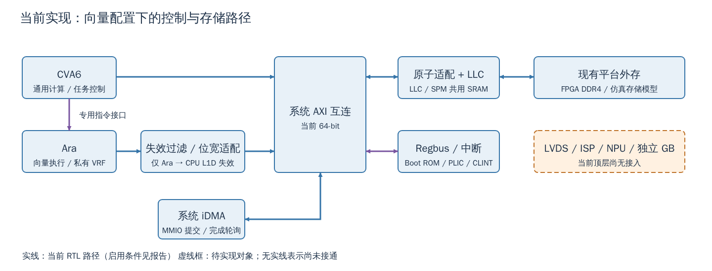
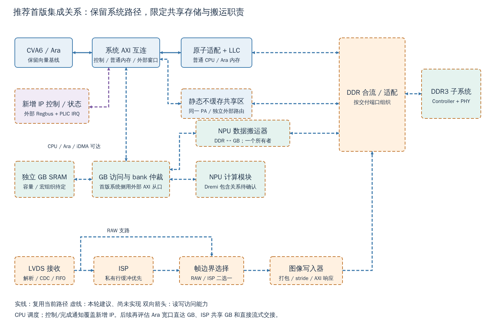

# Cheshire–CVA6–Ara 扩展架构审查报告

日期：2026-10-11。任务：M01/I01/S01/P01-AR。输入分支 `mp/ara-pulp-v2`，提交 `2784340240915fe4338ec54bfd613723b127d62e`。范围：当前源码、配置、已有图及受控 IP 接口资料的架构审查；只新增分析产物，不实施 RTL/驱动修改，不提交或推送。

## 1. 审查结论与适用范围

**可以继续做固定基线提取、接口契约和分层验证；目前不具备按现有框图直接开展大规模集成或冻结流片接口的条件。** Cheshire–CVA6–Ara 的基本控制/访存路径有源码依据；LVDS、ISP、NPU、独立 GB、DDR 旁路及外购 DDR3 的完整闭环尚未建立。本轮没有新增 SoC 仿真、板测、综合或物理实现证据。

优先关闭以下问题：

1. **共享数据可见性。** 当前 LLC 不能仅凭 CPU 不缓存属性或 AXI `AxCACHE` 对任意 DDR 子区旁路。NPU/ISP 在 LLC 下游写 DDR 后，CPU/Ara 仍可能读到 LLC 旧副本。推荐冻结同一物理地址的静态不缓存共享区及所有权协议，避免首版依赖尚未打通的逐层维护。
2. **入口配置与启动。** 根构建默认标量 profile，现有 FPGA 清单才是向量配置；`SELCFG=3` 不能单独修正 CPU 源码选择。Platform ROM 普通返回缺陷仍在，启用已确认的 PLL/DDR 初始化钩子前必须修复并验收。
3. **搬运成功的定义。** iDMA 存在 64/32-bit 控制寄存器适配缺陷；其 wrapper 没有完成 IRQ，后端禁用错误处理。Ara 写响应错误亦有未完成处理。收到完成标志不能直接等同结果正确。
4. **负载与外部交付。** DDR 通用手册有 AXI4/混合位宽能力，但缺少选定配置的 RTL、PHY、模型和 manifest。55nm SRAM/LVDS/PLL/pad 资料与可实现频率未闭合。12K 图像指标若成为首版硬要求，会显著改变 DDR 和片上数据流选择。

**首版推荐：** 保留向量 2 lanes/VLEN 2048、系统 AXI64 和普通内存 LLC 路径；NPU/图像大流量在 DDR 侧合流；独立 GB 先以系统外部 AXI64 从口加 NPU 本地访问实现；图像采用 RAW/ISP 二选一共用写入器；CPU 负责单任务调度及缓冲区交接。暂缓 Ara 专用宽口分流、ISP/NPU 任意共享所有 GB bank、复杂描述符运行时和多芯扩展。此为本轮建议，不是已经冻结或实现的结构。

本轮已询问首版负载是否冻结；在没有新增确认时，按以下边界分析：55nm、CentOS/VCS 2018 约束、DDR 目标 AXI4、保留 Linux 硬件条件属于输入；12K×12K@30 Hz、小模型具体规模、token/s、并发帧率、DDR 速率/容量和 GB 容量均作为候选压力场景。没有把所有历史设想叠加成首版验收要求。

## 2. 当前实现、目标架构及假设

### 2.1 可追溯基线

开始时存在大量既有教程修改及未跟踪图、交接文件。本轮以独立目录交付；[初始工作区记录](evidence/initial_git_status.txt)及[533 个既有文件的哈希](evidence/initial_worktree.json)用于收尾保护检查。收尾发现其他对话仍在修改教程和旧图；本轮未改这些文件，也未覆盖共享状态/任务表，独立交接列明由协调者合并的审查结果。保护哈希发现的并行变化另有记录，不能声称整个工作区字节未变。

| 对象 | 当前生效条件或状态 | 证据与界限 |
|---|---|---|
| 系统默认 | `DefaultCfg`：AW48/DW64、master ID2、单核、Ara=0；LLC 8 ways×256 lines×8 blocks×8 B=128 KiB | `hw/cheshire_pkg.sv::DefaultCfg` :547–610、`get_llc_size` :275；声明默认不等于全部目标最终值 |
| 向量仿真参数 | `TbCheshireConfigs[3]` 开 Ara、2 lanes、VLEN2048 | `target/sim/src/tb_cheshire_pkg.sv::gen_cheshire_ara_cfg` :27；仍须匹配 CPU profile |
| CPU 源选择 | 根 `CHS_BENDER_RTL_FLAGS` 默认 `cv64a6_imafdchsclic_sv39_wb`；Ara 入口指定 `cv64a6_imafdcv_sv39` 和 `exclude_first_pass_decoder` | `cheshire.mk` :19；`.bender/git/checkouts/ara-2c7b103275a16c87/cheshire/Makefile` :25–31；现有仿真生成清单仍含标量选择，不代表向量仿真基线已通过 |
| VCU118 | 清单选向量 profile、ARA、2/2048；top 从 DefaultCfg 覆盖 RTC、关闭 SerialLink/无 USE_USB 时关闭 USB | `target/xilinx/scripts/add_sources.vcu118.tcl` :256、786；`target/xilinx/src/cheshire_top_xilinx.sv::gen_cheshire_xilinx_cfg` :115–129 |
| Ara 接口 | `AraDataWideWidth=32×NrLanes`，当前 64；经失效过滤和真实 `axi_dw_converter` 接系统64 | `hw/cheshire_soc.sv` :606、806–889；4 lanes 的128出口不自动加宽系统 |
| Linux 硬件条件 | 向量 profile 有 MMU、S/U、A；OSSupport=1，PLIC/CLINT 有 RTL | 不等于 Linux 镜像、DMA、RVV 上下文抢占已通过；详见 §3.5 |
| ASIC 提取 | `cheshire_ara_asic/` 尚未形成 | 本轮仅只读确认与审查，不启动 E01 实施 |
| FPGA HelloWorld | 用户报告已有 VCU118 运行结果 | 不能推出 Ara 运算、外购 DDR3、ASIC 时序或后续源码版本通过 |

依赖来源以 `.bender/SNAPSHOT.tsv` 为版本索引，且 vendor 有本地差异：Ara `2895ba907e9eb14b3464609dc791a969d159a7c3`，CVA6 `99eac9a649001bdf5b8f9da52e0ca73d5c48db1c`，AXI `39f5f2d51c5e524f6fc5cf8b6e901f7dcc5622d7`，LLC `559bcbd09a5a884dbe31e2d72fd95d024e357f39`，iDMA `c12caf59bb482fe44b27361f6924ad346b2d22fe`。`Bender.local` 指向版本管理中的本地快照；本轮未重拉、清理或升级依赖。

### 2.2 实现与设想分界

| 等级 | 对象 |
|---|---|
| 当前 RTL/软件有实现 | 系统 AXI、Regbus、原子适配、LLC/SPM、条件启用的 CVA6–Ara、系统 iDMA、Boot ROM、PLIC/CLINT、FPGA 外存适配；每项验证范围不同 |
| 有代码但未作为当前闭环验收 | AXI RT（默认关）、扩展主从口与映射参数、iDMA 其他前端/协议后端、OS 软件源码、部分外设和测试程序 |
| 需求或候选方案 | 独立共享 GB、NPU256 DDR 旁路、LVDS RAW/ISP 可选、ISP/NPU 保留并行能力、Ara4/128 分流；当前顶层和清单没有对应新增 IP 接入 |
| 无足够资料确认 | Dremi/脉动阵列/NPU 的包含关系、NPU 原有 DMA 能力、ISP 算法/缓存规模、传感器峰值/反压、SRAM 宏及外购 DDR 实际交付参数 |

定向查找 `hw/cheshire_soc.sv`、`hw/cheshire_pkg.sv`、`Bender.yml`、`target/xilinx/src/cheshire_top_xilinx.sv` 及工程非依赖文件名，没有发现已集成的 NPU/Dremi/LVDS/ISP/GB 定义。此结论只覆盖当前可见集成入口，**不表示用户在其他工程没有自研 IP**。图中只画一个“NPU 计算模块”，不凭名字新增 Dremi 子层级。

近期输入 `docs_codex/handoffs/M01_DDR_GB_requirements_update.md` 和 `L01_lvds_isp_gb_soc_topology.md` 记录了独立 GB、主 Xbar64、NPU256 及图像路径意向；既有 `ddr_interconnect.svg` 属候选架构图。本轮用它们定位待审查设计，所有实现事实重新追踪源码。当前请求重新开放“全部旁路/共享 GB”的合理性审查，旧状态中的“用户要求旁路”不替代此次比较。



图1：向量配置下的当前实现关系。完整维护源为 [SVG](figures/current_implementation.svg)。iDMA 和 Ara 的连通不代表错误恢复或数据交接已动态验证；虚线对象当前尚未接入。

## 3. 关键链路与接口审查

### 3.1 五条端到端链路

| 链路、发起者 → 目标 | 接口、地址与时钟 | 缓冲、完成与错误条件 | 证据状态 / 缺口 |
|---|---|---|---|
| 传感器 → LVDS RX → ISP → 存储/NPU | 串行差分输入→像素流；拟议 RX 时钟→系统/ISP 时钟 CDC；流无内存地址，图像写入器才产生 DDR 地址 | RX FIFO、ISP 行缓冲、写突发缓冲；帧/行身份及有效字节一致，最后一笔 AXI 写完成且无错误才发布帧；溢出应标整帧无效并计数/中断 | 当前无接入。lane数、bit/像素、blanking、可否停传、ISP尺寸/格式变化未知。不能靠 AXI READY 让物理传感器停发 |
| CPU → 控制口 → ISP/NPU/DMA → CPU | 当前 CPU 经 Xbar、Regbus；iDMA 例外为 AXI 配置窗 `0x01000000`；新增 IP 用外部 Regbus/必要协议桥，IRQ→PLIC | CPU 是首版调度者；命令需 job/epoch、地址/长度/stride、启动、状态、错误；完成需数据可见且该任务所有请求收束；超时后停止提交、隔离/排空或成组复位，旧 epoch 结果丢弃 | iDMA已有寄存器提交/轮询，其他IP任务接口未定；不得把 iDMA bus-error IRQ 写成完成 IRQ |
| DDR → 搬运器 → GB → NPU → 输出 | 搬运器发 AXI 主事务；GB 是被访问 SRAM；拟议独立 DDR 合流口与 GB 本地口；时钟/CDC/地址待定 | 两组 tile 缓冲；输入搬完且成功→READY，计算接管→COMPUTE，输出写完→DRAINED，再 FREE；DMA/计算不能同时覆写活跃区；双缓冲能否重叠取决于独立 bank 服务 | 无 NPU 端口定义/RTL；需要确认是否已有 DMA，再选一个任务所有者，不能额外再让系统 iDMA 无条件重复搬运 |
| Ara ↔ NPU，经 DDR | 当前 Ara→filter→converter→主 Xbar→原子适配→LLC→外存；NPU拟在LLC下游 | 必须走 §4 的共享池/所有权；Ara store 的完成、B 错误、DDR 可见点三者要定义；不允许只通知而不处理残留事务 | Ara原路径有代码；NPU端/共享池未实现。经DDR易调试但每次交接至少一次写+一次读 |
| Ara ↔ NPU，经 GB | 推荐 Ara→已有 Xbar→新增外部 AXI 从口→GB 仲裁→bank；NPU本地口接同一GB。以后才考虑Ara converter之前分流 | 对 tile 交接；Ara VRF 内容须先 store 到 GB，NPU结果须由Ara load；不同bank可重叠，同bank需预算；完成后才转所有权 | 当前无GB从接口/地址。首版扩展口方案使CPU、iDMA也可达；若只做Ara私有分流，系统iDMA不会自然可达 |
| 复位 → ROM/SPM → 平台初始化 → 装载 → 裸机/Linux | 复位参考时钟必须先可用；Boot ROM 固定窗口，LLC现有tag BIST后配置SPM，平台ROM代码/栈不能依赖DDR；DDR ready后才装载DDR程序 | 等待PLL lock/DDR init及超时，错误回到可用时钟与SPM诊断；重置不能遗留在途写；详见§3.5 | 当前早期ROM/SPM链存在，平台钩子返回缺陷开放；实际ASIC PLL/PHY/配置桥、初始化程序未交付 |

图像路径首版先保留私有行缓冲。局部卷积/点操作可直接接流；全局直方图反馈、跨帧降噪、畸变随机访问等是否需要整帧必须由算法决定。若采用 ISP→NPU 直接流交接，须先证明像素布局、tile边界、消费顺序、速率及反压相容，否则需要显式重排/分块缓存。RAW 与处理后同时保存会增加流量，不能沿用“二选一”的预算。

### 3.2 关键接口表

位宽按当前向量2-lane候选代入；S/M 均相对于列出的模块。`clk_i` 不是已冻结的 ASIC MHz。Xbar 命名 `SlvPort` 是接主设备的入口，与系统模块角色不要混淆。

| 模块/边界 | 角色、协议 | 数据/地址/ID 位宽 | 时钟、事务能力 | 地址窗口 / 证据 |
|---|---|---|---|---|
| CVA6→系统 | M，AXI+ATOP/原子语义 | 64/48，CPU ID4→系统ID2，真实 `axi_id_serialize` | `clk_i`；CoreMaxTxns8、每ID4；不是承诺每拍满带宽 | 主存/外设映射；`cheshire_soc` :774–798，`cheshire_pkg` :548 |
| Ara→filter→converter | M，AXI；专用指令/MMU另一路 | 32×lane=64/48/2；4lane候选128→64 | 同 `clk_i`；filter MaxTxns4，converter AxiMaxReads4；内部队列还可能限制吞吐 | 当前跟随主Xbar映射；`cheshire_soc` :602–606、839–889 |
| 主 Xbar | 多入口/多出口 AXI，ATOPs=1 | 64/48；出口ID=`2+clog2(N输入)`；默认向量7输入→5，VCU118关闭USB/SL后5输入→5 | MaxMstTrans/MaxSlvTrans24，CUT_ALL_PORTS；同目标仍仲裁 | `gen_axi_in/out`、`AxiXbarCfg` :231；外部入口当前未接新增IP |
| LLC/原子边界 | 上游S、下游M | 64/48；原子单元及LLC入口ID5→LLC出口ID6（增加读标识位）；ATOP由前置原子单元处理 | `clk_i`；适配限制16读/16写，并非DDR全链上限 | 默认 `[0x80000000,0x100000000)`；`cheshire_soc::gen_llc_atomics` :448起，LLC :510起；`hw/include/cheshire/typedef.svh` :23–25 |
| LLC SPM | AXI目标，共用LLC物理阵列 | 同系统宽；128 KiB最大值 | 与LLC仲裁，way可划SPM；没有新增GB端口 | `[0x10000000,0x10020000)`、非缓存别名`[0x14000000,0x14020000)`；`gen_axi_out` :361–364 |
| 系统 iDMA 数据口 | M，AXI读写合并口 | 64/48/2 | `clk_i`；NumAxInFlight16、MemSysDepth8、JobFifoDepth2、2D=1、legalizer=1 | 访问主Xbar可达目标；`cheshire_idma_wrap` :242、284–340 |
| iDMA配置 | S AXI→Regbus→reg64_2d | 总线DW64，但寄存器实现DW32 | wrapper无完成IRQ；控制前置原子上限4读/4写，内层旧桥默认各2，不能只看前级值 | `[0x01000000,0x01001000)`；wrapper :122；reg_top :30、55–61 |
| 常规控制出口 | Regbus S；不是原生APB | 外设侧数据32、地址随Cfg；无AXI ID | 系统域，跨配置时钟需显式桥/握手 | `RegExt*`，`cheshire_soc` :330–434；DDR APB版本未冻结 |
| VCU118外存适配 | 上游S、DDR M，真实DW/ID/CDC | 系统64→512，地址48→31、ID→8 | 配置EnCdc1、LogDepth5，DDR AXI注释333 MHz；MaxTxns24/唯一ID8 | `dram_wrapper_xilinx.sv::cfg` :60–70、i_axi_dw_converter/ID/CDC；仅FPGA路径 |
| NPU DDR口（目标） | M AXI4 | 数据256为需求；地址/ID/最大burst/在途未定 | NPU与DDR频率/CDC未定 | 共享池及允许私有区必须列白名单；无实际交付端口证据 |
| 图像写入器（拟议） | 输入流；输出M AXI4 | 流打包宽、AXI DW/AW/ID待预算 | RX/ISP/AXI各域待定；至少保证行尾WSTRB和写响应 | 帧池/stride待定；不是LVDS自身直接发AXI |
| GB（拟议） | 系统S AXI64+本地存储口 | SRAM宏DW/bank/地址深度待定；AXI宽不等于宏端口 | 单口/1R1W/真双口与仲裁待定 | 无当前窗口；须NC、幂等、NX，避免默认外部MMIO属性 |
| 外购DDR（目标） | S AXI4 + 配置从口 | DQ/控制器端口DW/AW/ID均须按选定manifest验收 | 资料有混宽/异步选项，不表示本次全部交付 | 通用手册与需求草案见§3.6；不默认增加AXI4→AXI3桥 |

### 3.3 必须冻结的 AXI 契约

两端名称相同不构成兼容证明。首版每口填写：允许 `INCR` 长度、`AxSIZE`、窄访问/非对齐支持、4 KiB和窗口边界切分、WSTRB、ID保持/扩展/回收、同ID顺序、最大在途读写、R/B错误、timeout和复位事务处置。AXI4 INCR可至256 beats且不能跨4 KiB，实际IP可支持更小子集；256-bit满宽在4 KiB边界内最多128 beats，不能机械使用256 beats。[Arm AXI规范 IHI0022H](https://developer.arm.com/-/media/Arm%20Developer%20Community/PDF/IHI0022H_amba_axi_protocol_spec.pdf)

现有 Ara、FPGA wrapper 的位宽/ID/CDC适配可复用设计经验，但它们没有已经连接到NPU或外购DDR。新增合流层必须给主源分配不冲突的ID命名空间或有状态串行化；不能直接截断ID。有限FIFO不是错误/超时机制，AXI也不自动提供最大响应时限。

普通内存路径保留LLC前原子适配，避免让AXI4 DDR承担AXI5 ATOP。新增旁路设备默认不产生ATOP/独占；未支持的事务应明确拒绝，不得把普通写当作原子完成。旁路写也不能参与上游LR/SC监视范围；首版共享池禁止设备/CPU共享原子控制字。所有Linux内核锁、页表、普通原子对象留正常RAM路径。

地址以半开区间统一检查。现有默认2 GiB DDR窗是逻辑映射，不是物理容量承诺；扩容超过4 GiB边界会与默认SerialLink窗口 `[0x100000000,0x200000000)` 相遇，不能只把控制器容量字段加大。旧SPM cached/uncached地址是同一阵列别名，不能同时当两个独立buffer使用。错误地址应返回DECERR/平台错误，禁止以低地址截断方式静默回卷。

### 3.4 DMA职责与任务调度

iDMA是输入/输出均可的memory-to-memory搬运器。本地wrapper选寄存器前端、2D midend及AXI读写后端，有长度、源/目的stride、重复次数和两项job FIFO；它没有图像帧同步入口，也没有启用描述符抓取前端。其他协议后端/descriptor代码存在，不等于当前SoC已选用。[iDMA官方设计分层](https://pulp-platform.github.io/iDMA/)，本地 `ID/doc/src/system_integration.rst`（ID前缀见附录） 和当前wrapper决定适用范围；不将最新网页新增功能算作本分支能力。

寄存器有64-bit源/目的/长度字段，不等于实现全部为64-bit：当前wrapper的地址随Cfg为48，`TfLenWidth/RepWidth`及2D stride类型为32（`cheshire_idma_wrap.sv` :42–56）。软件必须检查地址mask、长度/步长/重复次数及加法越界，不能让超范围值被截断后执行。

| 方案 | 好处 / 代价 | 本轮推荐 |
|---|---|---|
| 所有流量共用现有系统iDMA | 复用寄存器/2D；但当前走64-bit主总线/LLC，控制适配待修复，不直接消费LVDS流，不天然满足实时帧或NPU本地端口 | 用于系统复制、诊断和低速DDR↔GB辅助搬运；不作为整条实时图像链唯一后端 |
| ISP/NPU各自完整DMA | 可独立QoS/本地调度；增加寄存器、队列、错误、软件负担，同一buffer可能双重控制 | 先核现有NPU是否已有DMA；保留一个NPU数据搬运所有者，图像侧只增加必需流→内存功能 |
| 复用iDMA公共后端，新前端/本地口 | 可复用突发切分和协议实现，但需要实际选择/生成后端、重新验证错误与调度；不是零成本复用 | 若NPU尚无搬运器，优先评估已有后端能力，不另造完整DMA家族；与系统iDMA为独立实例/队列时清楚命名 |

首版CPU可以一次只发布一个NPU任务；搬运与计算在这个任务内部按tile双缓冲重叠。不可将“单任务”解释为把每次DMA和计算全部串行化。完成通知采用结果状态+job_id+epoch，IRQ只是通知；轮询可用于裸机首测，但需超时与错误检查。中途复位必须隔离新请求、处理已接受事务及迟到B/R，不能释放buffer后让旧写污染新任务。异步队列/描述符环应在负载证明CPU提交开销显著后再增加。

系统iDMA的具体问题：`cheshire_idma_wrap.sv` :55–72让Regbus随AXI为64，`idma_reg64_2d_reg_top.sv` :30、58–60固定32且直接截断/零扩展；旧`axi_to_reg`保持64数据宽。位于+4 lane的32-bit寄存器访问与64-bit成对读写并不等价。`sw/include/dif/dma.h` :63–67把`NEXT_ID/DONE_ID`当`uint64_t*`，而`sw/include/regs/idma.h`偏移为`0x44/0x84`。这是静态确认的适配缺陷，须统一桥和软件宽度并动态验收，不能只改调用方式宣称已修好。

后端 `ErrorCap=NO_ERROR_HANDLING`（wrapper :296），2D `nd_rsp_o` 未向软件暴露（:255）；外侧 `i_dma_bus_err` 可记录AXI错误并触发错误IRQ（SoC :1597–1618），但不会自动中止/回滚任务。现有`*_blk_memcpy`忙等没有超时。完成ID+错误单元记录+实际buffer结果才构成首版验收依据。

### 3.5 启动、裸机与 Linux

ASIC启动按以下依赖实施：已可用参考/保底系统时钟与复位释放→内置Boot ROM→等待LLC现有tag BIST、配置全SPM与栈→Platform ROM/早期SPM固件配置PLL、必要pad及DDR→锁定/训练成功→装载DDR程序→裸机，或OpenSBI/引导器/Linux→驱动使能加速器。Platform ROM钩子在已有SPM之后，不能用它初始化自己此前必须使用的时钟或SRAM电源；这些基础资源应由上电硬件保障。现有tag BIST不等于数据SRAM或全芯片MBIST。复杂训练可以放可更新的SPM固件，仍必须先于首次DDR使用。

初始化代码、常量、栈、异常处理和PLL/DDR控制窗口必须在DDR不可用时可访问，链接检查须覆盖`.text/.rodata/.data/.bss/stack`，不能只看入口地址在ROM。DDR ready前阻止普通master发请求；训练失败须能从SPM输出错误。在安全源上配置PLL，确认锁定和稳定，再按已验证协议排空/隔离受影响事务并无毛刺切钟；各域复位同步释放。正在承载DDR/AXI事务时不能任意调频。

`hw/bootrom/cheshire_bootrom.S`的`jalr t0`后直接是`boot_next_stage`：平台代码普通返回会跳过默认启动入口。默认`PlatformRom=0`不触发，但与已确认的平台初始化方向直接相关。官方已有最小修复[#187 / 9b4c222d](https://github.com/pulp-platform/cheshire/pull/187)，本轮未应用；S01-B01须修源、同步生成ROM并测普通返回、自行跳转及默认路径。不要以绕开钩子的自定义启动器掩盖该问题。

Linux分为两层工作：

| 硬件/平台条件应在首版保留 | 后续软件适配与验收 |
|---|---|
| RV64 S/U、MMU Sv39、A扩展、普通RAM原子路径、PLIC/CLINT、稳定RTC、UART/JTAG、足够DRAM及可装载镜像 | 固定SDK/内核/OpenSBI版本，设备树时钟/内存/中断、启动参数、镜像溯源和实启 |
| AXI地址宽和DMA地址可表达的物理池、NC保留区、错误/复位/IRQ接口 | `dma_addr_t`/mask、物理/总线地址转换、reserved-memory与分配器协同、DMA映射/同步后端；不得直接用虚拟指针作设备地址 |
| Ara配置和OSSupport、必要FP/RVV状态 | FS/VS启用与保存、异常/缺页/抢占迁移测试；源码存在不能替代运行 |

`gen_cva6_cfg`覆盖PMP项数为`Cfg.Cva6NrPMPEntries`，DefaultCfg为0；不能沿profile的值声称已有PMP隔离。IOMMU、硬件全一致互联和复杂运行时并非首版必须；没有IOMMU时，可信驱动限定DMA范围和长度，用户进程不直接任意编程master。非一致性DMA不是写一句`dma_sync_*`即可完成，详见§4。

### 3.6 外购 DDR 与配置接口证据

本轮只读访问受控资料目录，未上传厂家资料或将正文用于网络检索。目标仍是用户已确认的AXI4；旧AXI3材料用于版本核对，不推出必需协议桥。通用Controller手册列AXI3/AXI4、64/128/256混合位宽及同步/异步选项，证明系列可能支持目标组合；不证明选定交付已经包含这些功能。需求DOCX中AXI/APB版本存在差异，详见附录证据清单。

DDR配置接入推荐CPU→现有AXI/Regbus→明确版本的APB桥→Controller/PHY配置口；须在安全启动时钟下可用。APB2无等待/错误、APB3有PREADY/PSLVERR、APB4另有PSTRB/PPROT，桥不能凭名字互换，尤其字节写、读副作用和错误处理。控制器配置/PHY配置可能为两套目标；基址、默认时钟、复位值、训练启动/ready/error/BIST、超时和软复位影响范围都应进入manifest。本轮没有选择或实现桥。

## 4. 存储、一致性和数据所有权

### 4.1 三种片上存储必须分开

| 存储 | 当前含义/容量 | 访问与生命周期 |
|---|---|---|
| CVA6 L1D | 向量profile为8 KiB、WT、32 B line；写缓冲存在 | WT不等于无缓存副本，store进入写缓冲/LLC也不代表旁路设备已看到DDR |
| LLC/SPM | 当前最大128 KiB，共用同一阵列，按way切换 | 启动依赖SPM栈；改way归属须迁走活跃栈/数据并完成flush；不是额外128 KiB GB |
| Ara VRF | 32×VLEN bits，VLEN2048时8 KiB有效寄存器数据 | 私有向量寄存器；NPU/iDMA没有地址口可直接读；增加lane不自动增加总寄存器容量 |
| 独立GB | 目标SRAM，容量/宏/bank未定 | 需要真正从口、本地仲裁、地址、保护与生命周期；多逻辑端口不能自动增加物理端口带宽 |

### 4.2 当前维护机制的真实覆盖

向量profile不是根默认WB profile。`cv64a6_imafdcv_sv39_config_pkg.sv` :46–56、74选择WT、`DcacheFlushOnFence=0`。Ara的`axi_inval_filter`只观察自己的写并请求CPU L1D失效，受一致性使能控制；看不到旁路NPU/ISP写，也不维护LLC。因此既不能说系统完全没有任何一致性辅助，也不能把该局部机制推广成多master硬件一致性。

**官方文档与本地实现存在差异：** 本地`docs/um/arch.md`的LLC说明提到AXI cache信号旁路；当前依赖`axi_llc_top.sv`到`axi_llc_config.sv`的bypass控制只传地址，并以cacheable地址范围、SPM范围及flushed ways判定，未使用AxCACHE。按当前源码结论处理，见附录M类定位。`Cfg.LlcNotBypass=0`是整个LLC实例旁路并影响SPM，不是给NPU加一条支路。

CPU的`CSR_DCACHE=0x7c1`是M-mode控制；WT Dcache关闭后重开会先等待写缓冲/MSHR排空并全索引失效，它没有LLC维护作用，也不是Linux S-mode可直接调用的逐range操作。LLC另有按way flush/SPM配置，但没有现成覆盖L1+LLC+设备旁路的逐buffer维护闭环。普通`fence`用于顺序约束，不能替代LLC写回/失效；中断到达、任一B响应或C函数返回也不能单独证明所有层可见。若复用缓存数据交换，必须定义并验证：排空CPU写缓冲→对涉及所有LLC way做写回/失效并等待完成→设备访问期间禁止CPU/Ara重分配该共享数据→设备写收束→消除L1/LLC旧副本→消费者访问。LLC维护隔离会暂停包括SPM在内的入口访问；保持SPM归属时不等于擦除SPM内容。全way维护影响其他任务，当前不推荐作为首版默认路径。

本地Linux6.5 `LX/arch/riscv/mm/dma-noncoherent.c`（LX前缀见附录）依赖`ALT_CMO_OP`，缺适用扩展时其基线路径为NOP；配置声明Zicbom不等于当前CVA6 decoder实现CBO，更不等于LLC收到维护。必须验收平台DMA API实际效果，禁止在设备树虚报`dma-coherent`。首版推荐静态NC池，并为驱动实现与该池一致的分配/同步约定。可评估该内核已有per-device reserved coherent pool供`dma_alloc_coherent`分配；仅该池的物理NC属性保证可见性，不能据软件API名称允许设备任意访问普通缓存RAM。[Linux DMA API语义](https://docs.kernel.org/6.5/core-api/dma-api-howto.html)

### 4.3 推荐静态分区：同PA、单一路由

用符号地址而不擅自冻结数值：设真实可用DDR为`[D0,D1)`，选择共享池起点`S`，普通内存`[D0,S)`继续经LLC，共享池`[S,D1)`经系统外部AXI从口接DDR侧合流。将`LlcOutRegionEnd=S`后，`gen_axi_out`的LLC路由和`gen_cva6_cfg`的cached范围共同缩短；为尾段增加独立不重叠`AxiExtRegion`，下游保持同一PA，不做第二地址别名。

该候选在当前源码结构下改动较小，但仍待实现/验证：

- 尾段须落在默认non-idempotent区之外；当前≥`0x80000000`范围可形成NC、幂等、NX池。若改变地址或PMA规则，逐项复核，不凭页表推断硬件属性。
- 普通Linux RAM分配、链接器、设备树reserved-memory及驱动池必须一致，防止把同一存储另映射为缓存地址。NC池可跨CPU/Ara/NPU使用，但不执行代码，不放页表/内核锁/AMO/LRSC数据。
- 共享池外部支路绕过`i_llc_atomics`，须定义原子拒绝策略；NPU/图像master仅允许约定的数据窗口。现有AXI外部规则没有现成的产品安全策略。
- CPU/Ara/iDMA通过64-bit系统口访问共享区，NPU/ISP可用自己的宽口进入同一DDR合流。CPU/Ara带宽受64-bit路径限制，但其他流量不会被迫串过该口。
- 保留LLC实例和启动SPM。首次诊断可用LLC全SPM+禁用/清空CPU Dcache来简化共享检查，但这只是低性能验证模式，不能替代上述永久分区或Linux性能方案。

### 4.4 数据所有权契约

以下为**建议协议，尚无对应驱动/RTL实现**。同一可写buffer每次只有一个所有者；多个只读消费者须确认全部完成，固定任务可由CPU跟踪。状态为`FREE → FILLING → READY → COMPUTING → DRAINING → DONE → FREE`，错误进入`INVALID`，直到恢复方确认无迟到写才回FREE。

| 交接 | 物理位置/缓存属性 | 发布前动作 | 接收/释放条件 |
|---|---|---|---|
| CPU→NPU | NC DDR池或NC GB | CPU写完整内容；按平台顺序屏障约束数据与doorbell；设备不能抢读FILLING | NPU看到正确job/epoch后读；完成读/计算后才允许CPU复用 |
| NPU→CPU | 同NC池 | NPU等所有输出写响应、聚合错误、完成前置可见点后发布DONE/IRQ | CPU读状态并执行获取顺序，再验数据；错误帧不进入后处理 |
| Ara↔NPU，经DDR | 两方同NC物理池；Ara VRF不在共享池 | Ara存储到池、等待相关访存完成/错误，CPU发布任务；反向由NPU收束输出 | Ara必须重新load，不能继续使用旧VRF副本；不得在NPU拥有区上并发store |
| Ara↔NPU，经GB | 同一NC、幂等GB窗口，不与LLC/SPM重合 | GB仲裁确认写已进入目标bank；tile valid/job/epoch后发布 | 消费者读完并归还slot后覆盖；中间张量驻留GB不产生DDR流量 |
| ISP→NPU | NC帧池；后续可扩展到GB/直接流 | 图像写入器核帧长度/行数、收齐响应、无溢出才READY | NPU完成消费后归还帧；来不及处理时按冻结策略丢帧/停采，不能覆写正在读的帧 |

屏障具体指令/驱动API取决于最终memory属性与桥，需通过V02/V03验证跨端口可见性。对尚未完成的缓存方案，不能写“flush/invalidate即可”作为验收结论。

### 4.5 GB组织和55nm实现边界

首版推荐系统外部AXI64从口+NPU计算/搬运本地口、按bank仲裁；CPU调试和系统iDMA因此有可追踪入口。若选默认外部`[0x20000000,0x80000000)`区域，注意低段默认cacheable、高段默认非幂等；GB必须另定NC且幂等PMA范围，避免把普通SRAM当设备寄存器区。Ara4的128-bit直达分流只在测得系统64瓶颈后增加，需位宽/ID/AW-W关联/顺序/过滤器覆盖及CPU/iDMA替代入口同时设计。

按tile生命周期计算：`C_GB ≥ 2×(输入tile+输出tile) + 驻留权重tile + 累加/重排scratch + 同时存活的其他tensor + 元数据/对齐余量`；若权重也双缓冲则权重项加倍。不能把逻辑双缓冲当作已有两个物理端口。

每bank单口上限为`bank宽/8 × f × ηbank`，同bank读写共享服务；1R1W应分别计算读、写和同址约束。DMA写下一tile与NPU读当前tile最好分bank，Ara访问第三活跃tensor时再检查冲突；bank交错、stride和矩阵布局可能使全部请求落同bank。ISP实时行缓冲先私有化或保留有服务保证的bank，不让NPU长burst任意阻塞采集。

没有55nm宏compiler、位宽/深度列表、端口类型、mask/ECC、读延迟、PVT时序及测试模型，不能给出可信面积、功耗或频率。优先由可得单口/1R1W宏拼bank，是否复制/多泵/仲裁须据并发需求选择；不把256-bit AXI等同一个原生256-bit多端口SRAM宏。

## 5. 带宽、容量与性能预算

完整输入：[budget_inputs.json](inputs/budget_inputs.json)；来源/公式：[输入说明](inputs/README.md)；计算结果：[摘要](results/final/budget.md)、[完整JSON](results/final/budget.json)。**输入中没有目标硬件实测吞吐。** 每个数值有`measured/source/assumption`分类和来源；1333、2133、x16/x64、频率、利用率及模型均是比较输入，不是选型承诺。

### 5.1 统一公式与约束

`GB/s=10^9 B/s`，`GiB=2^30 B`，1 Byte=8 bit。DQ是物理数据引脚位宽，AXI DW是片上接口位宽，二者不得混同。

```text
B_DDR_peak = DQ_bits / 8 × rate_MT/s × 10^6
B_DDR_eff  = B_DDR_peak × η_DDR
B_AXI_dir  = AXI_DW / 8 × f_MHz × 10^6 × η_AXI
F_frame    = align_up(ceil(width × storage_bits / 8), stride_alignment) × height
R_image    = F_frame × fps × read_passes
W_image    = F_frame × fps × write_passes
T_memory ≥ max((R_bytes+W_bytes)/B_DDR_remaining,
               R_bytes/B_AXI_read_remaining, W_bytes/B_AXI_write_remaining)
```

MT/s已经包含DDR双边沿，不能再乘2。R/W AXI通道可并行，但物理DDR读写共享时间；不能把读峰值和写峰值相加当持续DDR带宽。η_DDR示例50/65/80%统一表示刷新、行/bank冲突、读写切换等影响；实际利用率随burst/stride/争用改变，必须用真实trace测量。每条路径同时受controller端口、CDC、变宽器、interconnect、发起端和bank服务限制，多端口不会增加DQ总带宽。

| 候选 | DDR理论峰值 GB/s | η=50% | η=65% | η=80% |
|---|---:|---:|---:|---:|
| DDR3-1333 ×16 | 2.666 | 1.333 | 1.733 | 2.133 |
| DDR3-1333 ×64 | 10.664 | 5.332 | 6.932 | 8.531 |
| DDR3-2133 ×64 | 17.064 | 8.532 | 11.092 | 13.651 |

系统AXI64在假设100/200/250 MHz的理论每方向能力仅0.8/1.6/2.0 GB/s；AXI256在250 MHz是8 GB/s，η_AXI=90%时7.2 GB/s。上述MHz均非55nm可达频率结论。NPU有256口不意味着CPU/Ara64路径也达到同样速率；GB本地NPU口无需穿过系统64口。

在途能力也可能限制带宽：若平均完整事务往返延迟为`L`、每事务有效字节`Q`，至少需约`ceil(B_target×L/Q)`项在途，且返回处理/缓冲要跟上。例：假设1.6 GB/s、200 ns、64 B/事务，需要至少5项；Ara变宽器4项读在途只是局部配置，应测真实burst长度和队列瓶颈。增加ID位数不自动增加有效在途或避免bank冲突。

### 5.2 图像与 ISP

按12K=12000：`12000²×30=4.32 Gpixel/s`。若12K实际为12288，所有同格式数据量增加4.8576%；脚本单列这组数值。

| 格式（紧密打包） | 单帧 MiB | 30 Hz有效载荷/一次DDR写 GB/s |
|---|---:|---:|
| 8-bit | 137.329 | 4.320 |
| 12-bit | 205.994 | 6.480 |
| 14-bit | 240.326 | 7.560 |
| 16-bit | 274.658 | 8.640 |

如果传感器12/14-bit数据落内存时使用16-bit容器，DDR仍是8.64 GB/s，不是6.48/7.56。LVDS线速还要加编码/同步/blanking及行有效期峰值：`N_lanes × lane_rate × payload_eff ≥ wire_payload_peak`。例如假设16条数据lane承载16-bit有效像素，仅有效载荷下限就为4.32 Gbit/s/lane；这是公式举例，绝非已有55nm LVDS能力。

| 同尺寸16-bit图像流程 | DDR读/写次数 | 合计GB/s | 改善与前提 |
|---|---:|---:|---|
| RAW写→ISP读→ISP写→NPU读 | 2R+2W | 34.56 | 四遍基准；要求算法真的需要RAW落帧 |
| 流式ISP→写处理帧→NPU读 | 1R+1W | 17.28 | 省RAW写+ISP读，减少17.28 GB/s（50%）；保留处理帧 |
| 流式ISP→仅保存帧 | 0R+1W | 8.64 | 不包含NPU输入读取，不能用来代表完整推理 |
| ISP→NPU片上交接，无图像整帧溢出 | 0 | 0（仅此段） | 还需权重/激活/输出；要求流顺序、tile、buffer、算力均相容 |

两个与η无关的结论：x16-1333峰值2.666已低于8-bit图像一次写的4.32；x64-2133峰值17.064仍低于16-bit同图像一次写一次读的17.28。因此不能通过改善仲裁或加FIFO满足这两个特定场景。格式从16-bit容器改12-bit packed最多省25%存储流量，14-bit packed省12.5%，代价是打包/解包、对齐和算子适配，不能假定算法允许量化到8-bit。

进一步考虑η_DDR=65%、CPU/Ara预留0.6读+0.15写GB/s、图像接口256@250 MHz且η_AXI=90%（全部假设）：

| 候选 | 一次写最高平均fps | 一写一读最高fps | 一写一读保持30 Hz时ROI面积上限 |
|---|---:|---:|---:|
| x16-1333 | 3.413 | 1.706 | 5.69% |
| x64-1333 | 21.464 | 10.732 | 35.77% |
| x64-2133 | 25.000 | 17.954 | 59.85% |

这些是指定端口模型下的平均上限，不保证实时截止期。x64-2133一次写首先卡在图像口7.2<8.64；若该口256-bit且η90%，仅此写流需至少300 MHz。是否可达要由工艺/宏/时序确认，不能把数学下限变成时钟决策。图像读写若分多个独立入口，应替换脚本的共同入口约束；DDR总量约束不变。

### 5.3 FIFO、实时性和并发

16-bit压力流8.64 GB/s在完全阻塞10/100/1000 µs时分别积压86,400/864,000/8,640,000 B，尚未算已有占用、CDC和帧封装余量。128 KiB只容纳约15.17 µs的连续输入；这也不能把当前承担启动的LLC/SPM直接全部借作接收FIFO。

`FIFO_needed ≥ peak_input×max_no_service_time + margin`，同时必须满足长期`average_input < guaranteed_average_service`并有追赶余量。若持续输入8.64、服务7.2 GB/s，1 MiB空FIFO约728 µs即满；加大有限FIFO只推迟溢出。帧丢弃要整帧标记、计数和恢复同步，禁止悄悄覆盖消费者数据。压缩只可按最坏压缩/扩张及回退预算；平均压缩率不能作为不可反压源的保证。

首版并发调度优先确保图像写入器的最大无服务间隔和CPU控制最低服务，再让NPU使用剩余带宽；这不是无限静态最高优先级，仍须防止NPU饥饿。已有AXI RT默认关闭且只覆盖其所在互联，无法自动限制新DDR侧master；先利用实际控制器仲裁和可观测计数，在测得缺口后再加必要限流。示例合成CNN在30fps额外1.384 GB/s，加一次16-bit图像写和0.75预留，共10.774 GB/s，x64-2133@65%总DDR名义容得下，图像入口仍失败。总量够不是所有端口或实时性通过。

### 5.4 CNN / Transformer 分块与模型推理

CNN流量按实际调度计算`D = rW×W + input_reads + activation_reads+writes + output_writes + halo/packing`。示例8 MiB权重、4 MiB输入、32 MiB其余激活读写，权重读1/2/4次，每推理44/52/68 MiB；30fps需1.384/1.636/2.139 GB/s。它是合成算例，不能解释为某检测模型实测。是否与图像读计数重叠须按同一张量合并，避免重复计算。

分块并非必然省DDR：512³ GEMM、INT8输入/INT32输出，唯一张量总量1.5 MiB；用64×64×128 tile且各输出tile间不共享A/B时5 MiB；每个K分块都把部分和落DDR时11 MiB。把部分和留片上可将该调度11→5 MiB，减少约54.5%；进一步复用A/B才接近1.5 MiB下界。实际Transformer还涉及归一化/softmax/转置/重排/量化元数据，Ara处理这些阶段所需tensor边界和来回传输须纳入算子表。

小模型分别核算容量与带宽：

```text
weights = N_parameters × weight_bits/8 × (1 + metadata_fraction)
KV = 2 × layers × batch × context × KV_heads × head_dim × KV_bits/8
decode_step = 外存权重读取 + 已有KV读取 + 新KV写入 + 激活/重排流量
prefill_request = 权重读取次数×权重 + KV构建写入 + 激活读写/溢出
```

KV使用KV头数，GQA不能直接用query头数代替。张量维度语义参考[Transformers官方缓存说明](https://huggingface.co/docs/transformers/en/cache_explanation)，本工程未因此获得对应运行时。假设24层、8 KV头、head_dim64、context4096、FP16、batch1，KV为192 MiB；上下文/batch翻倍分别使KV翻倍。此参数组与0.5B/1.5B/3B参数量是独立扫描轴，不指代某真实模型。

假设全部权重每decode步从DDR读一次、5%元数据、上述KV每步读一遍、激活流量按输入文件；对x64-1333、η65%、扣0.75 GB/s预留，脚本得到：

| 参数量 | 4-bit纯访存token/s上限 | 8-bit上限 | 16-bit上限 |
|---|---:|---:|---:|
| 0.5B | 13.30 | 8.50 | 4.94 |
| 1.5B | 6.25 | 3.48 | 1.84 |
| 3B | 3.48 | 1.84 | 0.95 |

**不是推理速度预测。** 未含NPU/Ara算力、精度支持、dequant、调度及软件开销；4-bit权重存储不代表当前NPU支持4-bit MAC。Decode低复用时往往受带宽约束；prefill可跨token复用权重，但取决于GB与分块，不能直接复用decode公式。例0.5B/4-bit的prefill，权重读1→4次时访存时间下界0.118→0.246 s；计算时间可能远大于此。完整公式、batch与重读敏感性在JSON中。

### 5.5 DDR容量与GB服务

容量算例预留OS/软件256 MiB、其他保留128 MiB、activation workspace128 MiB、KV192 MiB，图像按12000²16-bit双帧576,000,000 B；权重含5%元数据：

| 合成模型/缓冲 | 总需求 GiB | 对2 GiB候选的判断 |
|---|---:|---|
| 0.5B/4-bit、双帧 | 1.468 | 名义剩0.532；实际还核碎片、连续池与工作集 |
| 0.5B/4-bit、四帧 | 2.005 | 已超过，不能称“小模型所以容量足够” |
| 1.5B/4-bit、双帧 | 1.957 | 只余约43.7 MiB，余量脆弱 |
| 1.5B/8-bit、双帧 | 2.691 | 不够 |
| 3B/4-bit、双帧 | 2.691 | 不够；4 GiB候选还要改现有地址布局 |

名义2 GiB来自历史申请，不是交付事实；软件/激活/KV实际需要重新测量。小分块不自动减少权重总容量，可能增加读取次数。

GB示例活跃量2,717,440 B，2 MiB不足、4 MiB名义可容纳。假设8个64-bit单口bank、200 MHz、η80%，每bank1.28 GB/s，总10.24；总需求9.46 GB/s看似可行，但NPU读集中到2个bank后热点需求3.0575>1.28而失败。1 MiB tile搬运分配1.5 GB/s需至少699 µs，若计算仅250 µs，双缓冲也藏不住搬运。首版必须同时冻结容量、bank映射与服务，不仅报“GB几MB”。所有宏参数仍是假设，无面积/频率签核含义。

## 6. 风险与验证计划

### 6.1 风险登记

P0表示对应已确认功能/采用路径中的数据错误、死锁或启动阻断必须关闭；表中明确触发条件，不把未确认压力指标判成当前P0。P1为重大集成/性能/验证风险，P2为可延后优化。证据简称对应附录源码定位。

| ID | 性质 / 优先级 | 涉及链路、证据、触发与后果 | 修复/规避建议 | 验证 |
|---|---|---|---|---|
| AR01 | 有条件风险 / P0 | 旁路NPU/ISP与CPU/Ara共享缓存DDR；M1–M4显示LLC旧副本可能返回/覆盖新数据 | 静态NC同PA池，限制master访问范围；或另交付全层维护闭环 | V02/V03/V04 |
| AR02 | 已证实文档不一致 / P1 | `docs/um/arch.md`称AxCACHE旁路，M2源码不使用它；按文档设计会误判可见性 | 记录版本差异，以源码为准；不要仅改AxCACHE | V02负例 |
| AR03 | 已证实缺陷 / P0（启用平台钩子） | B1及ROM实有指令：Platform ROM ret落入boot_next_stage | 官方#187最小修复、同步ROM；默认路径回归 | V01 |
| AR04 | 已证实适配缺陷 / P0（使用iDMA） | D1：DW64→DW32未搬lane，HAL+0x44/+0x84宽读；命令/状态可能错误 | 明确Reg32适配及软件宽度，先单测再接加速器 | V05 |
| AR05 | 有条件风险 / P0（可靠完成） | D2/A1：iDMA无后端错误恢复，Ara B错误TODO；错误传输仍可能被当完成 | 任务聚合success/error、错误记录与buffer INVALID；验证现有bus-error覆盖，不盲目加重复监视器 | V06 |
| AR06 | 有条件风险 / P0 | M5：LR→旁路写→SC或AMO与旁路写交错，原子单元看不到设备写 | 共享池禁止共享原子对象，普通OS原子区不允许设备写；若确需则重设统一观察域 | V07 |
| AR07 | 信息缺口 / P0（闭环接入前） | 新增IP没有完成可见点、所有权、epoch及reset协议；可能早复用/迟到写 | 冻结§4状态机和超时恢复合同，先单任务 | V03/V06 |
| AR08 | 有条件风险 / P0 | B2：初始化代码/栈或配置时钟依赖未就绪DDR/PLL；启动循环/永久PREADY等待 | 早期ROM/SPM/安全时钟/配置始终可达，有限响应及可靠超时处置 | V01/V10 |
| AR09 | 信息缺口 / P1 | I1/受控原始资料：AXI4目标、AXI3旧表、APB2/3/4差异，交付组合无manifest | 供应商统一端口/参数/版本/模型与训练包；不默认AXI3桥 | V09/V10 |
| AR10 | 信息缺口 / P1 | 图像/GB实际格式、bank/宏/时钟未定；预算显示热点/输入口可能先失败 | 算法和宏输入驱动tile、接口与QoS选择；先定硬指标 | V08/V09 |
| AR11 | 有条件风险 / P1 | 12K压力场景两遍17.28>单x64-2133峰值17.064，或长期输入>服务 | 先减落帧/复用/ROI/格式；若仍是硬要求再改内存组织 | V09与计算脚本 |
| AR12 | 信息缺口 / P1 | P1：55nm SRAM/PLL/PHY/LVDS/pad/DFT视图未取得 | 真实工艺账本和时钟复位/测试协议，替换FPGA资源 | V11 |
| AR13 | 信息缺口 / P1 | T1：官方列VCS≥2024.09，当前PATH未发现vcs/vlogan；目标2018兼容未知 | 目标服务器分层小探针，记录补丁/ABI/模型；默认不升级 | V12 |
| AR14 | 有条件风险 / P0（Linux DMA使用时） | L1：本地DMA API无已验收CVA6+LLC维护，PTE/配置不能制造CBO | 硬件NC池+驱动限定分配；软件API与实际属性一致 | V13 |
| AR15 | 已证实错误返回未传播 / P1（采用ZSL时） | `sw/boot/zsl.c::load_part_or_spin` :44忽略grread返回仍打印OK | 读取错误不跳转固件，保留诊断恢复入口 | V01介质注错 |
| AR16 | 有条件风险 / P1 | P1：PLL变频影响RTC/总线与外设；现FPGA locked未接、RTC由soc_clk分频 | 首版固定运行工作点；保留配置入口，运行变频按协议开放 | V10/V11 |
| AR17 | 可选优化 / P2 | 4-lane Ara可能受系统64口限制；当前2-lane无专用128口必要证据 | 实测共享tensor流量后再增宽侧分流，主Xbar64先保留 | V08性能计数 |

未知NPU/ISP没有RTL属于规划/资料缺口，不列“模块设计错误”。AR03/04/15的“已证实”指静态源码/指令缺陷，不声称板上已发生故障。

### 6.2 可执行验证矩阵（本轮未运行这些目标测试）

| 用例 | 激励 | 观察点与预期 | 通过标准 |
|---|---|---|---|
| V01 启动与故障路径 | PlatformRom=0；非零钩子写标志后ret；平台自行跳转；DDR训练fail/timeout；ZSL中段读错误 | PC/ROM标志、SPM栈、PLL/DDR ready、首次AW/AR、介质返回码 | 返回后进入默认启动；ready前无普通DDR访问；失败可诊断且不跳残缺固件；默认路径不退化 |
| V02 缓存负例/NC对照 | CPU先制造L1旧行和LLC脏行；DDR侧代理写同PA；变AxCACHE、仅fence、关L1、全SPM和最终NC池分别运行 | L1/LLC allocate/hit/dirty、bypass选择、DDR值、CPU读回 | 能复现错误预期的负例；最终池不allocate、结果逐字节一致，旧脏行不迟到覆写；AxCACHE单独不误报旁路 |
| V03 CPU→NPU→CPU | 递增序号/CRC及保护字；随机长度/对齐/背压；按所有权doorbell/IRQ交接 | DDR/GB scoreboard、job/epoch、最后B、完成状态、CPU结果 | 全部合法任务数值一致；success只在数据可见且无错误后发布；缓冲区释放前无覆写 |
| V04 Ara↔NPU两条路径 | DDR和GB分别测，向量tail/mask/stride、VLEN及4 KiB边界；NPU代理改值后Ara重load | Ara物理地址、WSTRB/B/R、GB bank数据、标量黄金模型 | 两条路径独立通过；不使用旧VRF/L1/LLC结果；非法访问有定义错误 |
| V05 iDMA控制与搬运 | Reg32所有offset与+4 lane、NEXT_ID读副作用、64-bit成对字段；1D/2D/0长度/跨4KiB | AXI byte lane/Regbus数据、寄存器值、提交数、done_id、目标保护字 | 无误写/重复启动/宽读错位；每任务恰好一次完成；2D stride和边界逐字节正确 |
| V06 错误/背压/中途复位 | 注入RRESP/BRESP错误、长背压；AW后无W、W后无B、DMA/GB工作中复位 | 错误记录/IRQ、success、排空/隔离、outstanding计数、epoch、buffer保护 | 错误任务不发布成功；在合同timeout内恢复/终止；无死锁、响应丢失或旧写污染新任务；当前Ara错误路径预计需修复 |
| V07 原子观察域 | CPU正常RAM LR/SC/AMO；监视器内普通写；DDR侧旁路写同reservation作负例；设备越界写锁区 | reservation与SC返回、AMO顺序、地址白名单、错误响应 | 正常域原子满足参考结果；产品配置禁止设备进入原子区；未支持ATOP/lock明确拒绝不挂死 |
| V08 GB冲突与双缓冲 | NPU计算+搬运+Ara/CPU同时访同bank/不同bank；最坏stride、bank热点、交替tile | 每bank读写、arb grant、每源B/cycle/最长等待、slot状态 | scoreboard正确；无饥饿；每源最小服务及最大空窗满足已冻结值；计算未释放块不被搬运覆盖 |
| V09 持续图像/推理并发 | LVDS真实行有效期峰值+ISP+NPU压力+CPU/Ara；RAW/ISP帧边界切换；DDR刷新/读写翻转 | FIFO水位/溢出、frame_id/line_count、每master读写字节、尾延迟 | 指定连续帧数与最坏服务空窗下无无声丢数据；允许丢帧模式能准确报错恢复；实测流量与预算计数一致 |
| V10 AXI/APB/初始化 | 最大ID/在途、同ID多目标、窄/非对齐/4KiB；APB等待0/1/多拍、SLVERR、停钟和复位 | 协议断言、ID映射、地址、WSTRB、PREADY/PSLVERR、training/BIST状态 | 响应唯一/可追溯，非法访问定义明确；初始化不依赖不可用域；PREADY无限低有可靠终止机制 |
| V11 ASIC资源与域 | 宏读延迟/byte mask/同址读写；LVDS相位偏移/deskew/断流；复位边界/PLL不锁/合法切频；scan/MBIST模式 | 宏黄金模型、CDC/RDC、复位同步、timer单调、IO/pad条件、test访问 | 功能模型匹配；CDC/RDC/STA/工艺检查各有报告；数据宏MBIST覆盖单独验收，不以tag BIST替代 |
| V12 VCS2018准入 | 固定清单→package→RTL compile→elaborate→ROM/SPM smoke→DPI→供应商模型 | 目标CentOS工具补丁/编译器ABI、源码hash、每步真实退出码和日志 | 每层可复现成功，失败定位到最小单元；不以tee返回、历史ELF/simv或新工具成功替代 |
| V13 Linux同路径 | 保留池分配/mmap/回收，非法DMA地址/长度拒绝；用户进程并发和cache压力；FP/RVV抢占 | 设备树/实际PMA、allocator、DMA mask、任务结果、trap及向量寄存器 | 与裸机同seed结果一致；池无缓存别名、不被普通页分配；无虚报dma-coherent；FP/RVV上下文不串扰 |

V01–V13必须在固定输入配置下保留日志、波形和软件/RTL哈希；次数、最大阻塞时间、最小服务和帧周期由冻结契约填写，不在缺输入时编造验收阈值。先用NPU/ISP协议代理验证接口，再用真实IP与黄金算法回归；代理通过只能证明边界模型。

### 6.3 ASIC准入条件

| 项目 | 当前证据边界 | 接口冻结前最小输入/验证 |
|---|---|---|
| 时钟/复位 | FPGA IBUFDS/clkwiz；locked悬空；RTC由soc_clk÷50。ASIC无相应wrapper | 安全源/PLL锁定/失锁、系统/DDR/LVDS/配置域关系、同步释放与独立复位范围；运行变频时稳定timer和外设分频 |
| SRAM/ROM | `tc_sram`等行为/FPGA实现；Ara VRF按一拍读时序消费 | 55nm宏容量/组织、读延迟、mask、碰撞、PVT、功耗/保持/测试视图；wrapper不能任意换多拍宏 |
| 门控/切钟 | `tech_cells_generic/src/rtl/tc_clk.sv`行为门控/普通mux；普通mux不保证无毛刺 | 库ICG/clock mux映射、STA/门控检查和协议验证 |
| DDR | 通用controller资料；无配对PHY/模型/SDC/训练包 | AXI4实际manifest、controller/PHY/颗粒匹配、BIST/init/calibration/失败恢复、PVT/封装与模型兼容 |
| LVDS | 无目标接口/55nm IO资料 | lane速率/数、时钟、编码/帧同步、电压/共模/端接、deskew、PAD/封装和持续吞吐；GPIO/FPGA差分原语不能替代PHY能力 |
| DFT/MBIST/debug | Ara scan和VRF test使能在当前组合绑0；JTAG已有但ndmreset未用 | 测试时钟/复位、scan/MBIST/repair入口、调试复位范围、上电失败可访问路径；不同测试目的分别验收 |
| 电源/物理约束 | 无当前目标pad ring、宏布局与电源意图证明 | IO电压域/level shifter/隔离、上电顺序、DDR/LVDS引脚/走线/供电、宏位置/带宽布线及封装预算 |
| 工具 | 当前可见Questa2024.1；VCS/vlogan不在PATH；本地官方文档列出的已支持环境为VCS≥2024.09 | 在目标CentOS/VCS2018分层验证RTL/DPI/加密模型；不能断言一定不兼容，也不能默认升级 |

本轮只做架构准入检查，不是完整DFT、时序、电气或流片签核。[官方仿真支持说明](https://pulp-platform.github.io/cheshire/tg/sim/)与当前本地`docs/tg/sim.md`用于界定工具风险，不能替代目标服务器实测。

## 7. 推荐首版方案与待冻结决策



图2：推荐首版关系，全部虚线接口仍待实现。[SVG源](figures/recommended_integration.svg)；两图另有[原生可编辑PPTX](figures/editable_final/diagrams.pptx)。GB图示是本轮更小接法建议；既有Ara宽侧分流图仍保留为后续候选。图中控制/状态框统一代表新增IP的CPU配置和完成通路，未把每条IRQ挤入数据图。

### 7.1 关键取舍

| 决策 | 当前设想与替代 | 推荐、收益/代价及改变选择的证据 |
|---|---|---|
| ISP/NPU经LLC还是旁路 | 全部经LLC便于共享系统端口，却有容量污染、64口/LLC竞争；全部旁路又失去缓存/原子观察 | 大图像、一次消费权重/激活从DDR侧进入；CPU/Ara普通计算和私有可复用内存保留LLC。共享payload走NC池。若真实小块有高复用且维护闭环已验收，可单独评估经LLC，不作统一禁令 |
| DDR合流位置 | 接主Xbar不是真正绕LLC；新增外部互连或用controller原生多口均可 | 在LLC下游/控制器入口汇合。优先用厂商已交付的混宽/多口功能；否则复用AXI模块补最少转换/仲裁/CDC。NC系统共享口、NPU、图像与LLC外流是不同逻辑源，可局部汇聚；不把“三口”固定为采购条件 |
| DMA职责 | 共用系统DMA、每IP独立DMA、公共后端 | 系统iDMA用于通用复制/测试；图像一个RAW/ISP共享写入器；NPU一个DDR↔GB搬运所有者。已有NPU DMA适合则直接复用；否则评估iDMA后端。避免同一tensor既被系统DMA又被NPU DMA重复搬运 |
| Ara/NPU交换 | DDR通用但每次交接额外写+读；GB驻留快但需bank/端口与容量 | 首先用NC DDR建立数值/调度基准；首版独立GB实现至少一组实际中间tensor交接。大tensor分块/溢出仍用DDR，不能要求整个模型驻留GB |
| GB开放范围 | Ara宽口私连性能潜力高；系统外部slave让CPU/iDMA可达；ISP共用增加实时争用 | 首版系统slave64+NPU本地口，CPU初始化/检查、Ara操作、iDMA辅助；ISP私有行缓冲。按生命周期分bank，禁止任意同时写。同源模型证明128口瓶颈后再增Ara分流；ISP多帧算法需要GB时再分配受保障bank |
| DDR不足先改哪层 | 加FIFO、升DDR、扩通道、减落帧/提升复用、改变指标 | 先据算法删除不必要整帧往返与部分和溢出，再评估格式/ROI/fps；仍是硬要求则重选DQ/速率/通道/PHY/封装。FIFO只处理已界定的短时空窗，升频需真实55nm实现证据 |

上述连接组合是针对新增IP的项目建议；官方已提供的是Cheshire外部端口/平台钩子、AXI互联适配、iDMA分层和LLC/SPM机制。NVDLA的片上buffer/融合运算可作减少外存往返的实例，不能据此认定本项目已经有相同接口或编译栈。[NVDLA官方架构](https://nvdla.org/hw/v1/hwarch.html)

### 7.2 最小可行首版与后续增强

首版应完成的可验收闭环：

1. 一个可搬迁的向量固定配置、静态清单、行为存储仿真入口；保留旧FPGA工程，2/2048不自动变为4 lanes。
2. 安全时钟、ROM/SPM、已修复平台钩子和DDR初始化/错误返回；JTAG/UART诊断、PLIC/CLINT及后续Linux基础条件。
3. 一条可降速/ROI的真实LVDS→RAW/ISP选择→图像写入器→NC DDR帧池链；先确定可保证的负载包络，不承诺12K全速。
4. 一个NPU任务接口、一个搬运所有者、独立GB最小tile与bank组织；CPU→NPU→Ara→CPU的实际算子边界数值测试。Dremi功能关系由已有IP资料确定。
5. 统一的NC物理窗口、DMA地址宽度、buffer/job/epoch/错误语义及Linux保留池合同。基础状态可轮询，完成/错误IRQ接口应冻结；现iDMA先修复和验收。

编译部署只要求一张可执行算子分工表：算子/输入输出shape、dtype/量化scale、layout/stride、由CPU/Ara/NPU执行、tile、GB生命周期及搬运依赖；配黄金结果、编译ISA、链接区域和版本manifest。先支持固定模型片段/命令序列，暂不重写完整编译器。CVA6保留通用计算职责，不能把所有非NPU算子预设成Ara最优。

后续增强：Ara4/宽口GB分流、ISP↔NPU直接流、更多并发任务和描述符环、LLC精细维护/缓存共享优化、运行时调频、Linux整栈性能、需要时的IOMMU或多芯互联。增强项应由实际吞吐、软件需求或隔离要求触发。

### 7.3 接口冻结清单与少量待用户输入

| 决策/输入 | 责任方 | 在什么之前必须完成 |
|---|---|---|
| 首版硬指标：分辨率/帧率/输入bit、是否允许ROI/丢帧；模型/算子、精度、batch/context、prefill/decode时延与是否同时跑图像 | 用户/算法/I01 | DDR/GB容量与服务冻结前。12K若确认为硬要求，重新选择通过预算的拓扑 |
| Dremi/NPU包含关系、现有DMA/GB端口与指令格式；ISP行/块/整帧算法及LVDS背压 | IP负责人/I01 | 决定搬运职责、GB客户端与流接口前 |
| DDR交付版本、AXI4端口DW/AW/ID/在途/burst、APB版本、各时钟复位、PHY/颗粒组织/容量/训练模型 | 供应商/M01/P01 | 合流/转换/CDC和启动控制口冻结前 |
| 55nm SRAM宏/PLL/LVDS/pad/DFT视图、VCS2018目标环境最小探针 | P01/V01/工艺方 | GB bank/读延迟/时钟、IO/封装和验证计划冻结前 |
| NC池与GB地址/PMA、普通RAM/原子区、允许访问者、所有权/完成/错误/复位，Linux分配契约 | M01/S01/I01协调者 | 任何多master共享测试和大规模RTL接入前 |

用户最有价值的补充是前三行的实际负载与现有IP/供应商资料；其余可由负责工程师按本报告先形成具体接口表再评审。缺信息不阻止先完成固定基线和V01–V07接口代理测试准备。

## 8. 下一步实施优先级与本轮验证

建议顺序如下，不构成本轮实施授权：

| 顺序 | 最小实施包 | 出口条件 |
|---|---|---|
| 1 | E01固定向量基线与VCS2018分层准入；S01-B01及iDMA控制缺陷定向修复 | 正确profile/stub唯一，ROM/SPM运行，PlatformROM返回与iDMA控制定向通过 |
| 2 | M01/S01冻结NC池/GB/PMA/任务错误契约；I01整理真实NPU/ISP/LVDS端口；供应商manifest一致化 | 地址无重叠/别名，确认可用模型与数据格式；带宽/容量按硬指标重新计算 |
| 3 | 实现最小DDR合流与NC路径、GB slave64+本地口、代理NPU/图像master | V02–V08正确性及错误/复位通过，记录每口服务和最大背压 |
| 4 | 接真实LVDS/ISP/NPU，单算子再连续帧并发；准备Linux同池驱动 | V09/V10及数值黄金模型通过；Linux硬件接口保留完整，软件移植另立验收 |
| 5 | 在真实55nm宏/PHY/pad/DFT映射后推进综合、CDC/RDC/STA和物理实现 | V11及各签核流程有真实报告；本轮审查不替代这些工作 |

本轮实际完成：定向源码/配置/官方资料审读；受控DDR原始PDF/Word接口摘要核对；重新从生成ROM抽取指令确认返回布局；工具可见性查询；参数化计算脚本及11项自检、确定性复算/拒绝覆盖检查；SVG/原生PPTX结构校验与PNG视觉检查；报告本地HTML生成和产物检查。详细命令与结果见[验证记录](evidence/validation.md)，公式测试结果见[JSON日志](results/self_check.json)。

本轮没有执行V01–V13、生产RTL compile/elaborate、SoC仿真、Linux启动、真实DDR训练、刷板、综合/布局/STA或流片签核。Office实际显示/编辑未验证；PPTX仅对象结构检查。没有升级依赖、改RTL/驱动/寄存器或提交推送。

## 附录：关键证据定位

以下均为仓库相对路径+符号；行号针对输入快照，重构后应优先按符号定位。路径前缀：`CV=.bender/git/checkouts/cva6-20c9d7cbe0dd6995`，`AR=.bender/git/checkouts/ara-2c7b103275a16c87`，`LL=.bender/git/checkouts/axi_llc-5fb8850caad4fcfa`，`ID=.bender/git/checkouts/idma-77bf7fa56d324e6a`，`AT=.bender/git/checkouts/axi_riscv_atomics-40ad8d2d0e0daa8b`，`RI=.bender/git/checkouts/register_interface-902ad5bfde7bb98c`，`LX=AR/cheshire/sw/cva6-sdk/buildroot/output/build/linux-v6.5`。LX为本机已有构建源码，不等于可搬迁硬件依赖快照。

| 证据ID | 相对路径、符号/行号 | 支持的结论 |
|---|---|---|
| M1 | `CV/core/include/cv64a6_imafdcv_sv39_config_pkg.sv` :43–56、74；`CV/core/controller.sv` :170–212 | 向量WT L1D和FENCE默认维护范围 |
| M2 | `LL/src/axi_llc_top.sv` :422–438；`LL/src/axi_llc_config.sv` :295–335、395–495；`docs/um/arch.md` :206 | 地址/way旁路、配置flush及文档差异；库`LL/sw/lib/axi_llc_reg32.c::axi_llc_reg32_flush_all`只提交配置，调用者另等完成 |
| M3 | `hw/cheshire_pkg.sv::gen_axi_out/gen_cva6_cfg` :356–377、491–514；`hw/cheshire_soc.sv` :501–539 | LLC路由/PMA耦合，SPM别名，永久NC分区的条件 |
| M4 | `AR/hardware/src/axi_inval_filter.sv` :49–115；`CV/core/acc_dispatcher.sv` :113–129、398–426 | Ara局部失效/排序机制，不覆盖新增旁路master |
| M5 | `AT/src/axi_riscv_lrsc.sv` :672–683、707–758；`axi_res_tbl.sv` :38–64；`axi_riscv_amos.sv` :348–366 | 原子观察/序列化仅覆盖经过接口的访问 |
| M6 | `CV/core/include/riscv_pkg.sv` :650–653；`CV/core/csr_regfile.sv` :1798–1805；`CV/core/cache_subsystem/wt_dcache_missunit.sv` :408–465、544–552 | M-mode `CSR_DCACHE=0x7c1`，关闭/重开时排空和全索引失效；不是LLC或S-mode逐range维护 |
| A1 | `AR/hardware/src/vlsu/vstu.sv` :425–436；`AR/hardware/src/vlsu/addrgen.sv` :655–669、831–858 | Ara收到B后完成与错误TODO，burst/边界机制；R错误也需端到端注错，不预设已处理 |
| A2 | `AR/hardware/src/lane/vector_regfile.sv` :20–29、48–95；`ara_pkg.sv` :927–928 | 私有VRF、bank及单拍读/单口存储假设 |
| D1 | `hw/cheshire_idma_wrap.sv` :55–72、122；`ID/target/rtl/idma_reg64_2d_reg_top.sv` :30、55–61；`RI/src/deprecated/axi_to_reg.sv` :69–112；`sw/include/dif/dma.h` :63–91 | iDMA控制lane/软件宽度缺陷 |
| D2 | `hw/cheshire_idma_wrap.sv` :242–340；`hw/cheshire_soc.sv` :1597–1618 | 2D/AXI后端、无完成IRQ/错误处理、外侧错误记录 |
| B1 | `hw/bootrom/cheshire_bootrom.S` :59–117；当前`cheshire_bootrom.sv`生成指令；`LL/src/hit_miss_detect/axi_llc_tag_store.sv` :143–149 | tag BIST/SPM栈/平台钩子布局；0x020000b6 jalr返回0x020000b8进入boot_next_stage，真正_boot在0x02000154 |
| B2 | `sw/lib/gpt.c::gpt_boot_part_else_raw` :73–89；`sw/boot/zsl.c` :44、76–87；`sw/include/params.h` :40–44 | SPM早期装载、DDR首次使用与ZSL忽略读取错误 |
| L1 | `LX/arch/riscv/mm/dma-noncoherent.c` :15–79；`LX/arch/riscv/include/asm/errata_list.h` :120–143；`CV/core/decoder.sv` :451–465 | 本地DMA CMO路径依赖未实现/未验证扩展，不能自动维护LLC |
| L2 | `LX/kernel/dma/coherent.c` :38–64、100–115、361–400；`sw/boot/cheshire.dtsi` :25–40、62–115；`hw/cheshire_pkg.sv` :524、543 | per-device保留池可作软件候选；现DTS的1GiB/时钟/ISA需更新；PMP实际0 |
| I1 | `hw/cheshire_soc.sv` :369–434；`RI/src/reg_to_apb.sv` :35–70；`RI/src/reg_cdc.sv` | 已有Reg32/APB桥和CDC组件，但无DDR配置接入；桥无超时/CDC，热复位须另约束 |
| P1 | `target/xilinx/src/cheshire_top_xilinx.sv` :144–158、445–462、533–539；`target/xilinx/src/dram_wrapper_xilinx.sv` :60–70、138–236、311；`hw/cheshire_soc.sv` :830–832、1042；`.bender/git/checkouts/tech_cells_generic-223c43ccbeb688f9/src/rtl/tc_clk.sv` :30–81 | FPGA专用资源、外部口未接、DDR适配/ready及scan/时钟边界 |
| T1 | `docs/tg/sim.md` :5–8；`target/sim/vcs/start.cheshire_soc.sh` :53–57 | 官方工具支持门槛、DPI/日志退出码注意点；兼容性待测 |

受控DDR资料位置为 `D:/Personal_Files/科研任务/5.3-项目-大面阵短波红外视觉芯片/20260428-DDR PHY/`（本轮经`/mnt/d`只读）。仅记录授权接口摘要，不复制供应商原文：

| 文件（相对受控目录） | 本轮摘要/来源身份 |
|---|---|
| `DataSheet/DS_DDR2_3_3L_4_LPDDR2_3_4_4X_CTRL_V2p1(1).pdf` | 61页；p13系列AXI3/4及64/128/256混宽，p9 core:CK:data-rate=1:2:4，p18接口时钟；SHA256 `3ae6dcdb7cf481d53c61ee43d459d059d657c7d04e928749339d7ee049d01199` |
| `需求文档/IP核技术规格_S55_DDR3_3L_PHY_CTRL_20260416.docx` | 旧需求AXI3/APB2；SHA256 `49f37d8676c843b37c391e1ec0d2b7770732f1b4eb4d5478bc90ff6868ddf7d9` |
| `需求文档/INNO_星宇芯联_IP核技术规格_S55_DDR3_3L_PHY_CTRL_20260416d.docx` | 本轮磁盘快照仍为旧接口字段；SHA256 `1df1aa7e3428ba84b890d8d2a5e4b3c5626f2b4f750b56aa2c02c1caf7d7e58f` |
| `需求文档/IP核技术规格_S55_DDR3_3L_PHY_CTRL_Cheshire_NPU_20261009_V2.0_评审稿.docx` | 请求AXI4/APB4、64/256口及DQ64/1333/2GiB，属于申请非交付；SHA256 `aae52f6f5a3cecdae695deb2aa063da7c62a652f860b6aa18cdfa1bf85aaec12` |

目录未取得RTL/PHY/模型/初始化包/时序约束manifest；不排除它们位于其他受控位置。采购方应以选定交付表关闭AR09，而不是让集成团队从文件名猜版本。
