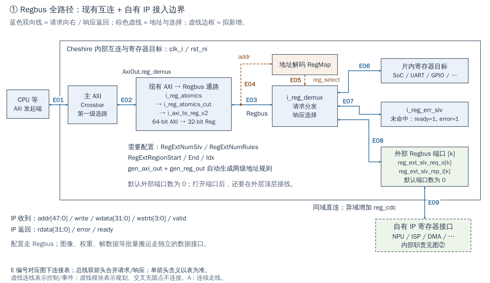
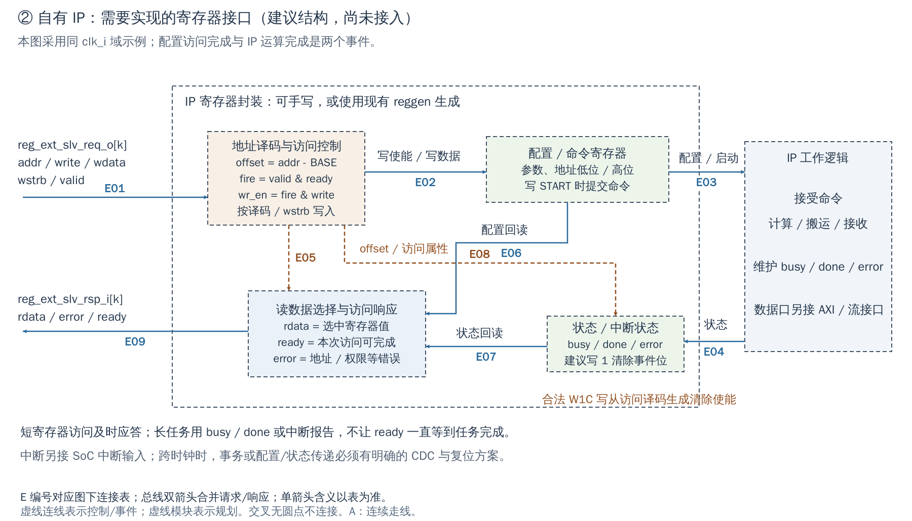

# 00 Regbus：软件访问、自有 IP 与 64→32 转换

[返回统一入口](README.md)。本章把前面 Regbus 的模块、时钟、AXI 适配和软件责任统一整理；图保持两张，转换器的内部原理用正文解释。

## 用途与当前配置

Regbus 是用于配置寄存器的轻量读写总线。CPU 用 MMIO（Memory-Mapped I/O，把设备寄存器映射为地址）访问它；NPU 权重、图像帧等批量数据另走 AXI 或流接口。下图回答“CPU 的一次寄存器访问如何到达现有外设，自己的 IP 应接在哪里”。

当前 `DefaultCfg` 和 FPGA 包装层都采用 AXI 数据 64-bit、Regbus 数据 32-bit、地址 48-bit；`RegExtNumSlv=0`，外部寄存器端口在本配置中没有可用实例。图中的自有 IP 是接入建议，尚未实现。

配置依据：[DefaultCfg](../../hw/cheshire_pkg.sv#L538) 与 [FPGA 配置函数](../../target/xilinx/src/cheshire_top_xilinx.sv#L115)。配置开关表示 RTL 是否生成，不等于功能已在板上验收。

[SVG](../diagrams/2026-10-13_rtl_module_comparison/A/00a_regbus.svg) · [PDF](../diagrams/2026-10-13_rtl_module_comparison/A/00a_regbus.pdf) · [A 图总览](../diagrams/2026-10-13_rtl_module_comparison/index.html#00a_regbus)

<!-- CONNECTIONS:00a_regbus -->

### 图中连线与信号组

编号仅在本图内有效。总线双箭头合并请求与响应；单箭头表示表内说明的主数据、控制或逻辑方向，握手返回不能据箭头省略。主图以连续连线表达连接，编号只用于查表。源码依据见本章代码对应。

| 连线 | 端点与方向 | 信号、用途和需要保留的约定 |
|---|---|---|
| E01 | CPU 等 ↔ 主 AXI | AXI4 请求 AW/W/AR 向 Xbar；B/R 响应及 ready 反向。默认数据64、地址48。 |
| E02 | 主 AXI ↔ 现有 AXI → Regbus 通路 | AxiOut.reg_demux：Xbar 选中的 AXI 请求/响应，进入原子适配、cut 和桥。 |
| E03 | 现有 AXI → Regbus 通路 ↔ i_reg_demux | reg_in_req / reg_in_rsp：Regbus addr/write/wdata[31:0]/wstrb[3:0]/valid，返回 rdata/error/ready。 |
| E04 | 现有 AXI → Regbus 通路 → 地址解码 RegMap | reg_in_req.addr：地址送 i_reg_demux_decode，以 RegMap 做范围译码。 |
| E05 | 地址解码 RegMap → i_reg_demux | reg_select：地址译码选中的目标索引；未命中使用默认错误端口。 |
| E06 | i_reg_demux ↔ 片内寄存器目标 | reg_out_req / reg_out_rsp：被选片内目标的 Regbus 请求及返回。 |
| E07 | i_reg_demux ↔ i_reg_err_slv | 错误端口 Regbus 请求/响应；未命中时 ready=1、error=1。 |
| E08 | i_reg_demux ↔ 外部 Regbus 端口 [k] | 扩展端口 reg_ext_slv_req_o[k] / reg_ext_slv_rsp_i[k]；配置产生后才有可用目标。 |
| E09 | 外部 Regbus 端口 [k] ↔ 自有 IP 寄存器接口 | 规划：外部 Regbus 请求/响应；同域直连，异域新增 reg_cdc。 |

<!-- /CONNECTIONS -->

图①用于定位配置访问的边界。已有桥接器、译码器和仲裁器可直接复用；自有 IP 应实现的部分见图②。这里只为说明接入点保留一个 AXI 入口，不展开整机互连。

## 一次访问怎样完成

AXI 地址落入寄存器窗口后，经过 `i_reg_atomics`、`i_reg_atomics_cut`、`i_axi_to_reg_v2`，变成 Regbus 请求。`i_reg_demux_decode` 按 RegMap 选目标，`i_reg_demux` 将请求发给目标并选回响应；未命中时由错误目标完成访问。模块名以文末定位表为准，图上“地址解码”是该逻辑的简称。

默认系统数据宽度为 AXI 64-bit、Regbus 32-bit。一个 Regbus 请求携带 `addr、write、wdata、wstrb、valid`，返回 `rdata、error、ready`。**只有 `valid && ready` 成立，才完成这一次寄存器访问。** 请求方等待 `ready` 时保持请求字段稳定；目标在握手处产生一次写入/弹出等副作用，不能在 `valid` 持续为 1 的每一拍重复操作。 `write=1` 表示写；四个 `wstrb` 分别控制四个字节。没有 AXI 那样独立的地址、数据和响应通道，也没有 burst 长度或事务 ID。

例如写 NPU 的 START：IP 在合法写握手时锁存命令并及时应答；NPU 可能在几千拍后完成，由 BUSY/DONE 或 IRQ 报告。不能把 `ready` 的含义改成“整个 NPU 任务已经完成”。上游一次访问被长期阻塞，也会妨碍其他寄存器访问。

## AXI 读和写为何先仲裁

AXI 的 AR/R 与 AW/W/B 是独立通道，读事务和写事务可以同时在途。一个 CPU 当前执行一条 load 或 store，不代表整个 AXI 接口永远只有一类请求。桥的后端是共享的请求流，必须把已经满足条件的读请求、写请求排成一列。

`axi_to_detailed_mem` 对写地址与写数据做握手配合，对 burst 逐 beat 处理，再将读和写仲裁到同一个存储请求接口。仲裁不是把 AXI 标准改成单通道，而是适应这个后端的吞吐方式。用户接 IP 时一般不需要改这里。

## fork、缓冲和返回信息分别负责什么

`i_fork` 分发的是一次请求的握手许可：主分支走 `stream_to_mem`，另外两支保存返回时需要的元数据和读写选择。它保证每个分支各接收一次；各分支不一定在同一拍接收。图中旧版“直连黑箭头”指主请求流的 valid/ready 控制，不是绕过 FIFO 的神秘数据通路。

`i_meta_buf` 保存响应需要的 AXI 元信息，`i_sel_buf` 保存响应应归入读还是写的选择。它们与主请求一一对应，使后端晚几拍返回后，桥仍知道要构成哪个 AXI 响应。它们不是专为等待 AW 与 W 相遇设置的两个数据 FIFO。“META”“RB”“P0/T0”是旧图自定义简写，当前接入图不再使用这些没有自解释的标签。

`stream_to_mem` 把流的 valid/ready 握手变为存储器的 req/gnt，跟踪已接受但未返回的请求数，并缓冲返回数据。原因是这种存储返回接口没有可无限反压的 ready；请求发出去前就要保证将来有地方接响应。它负责流量/返回时序，不负责解析用户寄存器。

## 64-bit 不是直接截掉高 32 位

`mem_to_banks_detailed` 在这里形成两个 32-bit bank 请求，低、高半部各自有数据、字节使能和地址；`axi_to_reg_v2` 再把有效请求汇合到一个 Regbus 输出。可以把它理解为“拆开并保持对应关系”，不能理解为“只保留低半部”。

以 **8-byte 对齐的写地址 A** 为例：

| AXI 字节位置 | 后端地址 | 32-bit 写数据 | 写使能 |
|---|---|---|---|
| 0…3 | A | `wdata[31:0]` | `wstrb[3:0]` |
| 4…7 | A+4 | `wdata[63:32]` | `wstrb[7:4]` |

若 CPU 对 A+4 做合法 32-bit store，AXI 有效字节落在对应高半部，桥将它送到地址 A+4 的 Regbus 数据位 `[31:0]`。软件无需手工移位去“适配 64-bit 总线”。对齐的 64-bit store 则可能成为两个 32-bit 寄存器访问：两者不是一个不可分割的更新。

读方向将两个 bank 的返回值按原来的低/高位置组合回 AXI 数据；CPU 根据访问地址和大小取所需部分。**当前桥的读副作用要额外注意**：此整合的读请求会进入两个 bank；外层只过滤零 strobe 写，并没有同等的窄读过滤。因此不能仅凭软件用了 `uint32_t` 就断言相邻寄存器绝不会被读取。UART 的读清除/FIFO、PLIC claim、SPI RX 窗口等必须按实际地址布局分析并测试。新 IP 推荐状态无读副作用、事件位采用 W1C（Write One to Clear，写 1 清除选中的事件位）；这是一项自定义接口建议，不是已经修复桥接器。

## 软件到底需要管哪些事

正常设备驱动只访问设备规定的地址和宽度，硬件完成通道和位宽转换。软件仍须保证对齐、合法宽度、访问顺序、缓存属性及副作用。不能用 `uint64_t*` 一次写相邻两个控制寄存器，只因 CPU 是 RV64；不能用普通内存复制替代任意 MMIO 序列；`volatile` 也不等于硬件内存屏障或缓存维护。

例如 DMA 的 64-bit 目标地址放在两个 32-bit 寄存器中，建议采用“先写 ADDR_LO/HI、LEN 等 shadow 参数，最后写 START 原子采样”的设备约定。只要硬件按 START 锁存，半新半旧的配置不会进入运行任务。该锁存必须由 IP 自己实现，AXI→Regbus 桥不会替它实现。

## 时钟为什么不是默认低速

本工程主 Regbus 适配、译码和大多数外设寄存器直接接 `clk_i / rst_ni`，没有在 AXI→Regbus 时自动分频。Regbus 协议简单、吞吐需求低，不等于实际时钟低。AHB→APB 桥后的 APB 也只有平台明确设置 PCLK 分频/跨域时才运行在较低频率；“桥存在”本身不能推出频率关系。

CDC（Clock Domain Crossing，跨时钟域）解决两个时钟之间的采样与数据一致性。若 IP 寄存器也位于慢时钟域，应在端口加 `reg_cdc` 完整跨越请求与响应。若寄存器仍留在 SoC 域而计算内核异步，则配置、启动和状态还需单独的 CDC 方案。给时钟换个名字或把一个周期脉冲直接送过去，都不能代替 CDC。

[SVG](../diagrams/2026-10-13_rtl_module_comparison/A/00b_ip_contract.svg) · [PDF](../diagrams/2026-10-13_rtl_module_comparison/A/00b_ip_contract.pdf) · [A 图总览](../diagrams/2026-10-13_rtl_module_comparison/index.html#00b_ip_contract)

<!-- CONNECTIONS:00b_ip_contract -->

### 图中连线与信号组

编号仅在本图内有效。总线双箭头合并请求与响应；单箭头表示表内说明的主数据、控制或逻辑方向，握手返回不能据箭头省略。主图以连续连线表达连接，编号只用于查表。源码依据见本章代码对应。

| 连线 | 端点与方向 | 信号、用途和需要保留的约定 |
|---|---|---|
| E01 | Regbus 请求 → 地址译码与访问控制 | 建议 Regbus 端点请求：addr/write/wdata/wstrb/valid；完整地址是否减 BASE 由封装定义。 |
| E02 | 地址译码与访问控制 → 配置 / 命令寄存器 | 建议写路径：地址命中、权限和 wstrb 合法且 valid&ready 后产生字段写使能/写数据。 |
| E03 | 配置 / 命令寄存器 → IP 工作逻辑 | 建议 START 提交及整组配置快照；工作逻辑另定义 accept/busy 协议。 |
| E04 | IP 工作逻辑 → 状态 / 中断状态 | 建议工作状态 busy/done/error 回到可读状态与事件锁存。 |
| E05 | 地址译码与访问控制 → 读数据选择与访问响应 | 建议读地址/访问属性译码，选择 rdata 并判定错误及完成条件。 |
| E06 | 配置 / 命令寄存器 → 读数据选择与访问响应 | 建议配置寄存器当前值送读选择器。 |
| E07 | 状态 / 中断状态 → 读数据选择与访问响应 | 建议状态/事件寄存器当前值送读选择器。 |
| E08 | 地址译码与访问控制 → 状态 / 中断状态 | 建议：地址/访问译码生成 W1C 清除使能，N01→N03；没有独立外部 W1C 端口。 |
| E09 | 读数据选择与访问响应 → Regbus 响应 | 建议 Regbus 返回：rdata/error/ready；应答配置访问，非等待整个运算完成。 |

<!-- /CONNECTIONS -->

图②是**建议的自有 IP 结构，尚未接入**。从左到右是合法访问译码、配置/命令寄存器、工作逻辑；下方是状态/事件寄存器和读响应选择。完整地址是否减 BASE，由 IP 自己约定：SoC 的 Regbus 端口不会自动替所有目标减基地址，现有 reggen 模块常只取低若干地址位。

## 实际扩展步骤

1. 配置 `RegExtNumSlv` 和 `RegExtNumRules`，填 `RegExtRegionStart/End/Idx`。当前地址译码采用结束地址不包含在窗口内的约定；检查窗口不重叠。`gen_axi_out` 和 `gen_reg_out` 生成两级路由。
2. 在外层顶层接 `reg_ext_slv_req_o[k] / reg_ext_slv_rsp_i[k]`。默认数量为零，配置增加端口不等于顶层自动有 IP。
3. 实现地址/权限检查、`wstrb`、一次握手一次副作用、稳定响应；复用 reggen 或现有 Regbus 模块。
4. 定义启动提交、busy/done/error、中断清除和复位值。给异步工作域配 CDC；中断经外部 IRQ 输入接入，另配 Router/PLIC/CLIC。
5. 软件增加地址常量与驱动，并检查该区的 CPU 物理属性。地址能够路由到 IP，不等于它已经是正确的不可缓存 MMIO。

你通常不需要修改 AXI burst 切分、返回 ID 队列、RR 仲裁或 Regbus demux 的内部实现。真正需要验收的是自有 IP 的接口契约，尤其窄读、副作用、跨域复位和连续访问。

## 一个可跟随的自有 IP 配置过程

以下是建议的 NPU 寄存器契约，并非现有寄存器地址表：CPU 等待 BUSY=0，依次写输入地址低/高半字与长度，执行平台要求的 MMIO 顺序保证，再写 START。IP 在 START 写握手处同时采样参数、置 BUSY 并应答；完成后清 BUSY、锁存 DONE，若使能则保持 IRQ。服务程序处理结果，最后 W1C 清事件。

这个例子只定义配置/完成通路。输入缓冲区是否对 NPU 可见、输出在 CPU cache 中是否过时，还要按 [LLC/SPM](16_llc_spm.md) 和工程 IP 契约处理；Regbus `ready`、CPU `volatile` 或 IRQ 本身都不代替数据可见性规则。

<!-- RTL_SOURCES -->

## 代码对应（本次源码快照）

| 图中职责 | 文件与行号 | 可搜索符号 |
|---|---|---|
| SoC：AXI 到 Regbus | [cheshire_soc.sv:369](../../hw/cheshire_soc.sv#L369) | `axi_to_reg_v2 #(` |
| SoC：地址选择 | [cheshire_soc.sv:397](../../hw/cheshire_soc.sv#L397) | `) i_reg_demux_decode (` |
| 扩展配置/两级路由 | [cheshire_pkg.sv:120](../../hw/cheshire_pkg.sv#L120) | `RegExtRegionIdx;` |
| 桥：bank 数与具体参数 | [axi_to_reg_v2.sv:49](../../.bender/git/checkouts/register_interface-902ad5bfde7bb98c/src/axi_to_reg_v2.sv#L49) | `localparam int unsigned NumBanks` |
| AXI 请求与返回信息 | [axi_to_detailed_mem.sv:330](../../.bender/git/checkouts/axi-ecdc900686449c15/src/axi_to_detailed_mem.sv#L330) | `) i_fork (` |
| 元数据缓冲 | [axi_to_detailed_mem.sv:364](../../.bender/git/checkouts/axi-ecdc900686449c15/src/axi_to_detailed_mem.sv#L364) | `) i_meta_buf (` |
| 流到存储握手 | [stream_to_mem.sv:17](../../.bender/git/checkouts/common_cells-7f7ae0f5e6bf7fb5/src/stream_to_mem.sv#L17) | `module stream_to_mem` |
| 分拆请求与重组响应 | [mem_to_banks_detailed.sv:15](../../.bender/git/checkouts/common_cells-7f7ae0f5e6bf7fb5/src/mem_to_banks_detailed.sv#L15) | `module mem_to_banks_detailed` |
| 跨域完整请求/响应 | [reg_cdc.sv:14](../../.bender/git/checkouts/register_interface-902ad5bfde7bb98c/src/reg_cdc.sv#L14) | `module reg_cdc` |
| 项目本地架构说明 | [arch.md:20](../../docs/um/arch.md#L20) | `Regbus` |
| 当前默认配置 | [cheshire_pkg.sv:538](../../hw/cheshire_pkg.sv#L538) | `localparam cheshire_cfg_t DefaultCfg` |
| 当前 FPGA 参数覆盖 | [cheshire_top_xilinx.sv:115](../../target/xilinx/src/cheshire_top_xilinx.sv#L115) | `function automatic cheshire_cfg_t gen_cheshire_xilinx_cfg` |
| 零 strobe 写过滤条件 | [axi_to_reg_v2.sv:201](../../.bender/git/checkouts/register_interface-902ad5bfde7bb98c/src/axi_to_reg_v2.sv#L201) | `filter zero strobe writes early` |
| bank 对齐地址 | [mem_to_banks_detailed.sv:122](../../.bender/git/checkouts/common_cells-7f7ae0f5e6bf7fb5/src/mem_to_banks_detailed.sv#L122) | `assign bank_req[i].addr` |
