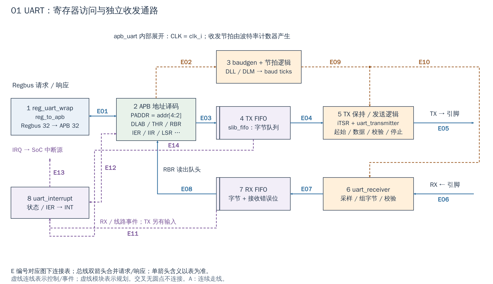

# 01 UART：从寄存器字节到串行收发

[返回统一入口](README.md)

UART（通用异步收发器）负责将软件字节变成串行引脚波形，并把接收波形还原为字节。它适合控制台和低速设备通讯；此实例没有把一串字节自动 DMA 到 DDR 的 AXI master。

## 用途与当前配置

`Cfg.Uart=1` 在默认配置和当前 FPGA 包装层中均保留；CPU 经主 Regbus 访问 `i_uart`，随后由本模块局部桥转换为 APB（外围寄存器总线）。地址窗口为 `[0x0300_2000, 0x0300_3000)`，端点数据通路、寄存器和波特率计数器均使用 `clk_i/rst_ni`。下图回答“写 THR 后谁负责发出比特，收到字节后软件从哪里取走”。

配置依据：[DefaultCfg](../../hw/cheshire_pkg.sv#L538) 与 [FPGA 配置函数](../../target/xilinx/src/cheshire_top_xilinx.sv#L115)。配置开关表示 RTL 是否生成，不等于功能已在板上验收。

[SVG](../diagrams/2026-10-13_rtl_module_comparison/A/01_uart.svg) · [PDF](../diagrams/2026-10-13_rtl_module_comparison/A/01_uart.pdf) · [A 图总览](../diagrams/2026-10-13_rtl_module_comparison/index.html#01_uart)

<!-- CONNECTIONS:01_uart -->

### 图中连线与信号组

编号仅在本图内有效。总线双箭头合并请求与响应；单箭头表示表内说明的主数据、控制或逻辑方向，握手返回不能据箭头省略。主图以连续连线表达连接，编号只用于查表。源码依据见本章代码对应。

| 连线 | 端点与方向 | 信号、用途和需要保留的约定 |
|---|---|---|
| E01 | 1  reg_uart_wrap ↔ 2  APB 地址译码 | APB 请求 PSEL/PENABLE/PWRITE/PADDR/PWDATA；PRDATA/PREADY/PSLVERR 返回。PADDR=addr[4:2]。 |
| E02 | 2  APB 地址译码 → 3  baudgen + 节拍逻辑 | iBaudgenDiv={iDLM,iDLL}：分频寄存器给 uart_baudgen.DIVIDER。 |
| E03 | 2  APB 地址译码 → 4  TX FIFO | PWDATA[7:0] 与 iTXFIFOWrite：合法 THR 写入 TX FIFO；复位/清空由 FCR 控制。 |
| E04 | 4  TX FIFO → 5  TX 保持 / 发送逻辑 | iTXFIFOQ[7:0] 经发送控制过程锁存 iTSR，再送 UART_TX.DIN；iTXFIFORead 消耗队头。 |
| E05 | 5  TX 保持 / 发送逻辑 → UART TX 输出 | iSOUT 到 SOUT/uart_tx_o：串行输出位，调制解调/回环选择属于 UART 包装逻辑。 |
| E06 | UART RX 输入 → 6  uart_receiver | uart_rx_i/SIN 经输入同步与回环选择成为 iSIN，送 UART_RX.SIN。 |
| E07 | 6  uart_receiver → 7  RX FIFO | iRXData[7:0]、iRXPE/iRXFE/iRXBI 与 iRXFinished：RX 控制过程产生 iRXFIFOD[10:0]/iRXFIFOWrite。 |
| E08 | 7  RX FIFO → 2  APB 地址译码 | iRXFIFOQ[7:0]→iRBR→PRDATA；RBR 读产生反向 iRXFIFORead 出队动作。 |
| E09 | 3  baudgen + 节拍逻辑 → 5  TX 保持 / 发送逻辑 | iBaudtick16x 经 UART_BG2 分频得到 iBaudtick2x，作为 UART_TX.TXCLK 的使能节拍。 |
| E10 | 3  baudgen + 节拍逻辑 → 6  uart_receiver | 波特率/边沿逻辑产生 iRCLK，送 UART_RX.RXCLK；不是另一个寄存器时钟域。 |
| E11 | 7  RX FIFO → 8  uart_interrupt | 接收水位/错误/超时派生 iRDAInterrupt、iLSR[4:0]、iCharTimeout，送 UART_IIC。 |
| E12 | 2  APB 地址译码 ↔ 8  uart_interrupt | iIER[3:0]、iMCR_AFE、iMSR[3:0] 等配置/状态送 UART_IIC；iIIR[3:0] 返回寄存器读路径。 |
| E13 | 8  uart_interrupt → SoC UART IRQ | UART_IIC.INT→intr_o→intr.intn.uart；设备事件再进入 SoC IRQ 路径。 |
| E14 | 4  TX FIFO → 8  uart_interrupt | TX FIFO/顶层控制派生 iTHRInterrupt → UART_IIC.THI；发送空事件。 |

<!-- /CONNECTIONS -->

## 按图理解电路

**1→2：总线访问变为寄存器动作。** `reg_uart_wrap` 先用 `reg_to_apb` 转成 APB，再送 `apb_uart`。UART 内核用 `paddr[4:2]` 作为寄存器编号，因此相邻编号间隔 4 byte，不是连续 byte 地址。DLAB（Divisor Latch Access Bit，分频锁存访问选择位）还会改变部分编号的意义：同一位置可表示 THR/RBR，也可表示分频值低字节。

**3：产生收发节拍。** 软件设置 DLL/DLM；`uart_baudgen` 在系统 CLK 下计数，生成收发所需 tick。后续还有节拍分频逻辑。这些 tick 是使能信号，不能据此把 APB 寄存器画成独立低频域。当前驱动用 `freq / (16 × baud)` 计算 divisor，`freq` 必须是实际 UART 输入时钟。

**4→5：发送。** 对 THR 的合法写把字节压入 TX FIFO；发射器在使能条件满足时取字节，再输出起始位、数据位、可选校验位和停止位。FIFO 空仅表示没有待取字节；最后一个字节仍可能在移位发送，所以 THRE（发送保持寄存器空）与 TEMT（发送器完全空）不是同一个状态。FIFO 的实现容量为 64 项，逻辑还区分 FIFO 禁用、16/64 模式及阈值，不应把所有模式统称为“64 字节可随时写满”。

**6→7：接收。** RX 经过采样和串并转换，接收器给出字节和 parity/framing/break 等错误；RX FIFO 保存这些信息。读 RBR 会推进队头，是有副作用的访问。软件先检查 DATA_READY，再读取数据。

**8：中断。** `uart_interrupt` 根据接收、发送、线路/调制解调器状态及 IER 产生 INT，送到 SoC 的 UART 中断源。处理中断时应按 IIR/LSR 及对应原因处理，不能套用“所有外设统一写某一个 DONE 位”的模型。图中将中断逻辑独立放在左下，仍属于 UART 内核。其输入还包括发送空事件 `iTHRInterrupt`、线路状态 `iLSR`、接收水位 `iRDAInterrupt`、字符超时 `iCharTimeout` 和调制解调状态 `iMSR`；这些由 UART 内部多处产生，不能把 RX FIFO 的单条箭头当作全部来源。

## 使用时必须感知

| 内容 | 需要遵守的约定 |
|---|---|
| 寄存器访问 | 当前 HAL 使用 `reg8`，访问点仍相隔 4 byte；保留现有设备约定，不因 Regbus32 就批量替换全部访问类型 |
| 配置顺序 | 禁中断、置 DLAB、写 divisor、恢复线路格式，再配置 FIFO/流控；DLAB 不恢复会把数据写到分频寄存器 |
| 发送完成 | 把 FIFO 写入完成和最后停止位发出区分开；需要排空时参考 `uart_write_flush` |
| 读副作用 | RBR 弹出数据，状态/中断寄存器也有各自清除语义；结合 Regbus 的相邻窄读行为检查地址组合 |
| 引脚 | RX/TX 与 CTS/RTS 等可选流控引脚的接法应一致；没有对端流控时不能凭软件开位就假定能发送 |

例如打印字符串，CPU 依次等 TX 空间并写 THR，FIFO 吸收软件与串行速度差异；不是一次 MMIO 写就传出整串字符串。接收连续数据时，服务延迟大于 FIFO 能吸收的时间会溢出。

## 扩展与可复用边界

新增一个 UART 实例，需要独立地址窗口、中断源、引脚和驱动基址，并确认实际时钟/复位；UART 的 APB bridge、收发状态机和 FIFO 一般直接复用。ASIC 集成时另接 I/O PAD 与电压域，不能把数字 `tx_o` 当成板上 RS-232 电平。

当前 SoC 用 `Cfg.Uart` 条件生成，寄存器和 UART 内核接 `clk_i/rst_ni`。已有 HelloWorld 只覆盖已使用的输出场景，本批没有新增 RX、流控、错误或 FIFO 压力测试。

## 对照现有驱动执行一次输出

1. `uart_init(base, freq, baud)` 关闭 IER 中断，设置 DLAB，写 DLL/DLM，再恢复为 8 数据位、无校验、1 停止位，配置 FIFO 与自动流控。这里 `freq` 来自平台实际时钟，不能直接填期望的 baud。
2. `uart_write(base, byte)` 轮询 LSR 的 THRE，再写 THR；软件返回说明字节已提交，不保证 TX 引脚已经发完。
3. 需要随后关时钟或切引脚时，调用 `uart_write_flush` 的意图是执行 `fence()` 后等 THRE 与 TEMT。驱动本身保留 CVA6 读写顺序核查 TODO，因此这里是源码流程说明，不是已验证的关钟协议。

Regbus/APB 箭头表示请求与返回，FIFO/移位器箭头表示字节流；波特率虚线是计数使能。TX FIFO 到发射器之间还经过 `apb_uart` 的发送控制过程和 `iTSR` 保持寄存器，图将这部分归入发送路径。

<!-- RTL_SOURCES -->

## 代码对应（本次源码快照）

| 图中职责 | 文件与行号 | 可搜索符号 |
|---|---|---|
| SoC 条件生成与接线 | [cheshire_soc.sv:1351](../../hw/cheshire_soc.sv#L1351) | `) i_uart (` |
| 图①：Regbus/APB 适配 | [reg_uart_wrap.sv:62](../../.bender/git/checkouts/apb_uart-38dcfab592cbc1a1/src/reg_uart_wrap.sv#L62) | `reg_to_apb #(` |
| 图②：APB 地址位选择 | [reg_uart_wrap.sv:82](../../.bender/git/checkouts/apb_uart-38dcfab592cbc1a1/src/reg_uart_wrap.sv#L82) | `.PADDR` |
| 图③：波特率发生器 | [apb_uart.sv:630](../../.bender/git/checkouts/apb_uart-38dcfab592cbc1a1/src/apb_uart.sv#L630) | `uart_baudgen UART_BG16` |
| 图④⑦：TX/RX 队列 | [apb_uart.sv:648](../../.bender/git/checkouts/apb_uart-38dcfab592cbc1a1/src/apb_uart.sv#L648) | `UART_TXFF` |
| 图⑤⑥：收发器 | [apb_uart.sv:681](../../.bender/git/checkouts/apb_uart-38dcfab592cbc1a1/src/apb_uart.sv#L681) | `uart_transmitter UART_TX` |
| 图⑧：IRQ | [apb_uart.sv:273](../../.bender/git/checkouts/apb_uart-38dcfab592cbc1a1/src/apb_uart.sv#L273) | `uart_interrupt UART_IIC` |
| 软件初始化/访问宽度 | [uart.c:12](../../sw/lib/dif/uart.c#L12) | `void uart_init` |
| 当前默认配置 | [cheshire_pkg.sv:538](../../hw/cheshire_pkg.sv#L538) | `localparam cheshire_cfg_t DefaultCfg` |
| 当前 FPGA 参数覆盖 | [cheshire_top_xilinx.sv:115](../../target/xilinx/src/cheshire_top_xilinx.sv#L115) | `function automatic cheshire_cfg_t gen_cheshire_xilinx_cfg` |
| 发送等待与排空 | [uart.c:48](../../sw/lib/dif/uart.c#L48) | `void uart_write_flush` |
