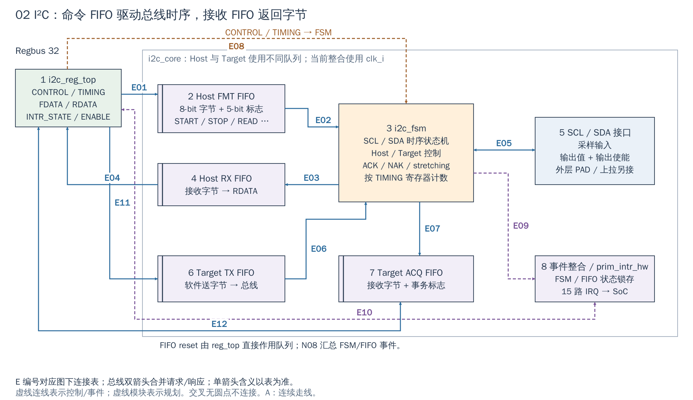

# 02 IIC / I²C：命令队列与总线时序

[返回统一入口](README.md)

I²C（Inter-Integrated Circuit，常写 IIC）用 SCL 时钟线和 SDA 数据线连接低速器件。这里使用 OpenTitan peripherals 的 `i2c`：Host 指发起事务的一方，Target 指被寻址并应答的一方；本地 RTL 支持两种角色。

## 用途与当前配置

`Cfg.I2c=1` 在默认配置和 FPGA 包装层均保留，地址窗口为 `[0x0300_3000, 0x0300_4000)`；`i_i2c` 通过 Regbus 配置，寄存器与 core 同用 `clk_i/rst_ni`。现有 EEPROM 驱动使用 Host，不能据此认为 Target 软件也已验证。下图解释“软件写入的命令怎样变成 SCL/SDA 时序，以及接收到的字节如何返回”。

配置依据：[DefaultCfg](../../hw/cheshire_pkg.sv#L538) 与 [FPGA 配置函数](../../target/xilinx/src/cheshire_top_xilinx.sv#L115)。配置开关表示 RTL 是否生成，不等于功能已在板上验收。

[SVG](../diagrams/2026-10-13_rtl_module_comparison/A/02_i2c.svg) · [PDF](../diagrams/2026-10-13_rtl_module_comparison/A/02_i2c.pdf) · [A 图总览](../diagrams/2026-10-13_rtl_module_comparison/index.html#02_i2c)

<!-- CONNECTIONS:02_i2c -->

### 图中连线与信号组

编号仅在本图内有效。总线双箭头合并请求与响应；单箭头表示表内说明的主数据、控制或逻辑方向，握手返回不能据箭头省略。主图以连续连线表达连接，编号只用于查表。源码依据见本章代码对应。

| 连线 | 端点与方向 | 信号、用途和需要保留的约定 |
|---|---|---|
| E01 | 1  i2c_reg_top → 2  Host FMT FIFO | reg2hw.fdata→fmt_fifo_wdata[12:0]/fmt_fifo_wvalid：8-bit 字节+5-bit 事务标志。 |
| E02 | 2  Host FMT FIFO → 3  i2c_fsm | fmt_byte/五个 fmt_flag 与 fmt_fifo_rvalid；FSM 以 fmt_fifo_rready 消耗命令。 |
| E03 | 3  i2c_fsm → 4  Host RX FIFO | rx_fifo_wdata[7:0]/rx_fifo_wvalid：FSM 采样接收字节，写入 Host RX FIFO。 |
| E04 | 4  Host RX FIFO → 1  i2c_reg_top | rx_fifo_rdata→hw2reg.rdata；读请求经 reg2hw.rdata.re 产生 FIFO 消耗。 |
| E05 | 3  i2c_fsm ↔ 5  SCL / SDA 接口 | FSM scl_out_fsm/sda_out_fsm 输出，scl_sync/sda_sync 反馈；core 加 override/采样和 OE 后连接 cio_scl/sda_*。 |
| E06 | 6  Target TX FIFO → 3  i2c_fsm | tx_fifo_rdata[7:0]/rvalid 与 FSM 反向 rready：Target 发送字节。 |
| E07 | 3  i2c_fsm → 7  Target ACQ FIFO | acq_fifo_wdata[9:0]/wvalid：Target 接收内容与事务标志；还有 FIFO 深度/当前项反馈到 FSM。 |
| E08 | 1  i2c_reg_top → 3  i2c_fsm | host_enable/target_enable、thigh/tlow/建立保持/超时等字段控制 FSM；FIFO reset 另接各队列，不是经过 FSM。 |
| E09 | 3  i2c_fsm → 8  事件整合 / prim_intr_hw | FSM 的 event_nak/event_cmd_complete/event_* 送中断逻辑；水位/溢出等另来自 FIFO 周边。 |
| E10 | 1  i2c_reg_top ↔ 8  事件整合 / prim_intr_hw | reg2hw.intr_enable/intr_test/intr_state 送 prim_intr_hw；hw2reg.intr_state.d/de 反向更新寄存器。 |
| E11 | 1  i2c_reg_top → 6  Target TX FIFO | reg2hw.txdata → tx_fifo_wdata/wvalid；Target TX 队列由软件填充。 |
| E12 | 7  Target ACQ FIFO ↔ 1  i2c_reg_top | acq_fifo_rdata → hw2reg.acqdata；软件读消费由 reg2hw 返回。 |

<!-- /CONNECTIONS -->

## 按图理解电路

**1→2：写入的是带含义的命令。** `i2c_reg_top` 把 FDATA 的字段组合成 13-bit FMT FIFO 项：8-bit 数据与 START、STOP、READ、持续读、NAK 允许等控制。因而“写一个字节寄存器”可以表示发地址/数据，也可以要求接收若干字节，不只是给 SDA 提供八个比特。

**2→3→5：硬件执行串行事务。** `i2c_fsm` 取队头命令，结合 TIMING 参数控制 SCL 高低持续时间、SDA 建立/保持、ACK/NAK 和 clock stretching。引脚输入会反馈到 FSM，实际总线状态不完全由本机输出决定。PAD 的输入、输出值和输出使能是不同信号，必须全部按平台电气方案接好。

**3→4→1：返回接收字节。** Host 读到的数据进入 RX FIFO，软件通过 RDATA 取走。FMT FIFO 和 RX FIFO 分开，使软件可以先排命令，再处理返回数据；容量有限，仍需水位、满空检查和及时服务。

**6、7：Target 的另一组队列。** 外部主机访问本器件时，TX FIFO 提供应答数据，ACQ FIFO 记录收到的数据与事务标志。这不是 Host RX FIFO 的别名；不同角色对应不同的软件动作。图中省略了这两个队列回到 reg_top 的重复总线线条。

**8：事件变成可处理的中断。** `prim_intr_hw` 将阈值、溢出、NAK、干扰、拉伸超时、命令完成等事件组合进状态/使能逻辑；SoC 接入 15 路相关 IRQ。中断报告的是具体条件，有些表示进度，有些表示错误；“来了中断”不能直接等价为 EEPROM 写入成功。

## 软件与扩展要关注什么

读取 EEPROM 时，软件先给控制器排入器件地址和内部偏移，再发读地址/长度，最后取 RX 数据。地址阶段与读取阶段之间是否要求 repeated START（不先 STOP 的重复起始条件），必须查外部器件约定；控制器不会自动推断。当前 `i2c_24fc1025.c` 读路径在偏移低字节使用 `kDifI2cFmtTxStop`，之后才使用 `kDifI2cFmtStart`，不能把它描述成已经实现了 repeated START 的通用传感器驱动。

| 接口点 | 对使用/扩展的影响 |
|---|---|
| CONTROL / TIMING | 角色使能、输入系统时钟与总线时序要匹配；改变系统频率后旧 TIMING 不一定适用 |
| FDATA / RDATA | FIFO 推入/弹出有副作用；先检查容量/水位；实际窄读行为见 Regbus 章 |
| FIFO reset | 用于已定义的清空/恢复流程，不能在正常传输中随意清掉队列 |
| INTR_STATE / ENABLE | 按事件检查、处理并清除；目标线维持有效时只清 PLIC 无法解决设备条件 |
| SCL / SDA / OE | 按开漏和上拉要求落实 PAD；不能作为普通推挽 GPIO 任意驱动 |

`Cfg.I2c` 控制生成，寄存器/core 当前都在 `clk_i/rst_ni` 域；SCL 波形由计数与状态机产生。不是把整个 I²C RTL 的时钟直接接到 SCL。

接入更多 I²C 器件通常先检查地址冲突、总线负载和时序；需要另一条物理总线才考虑增加控制器实例。可复用 FSM、队列和 reggen 寄存器，不必逐状态修改。当前目录有 DIF 和 EEPROM 访问代码/仿真模型可参考，本批没有新增真实器件验收。

## 对照 EEPROM 驱动看一次读取

`i2c_24fc1025_init()` 先关闭 Host、清四类 FIFO，再用实际 `core_freq` 换算 TIMING 并启用 Host。读取分块函数先等 FIFO 空、暂停 Host，将寻址字节和读长度压入 FMT，随后启用 Host；当 RX 水位达到本块长度时，用 `dif_i2c_read_byte()` 逐字节取到 CPU 缓冲区。这是 CPU 搬运，图中没有 I²C 到 DDR 的 DMA 连接。

此实现用轮询而非设备中断完成上述路径，等待循环没有统一超时保护；对新传感器应另定超时、NAK 和总线恢复流程。本轮只说明现有代码，未运行器件测试。图中 Target TX 的软件写入、ACQ 的软件读出，以及 FIFO 水位到中断逻辑的关系也属于寄存器/FIFO 通路，不是队列之间的隐含直连。

## 复用 EEPROM 写驱动前需核查分块路径

本章运行例采用现有读取流程。写路径还存在静态疑点：[i2c_24fc1025.c:64](../../sw/lib/hal/i2c_24fc1025.c#L64) 用 `half_fill` 限制首段循环，却取 `buf[len-1]` 作为末字节，并在递归时按 `buf+len/addr+len` 前进、剩余长度只减 `half_fill`；长度超过半 FIFO 时，索引与分块边界不一致。末字节注释要求 STOP，但调用仍使用 `kDifI2cFmtTx`。这些证据不足以把写驱动当成已验证模板；用于 ISP 传感器/EEPROM 配置前，应另行修复并验证边界。本轮未修改软件，也未声称已复现总线故障。

<!-- RTL_SOURCES -->

## 代码对应（本次源码快照）

| 图中职责 | 文件与行号 | 可搜索符号 |
|---|---|---|
| SoC 15 路事件/引脚 | [cheshire_soc.sv:1388](../../hw/cheshire_soc.sv#L1388) | `) i_i2c (` |
| 图①：寄存器与 core 连接 | [i2c.sv:54](../../.bender/git/checkouts/opentitan_peripherals-7b624fb57f78de9a/src/i2c/rtl/i2c.sv#L54) | `) u_reg (` |
| 图②：FMT 字段组合 | [i2c_core.sv:269](../../.bender/git/checkouts/opentitan_peripherals-7b624fb57f78de9a/src/i2c/rtl/i2c_core.sv#L269) | `assign fmt_fifo_wdata` |
| 图②④⑥⑦：FIFO 实例 | [i2c_core.sv:292](../../.bender/git/checkouts/opentitan_peripherals-7b624fb57f78de9a/src/i2c/rtl/i2c_core.sv#L292) | `prim_fifo_sync #(` |
| 图③⑤：时序与引脚 | [i2c_core.sv:413](../../.bender/git/checkouts/opentitan_peripherals-7b624fb57f78de9a/src/i2c/rtl/i2c_core.sv#L413) | `) u_i2c_fsm (` |
| 图⑧：事件锁存/使能 | [i2c_core.sv:483](../../.bender/git/checkouts/opentitan_peripherals-7b624fb57f78de9a/src/i2c/rtl/i2c_core.sv#L483) | `intr_hw_fmt_threshold` |
| 当前默认配置 | [cheshire_pkg.sv:538](../../hw/cheshire_pkg.sv#L538) | `localparam cheshire_cfg_t DefaultCfg` |
| 当前 FPGA 参数覆盖 | [cheshire_top_xilinx.sv:115](../../target/xilinx/src/cheshire_top_xilinx.sv#L115) | `function automatic cheshire_cfg_t gen_cheshire_xilinx_cfg` |
| EEPROM 初始化时序 | [i2c_24fc1025.c:15](../../sw/lib/hal/i2c_24fc1025.c#L15) | `int i2c_24fc1025_init` |
| 实际分块读序列 | [i2c_24fc1025.c:46](../../sw/lib/hal/i2c_24fc1025.c#L46) | `static inline int __i2c_24fc1025_access_chunk` |
