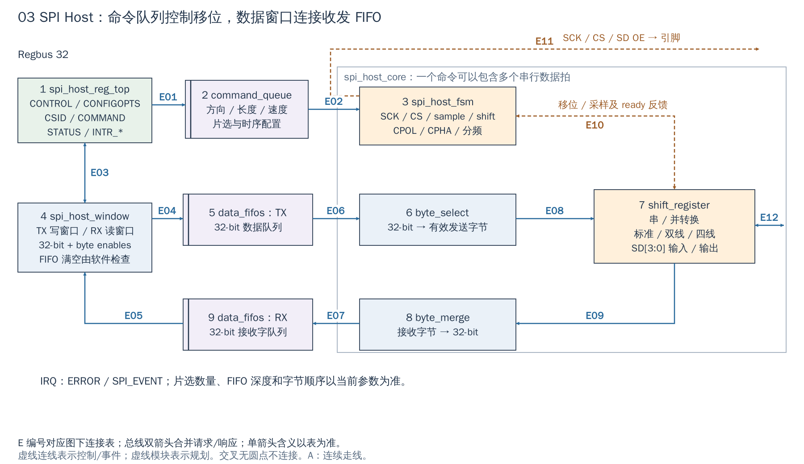

# 03 SPI Host：命令与数据分开排队

[返回统一入口](README.md)

SPI（Serial Peripheral Interface，串行外设接口）通常由 Host 产生时钟和片选。本工程的 `spi_host` 用来访问 Flash、SPI 模式 SD 卡等器件；它不是 SPI slave，也没有独立的内存 DMA 端口。

## 用途与当前配置

`Cfg.SpiHost=1` 在默认配置和 FPGA 包装层均保留，地址窗口为 `[0x0300_4000, 0x0300_5000)`；CPU 从 Regbus 配置命令及收发窗口。core、FIFO 和寄存器均用 `clk_i/rst_ni`，SCK 是 FSM（有限状态机）产生的接口时钟。下图回答“为什么命令与数据需要分别排队，谁决定片选与每个串行比特的时刻”。

配置依据：[DefaultCfg](../../hw/cheshire_pkg.sv#L538) 与 [FPGA 配置函数](../../target/xilinx/src/cheshire_top_xilinx.sv#L115)。配置开关表示 RTL 是否生成，不等于功能已在板上验收。

[SVG](../diagrams/2026-10-13_rtl_module_comparison/A/03_spi.svg) · [PDF](../diagrams/2026-10-13_rtl_module_comparison/A/03_spi.pdf) · [A/C 对比](../diagrams/2026-10-13_rtl_modules_native_c/index.html#03_spi)

<!-- CONNECTIONS:03_spi -->

### 图中连线与信号组

编号仅在本图内有效。总线双箭头合并请求与响应；单箭头表示表内说明的主数据、控制或逻辑方向，握手返回不能据箭头省略。A/C 均以连续连线表达连接，编号只用于查表。源码依据见本章代码对应。

| 连线 | 端点与方向 | 信号、用途和需要保留的约定 |
|---|---|---|
| E01 | 1  spi_host_reg_top → 2  command_queue | command/command_valid 进入命令队列，command_busy/qd/error_busy 回到状态与错误逻辑。 |
| E02 | 2  command_queue → 3  spi_host_fsm | core_command/core_command_valid 向 FSM；core_command_ready 反向接受命令。 |
| E03 | 1  spi_host_reg_top ↔ 4  spi_host_window | fifo_win_h2d[RX/TX] 与 fifo_win_d2h[RX/TX]：reg_top 解码后的两个 Regbus 窗口。 |
| E04 | 4  spi_host_window → 5  data_fifos：TX | tx_data[31:0]/tx_be[3:0]/tx_valid_checked 入 TX FIFO；tx_ready 用于写溢出检查，不无限延迟 MMIO。 |
| E05 | 9  data_fifos：RX → 4  spi_host_window | rx_data[31:0]/rx_valid 到窗口；窗口读产生 rx_ready，读空由 error_underflow 报告。 |
| E06 | 5  data_fifos：TX → 6  byte_select | core_tx_data[31:0]/core_tx_be/core_tx_valid；byte_select 返回 core_tx_ready。 |
| E07 | 8  byte_merge → 9  data_fifos：RX | core_rx_data[31:0]/core_rx_valid；RX FIFO 返回 core_rx_ready。 |
| E08 | 6  byte_select → 7  shift_register | tx_data_sr[7:0]/tx_valid_sr；反向 tx_ready_sr，另有 tx_flush_sr 消耗当前残余字节。 |
| E09 | 7  shift_register → 8  byte_merge | rx_data_sr[7:0]/rx_valid_sr/rx_last_sr；byte_merge 返回 rx_ready_sr。 |
| E10 | 3  spi_host_fsm ↔ 7  shift_register | wr_en/rd_en/shift_en/sample_en/speed/full_cyc/last_* 到移位器；wr_ready/rd_ready 返回 FSM。SCK/CS/OE 是 FSM 独立引脚输出。 |
| E11 | 3  spi_host_fsm → SPI SCK / CS / SD OE 引脚 | sck_o/csb_o/sd_en_o：FSM 产生 SCK、片选和数据输出使能。 |
| E12 | 7  shift_register ↔ SPI SD[3:0] 数据引脚 | sd_o[3:0]/sd_i[3:0]：移位逻辑输出数据、采样引脚数据。 |

<!-- /CONNECTIONS -->

## 按图理解电路

**1→2→3：先说明“怎么传”。** 软件配置时钟极性/相位、分频、片选及命令段。`spi_host_command_queue` 将命令保存下来，`spi_host_fsm` 决定当前段要发、收还是双向传输、何时拉低/保持片选、何时采样/移位。命令长度和 FIFO 中的数据字节必须匹配；CPU 把命令寄存器写完，串行操作未必已完成。

**4→5→6→7：发送数据。** `spi_host_window` 处理 TX 数据窗口写，将 32-bit 数据和 byte enable 送到 `spi_host_data_fifos`；`byte_select` 按有效字节和顺序取出字节，`shift_register` 逐位或按多线模式输出到 SD。FIFO 吸收软件供数和串行消耗的速度差异，不替软件判断器件命令码。

**7→8→9→4：接收数据。** 输入 SD 经移位寄存器还原成字节，`byte_merge` 组为软件可读的 32-bit 字，RX FIFO 保持返回数据。读 RX 窗口推进 FIFO；它不是普通无副作用的状态寄存器。

命令与数据分开是因为一条命令可以覆盖多个数据字节，也可能只生成 dummy 周期或读操作；若把命令和每个 32-bit 数据字强行绑定，会限制连续传输和组合事务。

## 使用时的关键顺序

以“读 Flash 的一段数据”为例，软件按器件协议安排 command/address/dummy/read 段，并使片选按要求跨段保持；先准备需发的数据，再启动命令并持续排空 RX。切换 CPOL/CPHA、速度或片选配置时，应遵循空闲/段边界约定。

| 位置 | 软件必须知道 |
|---|---|
| CONFIGOPTS / CONTROL | SPI 时序、分频及输出使能；不是 UART 波特率寄存器 |
| CSID / COMMAND | 当前器件、段长度、方向、标准/双/四线及片选保持 |
| TX / RX 窗口 | 检查队列可用量；该 RTL 对溢出、下溢和非法 byte enable 报错，而不是无限等待直到有空间 |
| STATUS | 区分命令就绪、FIFO 水位与实际事务结束 |
| ERROR / SPI_EVENT | 两类中断各自有触发、使能和清除条件 |

不要因为端口有 `sd[3:0]` 就认定所有外设都可以四线访问：还需要器件支持、命令模式、引脚连接和板级时序。SoC 接线为片选阵列增加了一个 dummy 项，物理片选数量和寄存器可选值要一起检查。

`Cfg.SpiHost` 控制生成；core、FIFO 和寄存器均接 `clk_i/rst_ni`，SCK 由 FSM 分频/控制。新增片选、器件或控制器时重点改参数、引脚、地址与驱动；命令队列、移位与字节转换通常复用。此批只核对结构，不宣称任意 Flash/SD 型号已可用。

## 对照 Flash 驱动看一次读取

`spi_s25fs512s_init()` 复位 Host，用 `core_freq` 和器件目标频率配置 CPOL/CPHA、分频及片选前后延时，随后打开控制器及输出。`__spi_s25fs512s_single_read_chunk()` 给 `dif_spi_host_transaction()` 传入三段：`0x13` opcode、4-byte 地址、RX 数据段。DIF 再把这些段变为控制命令和 FIFO 操作，接收到的数据由 CPU 读入传入的 `buf`；这不是 Flash 的 AXI memory-mapped/XIP 通路。

图中的 FSM 到移位器连接具体为 `wr_en/rd_en/shift_en/sample_en/speed` 等控制，并有 `wr_ready/rd_ready` 反馈；`sck_o/csb_o/sd_en_o` 从 FSM 单独送到外部接口，不能误认为经过移位器生成。`reg_top` 与数据窗口之间传的是 `fifo_win_h2d/d2h` 寄存器请求/响应，收发数据窗口并非命令 FIFO 的后一级。

<!-- RTL_SOURCES -->

## 代码对应（本次源码快照）

| 图中职责 | 文件与行号 | 可搜索符号 |
|---|---|---|
| SoC 片选/引脚/IRQ | [cheshire_soc.sv:1453](../../hw/cheshire_soc.sv#L1453) | `) i_spi_host (` |
| 图①②：命令队列 | [spi_host.sv:195](../../.bender/git/checkouts/opentitan_peripherals-7b624fb57f78de9a/src/spi_host/rtl/spi_host.sv#L195) | `spi_host_command_queue #(` |
| 图④：数据窗口 | [spi_host.sv:220](../../.bender/git/checkouts/opentitan_peripherals-7b624fb57f78de9a/src/spi_host/rtl/spi_host.sv#L220) | `spi_host_window #(` |
| 图⑤⑨：数据 FIFO | [spi_host.sv:312](../../.bender/git/checkouts/opentitan_peripherals-7b624fb57f78de9a/src/spi_host/rtl/spi_host.sv#L312) | `spi_host_data_fifos #(` |
| 图③⑥⑦⑧：核心实例 | [spi_host_core.sv:64](../../.bender/git/checkouts/opentitan_peripherals-7b624fb57f78de9a/src/spi_host/rtl/spi_host_core.sv#L64) | `spi_host_byte_merge` |
| 溢出/下溢/使能约束 | [spi_host.sv:282](../../.bender/git/checkouts/opentitan_peripherals-7b624fb57f78de9a/src/spi_host/rtl/spi_host.sv#L282) | `assign error_overflow` |
| 当前默认配置 | [cheshire_pkg.sv:538](../../hw/cheshire_pkg.sv#L538) | `localparam cheshire_cfg_t DefaultCfg` |
| 当前 FPGA 参数覆盖 | [cheshire_top_xilinx.sv:115](../../target/xilinx/src/cheshire_top_xilinx.sv#L115) | `function automatic cheshire_cfg_t gen_cheshire_xilinx_cfg` |
| Flash 读取三段命令 | [spi_s25fs512s.c:40](../../sw/lib/hal/spi_s25fs512s.c#L40) | `static inline int __spi_s25fs512s_single_read_chunk` |
| FSM 到引脚与移位器 | [spi_host_core.sv:117](../../.bender/git/checkouts/opentitan_peripherals-7b624fb57f78de9a/src/spi_host/rtl/spi_host_core.sv#L117) | `spi_host_fsm #(` |
