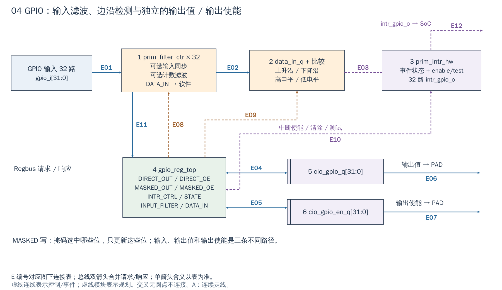

# 04 GPIO：输入、输出值和输出使能

[返回统一入口](README.md)

GPIO（通用数字输入输出）有三条不同路径：读入外部引脚、保存要输出的值、决定是否驱动 PAD（芯片的 I/O 单元）。读到的输入不必等于输出寄存器，尤其在输出禁用、外部拉电平或引脚复用时。

## 用途与当前配置

`Cfg.Gpio=1` 在默认配置和 FPGA 包装层均保留，地址窗口为 `[0x0300_5000, 0x0300_6000)`；`i_gpio` 由 Regbus 配置，逻辑在 `clk_i/rst_ni` 下工作，端口宽度为 32。下图解释输入采样、事件检测、输出值和 OE（Output Enable，输出驱动使能）之间的区别。

配置依据：[DefaultCfg](../../hw/cheshire_pkg.sv#L538) 与 [FPGA 配置函数](../../target/xilinx/src/cheshire_top_xilinx.sv#L115)。配置开关表示 RTL 是否生成，不等于功能已在板上验收。

[SVG](../diagrams/2026-10-13_rtl_module_comparison/A/04_gpio.svg) · [PDF](../diagrams/2026-10-13_rtl_module_comparison/A/04_gpio.pdf) · [A/C 对比](../diagrams/2026-10-13_rtl_modules_native_c/index.html#04_gpio)

<!-- CONNECTIONS:04_gpio -->

### 图中连线与信号组

编号仅在本图内有效。总线双箭头合并请求与响应；单箭头表示表内说明的主数据、控制或逻辑方向，握手返回不能据箭头省略。A/C 均以连续连线表达连接，编号只用于查表。源码依据见本章代码对应。

| 连线 | 端点与方向 | 信号、用途和需要保留的约定 |
|---|---|---|
| E01 | GPIO 输入 32 路 → 1  prim_filter_ctr × 32 | gpio_i[31:0]→cio_gpio_i：外部数字输入进入各 prim_filter_ctr。 |
| E02 | 1  prim_filter_ctr × 32 → 2  data_in_q + 比较 | data_in_d[31:0]：滤波后的本拍输入，与保存的 data_in_q 比较。 |
| E03 | 2  data_in_q + 比较 → 3  prim_intr_hw | event_intr_combined[31:0]：选中的上升/下降沿及高/低电平条件。 |
| E04 | 4  gpio_reg_top ↔ 5  cio_gpio_q[31:0] | reg2hw.direct_out 或 masked_out_* 的 q/qe：按掩码更新 cio_gpio_q；当前值反向供 hw2reg 回读。 |
| E05 | 4  gpio_reg_top ↔ 6  cio_gpio_en_q[31:0] | reg2hw.direct_oe 或 masked_oe_* 的 q/qe：按掩码更新 cio_gpio_en_q；当前值反向供 hw2reg 回读。 |
| E06 | 5  cio_gpio_q[31:0] → GPIO PAD 输出值 | cio_gpio_q→cio_gpio_o→gpio_o[31:0]：PAD 输出数据。 |
| E07 | 6  cio_gpio_en_q[31:0] → GPIO PAD 输出使能 | cio_gpio_en_q→cio_gpio_en_o→gpio_en_o[31:0]：PAD 输出使能。 |
| E08 | 4  gpio_reg_top → 1  prim_filter_ctr × 32 | reg2hw.ctrl_en_input_filter.q：逐位滤波使能；同步器有无由 GpioAsyncOn 参数决定。 |
| E09 | 4  gpio_reg_top → 2  data_in_q + 比较 | reg2hw.intr_ctrl_en_rising/falling/lvlhigh/lvllow：选定检测条件。 |
| E10 | 4  gpio_reg_top ↔ 3  prim_intr_hw | reg2hw.intr_enable/intr_test/intr_state 到 IRQ 逻辑；hw2reg.intr_state.d/de 反向更新事件寄存器。 |
| E11 | 1  prim_filter_ctr × 32 → 4  gpio_reg_top | data_in_d → hw2reg.data_in.d/de；CPU 回读采样输入。 |
| E12 | 3  prim_intr_hw → SoC GPIO IRQ | intr_gpio_o[31:0] → intr.intn.gpio，进入 SoC IRQ 汇聚。 |

<!-- /CONNECTIONS -->

## 按图理解电路

**1：同步与滤波。** 每个输入经过 `prim_filter_ctr`，由参数选择异步输入同步，由寄存器选择计数滤波，再成为 DATA_IN。SoC 的 `Cfg.GpioInputSyncs` 接到 `GpioAsyncOn`；这里是开关意义，不能把名字中的 Syncs 解释成用户指定任意同步级数。滤波也不自动等于已经满足某个机械按键的去抖时间。

**2→3：产生中断事件。** 当前采样值和 `data_in_q` 的上一拍值用于检测上升沿/下降沿；也可以选择高/低电平条件。事件再经 `prim_intr_hw` 的状态、使能与测试路径输出 32 路 `intr_gpio_o`。配置为电平触发时，若外部电平持续成立，清状态后可能再次产生事件。

**4→5、6：更新输出。** `gpio_reg_top` 解码 direct 或 masked 写。`cio_gpio_q` 是输出数据，`cio_gpio_en_q` 是驱动使能；复位时两者清零。使能为 0 时必须由外层 PAD 连接实现不驱动，RTL 的 out 值仍可保持一个数字 0/1。

masked upper/lower 写把数据位和掩码一起提交，只改变被选位。例如两个软件上下文控制不同 GPIO，使用 masked 写可避免整个 32-bit direct 寄存器的普通“读—改—写”覆盖另一方更新；它不等于对任意多条软件指令提供互斥。

## 如何用及如何扩展

| 目标 | 推荐核对点 |
|---|---|
| 输出一个稳定初值 | 先准备 OUT，再启用对应 OE，避免先驱动错误电平 |
| 读取输入 | 确认 PAD/复用连接、同步/滤波选项，再读取 DATA_IN |
| 按键/边沿中断 | 配置检测类型、清旧事件、开设备/控制器/CPU 层使能；检查脉宽与采样/滤波条件 |
| 多方控制引脚 | 使用合适的 masked 写或软件锁，不随意整字覆盖 OUT/OE |
| ASIC 外围 | 接入工艺 PAD 的输入、输出、OE 与电压域；数字控制器不提供模拟电气能力 |

一个自有 IP 的状态输入可以借鉴 GPIO 的同步/事件锁存，但不能把窄于采样周期的异步 done 脉冲直接送进去就期待必然捕获。跨域事件应采用明确的脉冲展宽、toggle 或握手机制。

当前实例由 `Cfg.Gpio` 控制，逻辑在 `clk_i/rst_ni` 下工作。只增加引脚用途时一般复用控制器，不需更改边沿比较器和寄存器生成逻辑；增加位数则涉及生成寄存器、IRQ 向量和软件头文件，不能只扩大顶层数组。

## 用一根 GPIO 控制外部复位的示例

下面是应用顺序建议，实际有效电平和 PAD 由外部器件决定：先保持该位 OE=0，用 `dif_gpio_write(handle, pin, initial_value)` 准备安全电平，再用 `dif_gpio_output_set_enabled(..., kDifToggleEnabled)` 打开驱动；满足器件要求的等待时间后，写释放电平。对输入状态则用 `dif_gpio_read()`，读到的是 `DATA_IN` 采样值，不是 OUT 的简单回读。

这些 DIF 位操作使用 masked 寄存器；若一次 mask 同时覆盖低、高 16 位，`gpio_masked_write()` 可能发出两次 MMIO 写，两半不是同时提交。它适合逐位设备控制，不能据此搭建需要多位同时改变的无毛刺异步握手总线。

图中输入滤波后的 `data_in_d` 同时送往边沿检测与 `hw2reg.data_in.d` 供 CPU 回读；IRQ 逻辑通过 `hw2reg.intr_state` 更新寄存器状态。画成返回连线时表示电路反馈，并不意味着软件主动给输入路径发送数据。

<!-- RTL_SOURCES -->

## 代码对应（本次源码快照）

| 图中职责 | 文件与行号 | 可搜索符号 |
|---|---|---|
| SoC GPIO 参数/接线 | [cheshire_soc.sv:1493](../../hw/cheshire_soc.sv#L1493) | `) i_gpio (` |
| 图①：输入滤波 | [gpio.sv:45](../../.bender/git/checkouts/opentitan_peripherals-7b624fb57f78de9a/src/gpio/rtl/gpio.sv#L45) | `prim_filter_ctr #(` |
| 图⑤⑥：输出/使能更新 | [gpio.sv:38](../../.bender/git/checkouts/opentitan_peripherals-7b624fb57f78de9a/src/gpio/rtl/gpio.sv#L38) | `cio_gpio_q` |
| 图②③：中断检测/锁存 | [gpio.sv:120](../../.bender/git/checkouts/opentitan_peripherals-7b624fb57f78de9a/src/gpio/rtl/gpio.sv#L120) | `prim_intr_hw #(` |
| 图④：寄存器连接 | [gpio.sv:145](../../.bender/git/checkouts/opentitan_peripherals-7b624fb57f78de9a/src/gpio/rtl/gpio.sv#L145) | `gpio_reg_top #(` |
| 当前默认配置 | [cheshire_pkg.sv:538](../../hw/cheshire_pkg.sv#L538) | `localparam cheshire_cfg_t DefaultCfg` |
| 当前 FPGA 参数覆盖 | [cheshire_top_xilinx.sv:115](../../target/xilinx/src/cheshire_top_xilinx.sv#L115) | `function automatic cheshire_cfg_t gen_cheshire_xilinx_cfg` |
| masked 写可分两次 | [dif_gpio.c:44](../../.bender/git/checkouts/opentitan_peripherals-7b624fb57f78de9a/sw/device/lib/dif/dif_gpio.c#L44) | `static dif_result_t gpio_masked_write` |
| DIF 单引脚更新 | [dif_gpio.c:219](../../.bender/git/checkouts/opentitan_peripherals-7b624fb57f78de9a/sw/device/lib/dif/dif_gpio.c#L219) | `dif_result_t dif_gpio_write(` |
