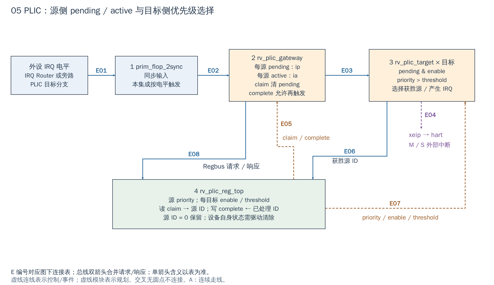

# 05 PLIC：源事件与 CPU 通知分两级管理

[返回统一入口](README.md)

PLIC（Platform-Level Interrupt Controller，平台级中断控制器）把多条设备事件汇合为每个 hart（硬件执行线程）的外部中断通知。CPU 进入处理程序后，软件通过 claim（认领）读取具体源 ID；PLIC 不接管设备的传输状态机，也不自动执行服务程序。

## 用途与当前配置

`i_plic` 在 SoC 中无条件实例化，通过 Regbus 配置。当前生成包是 `NumSrc=58`、`NumTarget=2`，与单核的 M/S（机器态/监督态）通知相配；这不是自动随 `Cfg.NumCores` 扩展的通用寄存器阵列。IRQ Router 未启用时，PLIC 直接收到 SoC 的源向量副本。下图回答“事件被认领后，为何还需要处理设备并 complete（完成）”。

配置依据：[DefaultCfg](../../hw/cheshire_pkg.sv#L538) 与 [FPGA 配置函数](../../target/xilinx/src/cheshire_top_xilinx.sv#L115)。配置开关表示 RTL 是否生成，不等于功能已在板上验收。

[SVG](../diagrams/2026-10-13_rtl_module_comparison/A/05_plic.svg) · [PDF](../diagrams/2026-10-13_rtl_module_comparison/A/05_plic.pdf) · [A/C 对比](../diagrams/2026-10-13_rtl_modules_native_c/index.html#05_plic)

<!-- CONNECTIONS:05_plic -->

### 图中连线与信号组

编号仅在本图内有效。总线双箭头合并请求与响应；单箭头表示表内说明的主数据、控制或逻辑方向，握手返回不能据箭头省略。A/C 均以连续连线表达连接，编号只用于查表。源码依据见本章代码对应。

| 连线 | 端点与方向 | 信号、用途和需要保留的约定 |
|---|---|---|
| E01 | 外设 IRQ 电平 → 1  prim_flop_2sync | intr_routed[IntrRtdPlic][NumSrc-1:0]→intr_src_i：输入源向量，当前58位含保留源0。 |
| E02 | 1  prim_flop_2sync → 2  rv_plic_gateway | intr_src_synced→gateway.src_i；LevelEdgeTrig 默认全0，当前按电平采样。 |
| E03 | 2  rv_plic_gateway → 3  rv_plic_target × 目标 | ip[NumSrc-1:0]→各 target.ip_i：源 pending 向量，active 留在 gateway 内。 |
| E04 | 3  rv_plic_target × 目标 → xeip → hart | irq_o[NumTarget-1:0]→xeip：当前两个目标向单核发送 M/S 外部中断通知。 |
| E05 | 4  rv_plic_reg_top → 2  rv_plic_gateway | claim/complete：由 reg2hw.cc*.re/qe 及源ID译为逐源控制位。 |
| E06 | 3  rv_plic_target × 目标 → 4  rv_plic_reg_top | irq_id_o→cc_id→hw2reg.cc*.d：获胜ID供 claim MMIO 读取；外部 irq_id_o 端口未接CPU。 |
| E07 | 4  rv_plic_reg_top → 3  rv_plic_target × 目标 | prio/ie[target]/threshold[target]：源优先级、目标屏蔽和阈值控制。 |
| E08 | 2  rv_plic_gateway → 4  rv_plic_reg_top | ip → hw2reg.ip.d/de；pending 状态供软件回读。 |

<!-- /CONNECTIONS -->

## 按图理解电路

**1：输入同步。** `rv_plic` 内部对输入再次使用 `prim_flop_2sync`。当前实例未覆盖 `LevelEdgeTrig` 默认值，因此 PLIC gateway 按电平源处理。外部输入进入 SoC 前还有独立同步；它们解决不同边界的采样，并不构成对任意窄脉冲的可靠捕获保证。

**2：gateway 保存 pending 与 active。** `ip` 表示有待认领的事件，`ia` 表示该源已有一次事件进入处理生命周期。源有效且允许接收时置 pending；claim 清 pending，但 active 继续阻止该源无限重复入队；complete 才允许重新接收后续事件。因此“pending 已清”不等于设备已清，也不等于 gateway 已重新开放。

**3：每目标单独选优先级。** `rv_plic_target` 对 `ip & ie[target]` 做最大优先级选择，再与该目标 threshold 比较，产生 IRQ。同一 pending 向量可供不同目标使用，而每目标 enable/threshold 独立。SoC 的 `xeip` 按 hart 包含 M/S 通知，外部 `irq_id_o` 未被接去直接驱动 CPU；软件靠 MMIO claim 读取 ID。

**4：寄存器是软件参与流程的入口。** priority 按源配置，enable/threshold/claim-complete 按目标配置。读 claim 的副作用是认领；写 complete 的内容是已完成的源 ID。普通寄存器 dump 若碰到 claim，可能改变正在调试的中断状态。

## 一次中断如何正确收尾

以 UART RX 为例：UART 使 IRQ 有效，PLIC 记录 pending，目标满足屏蔽与阈值条件后向 CPU 通知；CPU trap 入口读取该目标 claim 得到 UART 源 ID；驱动读取 RX/处理错误，使 UART 不再维持原中断条件；然后写相同 ID 到 complete，最后恢复现场返回。

**设备事件清除、PLIC complete、CPU xRET 是三个动作。** 只 complete 而设备仍为有效电平，gateway 重新开放后会再次请求；只处理设备而不 complete，则该源可能被 active 阻止下一次正常上报。ID=0 是保留值，软件不应把它当作普通设备号。

## 扩展时重点在哪里

- 增加自有 IP 时，先分配 SoC 源编号并接入中断向量，再检查 IRQ Router 目标掩码、PLIC 的生成寄存器/源数与软件 ID 一致。不能只加一根线，假定生成的 enable/priority 数组会自动增长。
- 建议设备提供可保持的事件状态和显式清除方式，避免把一拍异步 done 直接当作可靠外部中断。设备可以完成多次任务时还需定义丢事件、合并事件或计数/队列策略。
- 软件同时打开设备层、PLIC 目标层和 CPU 层的必要使能；只看见 pending 不代表 CPU 一定进入处理程序。

PLIC 当前接 `clk_i/rst_ni`。其 gateway 和最大值树通常直接复用；需要理解配置、claim/complete、源编号及持续电平，不必为增加 NPU 中断重写仲裁树。Regbus 窄读与副作用仍按 [00 章](00_regbus.md)检查，本次未运行中断压力/嵌套测试。

## 对照 DIF 配置与处理一个源

初始化时先建立设备的安全状态，再调用 `dif_rv_plic_irq_set_priority()`、`dif_rv_plic_irq_set_enabled()`、`dif_rv_plic_target_set_threshold()` 配置目标，最后按 CPU 启动代码安装 trap 入口并开放 CPU 使能。服务程序用 `dif_rv_plic_irq_claim()` 获取 ID，分派给设备驱动，处理设备条件后再调用 `dif_rv_plic_irq_complete()`。

这是本地 DIF 可表达的流程，不是新增 NPU 驱动；源 ID 和 target 值必须从当前 SoC 映射与生成头文件取得，不能照抄示例数字。源 priority=0 或不超过 threshold 都不会形成目标通知；源已 pending 而 CPU 不响应时，应分别检查设备、目标使能和 CPU 层。

`ip` 也回传给寄存器供 pending 查询；claim/complete 的控制线是对源 ID 译码后的向量。图中 `irq_id_o` 到寄存器的连接在 PLIC 内部有效，SoC 不接模块外部同名端口不影响 MMIO claim。

<!-- RTL_SOURCES -->

## 代码对应（本次源码快照）

| 图中职责 | 文件与行号 | 可搜索符号 |
|---|---|---|
| SoC PLIC 目标连接 | [cheshire_soc.sv:1213](../../hw/cheshire_soc.sv#L1213) | `) i_plic (` |
| 图①：同步与触发类型 | [rv_plic.sv:27](../../.bender/git/checkouts/opentitan_peripherals-7b624fb57f78de9a/src/rv_plic/rtl/rv_plic.sv#L27) | `LevelEdgeTrig =` |
| 图②：pending/active | [rv_plic_gateway.sv:7](../../.bender/git/checkouts/opentitan_peripherals-7b624fb57f78de9a/src/rv_plic/rtl/rv_plic_gateway.sv#L7) | `module rv_plic_gateway` |
| 图③：最大值树/阈值 | [rv_plic_target.sv:42](../../.bender/git/checkouts/opentitan_peripherals-7b624fb57f78de9a/src/rv_plic/rtl/rv_plic_target.sv#L42) | `prim_max_tree #(` |
| 图④：claim/complete | [rv_plic.sv:58](../../.bender/git/checkouts/opentitan_peripherals-7b624fb57f78de9a/src/rv_plic/rtl/rv_plic.sv#L58) | `claim_re` |
| 生成寄存器入口 | [rv_plic_reg_top.sv:10](../../.bender/git/checkouts/opentitan_peripherals-7b624fb57f78de9a/src/rv_plic/rtl/rv_plic_reg_top.sv#L10) | `module rv_plic_reg_top` |
| 当前默认配置 | [cheshire_pkg.sv:538](../../hw/cheshire_pkg.sv#L538) | `localparam cheshire_cfg_t DefaultCfg` |
| 当前 FPGA 参数覆盖 | [cheshire_top_xilinx.sv:115](../../target/xilinx/src/cheshire_top_xilinx.sv#L115) | `function automatic cheshire_cfg_t gen_cheshire_xilinx_cfg` |
| 当前生成源数/目标数 | [rv_plic_reg_pkg.sv:10](../../.bender/git/checkouts/opentitan_peripherals-7b624fb57f78de9a/src/rv_plic/rtl/rv_plic_reg_pkg.sv#L10) | `parameter int NumSrc` |
| DIF 认领与完成 | [dif_rv_plic.c:252](../../.bender/git/checkouts/opentitan_peripherals-7b624fb57f78de9a/sw/device/lib/dif/dif_rv_plic.c#L252) | `dif_result_t dif_rv_plic_irq_claim` |
