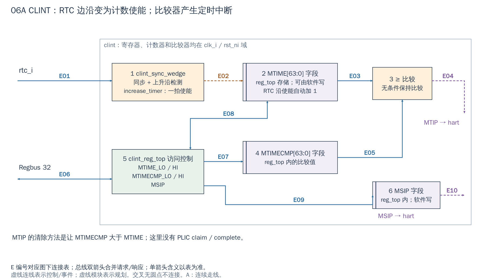
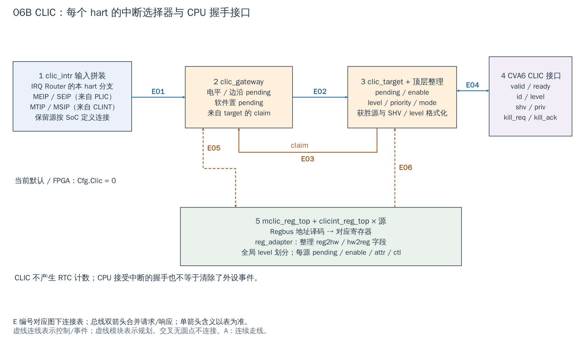

# 06 CLINT / CLIC：产生本地事件与选择本地中断

[返回统一入口](README.md)。CLINT 和 CLIC 名称相似，职责不同，分别用一张图说明。

## 用途与当前配置

CLINT（Core-Local Interruptor）产生计时器和软件中断；CLIC（Core-Local Interrupt Controller）选择当前 hart 应处理的本地中断，并与 CPU 握手。前者产生事件，后者选择事件，两者可以同时存在。

当前 `i_clint` 无条件实例化；依赖中的生成 RTL 固定为一个 hart 的 MTIP/MSIP。`Cfg.Clic=0` 是默认及当前 FPGA 包装层的设置，因此CLIC 图 描述**已存在但该配置未生成**的分支。CLINT 与 CLIC 寄存器均用 SoC `clk_i/rst_ni`；RTC（实时时基输入）另用于计时。CLINT 图 先回答“时间怎样增长、何时持续请求中断”，CLIC 图 再解释“多路本地事件怎样通知 CPU”。

配置依据：[DefaultCfg](../../hw/cheshire_pkg.sv#L538) 与 [FPGA 配置函数](../../target/xilinx/src/cheshire_top_xilinx.sv#L115)。配置开关表示 RTL 是否生成，不等于功能已在板上验收。

[SVG](../diagrams/2026-10-13_rtl_module_comparison/A/06a_clint.svg) · [PDF](../diagrams/2026-10-13_rtl_module_comparison/A/06a_clint.pdf) · [A 图总览](../diagrams/2026-10-13_rtl_module_comparison/index.html#06a_clint)

<!-- CONNECTIONS:06a_clint -->

### 图中连线与信号组

编号仅在本图内有效。总线双箭头合并请求与响应；单箭头表示表内说明的主数据、控制或逻辑方向，握手返回不能据箭头省略。主图以连续连线表达连接，编号只用于查表。源码依据见本章代码对应。

| 连线 | 端点与方向 | 信号、用途和需要保留的约定 |
|---|---|---|
| E01 | rtc_i → 1  clint_sync_wedge | rtc_i→clint_sync_wedge.serial_i：外部计时时基波形，需满足 SoC 采样条件。 |
| E02 | 1  clint_sync_wedge → 2  MTIME[63:0] 字段 | increase_timer→hw2reg.mtime_low/high.de：RTC 上升沿的一拍自动加1使能。 |
| E03 | 2  MTIME[63:0] 字段 → 3  ≥ 比较 | mtime_q[63:0]={reg2hw.mtime_high.q,mtime_low.q}：组合读出当前时间到比较器。 |
| E04 | 3  ≥ 比较 → MTIP / timer_irq_o | 比较结果 timer_irq_o[0]→mtip：mtime>=mtimecmp 时持续有效。 |
| E05 | 4  MTIMECMP[63:0] 字段 → 3  ≥ 比较 | mtimecmp_q[0]：reg_top 中高/低比较字段组成的64-bit值。 |
| E06 | Regbus 32 ↔ 5  clint_reg_top 访问控制 | Regbus 请求 addr/write/wdata/wstrb/valid；rdata/error/ready 返回。 |
| E07 | 5  clint_reg_top 访问控制 → 4  MTIMECMP[63:0] 字段 | 字段展开：MTIMECMP_LOW0/HIGH0 存储在 clint_reg_top 内，经 reg2hw 组成 mtimecmp_q。 |
| E08 | 5  clint_reg_top 访问控制 ↔ 2  MTIME[63:0] 字段 | 字段展开：MTIME 存储在 reg_top，reg2hw 提供当前值，hw2reg.d/de 提交自动计时更新；软件也可读写。 |
| E09 | 5  clint_reg_top 访问控制 → 6  MSIP 字段 | 字段展开：reg2hw.msip[0].p.q，存储在 clint_reg_top 内，由软件置位或清零。 |
| E10 | 6  MSIP 字段 → MSIP / ipi_o | reg2hw.msip[0].p.q→ipi_o[0]→msip：本 hart 软件中断电平。 |

<!-- /CONNECTIONS -->

## CLINT：计时与软件中断

**1→2：RTC 提供计数节拍。** `clint_sync_wedge` 先同步 `rtc_i`，检测其上升沿并给 `increase_timer` 一拍使能。MTIME 的寄存器和加法器仍运行在 `clk_i`。因此 RTC 低频输入不意味着 CLINT 的 Regbus 低频运行，也不能把不受约束的高速 RTC 接入后期望每个沿都被捕获。

CLINT 图②中的 RTC 使能限定的是**自动加 1**，软件仍可经图中⑤改写 MTIME 寄存器；它并不是只读计数输出。②MTIME、④MTIMECMP、⑥MSIP 是 `clint_reg_top` 内寄存器字段的功能展开，并非另外三个独立实例：`mtime_q/mtimecmp_q` 是 `reg2hw` 字段的组合别名，外部加法器经 `hw2reg.mtime_*.d/de` 更新计时字段。

**2、4→3：比较到期条件。** 每个 hart 的 MTIMECMP 与公共 MTIME 做 `mtime >= mtimecmp` 比较，条件为真就维持 MTIP。没有“到点打一拍然后自动清零”的默认机制。驱动通过更新下一次比较值，使其大于当前时间，解除本次定时条件。

**5→6：软件中断。** MSIP 是软件可写的每 hart 位：写 1 产生相应软件中断条件，写 0 清除。此处没有 PLIC priority/claim/complete，MSIP 也不是外设 W1C 状态位。

### 64-bit 计时量经过 32-bit 寄存器接口

MTIME 和 MTIMECMP 在电路中是 64-bit，软件接口分成 LOW/HIGH。读两次并非自动快照：在低 32 位进位时，简单的“先高后低”可能得到不一致组合。需要稳定时间读法时，可采用高—低—高并比较两次高位，变化则重读；这是软件使用建议，当前 `clint_get_mtime()` 只做一次高/低读取，不能据此宣称已有快照保证。

写比较值也可能在两次写之间产生暂态到期。应结合 CPU 中断屏蔽、写入顺序和比较寄存器行为设计更新过程；参考现有 HAL 之前先检查其边界条件。本次未修改/测试该 HAL。例如当前 `clint_sleep_until()` 的早退条件写成 `current < target`，与函数名暗示的“等待未来目标”不符，属于静态阅读发现，不能直接把它当作可靠睡眠示例。

[SVG](../diagrams/2026-10-13_rtl_module_comparison/A/06b_clic.svg) · [PDF](../diagrams/2026-10-13_rtl_module_comparison/A/06b_clic.pdf) · [A 图总览](../diagrams/2026-10-13_rtl_module_comparison/index.html#06b_clic)

<!-- CONNECTIONS:06b_clic -->

### 图中连线与信号组

编号仅在本图内有效。总线双箭头合并请求与响应；单箭头表示表内说明的主数据、控制或逻辑方向，握手返回不能据箭头省略。主图以连续连线表达连接，编号只用于查表。源码依据见本章代码对应。

| 连线 | 端点与方向 | 信号、用途和需要保留的约定 |
|---|---|---|
| E01 | 1  clic_intr 输入拼装 → 2  clic_gateway | clic_intr→intr_src_i：SoC 拼装设备向量和 MEIP/SEIP/MTIP/MSIP 等 core 源。 |
| E02 | 2  clic_gateway → 3  clic_target + 顶层整理 | ip→clic_target.ip_i：gateway 维护的 pending 状态。 |
| E03 | 3  clic_target + 顶层整理 → 2  clic_gateway | claim→gateway.claim_i：target 接受流程产生的逐源认领控制。 |
| E04 | 3  clic_target + 顶层整理 ↔ 4  CVA6 CLIC 接口 | 整个 CLIC 的 irq_valid/id/level/shv/priv/kill_req→CPU；irq_ready/kill_ack 返回。顶层另完成 shv 选择与 level/priv 格式化。 |
| E05 | 5  mclic_reg_top + clicint_reg_top × 源 ↔ 2  clic_gateway | clic_reg_adapter 输出 ip_sw/le 到 gateway；gateway 的 ip 返回 adapter→clicint_hw2reg。 |
| E06 | 5  mclic_reg_top + clicint_reg_top × 源 → 3  clic_target + 顶层整理 | clic_reg_adapter 输出 ie/intctl/intmode/le 到 target；全局 mnlbits/shv 字段另供顶层输出格式化。 |

<!-- /CONNECTIONS -->

## CLIC：每 hart 的源选择与 CPU 握手

**1：输入拼装。** SoC 将 Router 给该 hart 的源分支与 MEIP/SEIP、MTIP/MSIP 等 core 源合并为 `clic_intr`。所以 CLIC 可以接收 CLINT 产生的事件；它并不取代 MTIME 计数器。PLIC 汇总事件与设备直接源同时可达时，要有明确路由/使能策略，避免同一事件经两条路径被重复服务。

**2→3：pending 与选择。** `clic_gateway` 处理电平/边沿和软件 pending，`clic_target` 根据 pending、enable、控制值及特权模式选出当前中断。target 的 claim 用于源侧更新，不等于所有设备都自动清事件。

**3↔4：通知接口更丰富。** 输出包含 valid/ready、id、level、shv、priv 与 kill_req/kill_ack，CPU 参与接受/撤销处理。`shv`（Selective Hardware Vectoring，选择性硬件向量处理）与入口选择有关，`priv` 指示目标特权；不能把这些线简化成一根 PLIC 式外部 IRQ，再丢掉握手。`clic_target` 负责获胜源/握手，顶层还从 `shv[irq_id_o]` 选择向量位，并根据全局字段格式化 level/priv；图中这组连接表达整个 CLIC 的输出，不代表这些信号全出自 target 实例。

**5：全局和逐源寄存器。** 地址译码将 Regbus 请求直接分给 `mclic_reg_top`（全局配置）或 `clicint_reg_top`（每源 pending/enable/attr/ctl）。之后的 `clic_reg_adapter` 把寄存器字段整理为 `ip_sw/le/ie/intctl/intmode/shv` 等内部控制，并把 pending 返回寄存器；它不是位于总线和寄存器之间的协议桥。配置 level/priority 划分、向量表、CPU trap 模式需要与当前 CVA6 配置共同确认；仅设 `Cfg.Clic=1` 不是完整的软件启用流程。

## 用户需要掌握的边界

| 需求 | 首先看哪个模块 |
|---|---|
| 定时唤醒、测量时间 | CLINT MTIME/MTIMECMP、RTC 频率、CPU 定时中断使能 |
| 向 hart 发软件通知 | CLINT MSIP 与接收端清零流程 |
| 多源本地中断、level/priority/向量 | CLIC 生成配置、每源寄存器和 CVA6 模式 |
| 新 NPU/ISP 事件 | 设备事件保持/清除、Router、PLIC 或 CLIC 所选路径 |

当前 CLINT 是依赖中生成的具体寄存器实现；不要把 SoC 的 hart 数参数化能力等同于 CLINT 生成文件自动支持任意 hart 数。CLIC 每个内部 hart 按 `Cfg.Clic` 条件生成，SSCLIC=1、USCLIC=0；当前实现明确不支持 USCLIC。已有 `sw/tests/clic_*.spm.S` 可用于理解程序设置，不表示本次已经运行测试。

## 运行例与实际时基

定时器使用建议：安装并测试 trap 入口，读取一致的 MTIME，按实际 RTC 频率计算未来比较值，在受控屏蔽/排序条件下更新 MTIMECMP，然后打开定时中断。处理函数再次设置未来比较值，使 MTIP 解除，再返回；这里没有 PLIC complete。当前默认 `RtcFreq=32768`，FPGA 配置改为 `1000000`，二者是配置声明，必须对应顶层实际产生的 RTC；不能把常数自动当成测量结果。

CLIC 可沿 `sw/tests/clic_basic.spm.S` 学习已有测试意图：设置 `mtvec` 的 CLIC 模式和 `mtvt` 向量表，为源 31 配置 SHV/边沿/pending，设置 level/priority，再先升高、后降低 CPU 阈值观察是否触发。这是软件构造的测试源编号，不能把 31 自动分配给新 NPU。当前 FPGA 配置不生成 CLIC，本轮也未运行该测试。

<!-- RTL_SOURCES -->

## 代码对应（本次源码快照）

| 图中职责 | 文件与行号 | 可搜索符号 |
|---|---|---|
| SoC CLINT 连接 | [cheshire_soc.sv:1231](../../hw/cheshire_soc.sv#L1231) | `) i_clint (` |
| CLINT 图：计数、比较、MSIP | [clint.sv:15](../../.bender/git/checkouts/clint-de4a234303f657d0/src/clint.sv#L15) | `module clint` |
| RTC 同步与边沿 | [clint.sv:82](../../.bender/git/checkouts/clint-de4a234303f657d0/src/clint.sv#L82) | `clint_sync_wedge` |
| CLIC 图①：输入与生成条件 | [cheshire_soc.sv:716](../../hw/cheshire_soc.sv#L716) | `assign clic_intr` |
| CLIC 图②③④：选择/握手 | [clic.sv:20](../../.bender/git/checkouts/clic-360fff7ce2d41116/src/clic.sv#L20) | `module clic` |
| CLIC 图⑤：逐源寄存器 | [clic.sv:170](../../.bender/git/checkouts/clic-360fff7ce2d41116/src/clic.sv#L170) | `clicint_reg_top #(` |
| 当前时间读取 HAL | [clint.c:14](../../sw/lib/dif/clint.c#L14) | `uint64_t clint_get_mtime` |
| 待核查睡眠条件 | [clint.c:55](../../sw/lib/dif/clint.c#L55) | `void clint_sleep_until` |
| 已有 CLIC 程序（未本次运行） | [clic_basic.spm.S:30](../../sw/tests/clic_basic.spm.S#L30) | `main:` |
| 当前默认配置 | [cheshire_pkg.sv:538](../../hw/cheshire_pkg.sv#L538) | `localparam cheshire_cfg_t DefaultCfg` |
| 当前 FPGA 参数覆盖 | [cheshire_top_xilinx.sv:115](../../target/xilinx/src/cheshire_top_xilinx.sv#L115) | `function automatic cheshire_cfg_t gen_cheshire_xilinx_cfg` |
| 寄存器字段适配而非总线桥 | [clic.sv:245](../../.bender/git/checkouts/clic-360fff7ce2d41116/src/clic.sv#L245) | `clic_reg_adapter #(` |
| SHV 顶层选择 | [clic.sv:279](../../.bender/git/checkouts/clic-360fff7ce2d41116/src/clic.sv#L279) | `assign irq_shv_o` |
