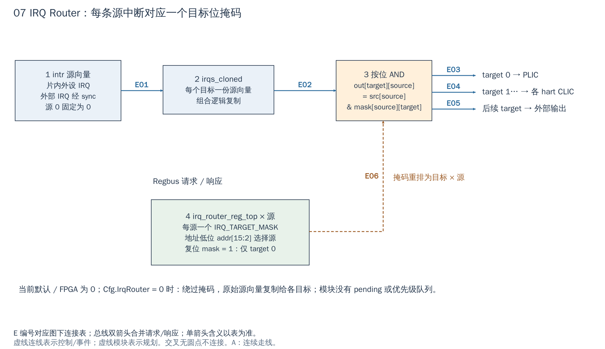

# 07 IRQ Router：选择事件可以去哪些目标

[返回统一入口](README.md)

IRQ Router（中断路由器）按可编程掩码把同一个中断源分发给选定目标。它不保存待处理事件，不比较优先级，也没有 claim/complete；这些是设备、PLIC/CLIC 和 CPU 的后续职责。

## 用途与当前配置

默认及当前 FPGA 包装层均为 `Cfg.IrqRouter=0`：RTL 存在，当前配置采用旁路复制，没有 Router 配置寄存器实例。只有置 1 才生成图中掩码电路及 `[0x0208_0000, 0x020c_0000)` 窗口。下图回答“一个设备事件可以送给哪些控制器，复制与中断排队有什么区别”。

配置依据：[DefaultCfg](../../hw/cheshire_pkg.sv#L538) 与 [FPGA 配置函数](../../target/xilinx/src/cheshire_top_xilinx.sv#L115)。配置开关表示 RTL 是否生成，不等于功能已在板上验收。

[SVG](../diagrams/2026-10-13_rtl_module_comparison/A/07_irq_router.svg) · [PDF](../diagrams/2026-10-13_rtl_module_comparison/A/07_irq_router.pdf) · [A 图总览](../diagrams/2026-10-13_rtl_module_comparison/index.html#07_irq_router)

<!-- CONNECTIONS:07_irq_router -->

### 图中连线与信号组

编号仅在本图内有效。总线双箭头合并请求与响应；单箭头表示表内说明的主数据、控制或逻辑方向，握手返回不能据箭头省略。主图以连续连线表达连接，编号只用于查表。源码依据见本章代码对应。

| 连线 | 端点与方向 | 信号、用途和需要保留的约定 |
|---|---|---|
| E01 | 1  intr 源向量 → 2  irqs_cloned | intr→irqs_i：已按 SoC 同步约定形成的源向量。 |
| E02 | 2  irqs_cloned → 3  按位 AND | irqs_cloned：每目标复制一组输入源，不存储事件。 |
| E03 | 3  按位 AND → target 0 → PLIC | irqs_distributed_o 对应 intr_routed[0]，截取 PLIC NumSrc 后接 intr_src_i。 |
| E04 | 3  按位 AND → target 1… → hart CLIC | intr_routed[IntrRtdCoreBase+hart]：各内部 hart 的源分支，仅启用 CLIC 时消费。 |
| E05 | 3  按位 AND → 后续 target → 外部 IRQ | intr_routed[IntrRtdExtBase+target]：按配置截取后送 intr_ext_o 外部目标。 |
| E06 | 4  irq_router_reg_top × 源 → 3  按位 AND | irq_router_reg2hw[source].irq_target_mask.q[target] 重排成 irqs_target_mask，与 cloned 逐位 AND。 |

<!-- /CONNECTIONS -->

## 按图理解电路

**1：形成源向量。** SoC 用 packed struct 组合片内设备和外部输入，源 0 固定为 0。外部中断经 `Cfg.NumExtIntrSyncs` 控制的同步器进入 `clk_i` 域；片内设备信号按当前同域假设直接连接。改变设备时钟域后，这个假设必须重新审查。

**2：复制。** `irqs_cloned` 为每个目标准备同一份原始源向量。这是数字连线/组合逻辑意义的复制，不是 FIFO，不会缓存路由配置关闭期间发生的脉冲。

**4→3：掩码决定目标。** 每个源有一个 32-bit `IRQ_TARGET_MASK`，每位对应一个目标；RTL 把“每源的目标 mask”重排为“每目标的源 mask”，再与复制向量做 AND：`out[t][s] = src[s] & mask[s][t]`。

目标编号由 SoC 定义：target 0 给 PLIC，之后是内部 hart 的本地/CLIC 分支，再后面是外部输出目标。**target 编号不是设备源 ID，也不是任意情况下直接等于 hart ID。** 当前每源 mask 的复位值为 1，仅 bit0 打开，即默认流向 PLIC。

## 配置一个新事件的例子

若新 NPU 事件采用 PLIC 服务，保持其 target0 位并配好 PLIC 的源 priority/enable/threshold。若希望直接进入某 hart 的 CLIC，就打开对应 Router target 位，并配置那一 CLIC 源；是否仍保留 PLIC 分支由软件方案决定。多位打开意味着同一个源同时出现在多个目标，不是轮流仲裁给一个目标。

`reg_req_i.addr[15:2]` 选择源寄存器，步长 4 byte。访问必须落在实例支持的源数以内；不能依赖数组越界时产生可移植的错误响应。其目标数也受 32-bit mask 限制。增加源/目标时要同时检查 SoC typedef 顺序、参数、外部端口、PLIC/CLIC 生成文件与软件常量。

## 最容易误会的配置

`Cfg.IrqRouter=0` 时，SoC 绕过该模块，直接把原始源向量复制给各个目标；这与“Router 已生成，所有 mask=0”完全不同。前者仍有中断输入，后者会屏蔽掉 Router 经过的路径。

Router 的寄存器与组合分发均使用 SoC `clk_i/rst_ni`，本身不解决跨域脉冲丢失。对自有 IP，最重要的是源事件保持、目标选择和清除责任；复制/按位 AND 可以直接复用，无需为新增一个设备设计新的中断仲裁器。

## 从 NPU 完成事件到目标的建议顺序

新增设备先用保持到清除的 DONE 状态驱动 IRQ，明确源编号后，检查目标控制器实际支持的输入范围。若硬件选择启用 Router，再为该源写 `IRQ_TARGET_MASK`，配置对应 PLIC/CLIC 目标与 CPU 使能，最后启动任务。服务程序在读完结果后清设备 DONE，并按所选控制器完成收尾。

切换路由时，应在设备/软件约定的安静点停止新事件，处理完原目标正在服务的事件，再更新 mask。Router 不转移旧目标的 pending/active，也不保证改路由期间的瞬时脉冲被保存。当前未启用 Router 的 FPGA 配置只能使用旁路行为；要使用可编程分发，需后续独立修改配置、编译及验证。

另外，路由输出宽度并不等于每个目标都能接受全部源：SoC 在连接 PLIC/CLIC/外部端口前按目标宽度截取。新增外部 IRQ 时，必须检查它是否落在目标的保留范围内；只增 `NumExtInIntrs` 不保证 CPU 能看到它。

<!-- RTL_SOURCES -->

## 代码对应（本次源码快照）

| 图中职责 | 文件与行号 | 可搜索符号 |
|---|---|---|
| 图①：外部源同步 | [cheshire_soc.sv:165](../../hw/cheshire_soc.sv#L165) | `) i_ext_intr_sync (` |
| SoC Router/旁路生成 | [cheshire_soc.sv:1188](../../hw/cheshire_soc.sv#L1188) | `) i_irq_router (` |
| 图②③④：源复制与掩码 | [irq_router.sv:15](../../.bender/git/checkouts/irq_router-376b3d113c15d0ef/rtl/irq_router.sv#L15) | `module irq_router` |
| 目标掩码复位规格 | [irq_router_regs.hjson:25](../../.bender/git/checkouts/irq_router-376b3d113c15d0ef/gen/irq_router_regs.hjson#L25) | `resval: 1` |
| SoC 目标编号定义 | [cheshire_soc.sv:130](../../hw/cheshire_soc.sv#L130) | `IntrRtdCoreBase` |
| 当前默认配置 | [cheshire_pkg.sv:538](../../hw/cheshire_pkg.sv#L538) | `localparam cheshire_cfg_t DefaultCfg` |
| 当前 FPGA 参数覆盖 | [cheshire_top_xilinx.sv:115](../../target/xilinx/src/cheshire_top_xilinx.sv#L115) | `function automatic cheshire_cfg_t gen_cheshire_xilinx_cfg` |
| PLIC 目标截取 | [cheshire_soc.sv:1218](../../hw/cheshire_soc.sv#L1218) | `.intr_src_i ( intr_routed[IntrRtdPlic]` |
