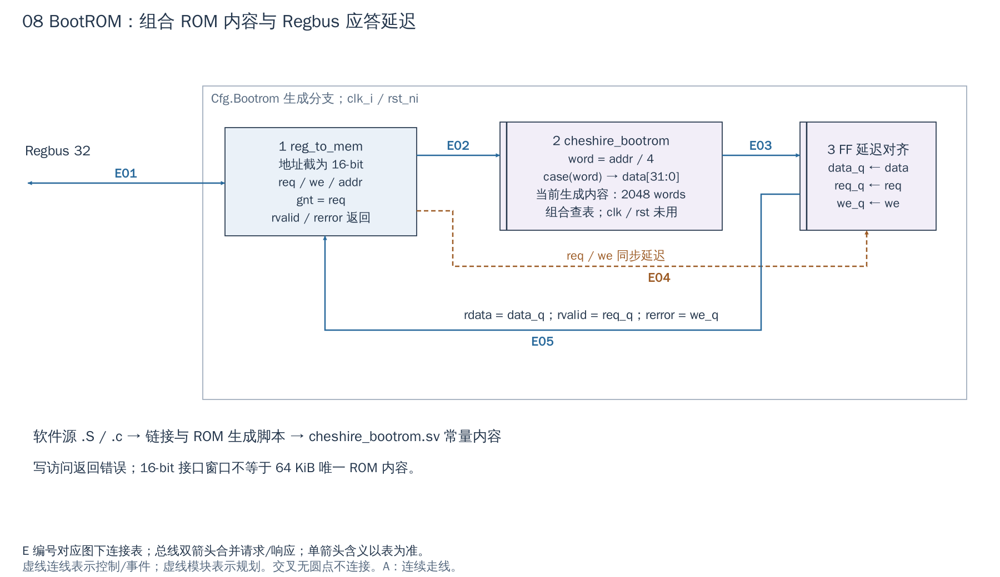

# 08 BootROM：代码常量如何回应总线读取

[返回统一入口](README.md)

BootROM（启动只读存储器）让 CPU 在外部 DDR 尚未可用时也能取到第一段指令。本图回答：CPU 的一次总线读怎样得到 ROM 指令，以及为什么 ROM 内容是组合查表、总线应答仍有一拍延迟。图中是实际模块/信号路径，启动介质选择属于软件行为。

**当前配置：**`DefaultCfg.Bootrom=1`，Xilinx wrapper 沿用该项；ASIC 新 ROM 宏与新增 PLL/DDR 初始化仍属于待适配内容。读取入口见 `RegOut.bootrom`，不是 ROM 自己主动向 AXI 发送请求。

[SVG](../diagrams/2026-10-13_rtl_module_comparison/A/08_bootrom.svg) · [PDF](../diagrams/2026-10-13_rtl_module_comparison/A/08_bootrom.pdf) · [A/C 对比](../diagrams/2026-10-13_rtl_modules_native_c/index.html#08_bootrom)

<!-- CONNECTIONS:08_bootrom -->

### 图中连线与信号组

编号仅在本图内有效。总线双箭头合并请求与响应；单箭头表示表内说明的主数据、控制或逻辑方向，握手返回不能据箭头省略。A/C 均以连续连线表达连接，编号只用于查表。源码依据见本章代码对应。

| 连线 | 端点与方向 | 信号、用途和需要保留的约定 |
|---|---|---|
| E01 | Regbus 32 ↔ 1  reg_to_mem | Regbus 请求/响应：reg_out_req/rsp[RegOut.bootrom]；valid、addr、write、wdata/wstrb，返回 ready、rdata、error；地址发起方向 P01→N01 |
| E02 | 1  reg_to_mem → 2  cheshire_bootrom | ROM 地址/请求：bootrom_addr[15:0]、bootrom_req → addr_i、req_i；当前 ROM 只用地址组合查表，不用 req 门控 |
| E03 | 2  cheshire_bootrom → 3  FF 延迟对齐 | ROM 数据：bootrom_data[31:0] → 外层数据 FF；这是读数据，不是下一次存储请求 |
| E04 | 1  reg_to_mem → 3  FF 延迟对齐 | 返回控制对齐：bootrom_req、bootrom_we → req_q、we_q FF；与 data 同拍延迟 |
| E05 | 3  FF 延迟对齐 → 1  reg_to_mem | 存储响应：bootrom_data_q / bootrom_req_q / bootrom_we_q → reg_to_mem.rdata_i / rvalid_i / rerror_i；写不改 ROM 且返回 error |

<!-- /CONNECTIONS -->

BootROM 保存复位后执行的启动代码，但 RTL 中的 ROM 本身只根据地址返回字；启动选择、读取 Flash/EEPROM 和跳转是 ROM 中的软件执行出来的行为，不能画成 ROM 内含一个自动拷贝所有代码的硬件 DMA。

## 按图理解电路

**1：Regbus 到存储请求。** SoC 的 `i_reg_to_bootrom` 使用 `reg_to_mem`，数据宽度 32、地址宽度 16，产生 req/we/addr。`gnt=req` 表示请求被接收，返回数据仍通过 rvalid 通知；这两个时刻的语义不同。

**2：ROM 内容查表。** `cheshire_bootrom.sv` 是生成文件，当前 `NumWords=2048`、整合时每字 32-bit，即实际内容 8 KiB。`word = addr / 4` 后进入组合 `case`；模块虽带 clk/rst/req 端口，当前查表逻辑不靠时钟顺序输出。

地址窗口、16-bit 内部地址和 8 KiB 内容不能混为一谈。word 信号宽度由 2048 项决定，超出内容所需地址位可能被截去形成别名；SoC 分配的大窗口并不证明里面每个字节都对应独立 ROM，也不证明越界读取自动报错。

**3→1：延迟对齐返回。** SoC 在外层用 FF 同时保存 ROM data、req 和 we，下一阶段以 data_q、req_q、we_q 作为 rdata、rvalid 和 rerror。读请求返回字；写请求不修改 ROM，并通过延迟后的 we 返回错误。这里不能把组合 ROM 随意替换成两拍宏，而不调整返回有效信号。

## 从复位到外存可用，谁负责什么

[启动汇编](../../hw/bootrom/cheshire_bootrom.S#L60)先检查 LLC 能力，等待 tag 存储 BIST（内建自测），提交全 SPM 配置并把栈放到片内存储末端，再检查 Platform ROM 入口。这里的“等待 BIST”不能推广为已对全部 data SRAM 或外购 DDR 完成制造测试。

[启动 C 入口](../../hw/bootrom/cheshire_bootrom.c#L70)读取 `BOOT_MODE` 和 `RTC_FREQ`，测量核心频率，然后选择被动装载、SPI SD、SPI Flash 或 I²C EEPROM 路径。寄存器中有某个启动模式不表示 VCU118 已接出相应介质；平台引脚仍要逐项核对。

计划加入的 PLL/DDR 初始化可以沿官方 Platform ROM 钩子组织，但**当前 `PlatformRom=0` 路径与启用钩子的路径必须区分**。启用非零入口前需先关闭已登记的 S01-B01：当前 `jalr t0` 返回会落到 `boot_next_stage`，而非预期的内置介质启动入口。见[已核对的缺陷与官方修复依据](../handoffs/L01_platform_rom_boot_review.md)。新增初始化代码在 DDR ready 前只能使用已可用的 ROM/片内存储；不能先把栈放进待训练的 DDR。

## 改启动代码与换 ROM 宏分别改哪里

软件内容入口是 `hw/bootrom/cheshire_bootrom.S`、`.c` 和链接脚本，经过对应构建与生成过程变成 SV 常量。不要手改 case 中某个十六进制数并以此维护长期启动代码；应保留可重建的源、工具版本、镜像和哈希关系。

ASIC 替换为 ROM 宏时，需要确认容量、字节/字地址换算、读延迟、复位/测试要求和异常返回；接口边界是图①至③的 req/gnt/rvalid 契约。ROM 镜像必须与软件链接地址、CPU boot 地址和平台钩子一致。这里不重新设计启动流程，也不改现有可运行 FPGA 内容。

## 使用时应知道的限制

`Cfg.Bootrom` 是静态生成条件；Boot Mode 引脚通过 SoC Regs 给启动代码读取，不会直接改 ROM 电路内容。当前软件还涉及 SPM 准备、启动介质驱动、被动装载和 platform ROM 钩子。平台钩子返回的已知缺陷及 ROM C 入口栈对齐的待核查项不能由这张结构图关闭，详见[启动排障资料](../learning/boot-debug.html)。

一般扩展 IP 不需修改 BootROM；只有要求在第二级程序运行前初始化新硬件，才评估启动代码和容量。新增 NPU 不意味着必须把 NPU 驱动全部塞入 ROM。本次仅核对静态接口，不重新生成、仿真或板测 ROM 镜像。

<!-- RTL_SOURCES -->

## 代码对应（本次源码快照）

| 图中职责 | 文件与行号 | 可搜索符号 |
|---|---|---|
| 图①③：存储适配与 FF | [cheshire_soc.sv:1312](../../hw/cheshire_soc.sv#L1312) | `) i_reg_to_bootrom (` |
| 图②：组合 ROM | [cheshire_bootrom.sv:24](../../hw/bootrom/cheshire_bootrom.sv#L24) | `localparam unsigned NumWords` |
| 启动汇编入口 | [cheshire_bootrom.S:17](../../hw/bootrom/cheshire_bootrom.S#L17) | `_start:` |
| 启动 C 软件 | [cheshire_bootrom.c:70](../../hw/bootrom/cheshire_bootrom.c#L70) | `int main` |
| ROM 链接布局 | [cheshire_bootrom.ld:11](../../hw/bootrom/cheshire_bootrom.ld#L11) | `SECTIONS` |
