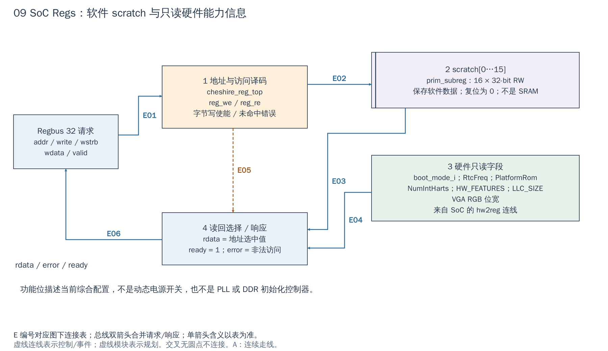

# 09 SoC Regs：软件可写寄存器与硬件只读信息

[返回统一入口](README.md)

SoC Regs 是 CPU 读取平台能力和交换少量启动状态的寄存器组。本图回答：同样是软件读到的 32-bit 值，哪些由触发器保存，哪些只是硬件输入/配置常量的读回。

**当前配置：**`i_regs` 在 `cheshire_soc.sv` 中无可选生成开关，接主 Regbus 的 `RegOut.regs`，在 `clk_i/rst_ni` 域工作。它不发起存储器访问，也不产生设备中断。

[SVG](../diagrams/2026-10-13_rtl_module_comparison/A/09_soc_regs.svg) · [PDF](../diagrams/2026-10-13_rtl_module_comparison/A/09_soc_regs.pdf) · [A/C 对比](../diagrams/2026-10-13_rtl_modules_native_c/index.html#09_soc_regs)

<!-- CONNECTIONS:09_soc_regs -->

### 图中连线与信号组

编号仅在本图内有效。总线双箭头合并请求与响应；单箭头表示表内说明的主数据、控制或逻辑方向，握手返回不能据箭头省略。A/C 均以连续连线表达连接，编号只用于查表。源码依据见本章代码对应。

| 连线 | 端点与方向 | 信号、用途和需要保留的约定 |
|---|---|---|
| E01 | Regbus 32 请求 → 1  地址与访问译码 | Regbus 请求：reg_intf_req.addr/valid/write/wdata/wstrb；形成 reg_addr、reg_we/reg_re 和 reg_be |
| E02 | 1  地址与访问译码 → 2  scratch[0…15] | 写 scratch：scratch_*_we / scratch_*_wd，由命中地址、reg_we、reg_be 选择字节；不是整组每次同时写 |
| E03 | 2  scratch[0…15] → 4  读回选择 / 响应 | 已保存软件值：scratch_*_qs[31:0] → reg_rdata_next 读回选择器 |
| E04 | 3  硬件只读字段 → 4  读回选择 / 响应 | 硬件值：hw2reg.boot_mode、rtc_freq、platform_rom、num_int_harts、hw_features、llc_size、vga_params → reg_rdata_next |
| E05 | 1  地址与访问译码 → 4  读回选择 / 响应 | 地址命中与非法访问控制：addr_hit/reg_addr、addrmiss、wr_err → 读选择及 reg_error；ready 恒为1 |
| E06 | 4  读回选择 / 响应 → Regbus 32 请求 | Regbus 响应：reg_intf_rsp.rdata / error / ready 返回请求者；error=(devmode_i & addrmiss) \| wr_err |

<!-- /CONNECTIONS -->

`cheshire_reg_top` 是理解自有 IP 寄存器封装的合适实例：没有复杂数据搬运，能直接看到地址译码、存储位、硬件输入和读回选择。

## 按图理解电路

**1：一次寄存器访问。** 输入 Regbus 的 `valid/write` 形成 reg_we/reg_re，地址按模块需要取低位，字节使能参与写入。该模块的 ready 固定为 1，因此有效访问可在本周期完成；这并不是所有 Regbus 外设都必须零等待的协议要求。`devmode_i=1` 时地址未命中与写使能错误进入 error。

**2：scratch 是实际保存状态的位。** HJSON 定义 16 个 32-bit RW scratch，经 reggen 生成 `prim_subreg` 存储和译码，复位值为 0。软件写入后可回读，除复位外由软件管理；硬件不把它们当 FIFO，也不自动将它们解释成 DMA 参数。

**3：只读字段来自硬件连线。** SoC 构造 `reg_hw2reg`，接入 boot_mode_i、RtcFreq、PlatformRom、NumIntHarts、HW_FEATURES、LLC_SIZE 和 VGA RGB 位宽。这里不少值是静态配置常量，boot_mode 来自输入。与 scratch 不同，它们不是软件写后改变硬件能力的控制位。

**4：读返回。** 地址命中哪项，就将 scratch 或 hw2reg 对应值送到 rdata，连同 ready/error 返回。`HW_FEATURES.dma=1` 只能说明该配置选择了 DMA 模块，不能证明驱动和所有接口适配已验证可用。写只读字段的具体响应也应以生成文件为准，不能把“只读”统一解释为一定返回总线异常。

## 读写示例与 scratch 的实际使用者

启动软件通过 `reg32(&__base_regs, CHESHIRE_RTC_FREQ_REG_OFFSET)` 读取参考时钟频率，再交给 CLINT 相关测量函数；这只是获得频率依据，不会给 SoC 自动分频。[BootROM C 入口](../../hw/bootrom/cheshire_bootrom.c#L70)是现成的软件对应。

scratch 在 RTL 中没有硬编码用途，**在软件契约中却并非全部空闲**：[BootROM 汇编](../../hw/bootrom/cheshire_bootrom.S#L94)用 `[4]`/`[5]` 发布下一阶段 64-bit 入口地址，退出路径用 `[2]` 保存退出状态。若新固件打算借它传递 DDR ready、NPU 地址等信息，应先约定使用者和生命期，避免覆盖启动协议；独立 IP 状态通常放在自己的寄存器中。

`HW_FEATURES` 反映对应 `Cfg` 字段。尤其 `hw_features.llc` 直接取 `Cfg.LlcNotBypass`，实际 LLC 生成还要求 `LlcOutConnect`；修改配置时应保持这些条件一致。不要用功能位独自证明训练完成、时钟可用、板级引脚可用或驱动验收通过。

## 扩展寄存器应从哪里改

正式寄存器规格在 `hw/regs/cheshire_regs.hjson`，不是生成 SV。新增项时需要维护名称、偏移、复位值、软件/硬件访问权限和副作用，再生成寄存器 RTL、package 与软件头文件，接好 SoC 的 hw2reg/reg2hw。此模块当前主要是硬件只读信息与 scratch，不存在一个通用的“所有 IP 控制 reg2hw 输出”。

对 NPU/ISP 的整套配置，通常更适合新建独立 Regbus target 和自己的 HJSON；把所有参数塞入公共 SoC Regs 会混淆模块责任和地址窗口。若只需要软件发现一个静态能力，也要决定功能位含义和兼容方式，不能借旧 reserved 位而不更新软件契约。

## 哪些细节可直接复用

可复用 reggen（寄存器 RTL/头文件生成工具）的地址译码、byte enable（字节写使能）、RW（读写）/RO（只读）/W1C（写 1 清除）等模板；需要你决定的是寄存器语义，例如长任务的 START 何时采样、DONE 如何清除、64-bit 地址怎样提交、跨时钟状态怎样同步。生成工具不会自动替 IP 设计这些规则。

本模块接 `clk_i/rst_ni`，未导出设备中断，也不是 PLL/复位/DDR 训练控制器。本次只解释结构，没有修改公共 HJSON、地址图或生成文件。

<!-- RTL_SOURCES -->

## 代码对应（本次源码快照）

| 图中职责 | 文件与行号 | 可搜索符号 |
|---|---|---|
| 图③：硬件只读字段来源 | [cheshire_soc.sv:1136](../../hw/cheshire_soc.sv#L1136) | `assign reg_hw2reg` |
| 图①④：直接 Regbus/响应 | [cheshire_reg_top.sv:54](../../hw/regs/cheshire_reg_top.sv#L54) | `assign reg_we` |
| 图②：存储寄存器实例 | [cheshire_reg_top.sv:168](../../hw/regs/cheshire_reg_top.sv#L168) | `prim_subreg #(` |
| 寄存器规格修改入口 | [cheshire_regs.hjson:20](../../hw/regs/cheshire_regs.hjson#L20) | `name:     "scratch"` |
