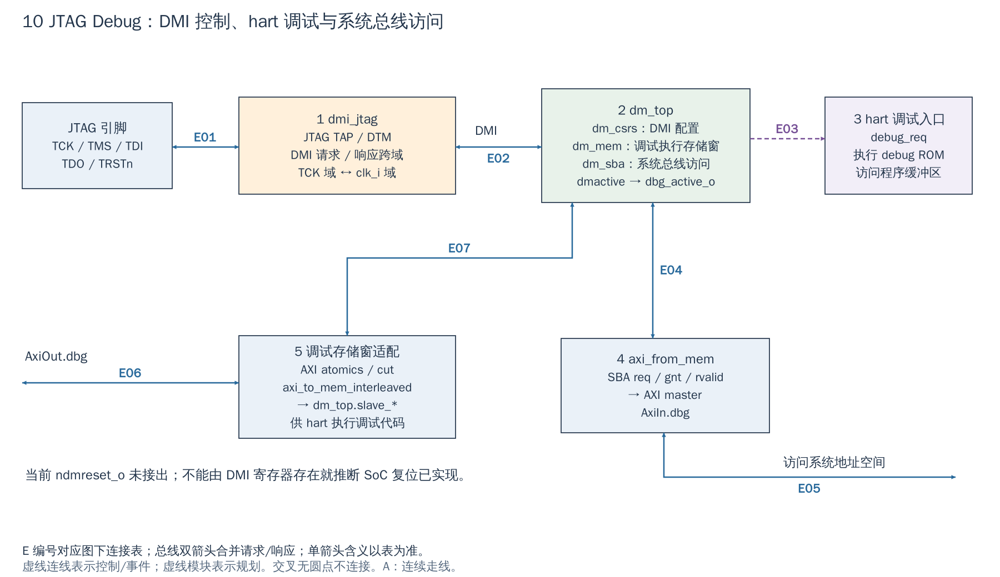

# 10 JTAG Debug：调试命令与系统内存访问

[返回统一入口](README.md)

本图把调试分为 DMI 控制、hart 调试执行、SBA 内存访问三条路径。DMI（Debug Module Interface）是调试传输模块与调试模块之间的命令接口；SBA（System Bus Access）允许调试模块自己访问系统总线。hart 是 RISC-V 的硬件执行线程，本工程通常对应一个 CPU 核的执行上下文。

**当前配置：**SoC 固定实例化 `dmi_jtag`/`dm_top`，VCU118 的引脚定义启用 JTAG；这说明有 RTL 和板级接线，不代表本轮重新连接探针测试。图中“访问系统地址”经过 SoC AXI 互联；它不是 DM 到每个 IP 的私有直连。

[SVG](../diagrams/2026-10-13_rtl_module_comparison/A/10_jtag_debug.svg) · [PDF](../diagrams/2026-10-13_rtl_module_comparison/A/10_jtag_debug.pdf) · [A/C 对比](../diagrams/2026-10-13_rtl_modules_native_c/index.html#10_jtag_debug)

<!-- CONNECTIONS:10_jtag_debug -->

### 图中连线与信号组

编号仅在本图内有效。总线双箭头合并请求与响应；单箭头表示表内说明的主数据、控制或逻辑方向，握手返回不能据箭头省略。A/C 均以连续连线表达连接，编号只用于查表。源码依据见本章代码对应。

| 连线 | 端点与方向 | 信号、用途和需要保留的约定 |
|---|---|---|
| E01 | JTAG 引脚 ↔ 1  dmi_jtag | JTAG 双向引脚组：tck_i/tms_i/trst_ni/td_i 输入 DTM，td_o/tdo_oe_o 输出；双箭头不表示每根引脚均双向 |
| E02 | 1  dmi_jtag ↔ 2  dm_top | DMI 请求/响应：dbg_dmi_req/rsp + 各 valid/ready；TCK→clk_i CDC 由 dmi_jtag 内 dmi_cdc 实现 |
| E03 | 2  dm_top → 3  hart 调试入口 | hart 调试请求：dm_top.debug_req_o=dbg_req，经 dbg_int_req 到 CPU debug_req_i；halt/resume 状态和程序缓冲交互不靠这一根线完成 |
| E04 | 2  dm_top ↔ 4  axi_from_mem | SBA 存储接口：dbg_sba_req/addr/we/wdata/strb → axi_from_mem；反向 gnt/rvalid/rdata/err 表示受理与完成 |
| E05 | 4  axi_from_mem ↔ 主 AXI：AxiIn.dbg | AXI master：axi_in_req/rsp[AxiIn.dbg]，由 DM 发起 AW/W/AR，经主互联返回 B/R；不是 CPU 发起的 debug 窗访问 |
| E06 | 主 AXI：AxiOut.dbg ↔ 5  调试存储窗适配 | AXI slave：axi_out_req/rsp[AxiOut.dbg] 经 atomics/cut 进入调试存储窗转换；请求来自主互联 |
| E07 | 5  调试存储窗适配 ↔ 2  dm_top | DM slave 存储口：dbg_slv_req/we/addr_long/wstrb/wdata → dm_top.slave_*；slave_rdata_o 返回到适配器；此口无独立 ready 信号 |

<!-- /CONNECTIONS -->

JTAG Debug 不走主 Regbus 配置窗口。JTAG 先转换成专用 DMI 请求，再由 Debug Module 控制 hart 或发起系统总线访问。调试器上的一次“读内存”与一次“读 DMI 状态寄存器”不是同一条硬件路径。

## 按图理解电路

**1：dmi_jtag。** JTAG TAP/DTM 在 TCK 域处理扫描操作；`dmi_cdc` 将完整 DMI 请求/响应跨到 SoC clk_i 域。TMS/TDI/TDO 是串行测试访问，不是 AXI 地址/数据线。TCK 和 clk_i 可以不同步，内部 CDC 不能在移植时随意删掉。

**2：dm_top。** 内含 DMI 控制/状态寄存器 `dm_csrs`、供 hart 调试执行访问的 `dm_mem`、系统总线访问逻辑 `dm_sba`。这些职责汇合在一个 Debug Module，但有各自的接口。

**2→3：让 hart 进入调试。** `debug_req` 请求目标 hart 进入 debug；hart 执行调试入口与程序缓冲相关代码，并与 DM 交互。硬件会选择 hart、检查可用状态，软件调试工具负责相应命令顺序。debug entry 与普通外设中断入口不同，不能用 PLIC claim 解释 halt/resume。

**3 经系统访问→5→2：调试存储窗。** SoC 的 `AxiOut.dbg` 经 atomic/cut 与 `axi_to_mem_interleaved` 变成 DM 的 slave 存储接口，供 hart 读取 debug ROM/程序缓冲及完成握手。图中省略了 hart 到这个 AXI 地址窗的整机互连，避免重复 SoC 全景图。

**2→4：SBA。** `dm_sba` 发出存储式请求，`axi_from_mem` 将它转成独立 AXI master，接到 `AxiIn.dbg`。这样调试器可以通过 DMI 操纵 SBA 来访问系统地址，而无需把所有数据都作为 hart 执行的 load/store。但访问是否成功仍依赖目标地址、时钟、复位与 AXI 响应。

## 使用时的四个区别

| 操作 | 硬件路径/注意点 |
|---|---|
| 读 DMI 状态 | JTAG→DTM→DMI→dm_csrs，不等于读取 SoC MMIO |
| halt/resume hart | DM 与 CPU debug 接口协作，检查 hart 状态 |
| hart 执行 debug 代码 | CPU 访问调试存储窗，经图中⑤到 dm_mem |
| SBA 读写内存 | DM 自己经图中④发 AXI 事务；缓存中的脏数据不必已出现在被读内存中 |

读写带副作用的 MMIO 时，调试器同样必须遵守设备访问宽度和时序。内存窗口自动刷新、反复读取 FIFO/claim 等寄存器可能改变设备状态；SBA 不会把 MMIO 变成无副作用快照。

## 用调试路径定位新 IP，按哪一步开始

以下是依据现有接口的调试建议，不是本轮探针实测结果：先确认 TCK/TAP 能读 DMI 状态，再 halt hart 并检查状态；随后通过 SBA 读一个已知无副作用的只读寄存器，例如 SoC 能力信息，确认 SoC 时钟、复位和地址路径工作。新 NPU/DDR 窗口读失败时，对比这个基准窗口，可把“调试链断了”和“新目标尚不可达”分开。

若要在 DDR 初始化之前装载/检查程序，目标必须是当时可用且已配置的片内存储；SBA 不会替 DDR 完成训练。读取 MMIO 出错时，`dbg_sba_err` 从 `axi_from_mem.mem_rsp_error_o` 回到 `dm_top.master_r_err_i`，调试软件应检查访问错误，而非只看显示出的数据值。DMI 的请求 ready 只说明命令握手，不能代替后续系统总线访问完成。

图中 TAP 是 JTAG 状态机，DTM 是 Debug Transport Module（调试传输模块），DM 是 Debug Module（调试模块）。CDC（Clock Domain Crossing）指跨时钟域传送完整事务；不是把每一位分别插两个触发器就能保证多位命令一致。

## 扩展与已知接线边界

新增 hart 时应统一 `NumDbgHarts`、hartinfo/unavailable、debug_req、DM 地址与 CPU debug 入口配置。默认总线位宽适配也不是无限参数化：本工程既有分析已指出 Debug 对更宽系统数据口需单独评估，不能只把全 SoC 改为 128-bit 就认为 Debug 同样有效。

`dmactive_o` 接出为 `dbg_active_o`；**当前 `ndmreset_o` 悬空**，因此不能声称调试器通过该信号已经能复位整个 SoC。JTAG pin、TDO OE、复位边界和 ASIC PAD 需外层接好。可复用 TAP/CDC/DM/SBA，不建议为新增 NPU 配置再发明一套 DMI 协议；调试器可通过已有系统访问观察 NPU 的 MMIO。

本次未连接实体探针或运行 OpenOCD，不把源码存在等同于完整调试流程已重新验收。

<!-- RTL_SOURCES -->

## 代码对应（本次源码快照）

| 图中职责 | 文件与行号 | 可搜索符号 |
|---|---|---|
| SoC DM / ndmreset 接线 | [cheshire_soc.sv:1038](../../hw/cheshire_soc.sv#L1038) | `) i_dbg_dm_top (` |
| 图①：DMI CDC | [dmi_jtag.sv:330](../../.bender/git/checkouts/riscv-dbg-1a98531d53bb4602/src/dmi_jtag.sv#L330) | `dmi_cdc i_dmi_cdc` |
| 图②：DM 子模块 | [dm_top.sv:20](../../.bender/git/checkouts/riscv-dbg-1a98531d53bb4602/src/dm_top.sv#L20) | `module dm_top` |
| 图④：SBA 转 AXI | [cheshire_soc.sv:1090](../../hw/cheshire_soc.sv#L1090) | `) i_dbg_sba_axi_from_mem (` |
| 图⑤：调试存储窗 | [cheshire_soc.sv:1004](../../hw/cheshire_soc.sv#L1004) | `axi_to_mem_interleaved #(` |
| CPU Debug 地址配置 | [cheshire_pkg.sv:503](../../hw/cheshire_pkg.sv#L503) | `ret.HaltAddress` |
