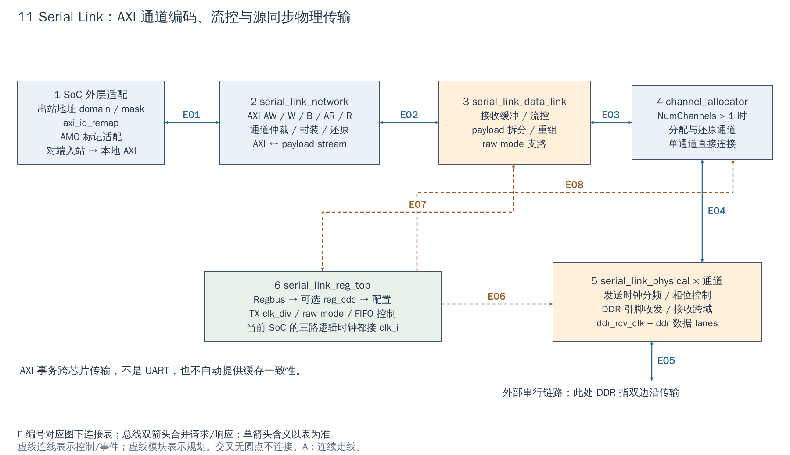

# 11 Serial Link：把 AXI 事务编码到串行链路

[返回统一入口](README.md)

本图回答 AXI 的请求与响应怎样被封装后跨芯片传输，并在对端恢复成 AXI。箭头所连的是本模块各协议层；外部链路端点需要兼容的另一套实现。

**当前配置：**`DefaultCfg.SerialLink=1`，但 [Xilinx wrapper](../../target/xilinx/src/cheshire_top_xilinx.sv#L115) 明确设 `ret.SerialLink=0`，因此当前 VCU118 路径不包含可用链路。下面解释已有可选 RTL，不能当作已经接出的板间接口。

[SVG](../diagrams/2026-10-13_rtl_module_comparison/A/11_serial_link.svg) · [PDF](../diagrams/2026-10-13_rtl_module_comparison/A/11_serial_link.pdf) · [A/C 对比](../diagrams/2026-10-13_rtl_modules_native_c/index.html#11_serial_link)

<!-- CONNECTIONS:11_serial_link -->

### 图中连线与信号组

编号仅在本图内有效。总线双箭头合并请求与响应；单箭头表示表内说明的主数据、控制或逻辑方向，握手返回不能据箭头省略。A/C 均以连续连线表达连接，编号只用于查表。源码依据见本章代码对应。

| 连线 | 端点与方向 | 信号、用途和需要保留的约定 |
|---|---|---|
| E01 | 1  SoC 外层适配 ↔ 2  serial_link_network | AXI 双向链路角色：slink_tx_idr_req/rsp 对应 axi_in_req_i/axi_in_rsp_o；对端请求还原为 axi_out_req_o/axi_out_rsp_i 后进入 AxiIn.slink |
| E02 | 2  serial_link_network ↔ 3  serial_link_data_link | 封装 payload stream：axis_out_req/rsp 与 axis_in_req/rsp；含封装数据和握手，不是直接五通道 AXI 引脚 |
| E03 | 3  serial_link_data_link ↔ 4  channel_allocator | 物理片段流：data_link2alloc_data_out + valid/ready，反向 alloc2data_link_data_in + valid/ready；NumChannels=1 时无 allocator 实例 |
| E04 | 4  channel_allocator ↔ 5  serial_link_physical × 通道 | 每通道片段流：alloc2phy_data_out + valid/ready；反向 phy2alloc_data_in + valid/ready |
| E05 | 5  serial_link_physical × 通道 ↔ 链路 DDR 引脚 | 源同步物理接口：ddr_o/ddr_rcv_clk_o 发出，ddr_i/ddr_rcv_clk_i 接收；DDR 表示双边沿，与 DDR 存储控制器不同 |
| E06 | 6  serial_link_reg_top → 5  serial_link_physical × 通道 | PHY 配置：reg2hw.tx_phy_clk_div[i].q、tx_phy_clk_start/end[i].q → clk_div_i/clk_shift_start_i/clk_shift_end_i |
| E07 | 6  serial_link_reg_top ↔ 3  serial_link_data_link | data_link 配置/状态：reg2hw.raw_mode_*、cfg_flow_control_fifo_clear 等控制；FIFO fill_state/is_full 返回 hw2reg（应双向标注） |
| E08 | 6  serial_link_reg_top → 4  channel_allocator | reg2hw.channel_alloc_*：通道使能/clear/flush/同步配置；仅 NumChannels>1。 |

<!-- /CONNECTIONS -->

Serial Link 可以把本地 AXI 访问送往对端，也能把对端发来的访问重新作为本地 AXI master 事务。这里“串行”不是 UART 字符流；物理层名字中的 DDR 指双边沿传输，不是 SoC 的 DDR 内存控制器。

## 按图理解电路

**1：SoC 适配。** 本地出站 `AxiOut.slink` 地址按 domain/mask 重映射，ID 通过 `axi_id_remap` 适配，AMO 相关 user 标记也在外层处理。反向收到的请求走 `AxiIn.slink`。配置 Regbus 是第三套接口，不应和出站 AXI slave 混为一谈。

**2：network 层。** `serial_link_network` 将 AW/W/B/AR/R 五通道的负载封装、仲裁到内部 stream，并在接收端还原通道与握手。链路上并非只传“地址加数据”；写响应、读返回、ID 及相关元信息同样影响正确性。

**3：data_link 层。** 处理 payload 的拆分/重组、接收缓冲与流控，还有 raw mode 路径。接收能力通过相应机制反馈给发送方，避免无条件持续推送。NumCredits、接收 FIFO 等参数会影响在途量、带宽与资源，不宜只按引脚速率判断吞吐。

**4：多通道分配。** NumChannels>1 时实例化 channel allocator，在多个物理通道间分配/还原数据；单通道走直连分支。逻辑 channel 与每 channel 的 lanes 是两个维度，扩大 lanes 不等于自动增加独立 AXI master。

**5：physical 层。** 产生发送分频/相位控制，结合收发 DDR 数据和接收时钟进行源同步传输、缓冲与跨域。协议参数匹配不代替芯片 IO 时序约束。对端接收时钟是实际需要处理的域，不可因为顶层部分时钟同名就删掉接收跨域逻辑。

**6：配置。** Regbus 可经 `reg_cdc` 进入配置寄存器；当前 Cheshire 将 clk_i、clk_sl_i、clk_reg_i 都接系统 clk_i，并将相应复位同源连接。这里要区分 `clk_reg_i` 的配置 CDC 和 `clk_sl_i`：后者在模块端口注释中定义为常开 `clk_i` 的门控版本，并非任意异步时钟；当前 SoC 三者同源，不能仅因端口分开就给 `clk_sl_i` 接入独立 PLL。外层 isolation 输入也按当前源码固定连接，不能推断完整运行时关断流程已经实现。

## 一次远端读取的完整闭环

在两端接口和初始化均已确认的前提下，本地 CPU 对 `AxiOut.slink` 窗口发出读地址 AR；SoC 先重映射地址与 ID，network/data_link/physical 将它传给对端。对端链路还原出 AXI master 读请求，对端目标返回 R 数据与 RRESP，随后返回包沿链路回到本地，ID 恢复后才完成原 CPU 的读。**远端地址可达、对端响应和返回链路都属于这次读的完成条件。** 这不是已经验证的 VCU118 操作例，而是根据当前端口接线推导的事务流程。

图中的 payload 是封装后的通道负载，valid/ready 是层间“有一份数据/接收方能接收”的握手；data_link 的流控和 PHY 接收缓冲解决的分别是链路接收能力与时钟相位/域问题。配置不仅影响 PHY 分频和 data_link，`NumChannels>1` 分支还把 `reg2hw.channel_alloc_*` 接到通道分配器；它不是完全独立于软件配置的固定轮询器。

## 使用或修改时要确认

| 项目 | 为什么软件/平台必须感知 |
|---|---|
| 两端参数与初始化 | payload 格式、通道/lane、时钟、流控状态必须匹配 |
| 出站地址窗口 | domain/mask 决定对端看见的地址；本地指针不是自动可供对端使用的地址 |
| 入站权限与映射 | 对端能作为本地总线发起者访问，应明确开放哪些资源 |
| reset / isolation | 有在途事务时停链路可能留下未完成 AXI 请求，需明确恢复契约 |
| 缓存所有权 | 链路可传 AXI/原子相关信息，不因此自动窥探 CPU cache 或解决共享缓冲一致性 |

本地依赖文档按 network/data link/channel allocator/physical 分层，可与本章对应。当前根软件主要有寄存器头文件，不能把它表述成已有完整对端驱动；测试 fixture 的链路 VIP 也不是一块真实远端 RAM 的全功能模型。本次未做链路训练、误码或跨芯片测试。

<!-- RTL_SOURCES -->

## 代码对应（本次源码快照）

| 图中职责 | 文件与行号 | 可搜索符号 |
|---|---|---|
| 图①：SoC 出站适配 | [cheshire_soc.sv:1671](../../hw/cheshire_soc.sv#L1671) | `) i_serial_link_tx_id_remap (` |
| SoC 时钟/复位/隔离接线 | [cheshire_soc.sv:1695](../../hw/cheshire_soc.sv#L1695) | `) i_serial_link (` |
| 图②：network | [serial_link.sv:154](../../.bender/git/checkouts/serial_link-6e09ea4800bad616/src/serial_link.sv#L154) | `) i_serial_link_network (` |
| 图③④⑤：层间连接 | [serial_link.sv:189](../../.bender/git/checkouts/serial_link-6e09ea4800bad616/src/serial_link.sv#L189) | `) i_serial_link_data_link (` |
| 图⑥：可选配置跨域 | [serial_link.sv:320](../../.bender/git/checkouts/serial_link-6e09ea4800bad616/src/serial_link.sv#L320) | `) i_cdc_cfg (` |
| 官方分层说明 | [README.md:8](../../.bender/git/checkouts/serial_link-6e09ea4800bad616/doc/README.md#L8) | `## Architecture` |
