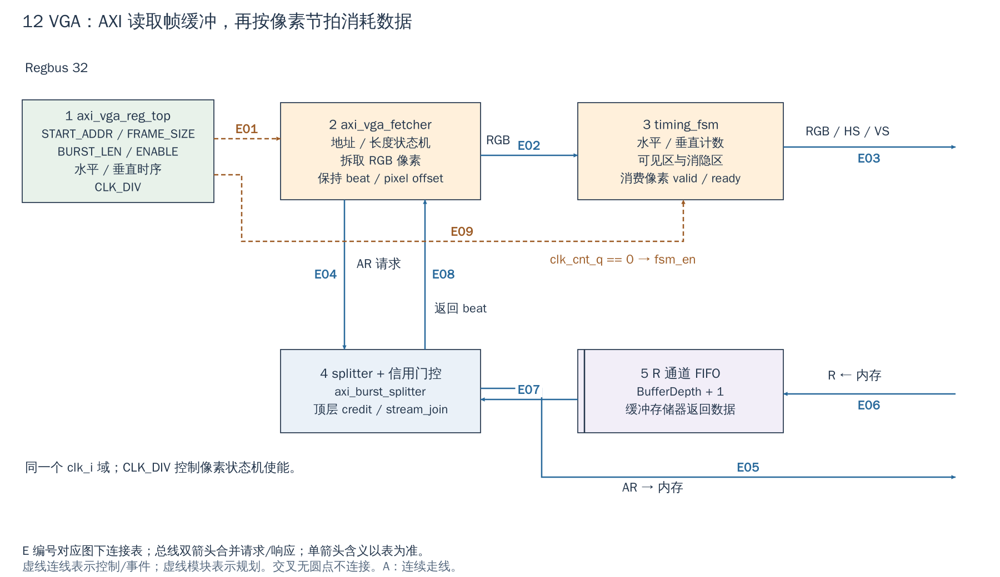

# 12 VGA：存储器数据怎样变成像素输出

[返回统一入口](README.md)

本图回答帧缓冲里的像素怎样被 AXI 读取、缓冲并按显示时序输出。VGA（Video Graphics Array）在这里指 RGB 加水平/垂直同步的显示输出。图只展开读取器内部，不把 DDR 画成直接接到像素选择器。

**当前配置：**`DefaultCfg.Vga=1`，Xilinx wrapper 沿用该值；但 [VCU118 引脚定义](../../target/xilinx/src/phy_definitions.svh#L6) 未定义 `USE_VGA`，故模块存在不等于该板已接出显示口。仿真 fixture 也将 VGA 输出悬空。

[SVG](../diagrams/2026-10-13_rtl_module_comparison/A/12_vga.svg) · [PDF](../diagrams/2026-10-13_rtl_module_comparison/A/12_vga.pdf) · [A 图总览](../diagrams/2026-10-13_rtl_module_comparison/index.html#12_vga)

<!-- CONNECTIONS:12_vga -->

### 图中连线与信号组

编号仅在本图内有效。总线双箭头合并请求与响应；单箭头表示表内说明的主数据、控制或逻辑方向，握手返回不能据箭头省略。主图以连续连线表达连接，编号只用于查表。源码依据见本章代码对应。

| 连线 | 端点与方向 | 信号、用途和需要保留的约定 |
|---|---|---|
| E01 | 1  axi_vga_reg_top → 2  axi_vga_fetcher | fetcher 配置：reg2hw.control.enable.q、start_addr_high/low.q、frame_size.q、burst_len.q → enable_i/start_addr_i/frame_size_i/burst_len_i |
| E02 | 2  axi_vga_fetcher → 3  timing_fsm | 像素握手：red/green/blue + valid 由 fetcher→timing_fsm；ready 反向返回，表示此像素被消费 |
| E03 | 3  timing_fsm → RGB / HS / VS 引脚 | 显示引脚：red_o/green_o/blue_o、hsync_o/vsync_o；输出节拍由 fsm_en 控制 |
| E04 | 2  axi_vga_fetcher → 4  splitter + 信用门控 | 读地址请求：axi_req.ar/ar_valid → splitter.slv_req_i；ar_ready 反向返回；写通道在 fetcher 中不发起 |
| E05 | 4  splitter + 信用门控 → 系统 AXI AR | 单拍 AR 与信用门控：axi_req_split.ar/ar_valid 经顶层 stream_join、credit_valid 发出 axi_req_o.ar/ar_valid，ar_ready 返回 |
| E06 | 系统 AXI R → 5  R 通道 FIFO | AXI R 返回入 FIFO：axi_resp_i.r/r_valid → i_stream_fifo.data_i/valid_i，axi_req_o.r_ready 反向背压；含 data/resp/id/last |
| E07 | 5  R 通道 FIFO → 4  splitter + 信用门控 | FIFO → splitter：axi_resp_split.r/r_valid；axi_req_split.r_ready 反向；弹出 last 的握手更新信用计数 |
| E08 | 4  splitter + 信用门控 → 2  axi_vga_fetcher | splitter → fetcher：axi_resp.r/r_valid，axi_req.r_ready 反向；复原原读 burst 的返回语义 |
| E09 | 1  axi_vga_reg_top → 3  timing_fsm | 显示参数与节拍：reg2hw → timing_fsm.reg2hw_i；clk_div 经 clk_cnt_q 产生 fsm_en_i=(clk_cnt_q==0)，不是跨时钟域 |

<!-- /CONNECTIONS -->

VGA 与 UART/SPI 不同：软件写的是帧缓冲地址和时序，模块自己通过 AXI master 读取像素。它是显示读取器，不是把摄像头帧写入 DDR 的 DMA。

## 按图理解电路

**1→2：配置读取任务。** `axi_vga_reg_top` 提供 START_ADDR_HIGH/LOW、FRAME_SIZE、BURST_LEN、ENABLE 等值。`axi_vga_fetcher` 维护当前地址、帧开始地址和剩余长度，按 burst/4 KiB 边界组织 AR 请求。源里 AW/W/B 控制被置为不发起写，说明当前数据口用于读取。

**2→4→内存→5→4→2：获取数据。** `axi_burst_splitter` 把读 burst 拆成单拍事务；外层信用计数限制尚未完成的请求；返回 R 数据进入深度 `BufferDepth+1` 的 FIFO，再经返回路径供 fetcher 消耗。FIFO 暂存存储器不均匀的返回节奏，不会增加 DDR 的长期平均带宽。

**2→3：按像素切片。** fetcher 保存新/旧 beat 与 offset，按 RGB 位宽从数据字中选出一个像素，以 valid/ready 交给 `axi_vga_timing_fsm`。当前实现要求总像素位宽不大于 AXI 数据宽度且整除它；改变 RGB 格式要同时核对内存打包方式，不能只改显示端位宽。

**3：产生显示时序。** 水平/垂直状态机区分可见区、同步与消隐，输出 HS/VS/RGB。`clk_cnt_q == 0` 产生 `fsm_en`，CLK_DIV 控制像素推进节奏；所有这些逻辑仍在 clk_i 域，不是默认增加一个独立 pixel-clock 域。

## 对使用最重要的约定

1. 准备可被该 AXI master 访问的连续帧缓冲，匹配地址宽度、像素打包、帧大小和当前实现的对齐/整拍要求。此控制器没有一个可随意配置任意二维 pitch 的通用 stride 引擎。
2. CPU 填帧后，按当前缓存属性完成必要的写回/可见性与所有权交接，再启动/切换显示。AXI master 不自动从 CPU 私有脏 cache 取新像素。
3. 配置分辨率与同步/消隐参数、CLK_DIV、读取长度，按已验证的停用/帧边界方式更新。寄存器可写不等于随意在半帧改地址不会撕裂。
4. 给实时消耗留带宽与最坏延迟余量。FIFO 暂时空了并不会让外部显示器无限等待；实际欠载表现要结合 timing FSM 验证。

当前数据路径对 RRESP 处理仍有 TODO；SoC 可选的总线错误监视器是另一层报告机制，不能把收到一个 beat 当作一定正确。它也没有在此图中虚构一个“每帧完成 IRQ”。

## 从帧缓冲到第一帧的使用流程

以下是依据 [寄存器/取数接线](../../.bender/git/checkouts/axi_vga-74c838b44ce780d5/src/axi_vga.sv#L124)整理的集成流程，当前没有声称可在 VCU118 直接运行的显示示例：停用输出并准备连续像素数据，完成 CPU→显示 master 的缓存/缓冲交接，写起始地址、帧长度与 burst 长度，再写同步/消隐参数和 `CLK_DIV`，最后设置 `ENABLE`。硬件随后发 AR，收到 R 后缓存数据，timing FSM 在可见区按 valid/ready 消费像素。

`DefaultCfg` 的 RGB 为 5/6/5，总计 16-bit，一个 64-bit AXI beat 可包含 4 个像素；这是数据打包关系，不代表每个系统时钟都能输出 4 个像素。`CLK_DIV=0` 在 RTL 中按 1 处理，其他值控制 `fsm_en` 的周期，见 [clk_div 赋值](../../.bender/git/checkouts/axi_vga-74c838b44ce780d5/src/axi_vga.sv#L76)。

图④把 splitter 与外围信用计数作为一个阅读分组；信用计数实际位于 `axi_vga` 顶层，借 `stream_join` 限制 AR 发出，不在 `axi_burst_splitter` 内。FIFO 返回 R 与 `r_ready` 反向握手也都经过 splitter。理解这点后，通常无需深入 splitter 的每个事务队列。

## 对图像帧写入 DMA 的借鉴

可以借鉴地址发生器、队列容量控制和参数寄存器；但帧写入需要接收像素流、按行/stride 打包、发 AW/W、跟踪 B 错误，并定义输入不能反压时的丢帧/溢出策略。这些不是把 VGA 的箭头反向就自动获得的功能。

`Cfg.Vga` 控制实例，RGB/计数器宽度、BufferDepth、MaxReadTxns 由 Cfg 传入。当前 fixture 不验证真实显示引脚，本次未做显示器或持续帧率测试。

<!-- RTL_SOURCES -->

## 代码对应（本次源码快照）

| 图中职责 | 文件与行号 | 可搜索符号 |
|---|---|---|
| SoC 配置/AXI/错误观察 | [cheshire_soc.sv:1741](../../hw/cheshire_soc.sv#L1741) | `axi_vga #(` |
| 图①③：寄存器和像素使能 | [axi_vga.sv:79](../../.bender/git/checkouts/axi_vga-74c838b44ce780d5/src/axi_vga.sv#L79) | `assign clk_cnt_d` |
| 图②：读取与像素选择 | [axi_vga_fetcher.sv:11](../../.bender/git/checkouts/axi_vga-74c838b44ce780d5/src/axi_vga_fetcher.sv#L11) | `module axi_vga_fetcher` |
| 图④⑤：拆分/FIFO/信用 | [axi_vga.sv:153](../../.bender/git/checkouts/axi_vga-74c838b44ce780d5/src/axi_vga.sv#L153) | `axi_burst_splitter #(` |
| 显示时序 | [axi_vga_timing_fsm.sv:10](../../.bender/git/checkouts/axi_vga-74c838b44ce780d5/src/axi_vga_timing_fsm.sv#L10) | `module axi_vga_timing_fsm` |
| 当前 RRESP 待处理点 | [axi_vga_fetcher.sv:197](../../.bender/git/checkouts/axi_vga-74c838b44ce780d5/src/axi_vga_fetcher.sv#L197) | `TODO check req.r.resp` |
