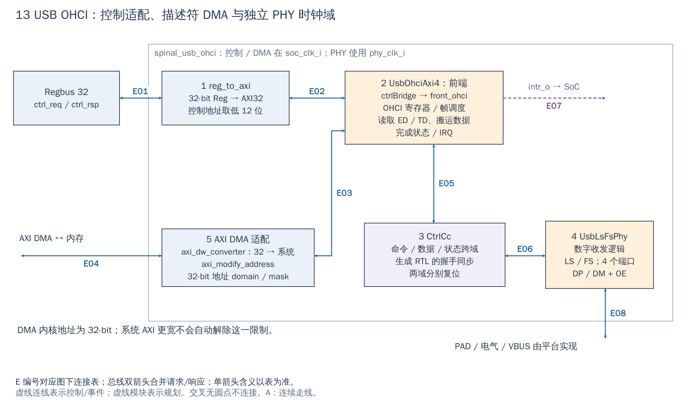

# 13 USB：OHCI 调度、DMA 与数字 PHY

[返回统一入口](README.md)

本图回答三个问题：CPU 如何配置 USB host、控制器如何主动读取描述符/数据、命令和接收数据如何跨到 USB PHY 时钟域。OHCI（Open Host Controller Interface）是主机控制器的编程接口；PHY 是物理层，本图中的 PHY 主要是数字收发逻辑。

**当前配置：**`DefaultCfg.Usb=1`，但 Xilinx wrapper 仅在 `USE_USB` 定义时启用；VCU118 的当前 [引脚定义](../../target/xilinx/src/phy_definitions.svh#L6) 无此宏，所以 **VCU118 配置中 USB 关闭**。基础仿真 fixture 的 `usb_clk_i=0`，不能作为 USB 功能运行环境。

[SVG](../diagrams/2026-10-13_rtl_module_comparison/A/13_usb.svg) · [PDF](../diagrams/2026-10-13_rtl_module_comparison/A/13_usb.pdf) · [A 图总览](../diagrams/2026-10-13_rtl_module_comparison/index.html#13_usb)

<!-- CONNECTIONS:13_usb -->

### 图中连线与信号组

编号仅在本图内有效。总线双箭头合并请求与响应；单箭头表示表内说明的主数据、控制或逻辑方向，握手返回不能据箭头省略。主图以连续连线表达连接，编号只用于查表。源码依据见本章代码对应。

| 连线 | 端点与方向 | 信号、用途和需要保留的约定 |
|---|---|---|
| E01 | Regbus 32 ↔ 1  reg_to_axi | 配置 Regbus：ctrl_req_i/ctrl_rsp_o，32-bit wdata/rdata，地址/valid/write/wstrb 与 ready/error |
| E02 | 1  reg_to_axi ↔ 2  UsbOhciAxi4：前端 | 配置 AXI32：ctrl_int_req/rsp；地址12位、ID0；在 UsbOhciAxi4 内 ctrlBridge 转为内部 BMB 控制访问 |
| E03 | 2  UsbOhciAxi4：前端 ↔ 5  AXI DMA 适配 | 内核 DMA AXI32：dma_int_req/rsp，32-bit 地址/数据，OHCI 发 AW/W/AR 并接 B/R |
| E04 | 5  AXI DMA 适配 ↔ 主 AXI：AxiIn.usb | 系统 AXI DMA：dma_req_o/dma_rsp_i → axi_in_req/rsp[AxiIn.usb]；数据位宽适配+地址 domain/mask 后发出，经过主互联访问内存 |
| E05 | 2  UsbOhciAxi4：前端 ↔ 3  CtrlCc | SoC 域 USB 流/命令：front_ohci_io_phy_tx_valid/ready、tx_payload_fragment/last、usbReset/usbResume；cc_input_rx_flow_*、端口状态反向 |
| E06 | 3  CtrlCc ↔ 4  UsbLsFsPhy | PHY 域 USB 流/命令：cc_output_tx_*、usbReset/usbResume → back_phy；back_phy_io_ctrl_rx_flow_*、txEop、tick 和端口状态返回 |
| E07 | 2  UsbOhciAxi4：前端 → SoC USB IRQ | 设备中断：OHCI io_interrupt → wrapper intr_o → intr.usb；由设备状态触发，不是 Regbus ready |
| E08 | 4  UsbLsFsPhy ↔ DP / DM / OE 引脚 | 数字引脚：phy_dp_i/dm_i 输入；phy_dp_o/dm_o 与 phy_dp_oe_o/dm_oe_o 输出；平台另实现 PAD/VBUS |

<!-- /CONNECTIONS -->

当前 SoC 的 USB 是 `spinal_usb_ohci` 包装的 OHCI host 控制器，生成 RTL 为 `UsbOhciAxi4.v`，带 4 个数字端口及 Low/Full Speed PHY 逻辑。不能据此声称它是 USB device、USB 2.0 High Speed 或一个已包含模拟 PAD/VBUS 的完整芯片接口。

## 按图理解电路

**1：控制方向反过来适配。** SoC 给的是 32-bit Regbus，而生成控制器的配置端是 32-bit AXI，所以 wrapper 用 `reg_to_axi` 转换，地址取低 12 位、内部 ID 固定。CPU 仍按该外设的寄存器地址访问，不需自己生成 AXI 信号。这也说明“接在 Regbus 上”不意味着 IP 内部一定原生使用 Regbus。

**2：OHCI 前端。** 图中②只展开 `UsbOhciAxi4` 的 front_ctrlBridge/front_ohci 部分，③④也属于同一生成 RTL 的内部。OHCI 寄存器控制帧调度；控制器读取内存中的 ED（端点描述符）、TD（传输描述符）等结构，决定从哪个缓冲取数据、给哪个端点发送，以及如何回写完成信息。

**2↔5：DMA 是数据通路。** 内核发出的 DMA 是 32-bit 数据/32-bit 地址。先经 `axi_dw_converter` 适配系统数据宽度，再由 `axi_modify_address` 用 domain/mask 映射到系统地址。加宽到 64-bit AXI 不会把描述符中的 32-bit 指针变成任意 48-bit 指针；驱动缓冲、描述符分配和映射策略必须遵守这一限制。

**2↔3↔4：跨到物理节拍。** `CtrlCc` 用生成的控制/数据握手及同步逻辑连接 SoC 域与 PHY 域；`UsbLsFsPhy` 处理数字串行收发，并通过 DP/DM 输入、输出和 OE 与外层接口连接。不能仅用两级同步器去替换整条跨域数据通路。

## 软件需要做什么

软件不是“写一个源地址和长度就完成所有 USB 访问”。需要 OHCI host 驱动管理控制器寄存器、描述符链、端点状态、端口复位/枚举与完成队列。描述符和数据缓冲必须对 DMA 可见；CPU 和控制器同时修改共享字段时，还要遵守 ownership 和缓存维护顺序。

完成/错误通过控制器状态与 `intr_o` 报告，再进入 SoC IRQ 路径。只有关闭设备层原因，后续 PLIC complete 才能按预期收尾。AXI 总线错误到 USB 状态的传播仍应单独验证，SoC 源码对此有缺少错误处理/监视的 TODO，不能把通用 DMA完成等同为成功。

## 一次 USB 传输应怎样串起软硬件

下面是与已有接口相符的 host 驱动流程，用于理解职责，**仓库没有在本轮提供并验证完整 USB host 软件栈**：先确保 PHY 时钟、端口供电和复位可用；驱动初始化 OHCI 调度所需的内存结构，准备描述符与缓冲，并完成 CPU→DMA 的可见性和所有权交接；再通过配置口使控制器运行。控制器通过 AXI 读取 ED/TD 和发送缓冲，经过 CtrlCc/PHY 传输；接收数据与完成信息写回内存，状态位满足条件后拉起 `intr_o`。驱动检查状态、读取完成队列、取回缓冲所有权并清事件。

Regbus 的 `ready` 在这里对应**一次配置寄存器访问**完成；USB 包已发送、端点已接受、描述符执行结束是后续不同层次的状态，不能用寄存器写响应替代。DMA 是 Direct Memory Access（设备主动存储器访问），它需要系统互联提供地址到达能力；图中“DMA↔内存”是 wrapper AXI master 的出口，并非 PHY 直接连到 DDR。

## 集成边界

| 范围 | 当前应重点检查 |
|---|---|
| 时钟复位 | wrapper 使用 soc_clk/soc_rst 与 phy_clk/phy_rst 两套输入；SoC 后者来自 usb_clk_i/usb_rst_ni |
| 数字 IO 与电气 | DP/DM/OE、端口供电与过流、PAD、上拉下拉和板级连接需落实到平台 |
| 软件栈 | 仓库中 wrapper/寄存器存在不代表根软件已有完整 USB host 栈 |
| 测试 | 当前基础 fixture 将相关 PHY 时钟/输入固定，不能当成 USB 功能验证 |

本地[官方架构说明](../../docs/um/arch.md#usb-11-ohci-controller)还将该控制器的适用范围限定为单核 CVA6、默认 cache 组合以及 32-bit 物理地址子空间。端口能连接不等于多核、其他 CPU cache profile 或新的共享缓存方案已获得相同软件支持；偏离此组合需要单独验证驱动和 DMA 可见性。

`Cfg.Usb` 控制生成。自有 IP 可以借鉴“Regbus 控制 + AXI DMA + 独立工作域”的分层，但不能照搬 OHCI 描述符格式去假定 NPU/ISP 自动适配。本次未做 USB 枚举、设备传输或电气测试。

<!-- RTL_SOURCES -->

## 代码对应（本次源码快照）

| 图中职责 | 文件与行号 | 可搜索符号 |
|---|---|---|
| SoC 两时钟域接线 | [cheshire_soc.sv:1835](../../hw/cheshire_soc.sv#L1835) | `) i_spinal_usb_ohci (` |
| 图①：Reg→AXI | [spinal_usb_ohci.sv:75](../../hw/future/spinal_usb_ohci.sv#L75) | `) i_reg_to_axi_ctrl (` |
| 图⑤：DMA 位宽/地址适配 | [spinal_usb_ohci.sv:134](../../hw/future/spinal_usb_ohci.sv#L134) | `) i_axi_dw_converter_dma (` |
| 图②：OHCI 前端 | [UsbOhciAxi4.v:592](../../hw/future/UsbOhciAxi4.v#L592) | `UsbOhciAxi4_UsbOhci front_ohci (` |
| 图③：CDC | [UsbOhciAxi4.v:854](../../hw/future/UsbOhciAxi4.v#L854) | `UsbOhciAxi4_CtrlCc cc (` |
| 图④：数字 PHY | [UsbOhciAxi4.v:700](../../hw/future/UsbOhciAxi4.v#L700) | `UsbOhciAxi4_UsbLsFsPhy back_phy (` |
