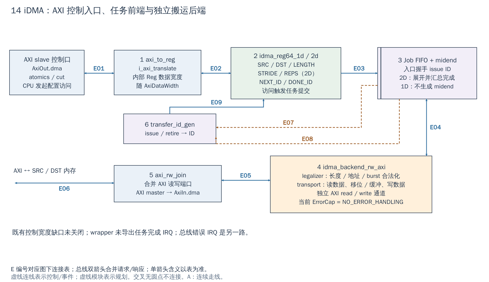

# 14 iDMA：控制 AXI、内部 Reg 与搬运 AXI

[返回统一入口](README.md)

iDMA（intelligent DMA）在本工程中承担存储器到存储器搬运。本图要区分“CPU 配置 DMA”与“DMA 自己读写存储器”：前者是 AXI slave 控制口，后者是 AXI master 数据口；中间的任务队列和 ID 负责解耦提交与完成。

**当前配置：**`DefaultCfg.Dma=1`、`DmaConfEnableTwoD=1`，默认选择 2D 前端，Xilinx wrapper 沿用。RTL 生成条件成立，但控制接口位宽缺口仍未关闭；不能据此宣称现有 DMA 例程可直接运行。图中的 1D 是同一 wrapper 的可选分支。

[SVG](../diagrams/2026-10-13_rtl_module_comparison/A/14_idma.svg) · [PDF](../diagrams/2026-10-13_rtl_module_comparison/A/14_idma.pdf) · [A/C 对比](../diagrams/2026-10-13_rtl_modules_native_c/index.html#14_idma)

<!-- CONNECTIONS:14_idma -->

### 图中连线与信号组

编号仅在本图内有效。总线双箭头合并请求与响应；单箭头表示表内说明的主数据、控制或逻辑方向，握手返回不能据箭头省略。A/C 均以连续连线表达连接，编号只用于查表。源码依据见本章代码对应。

| 连线 | 端点与方向 | 信号、用途和需要保留的约定 |
|---|---|---|
| E01 | AXI slave 控制口 ↔ 1  axi_to_reg | AXI slave 控制请求/响应：axi_slv_req_i/axi_slv_rsp_o；上游 AxiOut.dma 经 atomics/cut |
| E02 | 1  axi_to_reg ↔ 2  idma_reg64_1d / 2d | 内部配置 Reg：dma_reg_req/dma_reg_rsp；控制数据 typedef 随 AxiDataWidth，而生成 reg_top DW32（既有缺口） |
| E03 | 2  idma_reg64_1d / 2d → 3  Job FIFO + midend | 提交任务：1D burst_req_d/be_valid_d/be_ready_d；2D idma_nd_req_d/idma_nd_req_valid_d/ready_d；进入 Job FIFO 的握手才 issue |
| E04 | 3  Job FIFO + midend ↔ 4  idma_backend_rw_axi | 后端1D任务：burst_req/be_valid/be_ready；2D 由 midend 展开；后端 idma_rsp/valid/ready 返回2D midend，不应漏返向通道 |
| E05 | 4  idma_backend_rw_axi ↔ 5  axi_rw_join | 独立 AXI read/write：axi_read_req/rsp 与 axi_write_req/rsp → axi_rw_join；包含请求与 R/B 返回 |
| E06 | 5  axi_rw_join ↔ 主 AXI：AxiIn.dma | 系统 AXI master：axi_mst_req_o/axi_mst_rsp_i → AxiIn.dma；由 DMA 发起对 SRC/DST 的内存事务 |
| E07 | 3  Job FIFO + midend → 6  transfer_id_gen | issue：frontend → Job FIFO 入口 valid & ready；不是 midend 每派发一个一维子任务就 issue 新 ID。 |
| E08 | 3  Job FIFO + midend → 6  transfer_id_gen | 2D retire：midend 的 idma_nd_rsp_valid & idma_nd_rsp_ready → transfer_id_gen；1D 配置则使用 backend 的 idma_rsp 握手。 |
| E09 | 6  transfer_id_gen → 2  idma_reg64_1d / 2d | 进度寄存器：transfer_id_gen.next_o/completed_o = next_id/done_id → frontend.next_id_i/done_id_i，读 NEXT_ID 还参与提交 |

<!-- /CONNECTIONS -->

**iDMA 没接主 Regbus 解复用器，而是拥有独立 AXI slave 配置窗口。** 但它内部并非没有寄存器总线：wrapper 先用 `axi_to_reg` 转换，再接寄存器前端。独立 AXI master 才负责实际搬运，这两套 AXI 接口不能混用。

## 按图理解电路

**1→2：CPU 写参数。** SoC 的 AxiOut.dma 经 atomic/cut 进入 `i_axi_translate`，产生内部 dma_reg_req/rsp；1D 或 2D 前端把 SRC/DST/LENGTH 等寄存器转换成请求结构。2D 还包含重复次数和源/目的 stride，按配置启用更高维展开。

**启动操作有读副作用。** 当前前端读取 `NEXT_ID` 会令 `next_id.re` 有效，并参与 launch/ready 握手；这是提交任务并获得 ID 的接口，不是普通“只看看下一个编号”的无副作用读。不要用通用寄存器 dump 反复读它，也不要凭其他 DMA 的习惯编造一个 START 写寄存器。

**2→3→4：任务到具体 burst。** Job FIFO 把软件提交与后端执行解耦；2D 配置走 `idma_nd_midend` 展开成一维请求，1D 分支直接送后端。`idma_backend_rw_axi` 的 legalizer 处理地址/长度与 burst 约束，transport 负责读数据、必要的移位/缓冲与写数据。多个 AXI 请求可以在途，但受队列、NumAxInFlight、MemSysDepth 等参数约束。

**4↔5：独立读写接到一个 AXI master。** backend 提供 read/write 两套内部接口，`axi_rw_join` 组合成系统 AXI master，连接 `AxiIn.dma`。源和目的地址都必须可从该端口到达，不能把 CPU 虚拟地址直接当作 DMA 设备地址。

**6：完成进度。** issue/retire 驱动 `idma_transfer_id_gen` 更新 NEXT_ID/DONE_ID；2D 的 retire 按整体 ND 响应，不能把任一子行返回都当作整个二维任务完成。1D 时后端 `idma_rsp_valid & idma_rsp_ready` 直接形成 retire；2D 时后端响应先回到 midend，只有 `idma_nd_rsp_valid & idma_nd_rsp_ready` 才形成 retire。两种返回接线不能合并成一根“backend 完成”线。

## 现有代码不能被图解掩盖的问题

1. **控制宽度缺口仍开放。** wrapper 的内部 Reg typedef 数据/选通宽度跟随 `AxiDataWidth`，而当前 `idma_reg64_2d_reg_top` 的 DW 固定为 32。名称 reg64 描述前端寄存器组织，不能拿名字证明物理控制端口是 64-bit。既有诊断在系统 DW64 下尚未关闭；因此本章不给出声称可直接运行的 DMA 示例，也不自动修 RTL。
2. wrapper 没有导出任务完成 IRQ。可选 SoC bus-error monitor 的 DMA IRQ 报告的是总线错误，不能把它当作 DONE 中断。
3. 当前 backend 配置 `ErrorCap = NO_ERROR_HANDLING`。DONE_ID 进展不构成任意 AXI 错误都已可靠传播为任务失败的保证；应另定义和验证错误处理。

既有诊断入口：[外设/DMA 排障](../learning/peripheral-debug.html#dma)、[IP/DDR 契约](../engineering/IP_DDR_Interface_Contract.md)。

## 现有软件例程表达了什么，尚不能证明什么

[SPM 中的 2D 测试](../../sw/tests/dma_2d.spm.c#L14)准备源/目的缓冲，使用 SPM 非缓存别名，并调用 `sys_dma_2d_blk_memcpy()` 后逐字节比较结果。[HAL](../../sw/include/dif/dma.h#L110)的预期顺序是写源/目的地址、每次搬运字节数、stride（相邻重复块的地址步长）和重复次数，读 NEXT_ID 提交，再轮询 DONE_ID。它能帮助理解“参数→提交→等待→校验”的接口设计，不能替代当前控制宽度修复与运行验收。

扩展自己的搬运器时，应复制这个职责划分，而不是原样复制尚有缺口的访问实现：地址/长度写入应先完成并保持一致，再通过明确提交动作把快照放进任务 FIFO；完成后检查错误和输出数据，最后交回缓冲。outstanding 表示已发出但尚未收到完成响应的事务数量，队列变深只允许更多事务重叠，不自动增加 DDR 可持续带宽。

backend 的 legalizer 是“把一项任务划成符合地址/突发边界约束的事务”的逻辑；transport 才搬运字节。2D midend 是“展开重复行”的中间层，既不产生像素帧同步，也不把 iDMA 变为视频流接口。

## NPU 搬运器、帧 DMA 能否也用 AXI 配置

可以，独立 AXI slave 配置窗口是可选整合方式；也可以直接提供 32-bit Regbus slave，再配独立 AXI master 搬数据。选择主要由 IP 已有接口、地址窗口、适配成本、访问宽度与副作用决定，控制面的短访问通常不需要为“DMA”这个名字强行增加独立 AXI 控制口。

NPU 的 DDR↔GB 搬运还需 GB 端口与所有权约定；帧 DMA 还需像素流输入、stride、打包、帧边界和不可反压时的溢出策略。这些并非当前 memory-to-memory iDMA wrapper 已经提供的相机功能。

软件层必须约定参数提交、防止运行中覆盖、完成/错误、缓冲生命周期与缓存维护。当前 iDMA 接 clk_i/rst_ni，由 `Cfg.Dma` 生成；工作跨域时另加适当 AXI/命令 CDC，不改个时钟名字即可完成。

<!-- RTL_SOURCES -->

## 代码对应（本次源码快照）

| 图中职责 | 文件与行号 | 可搜索符号 |
|---|---|---|
| SoC 独立控制与数据端口 | [cheshire_soc.sv:1587](../../hw/cheshire_soc.sv#L1587) | `) i_idma (` |
| 图①：内部 Reg typedef 与转换 | [cheshire_idma_wrap.sv:66](../../hw/cheshire_idma_wrap.sv#L66) | `` `REG_BUS_TYPEDEF_ALL `` |
| 图②：读 NEXT_ID 提交 | [idma_reg64_2d_top.sv:88](../../.bender/git/checkouts/idma-77bf7fa56d324e6a/target/rtl/idma_reg64_2d_top.sv#L88) | `proc_launch` |
| 控制位宽缺口 | [idma_reg64_2d_reg_top.sv:30](../../.bender/git/checkouts/idma-77bf7fa56d324e6a/target/rtl/idma_reg64_2d_reg_top.sv#L30) | `localparam int DW = 32;` |
| 图③：二维展开 | [cheshire_idma_wrap.sv:249](../../hw/cheshire_idma_wrap.sv#L249) | `) i_idma_midend (` |
| 图④：后端 legalizer | [idma_backend_rw_axi.sv:344](../../.bender/git/checkouts/idma-77bf7fa56d324e6a/target/rtl/idma_backend_rw_axi.sv#L344) | `) i_idma_legalizer (` |
| 图⑤：读写口合并 | [cheshire_idma_wrap.sv:331](../../hw/cheshire_idma_wrap.sv#L331) | `) i_axi_rw_join (` |
| 图⑥：任务进度 | [cheshire_idma_wrap.sv:273](../../hw/cheshire_idma_wrap.sv#L273) | `) i_transfer_id_gen_2d (` |
