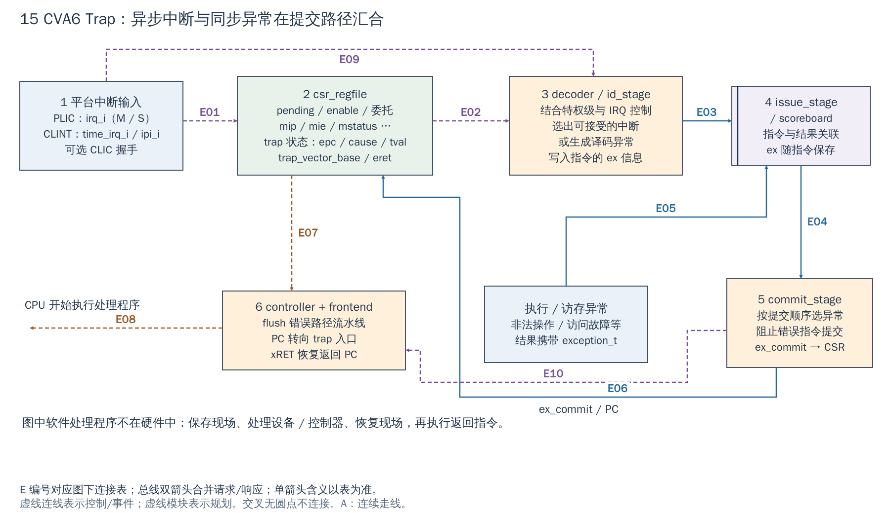

# 15 中断和异常处理：从事件到 CPU 执行处理程序

[返回统一入口](README.md)

本图回答外设事件或某条指令的错误，怎样沿 CPU 内部路径最终改变执行地址。trap 是 CPU 对中断/异常采取的控制转移；CSR（Control and Status Register）是用专门指令访问的控制状态寄存器，和主 Regbus MMIO 不同。

**当前配置：**PLIC 与 CLINT 接入当前 SoC；`DefaultCfg.Clic=0`，CLIC 是可选分支，另需匹配 CPU profile。图中异常信息流只保留影响软件接入的部分，流水线控制仍直接复用现有 CVA6。

[SVG](../diagrams/2026-10-13_rtl_module_comparison/A/15_interrupt_exception.svg) · [PDF](../diagrams/2026-10-13_rtl_module_comparison/A/15_interrupt_exception.pdf) · [A 图总览](../diagrams/2026-10-13_rtl_module_comparison/index.html#15_interrupt_exception)

<!-- CONNECTIONS:15_interrupt_exception -->

### 图中连线与信号组

编号仅在本图内有效。总线双箭头合并请求与响应；单箭头表示表内说明的主数据、控制或逻辑方向，握手返回不能据箭头省略。主图以连续连线表达连接，编号只用于查表。源码依据见本章代码对应。

| 连线 | 端点与方向 | 信号、用途和需要保留的约定 |
|---|---|---|
| E01 | 1  平台中断输入 → 2  csr_regfile | CSR 中断输入：irq_i、time_irq_i、ipi_i；CLIC 本身另经 clic_adapter 形成请求，不能把所有 CLIC 位都画成 mip 输入 |
| E02 | 2  csr_regfile → 3  decoder / id_stage | CSR→译码条件：irq_ctrl_csr_id、priv_lvl、clic_mode 等，控制 pending/enable/委托/全局允许；非所有外设线均先由 CSR 寄存 |
| E03 | 3  decoder / id_stage → 4  issue_stage | 译码指令/异常：issue_entry_id_issue（含 ex）+ valid/ack，经 issue_stage 进入 scoreboard；不是独立设备 IRQ 总线 |
| E04 | 4  issue_stage → 5  commit_stage | 按序提交候选：commit_instr_id_commit（含 ex）到 commit_stage；commit_ack_commit_id 反向推进条目 |
| E05 | 执行 / 访存异常 → 4  issue_stage | 执行/访存写回异常：ex_ex_ex_id + trans_id_ex_id + wt_valid_ex_id，经 issue_stage 关联 scoreboard 对应条目 |
| E06 | 5  commit_stage → 2  csr_regfile | 提交 trap：ex_commit（valid/cause/tval）与 pc_commit → csr_regfile.ex_i/pc_i，保存 epc/cause/tval |
| E07 | 2  csr_regfile → 6  controller + frontend | CSR 重定向/控制：trap_vector_base_commit_pcgen、epc_commit_pcgen、eret/flush 相关控制到 controller/frontend；另有 ex_commit.valid 直接输入 |
| E08 | 6  controller + frontend → 处理程序取指（逻辑结果） | 逻辑结果：frontend 开始从处理入口取指；此边是控制效果，不是某个外设端口或软件处理程序硬件模块 |
| E09 | 1  平台中断输入 → 3  decoder / id_stage | irq_i 直接输入译码；CLIC 经 clic_adapter 后为 clic_irq_req_id/cause_id。 |
| E10 | 5  commit_stage → 6  controller + frontend | ex_commit.valid → controller.ex_valid_i / frontend.ex_valid_i，与 CSR trap 状态更新并行。 |

<!-- /CONNECTIONS -->

前几章解释事件从外设怎样到 CPU 引脚，本章解释 CPU 内部发生什么。**中断是异步事件通知，异常是与某条指令执行相关的情况；它们都可以进入 trap 处理，但来源与恢复方式不同。** 图只展开当前 CVA6 与使用有关的路径，不重画完整流水线。

## 按图理解电路

**1→2：记录通知与允许条件。** PLIC 的 M/S 外部通知、CLINT 的 timer/software 信号，以及可选 CLIC 接口进入 CPU。`csr_regfile` 维护 pending、enable、全局允许和委托等状态；外设线有效与 CPU 真正接受事件之间还有这些条件。CSR 是 CPU 指令访问的寄存器，不是 SoC Regbus 上的外设寄存器。

**2→3：判断可接受的中断。** `decoder`/ID 路径结合 IRQ 控制、当前特权级与模式形成中断 cause；非法指令等也会产生异常信息。图把 M/S、CLIC 的部分并行输入合并为功能路径，实际接线还包含直接输入 decoder 的 IRQ/CLIC 信号，不能把图解释成每根线都必须先寄存到同一个 mip 位。

**3→4，以及执行/访存→4：异常随指令走。** 指令携带 `exception_t`，执行结果及访存异常按事务/指令关联返回 scoreboard。其作用是把“哪条指令出了问题”与“流水线上其他已发射指令”区分开，而不是一收到任意错误就立刻跳到处理程序、忽略提交顺序。

**4→5→2：在提交路径落实 trap。** `commit_stage` 选择需要提交的异常信息，经 `ex_commit` 交给 CSR；CSR 保存相应 epc/cause/tval、特权/中断状态并决定 trap 目标。图中用通用名称表示 M/S 对应寄存器，具体是否有某个特权模式由当前 CPU 配置决定。

**5/2→6：丢弃错误路径并重定向 PC。** controller 根据提交异常/返回等条件控制 flush，frontend 用 trap 向量或返回地址更新取指。图中为减少交叉只画主要反馈；`ex_commit.valid` 等还直接连接 controller/frontend。xRET 恢复的是已定义的 trap 状态与执行位置，不负责代替软件清设备中断。

## 软件处理程序不是硬件自动完成的一部分

硬件提供入口跳转和关键 trap CSR；普通 GPR 现场保存、判断源、服务设备、调度任务、恢复现场，由运行库/操作系统或裸机汇编入口完成。当前 `sw/lib/crt0.S` 与 CLIC 测试可作为本工程入口依据，不能用一句“CPU 会保存全部上下文”省略软件工作。

| 情况 | 处理重点 |
|---|---|
| PLIC 外部中断 | 读 claim 得设备 ID，处理/清设备，再 complete；仅看 mcause 通常不能辨别是哪一个 PLIC 源 |
| CLINT 定时中断 | 将下一次比较值设到未来，解除持续到期条件 |
| CLINT 软件中断 | 按约定处理通知并清 MSIP |
| CLIC 中断 | 使用当前模式的 ID/level/向量与接受语义，不能照搬 PLIC claim 流程 |
| 同步异常 | 检查 cause、epc 和附加信息；修复、终止或调整返回位置，不能一律直接重试 |
| Debug 请求 | 进入独立 debug 流程，参见 JTAG 章 |

例如 NPU 完成后触发一个外部 IRQ：设备锁存 DONE，Router/PLIC 或 CLIC 路由，CPU 判断允许条件并进入 trap；驱动确认是哪项任务、清设备事件/控制器状态、移交结果缓冲，再返回。中断表示“请软件来处理”，不自动保证结果已绕过 CPU cache 可见。

## 先把现有软件入口接通，再调设备中断

[crt0.S](../../sw/lib/crt0.S#L42)将 `mtvec` 设置到 `_trap_handler_wrap`；该包装保存 `ra`、临时寄存器和参数寄存器，调用 `trap_vector`，恢复后执行 `mret`。**默认 weak（可被应用覆盖的弱符号）`trap_vector` 只是无限循环**，见 [默认实现](../../sw/lib/crt0.S#L176)。因此“CPU 已跳到 trap 入口”不代表仓库已经替新 IP 分发和处理事件，应用必须提供对应处理函数。普通包装也不等同于 RTOS 的完整任务上下文切换。

例如先验证一个 PLIC 路径的设备事件：建立栈和处理入口，清除设备旧 pending（待处理状态），配置 PLIC 源优先级/目标使能/门限，再按运行模式打开 CPU 中断允许，最后启动设备。处理程序保存必要现场、claim 识别设备、检查并清设备原因、complete，随后返回；输出缓冲的缓存可见性仍需另行处理。这是新增 IP 的建议流程，NPU 源编号和寄存器尚未实现，不在此指定数值。

[CLIC 基础用例](../../sw/tests/clic_basic.spm.S#L30)则展示了另一种机制：进入 CLIC 模式、设置向量表和源属性，软件置 pending，通过门限阻止/放行事件。它依赖 CLIC 与 CPU 配置匹配，不应直接用于默认关闭 CLIC 的 FPGA 配置。

## 自有 IP 错误应放在哪条路径

CPU 对 MMIO 的非法访问可以由 target 返回 error，再经总线响应和 CPU 的相应处理成为访问失败；这条路径的完整性需要验证。IP 自己作为 DMA master 访问内存失败则是另一个发起者的事务，通常需要设备状态/错误 IRQ 或专门监视器，不会自然变成 CPU 当前指令的一次同步异常。

对用户扩展来说，应关注事件保持/清除、源编号、使能层次、处理程序、错误上报与缓冲交接。scoreboard、异常排序和 PC 重定向通常直接复用；本次未修改 trap 入口或 CPU RTL，也未验证嵌套、抢占、委托与异常恢复全部组合。

<!-- RTL_SOURCES -->

## 代码对应（本次源码快照）

| 图中职责 | 文件与行号 | 可搜索符号 |
|---|---|---|
| 图①②⑤：CPU 实际连接 | [cva6.sv:1120](../../.bender/git/checkouts/cva6-20c9d7cbe0dd6995/core/cva6.sv#L1120) | `) commit_stage_i (` |
| 图③：中断 cause 选择 | [decoder.sv:1594](../../.bender/git/checkouts/cva6-20c9d7cbe0dd6995/core/decoder.sv#L1594) | `interrupt_cause =` |
| 图④：scoreboard 结构 | [scoreboard.sv:15](../../.bender/git/checkouts/cva6-20c9d7cbe0dd6995/core/scoreboard.sv#L15) | `module scoreboard` |
| 图⑤：提交与异常 | [commit_stage.sv:16](../../.bender/git/checkouts/cva6-20c9d7cbe0dd6995/core/commit_stage.sv#L16) | `module commit_stage` |
| 图②：trap 状态 | [csr_regfile.sv:1977](../../.bender/git/checkouts/cva6-20c9d7cbe0dd6995/core/csr_regfile.sv#L1977) | `// Manage Exception Stack` |
| 图⑥：flush | [controller.sv:143](../../.bender/git/checkouts/cva6-20c9d7cbe0dd6995/core/controller.sv#L143) | `always_comb begin : flush_ctrl` |
| 运行库汇编入口 | [crt0.S:13](../../sw/lib/crt0.S#L13) | `_start:` |
